# Awesome Reference-to-Video Prompts

71 tested prompts for AI videos that keep **the same character, pet or product in every shot**. Each entry has the prompt, the reference photos it was made from, the finished clip and the settings, and every clip was really generated with that exact prompt.

Reference-to-video means you give the model a few photos of your subject and it keeps that face, coat or product the same across the whole clip. The prompts here work with Kling 4, Kling 3.0 Omni, Seedance, Wan, Vidu and other reference-to-video models; `[1]`, `[2]` stand for the first and second set of reference photos.

Made by [RefVid](https://refvid.com) — every prompt is also a ready template there: add your own photos and generate. Machine-readable list: [`prompts.json`](prompts.json). Agent skill for Claude Code / Codex: [`skills/reference-to-video-prompts`](skills/reference-to-video-prompts/SKILL.md).

Templates in other languages: [English](https://refvid.com/templates) · [Deutsch](https://refvid.com/de/templates) · [Français](https://refvid.com/fr/templates) · [Español](https://refvid.com/es/templates) · [Português](https://refvid.com/pt/templates) · [日本語](https://refvid.com/ja/templates) · [한국어](https://refvid.com/ko/templates)

## Contents

- [Products](#products) (26)
- [People](#people) (24)
- [Pets](#pets) (14)
- [Things & characters](#things--characters) (7)
- [How to write your own](#how-to-write-your-own)
- [License](#license)

## Products

Product ads and showcases from photos of one product.

### Cinematic Drive

<a href="https://refvid.com/templates/car-cinematic-drive"></a>

**Subjects:** `[1]` your car (product)  
**Settings:** Kling 3.0 Omni · 5 s · 16:9 · silent

```text
Shot 1: Low tracking shot alongside [1] as it drives along a winding coastal road at golden hour, the sea and cliffs behind, sunlight flaring off the paint.
Shot 2: [1] passes slowly close to the camera on the same road, the warm light running along its body from front to back, then drives on toward the sunset.
```

**Reference photos used:**    

**Best photos:** The camera tracks your car side-on and then lets it pass close by, so a full side profile with every wheel in frame matters most; add a front three-quarter view so the grille, lights and paint colour stay right.

*Made with RefVid on Kling 3.0 Omni from 4 reference photos of VELA (an AI-made subject), with this template's prompt.*

👉 [Try it with your own photos on RefVid](https://refvid.com/templates/car-cinematic-drive)

### Food Commercial

<a href="https://refvid.com/templates/food-pour-steam"></a>

**Subjects:** `[1]` your product (product)  
**Settings:** Kling 3.0 Omni · 5 s · 9:16 · silent

```text
Shot 1: Slow-motion macro: the hot drink or dish made with [1], glossy and steaming, pours into a white ceramic cup or bowl, steam curling up through warm side light against a dark background.
Shot 2: [1] stands next to the steaming cup or bowl on a wooden counter, a few of its ingredients scattered around, the camera pushing in until the label fills the frame.
```

**Reference photos used:**    

**Best photos:** The camera ends by pushing in until your label fills the frame, so a straight-on front photo with every word of the label sharp matters most; add a side view so the pack keeps its shape beside the steaming cup.

*Made with RefVid on Kling 3.0 Omni from 4 reference photos of EMBER (an AI-made subject), with an earlier wording of this template's prompt.*

👉 [Try it with your own photos on RefVid](https://refvid.com/templates/food-pour-steam)

### Handbag Street

<a href="https://refvid.com/templates/handbag-street-style"></a>

**Subjects:** `[1]` your bag (product)  
**Settings:** Kling 4 · 5 s · 9:16 · with sound

```text
A woman in a cream trench coat walks down a sunlit city street carrying [1] on her arm; the camera tracks alongside at hip height so [1] stays centred and sharp, swinging gently with each step, her face out of frame. Golden-hour light, shallow depth of field, fashion-ad style.
```

**Reference photos used:**  

**Best photos:** The bag swings at hip height beside the camera for the whole shot, so both its front and side show; photograph the front with the hardware sharp, the side panel, and one with the strap or handle at full length.

*Made with RefVid on Kling 4 from 2 reference photos of MARA (an AI-made subject), with this template's prompt.*

👉 [Try it with your own photos on RefVid](https://refvid.com/templates/handbag-street-style)

### Iced Drink

<a href="https://refvid.com/templates/iced-drink-frost"></a>

**Subjects:** `[1]` your drink (product)  
**Settings:** Kling 4 · 5 s · 9:16 · with sound

```text
[1] stands half-buried in a bed of crushed ice; white frost creeps up from its base across the surface, cold mist curls off it and beads of condensation run slowly down past the label. Cool blue backlight, dark background, slow push-in, crisp macro detail.
```

**Reference photos used:**  

**Best photos:** Condensation runs down past the label as the camera pushes in, so a straight-on photo with the label flat and readable matters most; if the can or bottle has a different back or cap, add that too so the frost wraps the right shape.

*Made with RefVid on Kling 4 from 2 reference photos of SOL (an AI-made subject), with this template's prompt.*

👉 [Try it with your own photos on RefVid](https://refvid.com/templates/iced-drink-frost)

### Jewelry on Hand

<a href="https://refvid.com/templates/jewelry-on-hand"></a>

**Subjects:** `[1]` your jewelry (product)  
**Settings:** Kling 4 · 5 s · 1:1 · with sound

```text
Close-up: a woman’s hand with a soft natural manicure, wearing [1], rests on cream silk and turns slowly toward the camera, [1] catching small sparkles in warm window light. Shallow depth of field, gentle slow push-in, elegant and natural.
```

**Reference photos used:**  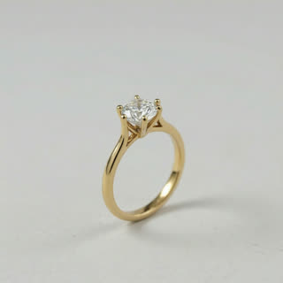  

**Best photos:** The piece is worn on a hand that turns toward the camera, so show it from the angle a wearer sees, plus a side view of the band or chain and the setting; a photo of it on a finger or wrist helps the size look right.

*Made with RefVid on Kling 4 from 4 reference photos of HALO (an AI-made subject), with this template's prompt.*

👉 [Try it with your own photos on RefVid](https://refvid.com/templates/jewelry-on-hand)

### Jewelry Sparkle

<a href="https://refvid.com/templates/jewelry-sparkle"></a>

**Subjects:** `[1]` your piece (product)  
**Settings:** Kling 3.0 Omni · 5 s · 1:1 · silent

```text
Macro shot: [1] rests on rich black velvet and turns slowly while a soft beam of light sweeps across it, the piece catching the light in sparkles and glints. Deep black background, shallow depth of field, luxurious.
```

**Reference photos used:**    

**Best photos:** A beam of light sweeps across the piece as it turns on black velvet, so take close photos on a dark surface where each stone and facet is sharp, and a side view of the setting so its depth holds while it rotates.

*Made with RefVid on Kling 3.0 Omni from 4 reference photos of HALO (an AI-made subject), with an earlier wording of this template's prompt.*

👉 [Try it with your own photos on RefVid](https://refvid.com/templates/jewelry-sparkle)

### Lipstick Swatch

<a href="https://refvid.com/templates/lipstick-swatch"></a>

**Subjects:** `[1]` your lipstick (product)  
**Settings:** Kling 4 · 5 s · 9:16 · with sound

```text
Macro: the bullet of [1] glides across a smooth cream surface and leaves a single rich, glossy swatch of its colour, then the camera rises to [1] standing upright beside the swatch in soft daylight, the colour and the case in sharp focus. Clean beauty-ad style, shallow depth of field.
```

**Reference photos used:**  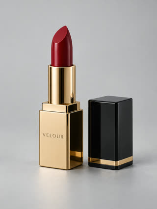

**Best photos:** The macro opens on the bullet as it glides, so photograph the lipstick uncapped with the bullet’s tip and true shade in sharp focus; add one of the closed case standing upright, as it stands beside the swatch at the end.

*Made with RefVid on Kling 4 from 2 reference photos of VELOUR (an AI-made subject), with this template's prompt.*

👉 [Try it with your own photos on RefVid](https://refvid.com/templates/lipstick-swatch)

### Perfume Reveal

<a href="https://refvid.com/templates/perfume-reveal"></a>

**Subjects:** `[1]` your perfume (product)  
**Settings:** Kling 4 · 5 s · 9:16 · with sound

```text
[1] stands on glossy black glass wrapped in slowly drifting soft mist; a single fine puff of perfume spray bursts from the top and catches a warm golden backlight, then the mist clears and a beam of light passes through the glass, ending on the label sharp and centred. Low-key, luxurious, slow push-in.
```

**Reference photos used:**   

**Best photos:** The clip ends with light passing through the glass onto a centred label, so photograph the bottle straight on with the label square to the lens and no glare on it; add one against a light background so the cap and the liquid’s colour read clearly.

*Made with RefVid on Kling 4 from 3 reference photos of NOIR 07 (an AI-made subject), with this template's prompt.*

👉 [Try it with your own photos on RefVid](https://refvid.com/templates/perfume-reveal)

### Product 360

<a href="https://refvid.com/templates/product-360-turntable"></a>

**Subjects:** `[1]` your product (product)  
**Settings:** Kling 3.0 Omni · 5 s · 1:1 · silent

```text
[1], matching the reference appearance and proportions, is on a circular white studio turntable against a light grey seamless background, under soft even studio light, with the entire product in sharp focus.
```

**Reference photos used:**   

**Best photos:** Every side faces the camera once as it turns, so photograph the product at the same height from the front, both sides and the back, on a plain background; shoppers rarely see the back, so include it if it carries a label or detail.

*Made with RefVid on Kling 3.0 Omni from 3 reference photos of AERO 1 (an AI-made subject), with this template's prompt.*

👉 [Try it with your own photos on RefVid](https://refvid.com/templates/product-360-turntable)

### 3D Billboard

<a href="https://refvid.com/templates/product-3d-billboard"></a>

**Subjects:** `[1]` your product (product)  
**Settings:** Kling 4 · 5 s · 9:16 · with sound

```text
A curved 3D LED billboard wraps the corner of a tall city building at dusk, seen from the street below: a giant [1] fills the screen, turns slowly, then appears to push out beyond the screen’s edge over the street in forced perspective while traffic moves below. Anamorphic CGI ad style, the camera tilting up slowly, city lights.
```

**Reference photos used:**    

**Best photos:** Your product is blown up to building size and turns before it pushes out of the screen, so any blur or dust shows: use crisp, high-resolution photos against a plain background, with a front view and a three-quarter view for the turn.

*Made with RefVid on Kling 4 from 4 reference photos of EMBER (an AI-made subject), with this template's prompt.*

👉 [Try it with your own photos on RefVid](https://refvid.com/templates/product-3d-billboard)

### Black Friday

<a href="https://refvid.com/templates/product-black-friday"></a>

**Subjects:** `[1]` your product (product)  
**Settings:** Kling 3.0 Omni · 5 s · 9:16 · silent

```text
Shot 1: A dark studio set lit by pink and blue neon tubes, stacks of black gift boxes with satin ribbons; [1] sits on top of the tallest box as the camera rises slowly toward it.
Shot 2: Slow push-in on [1], neon reflections sliding across it, the label sharp and centred, glittering confetti drifting down. Glossy, premium, high contrast.
```

**Reference photos used:**   

**Best photos:** The camera rises to your product on a stack of gift boxes and then pushes in until the label sits dead centre, so lead with a straight-on, glare-free photo of the label; a view of the top and sides lets the neon reflections wrap around the right shape.

*Made with RefVid on Kling 3.0 Omni from 3 reference photos of NOIR 07 (an AI-made subject), with this template's prompt.*

👉 [Try it with your own photos on RefVid](https://refvid.com/templates/product-black-friday)

### Bullet Time

<a href="https://refvid.com/templates/product-bullet-time"></a>

**Subjects:** `[1]` your product (product)  
**Settings:** Kling 4 · 5 s · 9:16 · with sound

```text
Bullet time: [1] hangs frozen in mid-air inside a burst of crystal-clear water droplets and splashes, every drop suspended and perfectly still, while the camera orbits smoothly half a circle around it and ends with the label facing the lens. Soft blue-white gradient background, bright studio light, crisp macro detail.
```

**Reference photos used:**   

**Best photos:** The camera orbits half a circle around your product and stops on the label, so the back and sides are on screen along the way: add photos of the back and one side next to a sharp label shot, with no hand holding it.

*Made with RefVid on Kling 4 from 3 reference photos of LUMEN (an AI-made subject), with this template's prompt.*

👉 [Try it with your own photos on RefVid](https://refvid.com/templates/product-bullet-time)

### Christmas Gift

<a href="https://refvid.com/templates/product-christmas-gift"></a>

**Subjects:** `[1]` your product (product)  
**Settings:** Kling 3.0 Omni · 5 s · 9:16 · silent

```text
Shot 1: A white gift box with a red satin ribbon sits under a glowing Christmas tree, warm fairy-light bokeh; a pair of hands pulls the ribbon loose and lifts the lid.
Shot 2: Looking into the open box: [1] rests on crisp white tissue paper, the label sharp and facing the camera, golden lights twinkling around it as the camera pushes in slowly.
```

**Reference photos used:**   

**Best photos:** The second shot looks down into the open gift box, where your product lies on tissue paper label up, so include a photo taken from slightly above with the label readable, and shoot it on its own so the gift box is the only box in the video.

*Made with RefVid on Kling 3.0 Omni from 3 reference photos of NOIR 07 (an AI-made subject), with this template's prompt.*

👉 [Try it with your own photos on RefVid](https://refvid.com/templates/product-christmas-gift)

### Flat Lay

<a href="https://refvid.com/templates/product-flat-lay"></a>

**Subjects:** `[1]` your product (product)  
**Settings:** Kling 3.0 Omni · 5 s · 1:1 · silent

```text
Top-down flat lay on a warm beige linen surface: [1] lies in the centre as three or four small props chosen for this exact product, everyday things its buyers use alongside it in colours that suit it, slide into the frame one by one around it. Soft even daylight.
```

**Reference photos used:**    

**Best photos:** Everything is filmed straight down, so the photo that counts is your product lying flat, shot from directly above with the label up; one side view helps the clip keep its thickness and the way it rests on the linen.

*Made with RefVid on Kling 3.0 Omni from 4 reference photos of EMBER (an AI-made subject), with an earlier wording of this template's prompt.*

👉 [Try it with your own photos on RefVid](https://refvid.com/templates/product-flat-lay)

### Floating Product

<a href="https://refvid.com/templates/product-floating"></a>

**Subjects:** `[1]` your product (product)  
**Settings:** Kling 4 · 5 s · 9:16 · with sound

```text
[1] floats weightlessly in mid-air against a soft peach-to-lavender gradient background, turning slowly through half a turn while drifting gently up and down, a soft round shadow on the floor below. Zero gravity, bright soft studio light, locked-off camera, crisp detail on the label.
```

**Reference photos used:**   

**Best photos:** Your product turns through half a turn as it floats, so the clip has to know its back as well as its front: give a clean front shot with the label, then the back and one side, ideally against a plain background.

*Made with RefVid on Kling 4 from 3 reference photos of AERO 1 (an AI-made subject), with this template's prompt.*

👉 [Try it with your own photos on RefVid](https://refvid.com/templates/product-floating)

### Product Reveal

<a href="https://refvid.com/templates/product-hero-reveal"></a>

**Subjects:** `[1]` your product (product)  
**Settings:** Kling 3.0 Omni · 5 s · 16:9 · silent

```text
Shot 1: Darkness, then a narrow beam of warm light sweeps slowly across [1] standing on a black stone pedestal, catching its edges and reflections. Low-key, cinematic, wisps of haze.
Shot 2: Slow push-in on [1] as the light settles, the label sharp and centred, deep black background.
```

**Reference photos used:**   

**Best photos:** A thin beam of light rakes across the edges and finish before the push-in to the label, so show the material honestly: one front photo with the label sharp, and one angled shot where light catches its edges, gloss or texture.

*Made with RefVid on Kling 3.0 Omni from 3 reference photos of NOIR 07 (an AI-made subject), with this template's prompt.*

👉 [Try it with your own photos on RefVid](https://refvid.com/templates/product-hero-reveal)

### UGC Ad

<a href="https://refvid.com/templates/product-in-hand-ugc"></a>

**Subjects:** `[1]` the presenter (person) · `[2]` your product (product)  
**Settings:** Kling 3.0 Omni · 10 s · 9:16 · with sound

```text
Shot 1: Handheld selfie-style video in a bright room at home: [1] holds [2] up next to the face, smiles at the phone camera and says: "Okay, I have to show you this one."
Shot 2: Close-up of [2] in [1]’s hand, turned slowly so the label faces the camera; then [1] looks back at the camera and nods. Natural daylight.
```

**Reference photos used:**      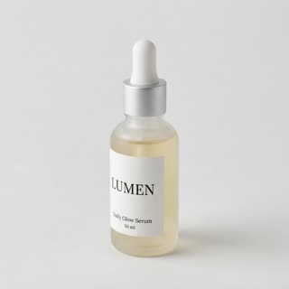 

**Best photos:** The presenter holds your product up beside their face, then turns it in close-up, so give a clear face-on photo of the presenter and a straight-on label shot of the product; one picture of it in a hand helps the size come out right.

*Made with RefVid on Kling 3.0 Omni from 7 reference photos of Mia and LUMEN (an AI-made subject), with an earlier wording of this template's prompt.*

👉 [Try it with your own photos on RefVid](https://refvid.com/templates/product-in-hand-ugc)

### Ingredient Splash

<a href="https://refvid.com/templates/product-ingredient-splash"></a>

**Subjects:** `[1]` your product (product)  
**Settings:** Kling 4 · 5 s · 9:16 · with sound

```text
Slow motion: [1] stands in the centre against a bright background in its pack’s main colour while its key ingredients, the ones its label names, burst up from below and tumble around it, droplets flying through the light, then they fall away and [1] stands clean with the label facing the camera. Bright studio light, crisp detail.
```

**Reference photos used:**  

**Best photos:** The background takes your pack’s main colour and the ingredients that fly up are the ones printed on it, so the key photo is the front with the ingredient names and true colours readable, not a dim or tinted shot.

*Made with RefVid on Kling 4 from 2 reference photos of SOL (an AI-made subject), with an earlier wording of this template's prompt.*

👉 [Try it with your own photos on RefVid](https://refvid.com/templates/product-ingredient-splash)

### Lifestyle at Home

<a href="https://refvid.com/templates/product-lifestyle-home"></a>

**Subjects:** `[1]` your product (product)  
**Settings:** Kling 3.0 Omni · 5 s · 16:9 · silent

```text
Shot 1: A calm sunlit bedroom: the camera glides slowly past linen curtains and a potted plant toward [1] standing on a wooden dresser by the window.
Shot 2: The camera settles on [1], the label sharp, soft morning light and gentle shadows of leaves moving across it.
```

**Reference photos used:**   

**Best photos:** The camera glides across a bedroom and settles on your product standing on a dresser, so use a photo of it upright at eye level with the label facing out; shots in soft daylight help it sit naturally in the morning light.

*Made with RefVid on Kling 3.0 Omni from 3 reference photos of NOIR 07 (an AI-made subject), with this template's prompt.*

👉 [Try it with your own photos on RefVid](https://refvid.com/templates/product-lifestyle-home)

### Petal Fall

<a href="https://refvid.com/templates/product-petal-fall"></a>

**Subjects:** `[1]` your product (product)  
**Settings:** Kling 4 · 5 s · 9:16 · with sound

```text
Slow motion: soft pink rose petals drift down through warm light around [1], which stands on a pale stone pedestal against a blush-pink background; a few petals land beside it as the camera pushes in gently until the label fills the frame. Dreamy, soft-focus background, beauty-ad style.
```

**Reference photos used:**   

**Best photos:** The camera pushes in until the label fills the whole frame, so your label photo has to hold up close, with small print and finish visible; add a full view of it standing upright, the way it will stand on the stone pedestal.

*Made with RefVid on Kling 4 from 3 reference photos of LUMEN (an AI-made subject), with this template's prompt.*

👉 [Try it with your own photos on RefVid](https://refvid.com/templates/product-petal-fall)

### Unboxing

<a href="https://refvid.com/templates/product-unboxing"></a>

**Subjects:** `[1]` your product (product)  
**Settings:** Kling 3.0 Omni · 10 s · 9:16 · with sound

```text
Shot 1: Top-down shot of a plain kraft box on a light wooden table in soft daylight; two hands lift the lid and fold back white tissue paper. Paper rustle.
Shot 2: Close-up as the hands lift [1] out of the box and hold it up, turning it slowly so the label faces the camera.
Shot 3: [1] stands on the table next to the open box, the camera gently pushing in. Clean, bright, shallow depth of field.
```

**Reference photos used:**   

**Best photos:** Hands lift your product out of a kraft box and turn it toward the camera, so show every side it turns through: the front label, the back and the base, each shot on its own, out of any box.

*Made with RefVid on Kling 3.0 Omni from 3 reference photos of LUMEN (an AI-made subject), with this template's prompt.*

👉 [Try it with your own photos on RefVid](https://refvid.com/templates/product-unboxing)

### Water Splash

<a href="https://refvid.com/templates/product-water-splash"></a>

**Subjects:** `[1]` your product (product)  
**Settings:** Kling 3.0 Omni · 5 s · 9:16 · silent

```text
Slow motion: [1] drops into a tank of crystal-clear water against a soft blue gradient background, a burst of bubbles and droplets exploding around it, then it settles upright with the label facing the camera. Bright studio light, macro detail.
```

**Reference photos used:**   

**Best photos:** Your product plunges into water and settles upright, so it needs a full standing view from cap to base with the label straight on; skip photos where wet glare or reflections hide the print.

*Made with RefVid on Kling 3.0 Omni from 3 reference photos of LUMEN (an AI-made subject), with this template's prompt.*

👉 [Try it with your own photos on RefVid](https://refvid.com/templates/product-water-splash)

### Skincare Texture

<a href="https://refvid.com/templates/skincare-texture-macro"></a>

**Subjects:** `[1]` your product (product)  
**Settings:** Kling 3.0 Omni · 5 s · 9:16 · silent

```text
Shot 1: Extreme macro: a single glossy dollop of [1]’s formula, in its own colour and texture, lands on a smooth pale stone surface and settles slowly. Soft daylight, creamy background.
Shot 2: [1] stands on the pale stone next to a few pieces of its key ingredient, the one its label names, in soft morning window light, the camera pushing in gently until the label fills the frame.
```

**Reference photos used:**   

**Best photos:** The first shot is the formula itself, so add a photo of a swatch or dollop that shows its real colour and texture, then a sharp front shot of the jar, tube or bottle, because the camera ends with the label filling the frame.

*Made with RefVid on Kling 3.0 Omni from 3 reference photos of LUMEN (an AI-made subject), with an earlier wording of this template's prompt.*

👉 [Try it with your own photos on RefVid](https://refvid.com/templates/skincare-texture-macro)

### Sneaker Ad

<a href="https://refvid.com/templates/sneaker-street-walk">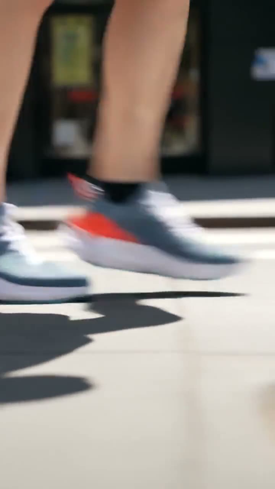</a>

**Subjects:** `[1]` your shoes (product)  
**Settings:** Kling 3.0 Omni · 5 s · 9:16 · silent

```text
Shot 1: Low camera at ankle height tracking alongside a pair of feet wearing [1] as they walk briskly down a sunlit city sidewalk, shadows of passers-by, shallow depth of field.
Shot 2: Close-up of [1] landing mid-step on the pavement, a little dust lifting, the camera slowing to a stop beside it.
```

**Reference photos used:**   

**Best photos:** The low camera tracks the shoes from the side and then catches one landing in close-up, so the outer profile with the sole edge matters most; a photo of the pair being worn helps the stride and fit look natural.

*Made with RefVid on Kling 3.0 Omni from 3 reference photos of AERO 1 (an AI-made subject), with this template's prompt.*

👉 [Try it with your own photos on RefVid](https://refvid.com/templates/sneaker-street-walk)

### Tech Reveal

<a href="https://refvid.com/templates/tech-gadget-reveal"></a>

**Subjects:** `[1]` your device (product)  
**Settings:** Kling 4 · 5 s · 16:9 · with sound

```text
[1] rests on a dark matte surface in near-darkness; a thin line of cool blue light traces its edges, then the light opens up and the camera glides in a slow arc around it, catching clean reflections on its surface, ending front-on with every detail sharp. Sleek tech-launch style, deep black background, subtle haze.
```

**Reference photos used:**  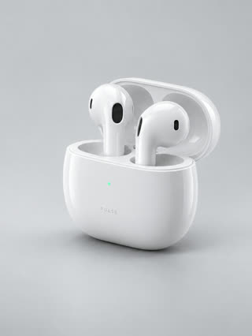

**Best photos:** Light first traces the outline, then the camera arcs round to end front-on, so give one dead-straight front photo with the screen or logo visible and one angled shot that shows the edges, ports and finish of the casing.

*Made with RefVid on Kling 4 from 2 reference photos of PULSE (an AI-made subject), with this template's prompt.*

👉 [Try it with your own photos on RefVid](https://refvid.com/templates/tech-gadget-reveal)

### Watch Macro

<a href="https://refvid.com/templates/watch-macro"></a>

**Subjects:** `[1]` your watch (product)  
**Settings:** Kling 4 · 5 s · 1:1 · with sound

```text
Extreme macro of [1]: the camera glides slowly across the dial as the seconds hand sweeps, light rolling over the polished case and the hour markers, then pulls back to show the whole watch resting on dark leather. Warm low-key light, shallow depth of field, luxurious detail.
```

**Reference photos used:**  

**Best photos:** The camera starts in extreme close-up on the dial, so lead with a sharp, glare-free top view where the markers, hands and logo are legible; add a side view of the case and crown, and one with the strap laid out.

*Made with RefVid on Kling 4 from 2 reference photos of ATLAS (an AI-made subject), with this template's prompt.*

👉 [Try it with your own photos on RefVid](https://refvid.com/templates/watch-macro)

## People

You, a friend or a couple in every shot, from a few photos of each face.

### Road Trip

<a href="https://refvid.com/templates/best-friends-road-trip"></a>

**Subjects:** `[1]` you (person) · `[2]` your friend (person)  
**Settings:** Kling 3.0 Omni · 10 s · 16:9 · with sound

```text
Shot 1: A vintage convertible drives along a sunny coastal road; [1] at the wheel and [2] in the passenger seat laugh, hair blowing in the wind. Wide tracking shot.
Shot 2: Close two-shot inside the car: [2] sings along loudly while [1] laughs and shakes their head. Wind noise, warm light.
Shot 3: The car parked at a cliff-top viewpoint at sunset, [1] and [2] sitting on the bonnet seen from behind, looking at the sea.
```

**Reference photos used:**        

**Best photos:** You sit side by side in the front seats and end on the bonnet seen from behind, so for each friend add a sharp face-on photo, one at a three-quarter angle and one that shows hair and build clearly.

*Made with RefVid on Kling 3.0 Omni from 8 reference photos of Mia and Leo (an AI-made subject), with this template's prompt.*

👉 [Try it with your own photos on RefVid](https://refvid.com/templates/best-friends-road-trip)

### Birthday Greeting

<a href="https://refvid.com/templates/birthday-greeting"></a>

**Subjects:** `[1]` you (person)  
**Settings:** Kling 3.0 Omni · 5 s · 9:16 · with sound

```text
Medium close-up of [1] in a cosy living room holding a small cake with lit candles toward the camera, then smiling and saying warmly: "Happy birthday! I hope this year is your best one yet." Warm evening light, fairy lights behind.
```

**Reference photos used:**    

**Best photos:** This is one medium close-up of you talking over a candlelit cake, so a sharp face-on photo framed at chest height works best; warm indoor light in it helps your skin tone match the candle glow.

*Made with RefVid on Kling 3.0 Omni from 4 reference photos of Leo (an AI-made subject), with this template's prompt.*

👉 [Try it with your own photos on RefVid](https://refvid.com/templates/birthday-greeting)

### Cooking Show

<a href="https://refvid.com/templates/chef-cooking-show"></a>

**Subjects:** `[1]` you (person)  
**Settings:** Kling 3.0 Omni · 10 s · 16:9 · with sound

```text
Shot 1: A warm home kitchen with copper pans and herbs on the counter: [1] in a navy apron smiles at the camera and says: "Welcome back to Sunday Kitchen. Today: the easiest pasta you’ll ever make."
Shot 2: Close-up of a pan on the stove as [1] tosses garlic and tomatoes in olive oil and a burst of flame rises. Sizzling sound.
Shot 3: [1] sets down a plate of spaghetti with fresh basil in front of the camera and gives a satisfied nod.
```

**Reference photos used:**    

**Best photos:** You talk straight to the camera at the counter and nod over the finished plate, so a sharp face-on photo with a natural smile matters most; one with your hair tied back, as you would cook, keeps you consistent at the stove.

*Made with RefVid on Kling 3.0 Omni from 4 reference photos of Leo (an AI-made subject), with this template's prompt.*

👉 [Try it with your own photos on RefVid](https://refvid.com/templates/chef-cooking-show)

### Christmas Market

<a href="https://refvid.com/templates/christmas-market-couple"></a>

**Subjects:** `[1]` you (person) · `[2]` your partner (person)  
**Settings:** Kling 3.0 Omni · 5 s · 16:9 · silent

```text
Shot 1: Dusk at a snowy Christmas market with wooden stalls and strings of warm lights: [1] and [2] walk arm in arm toward the camera, each holding a steaming cup of mulled wine, laughing. Light snow falling.
Shot 2: Close two-shot: [2] brushes a snowflake from [1]’s hair and they share a quiet smile, market lights glowing softly behind them.
```

**Reference photos used:**        

**Best photos:** You walk arm in arm toward the camera and then share a close moment face to face, so each of you needs a sharp front photo and a side profile; show your hair as you wear it, because a snowflake is brushed from it.

*Made with RefVid on Kling 3.0 Omni from 8 reference photos of Mia and Leo (an AI-made subject), with this template's prompt.*

👉 [Try it with your own photos on RefVid](https://refvid.com/templates/christmas-market-couple)

### Christmas Greeting

<a href="https://refvid.com/templates/christmas-sweater-greeting"></a>

**Subjects:** `[1]` you (person)  
**Settings:** Kling 3.0 Omni · 5 s · 9:16 · with sound

```text
Shot 1: A cosy living room at night: a lit Christmas tree with warm fairy lights and a crackling fireplace with stockings; [1] in a red knitted Christmas sweater sits on the rug holding a mug of cocoa, the camera drifting slowly closer.
Shot 2: [1] looks up at the camera with a warm smile and says: "Merry Christmas, I miss you all. See you soon!" Fire crackling softly.
```

**Reference photos used:**    

**Best photos:** You sit on the rug and look up at the camera to speak your wish, so a front photo taken from slightly above, your face in soft warm light, matches the shot best; a seated photo helps the sweater sit naturally.

*Made with RefVid on Kling 3.0 Omni from 4 reference photos of Mia (an AI-made subject), with this template's prompt.*

👉 [Try it with your own photos on RefVid](https://refvid.com/templates/christmas-sweater-greeting)

### Beach Sunset

<a href="https://refvid.com/templates/couple-beach-sunset"></a>

**Subjects:** `[1]` you (person) · `[2]` your partner (person)  
**Settings:** Kling 3.0 Omni · 10 s · 16:9 · silent

```text
Shot 1: Wide shot at golden hour: [1] and [2] walk barefoot along the waterline of a quiet beach toward the camera, talking, gentle waves washing over their feet.
Shot 2: Medium shot of [1] and [2] laughing together, warm low sun behind them, hair moving in the sea breeze.
Shot 3: [1] and [2] stand side by side seen from behind, looking out at the sun setting into the sea. Slow push-in, warm orange sky.
```

**Reference photos used:**        

**Best photos:** The first shot walks you toward the camera and the last shows you both from behind against the sunset, so for each partner add a clear face-on photo and one from behind with hair and shoulders; full-length photos keep your heights right.

*Made with RefVid on Kling 3.0 Omni from 8 reference photos of Mia and Leo (an AI-made subject), with this template's prompt.*

👉 [Try it with your own photos on RefVid](https://refvid.com/templates/couple-beach-sunset)

### Fashion Lookbook

<a href="https://refvid.com/templates/fashion-lookbook-walk"></a>

**Subjects:** `[1]` you (person)  
**Settings:** Kling 3.0 Omni · 10 s · 9:16 · silent

```text
Shot 1: Wide shot: [1] in a camel trench coat over a white tee and wide-leg jeans walks confidently toward the camera down a quiet Paris side street in soft morning light.
Shot 2: Low side angle tracking [1] mid-stride, the coat moving with each step, shopfronts sliding past.
Shot 3: Close-up as [1] turns over the shoulder toward the camera with a slight smile, hair catching the light.
```

**Reference photos used:**    

**Best photos:** The three shots show you walking head-on, from a low side angle and turning over your shoulder, so add a full-length front photo, a side view and one glancing back, with the face-on one sharp and well lit.

*Made with RefVid on Kling 3.0 Omni from 4 reference photos of Mia (an AI-made subject), with this template's prompt.*

👉 [Try it with your own photos on RefVid](https://refvid.com/templates/fashion-lookbook-walk)

### Fitness Coach

<a href="https://refvid.com/templates/fitness-coach-demo"></a>

**Subjects:** `[1]` you (person)  
**Settings:** Kling 3.0 Omni · 5 s · 9:16 · with sound

```text
Shot 1: A bright modern gym with large windows: [1] in black training clothes does a slow bodyweight squat seen from the side, back straight, arms forward. Gym ambience.
Shot 2: [1] stands up, looks into the camera and says with an encouraging smile: "Push the floor away, and keep your chest up."
```

**Reference photos used:**    

**Best photos:** The squat is filmed from the side before you speak face-on, so add a full-body side view in training clothes as well as a sharp front photo of your face; a photo that shows your build helps the movement look like you.

*Made with RefVid on Kling 3.0 Omni from 4 reference photos of Leo (an AI-made subject), with this template's prompt.*

👉 [Try it with your own photos on RefVid](https://refvid.com/templates/fitness-coach-demo)

### Bedsheet Ghost

<a href="https://refvid.com/templates/halloween-bedsheet-ghost">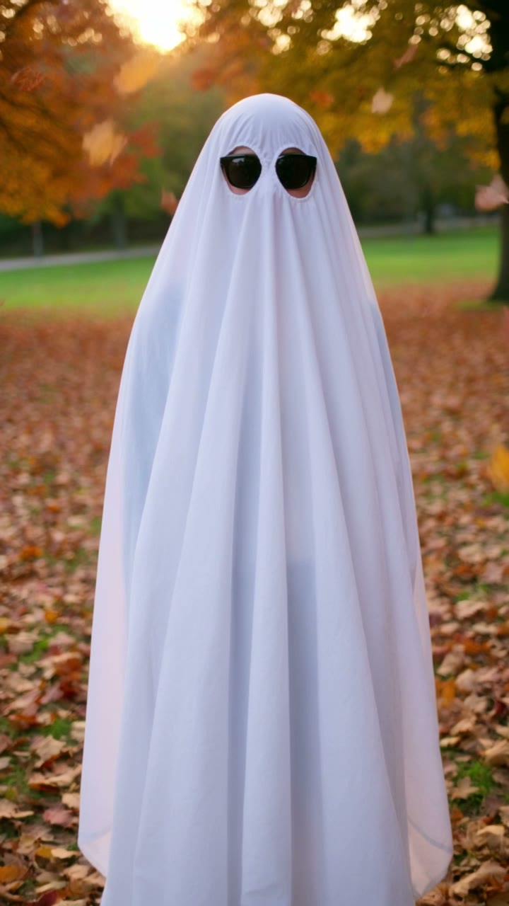</a>

**Subjects:** `[1]` you (person)  
**Settings:** Kling 3.0 Omni · 6 s · 9:16 · silent

```text
Shot 1: A figure under a plain white bedsheet with eye holes and black sunglasses stands on a leaf-covered path in an autumn park at golden hour, slowly turning toward the camera. Handheld, warm light, falling leaves.
Shot 2: The figure pulls the sheet off: it is [1], smiling, the sheet over one arm, leaves swirling. Medium shot, soft golden backlight.
```

**Reference photos used:**    

**Best photos:** You appear only once the sheet comes off, smiling in golden backlight, so a sharp face-on photo with your hair as you usually wear it matters most; a full-length photo keeps your height right under the sheet.

*Made with RefVid on Kling 3.0 Omni from 4 reference photos of Mia (an AI-made subject), with this template's prompt.*

👉 [Try it with your own photos on RefVid](https://refvid.com/templates/halloween-bedsheet-ghost)

### Costume Try-On

<a href="https://refvid.com/templates/halloween-costume-try-on"></a>

**Subjects:** `[1]` you (person)  
**Settings:** Kling 3.0 Omni · 10 s · 9:16 · silent

```text
Shot 1: [1] in everyday clothes spins once in front of a tall bedroom mirror and lands facing the camera as a vampire: bare head, a high-collared black cape with red lining, small plastic fangs, face fully visible. Warm fairy lights, phone-camera feel.
Shot 2: Hard cut: [1] spins again and the cape is gone; she lands in a round, puffy orange pumpkin costume with a green stem collar, bare head, laughing at the camera.
Shot 3: Hard cut: [1] spins a third time and the pumpkin costume is gone; she lands as a witch in a long black dress and a black pointed hat, giving the camera a playful wink.
```

**Reference photos used:**    

**Best photos:** Every costume leaves your head bare and you spin to face the camera three times, so add a sharp front photo with your whole face and hair visible, plus a full-length one so your build stays the same in each outfit.

*Made with RefVid on Kling 3.0 Omni from 4 reference photos of Mia (an AI-made subject), with this template's prompt.*

👉 [Try it with your own photos on RefVid](https://refvid.com/templates/halloween-costume-try-on)

### Pumpkin Head

<a href="https://refvid.com/templates/halloween-pumpkin-head"></a>

**Subjects:** `[1]` you (person)  
**Settings:** Kling 3.0 Omni · 6 s · 9:16 · silent

```text
Shot 1: In a dark studio with a deep orange backdrop, a person in a black turtleneck holds a glowing carved jack-o'-lantern in front of their face, candle flicker inside. Slow push-in, moody low-key light.
Shot 2: [1] lowers the pumpkin to chest height and looks straight into the camera with a slight smile, the candle glow lighting the face from below. Close-up, cinematic.
```

**Reference photos used:**    

**Best photos:** Your face shows only at the end, in a close-up lit from below by the candle glow, so a sharp straight-on photo of your face without a hat or sunglasses matters most; a calm look or slight smile suits the shot.

*Made with RefVid on Kling 3.0 Omni from 4 reference photos of Mia (an AI-made subject), with this template's prompt.*

👉 [Try it with your own photos on RefVid](https://refvid.com/templates/halloween-pumpkin-head)

### Y2K Flash

<a href="https://refvid.com/templates/halloween-y2k-flash"></a>

**Subjects:** `[1]` you (person)  
**Settings:** Kling 3.0 Omni · 5 s · 9:16 · silent

```text
The look of a 2004 disposable-camera party photo: a night-time Halloween house party, bright direct on-camera flash light, slightly overexposed skin, a hard shadow on the wall behind, heavy film grain, string lights in the background. [1] wearing black cat ears stands by the doorway holding a red paper cup, turns to the camera, laughs and throws up a peace sign. No light flare on the face.
```

**Reference photos used:**    

**Best photos:** The hard on-camera flash flattens the light, so a front-facing photo of your face taken in even light, without strong shadows, gives the most faithful result; you turn to the camera laughing, so a smiling one helps.

*Made with RefVid on Kling 3.0 Omni from 4 reference photos of Mia (an AI-made subject), with this template's prompt.*

👉 [Try it with your own photos on RefVid](https://refvid.com/templates/halloween-y2k-flash)

### Zombie Walk

<a href="https://refvid.com/templates/halloween-zombie-walk"></a>

**Subjects:** `[1]` you (person)  
**Settings:** Kling 3.0 Omni · 5 s · 16:9 · with sound

```text
Shot 1: Medium shot on a foggy street at night under one flickering streetlight: [1] dressed as a zombie for Halloween, face covered in heavy grey-green face paint, dark sunken shadows painted around the eyes, fake blood at the corner of the mouth, a ripped and stained flannel shirt, shuffles slowly toward the camera with stiff arms. Cold blue light, drifting fog.
Shot 2: Close-up of [1], still in the grey-green zombie face paint and fake blood, stopping under the lamp, tilting the head, then breaking into a grin at the camera. Low growl, distant wind.
```

**Reference photos used:**    

**Best photos:** Grey-green paint and dark shadows cover your face, so bone structure is what keeps you recognisable: use a sharp front photo and a side view in plain light, without make-up or glasses, as the shot ends on your grin.

*Made with RefVid on Kling 3.0 Omni from 4 reference photos of Mia (an AI-made subject), with this template's prompt.*

👉 [Try it with your own photos on RefVid](https://refvid.com/templates/halloween-zombie-walk)

### Video Intro

<a href="https://refvid.com/templates/linkedin-intro"></a>

**Subjects:** `[1]` you (person)  
**Settings:** Kling 3.0 Omni · 5 s · 16:9 · with sound

```text
Medium shot of [1] sitting in a bright modern office with plants and a window behind, looking straight into the camera and saying with a calm smile: "Hi, I’m Leo — I help small brands tell their story on video." Soft daylight.
```

**Reference photos used:**    

**Best photos:** You speak straight into the lens from a desk, so a sharp, face-on photo at eye level with a relaxed smile matters most; add one that shows your shoulders and the kind of top you wear for work.

*Made with RefVid on Kling 3.0 Omni from 4 reference photos of Leo (an AI-made subject), with this template's prompt.*

👉 [Try it with your own photos on RefVid](https://refvid.com/templates/linkedin-intro)

### Mini Drama

<a href="https://refvid.com/templates/mini-drama-scene"></a>

**Subjects:** `[1]` the first lead (person) · `[2]` the second lead (person)  
**Settings:** Kling 3.0 Omni · 10 s · 9:16 · with sound

```text
Shot 1: Rainy evening in a quiet café: [1] and [2] sit across a small table, untouched coffee between them. Wide shot, moody window light.
Shot 2: Close-up of [1], eyes steady, saying quietly: "You knew all along, didn’t you?"
Shot 3: Close-up of [2], looking down, then up, and answering: "I was going to tell you tonight."
```

**Reference photos used:**        

**Best photos:** Each lead gets a tight close-up for their line, so give both people sharp, face-on photos with a calm, serious expression rather than a big grin; a three-quarter view of each helps when they face each other across the table.

*Made with RefVid on Kling 3.0 Omni from 8 reference photos of Mia and Leo (an AI-made subject), with this template's prompt.*

👉 [Try it with your own photos on RefVid](https://refvid.com/templates/mini-drama-scene)

### Morning Routine

<a href="https://refvid.com/templates/morning-routine"></a>

**Subjects:** `[1]` you (person)  
**Settings:** Kling 3.0 Omni · 5 s · 9:16 · silent

```text
Shot 1: Soft morning sun in a calm, minimal kitchen: [1] in a loose linen shirt pours hot water slowly over a pour-over coffee, steam rising, plants on the windowsill.
Shot 2: [1] sits by the window with the mug in both hands, takes a slow first sip and looks out, smiling softly. Warm light, shallow depth of field.
```

**Reference photos used:**    

**Best photos:** The second shot is a soft, close look out of the window with the mug at your lips, so a sharp side or three-quarter photo of your face matters as much as a front one; a photo of your hands helps the pour.

*Made with RefVid on Kling 3.0 Omni from 4 reference photos of Mia (an AI-made subject), with this template's prompt.*

👉 [Try it with your own photos on RefVid](https://refvid.com/templates/morning-routine)

### New Year Countdown

<a href="https://refvid.com/templates/new-year-countdown"></a>

**Subjects:** `[1]` you (person)  
**Settings:** Kling 3.0 Omni · 5 s · 16:9 · with sound

```text
Shot 1: Medium shot facing the camera on a rooftop terrace at midnight on New Year’s Eve, the city skyline glittering behind: [1] in a sparkly outfit holds up a glass of champagne and counts down to the camera with a big smile: "Three, two, one…"
Shot 2: [1] turns toward the camera and cheers "Happy New Year!", glass raised, as golden fireworks burst over the skyline behind, confetti drifting through the air.
```

**Reference photos used:**    

**Best photos:** You count down facing the camera and then cheer with your mouth wide open, so a sharp front photo with a big, open smile matters most; one taken at arm’s length that shows your hair and upper body helps you stay yourself in the party outfit.

*Made with RefVid on Kling 3.0 Omni from 4 reference photos of Mia (an AI-made subject), with this template's prompt.*

👉 [Try it with your own photos on RefVid](https://refvid.com/templates/new-year-countdown)

### Podcast Host

<a href="https://refvid.com/templates/podcast-host"></a>

**Subjects:** `[1]` you (person)  
**Settings:** Kling 3.0 Omni · 5 s · 16:9 · with sound

```text
Medium shot of [1] at a podcast studio desk with a microphone on a boom arm and headphones on, warm lamp light and acoustic panels behind, leaning in and saying with a smile: "Welcome back to Small Brands, Big Stories."
```

**Reference photos used:**    

**Best photos:** Headphones go over your ears and you lean in toward a boom mic, so show your hairline and ears clearly in a front photo and add a three-quarter view; if you wear glasses on your show, wear them in the photos too.

*Made with RefVid on Kling 3.0 Omni from 4 reference photos of Leo (an AI-made subject), with this template's prompt.*

👉 [Try it with your own photos on RefVid](https://refvid.com/templates/podcast-host)

### Rap Duo

<a href="https://refvid.com/templates/rap-duo-booth"></a>

**Subjects:** `[1]` you (person) · `[2]` your rap partner (person)  
**Settings:** Kling 3.0 Omni · 15 s · 9:16 · with sound

```text
Inside a small music studio booth with seamless bright orange walls and floor, evenly lit from the front, two vocal microphones on stands. [1] and [2] stand side by side in streetwear facing the camera and rap a fast verse over a hard trap beat, nodding and moving their hands with the rhythm. [1] raps: "Same face every frame, yeah we never switch it up." Then [2] raps: "Two photos in and now the whole world's watching us." Then they rap together, grinning. Static vertical medium shot, live performance feel.
```

**Reference photos used:**        

**Best photos:** Both of you face the camera side by side and rap in a medium shot, so each person needs a sharp front-on face photo with the mouth uncovered, plus a waist-up picture so your heights and builds look right next to each other.

*Made with RefVid on Kling 3.0 Omni from 8 reference photos of Mia and Leo (an AI-made subject), with this template's prompt.*

👉 [Try it with your own photos on RefVid](https://refvid.com/templates/rap-duo-booth)

### Superhero Landing

<a href="https://refvid.com/templates/superhero-landing"></a>

**Subjects:** `[1]` you (person)  
**Settings:** Kling 3.0 Omni · 5 s · 16:9 · silent

```text
Shot 1: A stormy evening over a city: [1] in an original dark blue armoured suit with silver lines drops from the sky and lands on a rooftop in a three-point landing, one fist on the concrete, cracks spreading and dust blowing outward.
Shot 2: [1] rises slowly from the landing and looks straight into the camera, wind pulling at the suit, lightning flashing behind. Low angle, cinematic.
```

**Reference photos used:**    

**Best photos:** The suit replaces your clothes, so your face carries the whole likeness: a sharp face-on photo for the final stare into the camera, plus one from slightly below or the side, since the rise is filmed from a low angle.

*Made with RefVid on Kling 3.0 Omni from 4 reference photos of Mia (an AI-made subject), with this template's prompt.*

👉 [Try it with your own photos on RefVid](https://refvid.com/templates/superhero-landing)

### Talking Head Ad

<a href="https://refvid.com/templates/talking-head-ad"></a>

**Subjects:** `[1]` the presenter (person)  
**Settings:** Kling 3.0 Omni · 5 s · 9:16 · with sound

```text
Medium close-up of [1] sitting in a bright home office, looking straight into the camera, who says with a warm smile: "Here is the one thing I wish I had known sooner." Soft window light, shallow depth of field.
```

**Reference photos used:**    

**Best photos:** The presenter talks straight to the lens in a medium close-up, so the face and mouth carry the clip: use front-on photos taken at eye level, with no sunglasses or hands near the mouth, and one with a natural smile.

*Made with RefVid on Kling 3.0 Omni from 4 reference photos of Mia (an AI-made subject), with this template's prompt.*

👉 [Try it with your own photos on RefVid](https://refvid.com/templates/talking-head-ad)

### Thanksgiving Toast

<a href="https://refvid.com/templates/thanksgiving-table">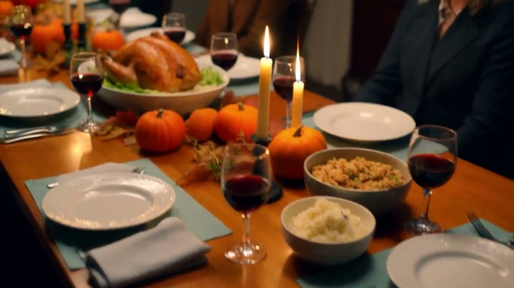</a>

**Subjects:** `[1]` you (person)  
**Settings:** Kling 3.0 Omni · 5 s · 16:9 · with sound

```text
Shot 1: A long Thanksgiving dinner table in warm candlelight: a roasted turkey, bowls of sides, small pumpkins and autumn leaves, the camera gliding slowly along it toward [1] at the head of the table.
Shot 2: [1] stands, raises a glass of red wine toward the camera and says with a warm smile: "To all of us, and to next year." Soft candlelight, quiet clinking of glasses.
```

**Reference photos used:**    

**Best photos:** You stand at the head of the table and raise a glass to the camera, so a warm, front-facing photo with a natural smile matters most; one waist-up picture helps the clip get your shoulders and outfit right as you rise.

*Made with RefVid on Kling 3.0 Omni from 4 reference photos of Mia (an AI-made subject), with this template's prompt.*

👉 [Try it with your own photos on RefVid](https://refvid.com/templates/thanksgiving-table)

### Travel Vlog

<a href="https://refvid.com/templates/travel-vlog-walk"></a>

**Subjects:** `[1]` you (person)  
**Settings:** Kling 3.0 Omni · 10 s · 9:16 · with sound

```text
Shot 1: Handheld vlog shot: [1] walks down a sunny cobbled old-town street lined with cafés and pastel houses, holding the camera at arm’s length, smiling. Street sounds, light breeze.
Shot 2: [1] stops by a fountain and says to the camera: "Okay, this little street is my favourite thing so far."
Shot 3: [1] turns the camera around to reveal a wide view over terracotta rooftops to the sea at golden hour.
```

**Reference photos used:**    

**Best photos:** The camera stays at arm’s length the whole time, so the clip leans on selfie-distance photos of your face from slightly above, in daylight; add a full-length one so the walk down the street keeps your build and clothes.

*Made with RefVid on Kling 3.0 Omni from 4 reference photos of Mia (an AI-made subject), with this template's prompt.*

👉 [Try it with your own photos on RefVid](https://refvid.com/templates/travel-vlog-walk)

### Save the Date

<a href="https://refvid.com/templates/wedding-save-the-date">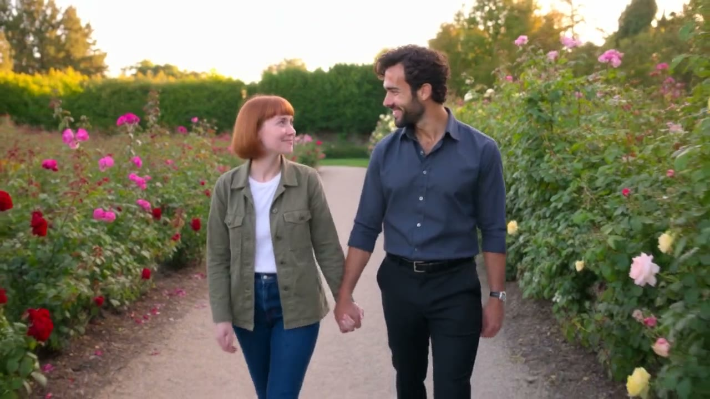</a>

**Subjects:** `[1]` you (person) · `[2]` your partner (person)  
**Settings:** Kling 3.0 Omni · 10 s · 16:9 · silent

```text
Shot 1: Late-afternoon light in a blooming rose garden: [1] and [2] walk hand in hand along a gravel path toward the camera, smiling at each other.
Shot 2: Medium shot: [2] whispers something to [1], who laughs and leans in; soft bokeh of flowers behind.
Shot 3: Close-up of their joined hands, a simple gold engagement ring catching the light.
```

**Reference photos used:**   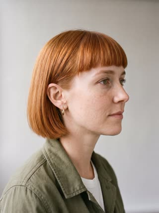     

**Best photos:** You walk toward the camera hand in hand, then share a laugh in a medium shot, so each of you needs a clear, smiling face-on photo and a full-length one; for your real ring in the close-up, add a photo of your joined hands.

*Made with RefVid on Kling 3.0 Omni from 8 reference photos of Mia and Leo (an AI-made subject), with this template's prompt.*

👉 [Try it with your own photos on RefVid](https://refvid.com/templates/wedding-save-the-date)

## Pets

Your own dog or cat, the same pet in every shot.

### Dog Rap

<a href="https://refvid.com/templates/dog-rap-video">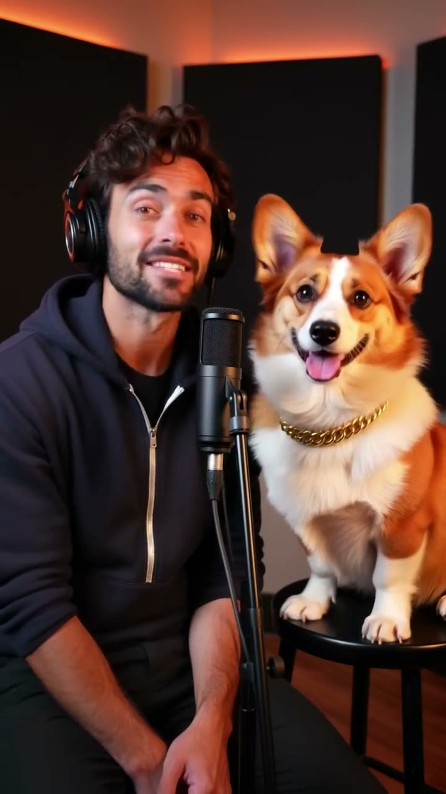</a>

**Subjects:** `[1]` you (person) · `[2]` your dog (pet)  
**Settings:** Kling 3.0 Omni · 10 s · 9:16 · with sound

```text
Inside a small recording studio booth with dark acoustic foam walls and warm orange light, a vocal microphone on a stand between them. [1], in headphones and a hoodie, stands next to [2] the dog, who sits on a tall stool wearing a tiny gold chain and bobs its head to a hard hip-hop beat. [1] raps to the camera: "Me and my dog, yeah we run this block." Then [2] the dog leans into the microphone and raps back in a gruff cartoon voice, its mouth moving with the words: "Treats on the table and we never stop." [1] laughs. Static vertical medium shot.
```

**Reference photos used:**        

**Best photos:** Your dog raps into the microphone with its mouth moving, so a sharp face-on photo of its head, muzzle and markings in clear light matters most; for you, a front photo at standing height suits the booth.

*Made with RefVid on Kling 3.0 Omni from 8 reference photos of Leo and Biscuit (an AI-made subject), with this template's prompt.*

👉 [Try it with your own photos on RefVid](https://refvid.com/templates/dog-rap-video)

### Pet Sunset Walk

<a href="https://refvid.com/templates/pet-and-owner-sunset"></a>

**Subjects:** `[1]` your pet (pet) · `[2]` you (person)  
**Settings:** Kling 3.0 Omni · 10 s · 16:9 · silent

```text
Shot 1: Wide shot at golden hour: [2] walks barefoot along the waterline of a quiet beach with [1] keeping pace beside them, gentle waves washing in, warm low sun behind them.
Shot 2: [2] and [1] sit side by side on the sand seen from behind, looking out at the sun setting into the sea. Slow push-in, warm orange sky.
```

**Reference photos used:**        

**Best photos:** Both shots show you and your pet side by side, the second from behind, so add full-body photos of each of you from the side and from the back, not only faces; your pet’s back and tail markings carry the sunset shot.

*Made with RefVid on Kling 3.0 Omni from 8 reference photos of Biscuit and Mia (an AI-made subject), with this template's prompt.*

👉 [Try it with your own photos on RefVid](https://refvid.com/templates/pet-and-owner-sunset)

### Pet Astronaut

<a href="https://refvid.com/templates/pet-astronaut"></a>

**Subjects:** `[1]` your pet (pet)  
**Settings:** Kling 3.0 Omni · 5 s · 16:9 · silent

```text
Inside a bright space station, [1] in a small white astronaut suit with the helmet visor open floats weightless toward the camera, paws drifting, as the blue Earth glows through the large window behind. Slow, dreamy movement.
```

**Reference photos used:**    

**Best photos:** Your pet’s face is framed by the open helmet visor as it floats toward you, so a sharp, face-on photo with eyes and muzzle clear matters most; the suit hides the body, so the coat colour around the face is what carries the likeness.

*Made with RefVid on Kling 3.0 Omni from 4 reference photos of Miso (an AI-made subject), with this template's prompt.*

👉 [Try it with your own photos on RefVid](https://refvid.com/templates/pet-astronaut)

### Pet Birthday

<a href="https://refvid.com/templates/pet-birthday-party">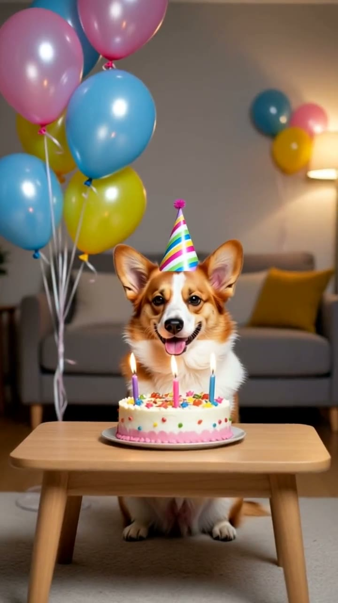</a>

**Subjects:** `[1]` your pet (pet)  
**Settings:** Kling 3.0 Omni · 5 s · 9:16 · with sound

```text
Shot 1: [1] sits at a little table wearing a tiny striped party hat, colourful balloons behind, a small birthday cake with three lit candles in front. Warm home light, gentle push-in.
Shot 2: [1] looks up at the camera next to the cake, tilts its head and makes one small happy sound in its own natural voice. Soft focus on the candles, cosy birthday mood.
```

**Reference photos used:**    

**Best photos:** Your pet sits at a little table and looks up into the camera under a tiny party hat, so a photo taken from slightly above, with ears and eyes sharp, matters most; one of it sitting upright shows how it holds itself beside the cake.

*Made with RefVid on Kling 3.0 Omni from 4 reference photos of Biscuit (an AI-made subject), with this template's prompt.*

👉 [Try it with your own photos on RefVid](https://refvid.com/templates/pet-birthday-party)

### Pet Chef

<a href="https://refvid.com/templates/pet-chef"></a>

**Subjects:** `[1]` your pet (pet)  
**Settings:** Kling 3.0 Omni · 5 s · 9:16 · with sound

```text
Shot 1: [1] wearing a small white chef’s hat sits up at a cosy kitchen counter behind a frying pan with vegetables sizzling, steam rising, warm morning light. Sizzling sound.
Shot 2: [1] sits next to a finished plate of colourful stir-fry and looks proudly at the camera, the chef’s hat slightly tilted.
```

**Reference photos used:**    

**Best photos:** The chef’s hat sits on your pet’s head and the second shot is a close, proud look into the camera, so a sharp face-on photo with both ears in frame matters most; add one side view so the coat and size hold at the counter.

*Made with RefVid on Kling 3.0 Omni from 4 reference photos of Miso (an AI-made subject), with this template's prompt.*

👉 [Try it with your own photos on RefVid](https://refvid.com/templates/pet-chef)

### Pet Christmas

<a href="https://refvid.com/templates/pet-christmas-morning"></a>

**Subjects:** `[1]` your pet (pet)  
**Settings:** Kling 3.0 Omni · 5 s · 9:16 · silent

```text
Shot 1: Christmas morning in a cosy living room: [1] wearing a small red knitted scarf sits beside a glowing Christmas tree, curiously sniffing a present wrapped in red paper with a gold ribbon. Warm fairy lights, soft morning light.
Shot 2: Close-up in the same living room, the lit Christmas tree glowing behind: [1], still in its red scarf, grabs the gold ribbon and pulls the wrapping paper open, scraps of red paper flying, then looks up at the camera.
```

**Reference photos used:**    

**Best photos:** The first shot is a side view of your pet nosing at the present and the scarf wraps its neck, so add a clear profile photo with the muzzle and the chest visible, next to a face-on one for the final look up.

*Made with RefVid on Kling 3.0 Omni from 4 reference photos of Biscuit (an AI-made subject), with this template's prompt.*

👉 [Try it with your own photos on RefVid](https://refvid.com/templates/pet-christmas-morning)

### Pet Comes to Life

<a href="https://refvid.com/templates/pet-comes-to-life"></a>

**Subjects:** `[1]` your pet (pet)  
**Settings:** Kling 3.0 Omni · 5 s · 9:16 · silent

```text
[1] lies on a soft blanket on a sofa in warm afternoon light, blinks slowly, tilts its head and looks straight at the camera, breathing softly. Gentle push-in, cozy home, shallow depth of field.
```

**Reference photos used:**    

**Best photos:** This is one close, still shot of your pet lying down and meeting your eyes, so the photo that matters most is a sharp one at its eye level where the eye colour and the fur around the eyes are clear; a lying-down photo helps the pose.

*Made with RefVid on Kling 3.0 Omni from 4 reference photos of Biscuit (an AI-made subject), with an earlier wording of this template's prompt.*

👉 [Try it with your own photos on RefVid](https://refvid.com/templates/pet-comes-to-life)

### Pet Family Portrait

<a href="https://refvid.com/templates/pet-family-portrait"></a>

**Subjects:** `[1]` your first pet (pet) · `[2]` your second pet (pet)  
**Settings:** Kling 3.0 Omni · 5 s · 1:1 · silent

```text
[1] and [2] sit side by side on a soft grey sofa with cushions in a cosy living room, like a family portrait; [2] glances at [1], then both look straight at the camera. Warm lamp light, gentle push-in.
```

**Reference photos used:**     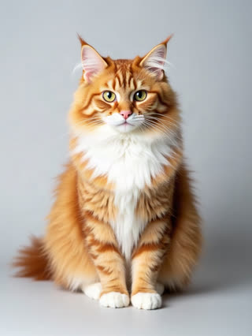   

**Best photos:** Two pets share one sofa, so the studio has to tell them apart: give each a face-on photo and one that shows its size next to something familiar, so the bigger one stays bigger when they sit side by side.

*Made with RefVid on Kling 3.0 Omni from 8 reference photos of Biscuit and Miso (an AI-made subject), with this template's prompt.*

👉 [Try it with your own photos on RefVid](https://refvid.com/templates/pet-family-portrait)

### Pet Costume

<a href="https://refvid.com/templates/pet-halloween-costume"></a>

**Subjects:** `[1]` your pet (pet)  
**Settings:** Kling 3.0 Omni · 6 s · 9:16 · with sound

```text
Shot 1: [1] sits on a wooden porch at dusk wearing a soft orange pumpkin costume, carved jack-o'-lanterns glowing on the steps, dry leaves around. Slow push-in, warm candlelight.
Shot 2: [1] looks up at the camera next to a bowl of wrapped candy, tilts its head and makes one small happy sound in its own natural voice. Cozy Halloween night, shallow depth of field.
```

**Reference photos used:**    

**Best photos:** The pumpkin costume covers your pet’s body, so its face and ears do all the work: use a close, well-lit front photo where the eyes catch the light, and one of it sitting so the costume fits its real shape.

*Made with RefVid on Kling 3.0 Omni from 4 reference photos of Biscuit (an AI-made subject), with an earlier wording of this template's prompt that asked for a bark.*

👉 [Try it with your own photos on RefVid](https://refvid.com/templates/pet-halloween-costume)

### Pet Memorial

<a href="https://refvid.com/templates/pet-memorial"></a>

**Subjects:** `[1]` your pet (pet)  
**Settings:** Kling 3.0 Omni · 5 s · 16:9 · silent

```text
Shot 1: A sunlit meadow of tall wildflowers under a warm golden sky, a soft rainbow arching in the distance: [1] bursts out of the flowers at full zoomies straight toward the camera, ears flapping, tongue out, a red and white striped sock clamped proudly in its mouth.
Shot 2: Close-up in the same meadow at golden hour, the rainbow glowing behind: [1] skids to a stop, drops the striped sock on the grass, sits down, tilts its head at the camera and wags its tail, looking very pleased with itself.
```

**Reference photos used:**    

**Best photos:** Your pet runs straight at the camera with ears flying and a sock in its mouth, so a photo of it running or playing with its mouth open helps most if you have one; old, slightly soft phone photos still work as long as the face is there.

*Made with RefVid on Kling 3.0 Omni from 4 reference photos of Captain (an AI-made subject), with this template's prompt.*

👉 [Try it with your own photos on RefVid](https://refvid.com/templates/pet-memorial)

### Pet News Anchor

<a href="https://refvid.com/templates/pet-news-anchor"></a>

**Subjects:** `[1]` your pet (pet)  
**Settings:** Kling 3.0 Omni · 5 s · 16:9 · with sound

```text
A TV news studio with bright lights and a city skyline on the screen behind: [1] sits upright behind the news desk wearing a small red tie, looks into the camera and says in a serious newsreader voice: "Good evening. Tonight’s top story: dinner is late again."
```

**Reference photos used:**    

**Best photos:** Behind the news desk only your pet’s head, neck and chest show, with the tie at its collar, so use a front photo of it sitting tall with the chest visible; a calm, serious face reads better for the headline than a playful one.

*Made with RefVid on Kling 3.0 Omni from 4 reference photos of Biscuit (an AI-made subject), with this template's prompt.*

👉 [Try it with your own photos on RefVid](https://refvid.com/templates/pet-news-anchor)

### Pet Ring Bearer

<a href="https://refvid.com/templates/pet-ring-bearer"></a>

**Subjects:** `[1]` your pet (pet)  
**Settings:** Kling 3.0 Omni · 5 s · 16:9 · silent

```text
A garden wedding in soft afternoon light: [1] wearing a small flower collar walks down the aisle between rows of white chairs toward the camera, carrying a little basket with a ring box in its mouth, guests on both sides turning to smile, petals on the grass.
```

**Reference photos used:**    

**Best photos:** Your pet walks the whole aisle toward the camera carrying the basket in its mouth, so a full-body photo of it walking or standing, taken head-on at its height, matters most; a clear view of the neck helps the flower collar sit right.

*Made with RefVid on Kling 3.0 Omni from 4 reference photos of Biscuit (an AI-made subject), with this template's prompt.*

👉 [Try it with your own photos on RefVid](https://refvid.com/templates/pet-ring-bearer)

### Pet Runway

<a href="https://refvid.com/templates/pet-runway-walk"></a>

**Subjects:** `[1]` your pet (pet)  
**Settings:** Kling 3.0 Omni · 5 s · 9:16 · with sound

```text
[1] walks confidently down a glossy fashion runway toward the camera under bright spotlights, photographers on both sides with camera flashes popping, then stops at the end and poses. Low camera, crowd murmur and shutter clicks.
```

**Reference photos used:**    

**Best photos:** The camera sits low as your pet struts the length of the catwalk, so its legs and gait carry this one: add a full-body photo from the front at floor level and one from the side so its build and coat pattern stay true mid-stride.

*Made with RefVid on Kling 3.0 Omni from 4 reference photos of Biscuit (an AI-made subject), with this template's prompt.*

👉 [Try it with your own photos on RefVid](https://refvid.com/templates/pet-runway-walk)

### Pet Underwater

<a href="https://refvid.com/templates/pet-underwater-swim"></a>

**Subjects:** `[1]` your pet (pet)  
**Settings:** Kling 3.0 Omni · 5 s · 9:16 · silent

```text
Underwater in clear turquoise sea, [1] swims toward the camera with its legs paddling and its eyes open, sunbeams rippling across it, small bubbles rising, its coat drifting gently in the water.
```

**Reference photos used:**    

**Best photos:** Underwater the coat floats and looks darker, so the face and markings have to be unmistakable: a sharp front photo with eyes open, plus one that shows the coat’s true length and colour in daylight, gives the studio what it needs.

*Made with RefVid on Kling 3.0 Omni from 4 reference photos of Biscuit (an AI-made subject), with this template's prompt.*

👉 [Try it with your own photos on RefVid](https://refvid.com/templates/pet-underwater-swim)

## Things & characters

A toy, a figure, a car or a drawn character kept the same.

### Claymation

<a href="https://refvid.com/templates/clay-figure-stopmotion"></a>

**Subjects:** `[1]` your clay character (thing)  
**Settings:** Kling 3.0 Omni · 5 s · 16:9 · silent

```text
Shot 1: Stop-motion claymation style, slightly stepped movement: [1] walks across a small handmade set of a paper-and-felt village street with tiny houses and a cotton-wool cloud, its clay texture and fingerprints visible. Warm tabletop light.
Shot 2: [1] stops, turns to the camera and waves with one clay hand, then gives a little hop. Stop-motion feel, shallow depth of field.
```

**Reference photos used:**    

**Best photos:** Your character walks across the set side-on and then turns to wave, so show its profile and front, photographed close enough that the clay texture and fingerprints read; a back view keeps the walk consistent.

*Made with RefVid on Kling 3.0 Omni from 4 reference photos of Momo (an AI-made subject), with this template's prompt.*

👉 [Try it with your own photos on RefVid](https://refvid.com/templates/clay-figure-stopmotion)

### Crochet Showcase

<a href="https://refvid.com/templates/crochet-showcase"></a>

**Subjects:** `[1]` your piece (thing)  
**Settings:** Kling 3.0 Omni · 5 s · 1:1 · silent

```text
Shot 1: [1] sits on a warm oak table beside two balls of soft yarn and a wooden crochet hook, afternoon window light, the camera gliding slowly around it.
Shot 2: Macro close-up moving across [1]’s stitches and face, every loop of yarn visible, shallow depth of field.
```

**Reference photos used:**    

**Best photos:** The second shot is a macro pass over the stitches and face, so take a close photo where single loops of yarn are sharp, plus front and side views so the shape holds as the camera glides around the piece.

*Made with RefVid on Kling 3.0 Omni from 4 reference photos of Bun (an AI-made subject), with this template's prompt.*

👉 [Try it with your own photos on RefVid](https://refvid.com/templates/crochet-showcase)

### Miniature Diorama

<a href="https://refvid.com/templates/diorama-miniature">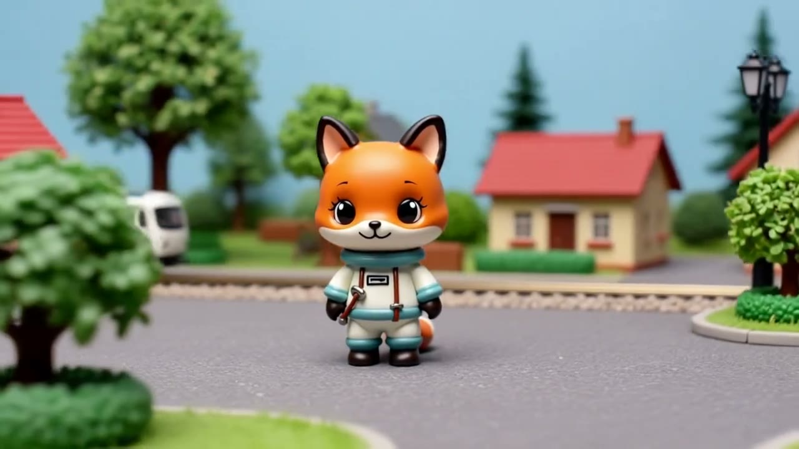</a>

**Subjects:** `[1]` your figure (thing)  
**Settings:** Kling 3.0 Omni · 5 s · 16:9 · silent

```text
Tilt-shift miniature diorama of a tiny town square with model trees, street lamps and little houses; [1] stands in the middle as a model train passes slowly behind it, the camera gliding past at its eye level, the edges softly blurred. Bright daylight.
```

**Reference photos used:**    

**Best photos:** The camera glides past your figure at its own eye level, so photograph it straight on from that low height rather than from above; a side view helps it keep its shape as the train passes behind.

*Made with RefVid on Kling 3.0 Omni from 4 reference photos of Pip (an AI-made subject), with this template's prompt.*

👉 [Try it with your own photos on RefVid](https://refvid.com/templates/diorama-miniature)

### Figure 360

<a href="https://refvid.com/templates/figure-turntable-showcase"></a>

**Subjects:** `[1]` your figure (thing)  
**Settings:** Kling 3.0 Omni · 5 s · 1:1 · silent

```text
Shot 1: [1] on a small round turntable in a dark display cabinet with a soft spotlight, rotating slowly through a full turn. Clean reflections on the glass shelf.
Shot 2: Macro close-up of [1]’s face and painted details, the light gliding across them, shallow depth of field.
```

**Reference photos used:**    

**Best photos:** The figure turns through a full circle before the camera moves in on its face, so cover the back and both sides as well as the front, and add a close photo of the face paint where small details are sharp.

*Made with RefVid on Kling 3.0 Omni from 4 reference photos of Pip (an AI-made subject), with this template's prompt.*

👉 [Try it with your own photos on RefVid](https://refvid.com/templates/figure-turntable-showcase)

### Mascot Hello

<a href="https://refvid.com/templates/mascot-wave-hello"></a>

**Subjects:** `[1]` your mascot (thing)  
**Settings:** Kling 3.0 Omni · 5 s · 1:1 · with sound

```text
[1] stands on a bright clean desk in front of a soft pastel backdrop, looks at the camera, waves one arm and says in a cheerful little voice: "Hi there, welcome in!" Gentle push-in.
```

**Reference photos used:**    

**Best photos:** Your mascot waves one arm and looks into the camera, so shoot it standing upright from the front with both arms and its face fully visible; a back or side view helps its shape hold as it moves.

*Made with RefVid on Kling 3.0 Omni from 4 reference photos of Pip (an AI-made subject), with this template's prompt.*

👉 [Try it with your own photos on RefVid](https://refvid.com/templates/mascot-wave-hello)

### Plush Adventure

<a href="https://refvid.com/templates/plush-adventure"></a>

**Subjects:** `[1]` your plushie (thing)  
**Settings:** Kling 3.0 Omni · 10 s · 9:16 · silent

```text
Shot 1: Stop-motion feel: [1] sits on a wooden seat of an old yellow city tram by the window, the street sliding past outside, morning light.
Shot 2: [1] sits at a tiny café table next to a cup of cocoa with whipped cream, turning its head toward the camera.
Shot 3: [1] sits on a stone bridge railing watching a river sunset, the city lights coming on behind.
```

**Reference photos used:**    

**Best photos:** Your plushie is seen sitting in all three places, from the side on the tram and from behind on the bridge, so photograph it sitting up from the front, side and back; keep any scarf, bow or patch on so those details travel with it.

*Made with RefVid on Kling 3.0 Omni from 4 reference photos of Bobo (an AI-made subject), with this template's prompt.*

👉 [Try it with your own photos on RefVid](https://refvid.com/templates/plush-adventure)

### Toy Comes Alive

<a href="https://refvid.com/templates/toy-comes-alive"></a>

**Subjects:** `[1]` your figure (thing)  
**Settings:** Kling 3.0 Omni · 5 s · 9:16 · silent

```text
Shot 1: [1] stands perfectly still on a wooden desk next to a pencil cup and a notebook in soft morning light, like a toy on display. Close-up at the toy’s eye level.
Shot 2: [1] comes to life: it blinks, looks around curiously, then takes a few small wobbly steps toward the camera and waves. It is still the same small painted toy, same material and colours. Shallow depth of field.
```

**Reference photos used:**    

**Best photos:** The figure blinks, looks around and walks toward a camera at its own eye level, so shoot it at that height too: a straight-on photo of the face and eyes, plus its feet or base, so the first steps keep its real shape and paint.

*Made with RefVid on Kling 3.0 Omni from 4 reference photos of Pip (an AI-made subject), with this template's prompt.*

👉 [Try it with your own photos on RefVid](https://refvid.com/templates/toy-comes-alive)

## How to write your own

1. **Name the subject by its photos, not by a description.** Write `[1]` where the subject appears and let the reference photos carry the face, coat or product; re-describing it in words fights the photos.
2. **Two or three shots, one action each.** Say where the camera is (wide, close-up, tracking, from behind) and one thing that happens.
3. **Photos decide consistency.** Use 3–4 sharp photos from different angles, one subject per set, plain background for products.
4. **End on a still frame worth keeping.** The last shot is the one people screenshot and share.

More on this: [RefVid tutorials](https://refvid.com/tutorials).

## License

Prompts, text, reference photos and clips: [CC BY 4.0](LICENSE) — use them for anything, credit "RefVid (refvid.com)". The people, pets and products in the reference photos are AI-made; none is a real person or a client's product.

Contributions welcome: open an issue with a prompt, the model you used and the result.
