[](README.md) [](README_de-DE.md) [](README_fr-FR.md) [](README_es-ES.md) [](README_pt-BR.md) [](README_ja-JP.md) [](README_ko-KR.md)

---

# Awesome Reference-to-Video Prompts

[](https://awesome.re) [](https://github.com/refvid/awesome-reference-to-video-prompts) [](LICENSE) [](#inhalt)

71 getestete Prompts für KI-Videos, in denen **dieselbe Person, dasselbe Haustier oder dasselbe Produkt in jeder Einstellung** zu sehen ist. Jeder Eintrag zeigt den Prompt, die Referenzfotos, den fertigen Clip und die Einstellungen – jeder Clip wurde wirklich mit genau diesem Prompt erzeugt.

Reference-to-Video heißt: Du gibst dem Modell ein paar Fotos deines Motivs, und es hält Gesicht, Fell oder Produkt im ganzen Clip gleich. Die Prompts funktionieren mit Kling 4, Kling 3.0 Omni, Seedance, Wan, Vidu und anderen Reference-to-Video-Modellen; `[1]`, `[2]` stehen für den ersten und zweiten Satz Referenzfotos.

Erstellt von [RefVid](https://refvid.com/de) – jeder Prompt ist dort auch eine fertige Vorlage: eigene Fotos hinzufügen und generieren. Maschinenlesbare Liste: [`prompts.json`](prompts.json). Agent-Skill für Claude Code / Codex: [`skills/reference-to-video-prompts`](skills/reference-to-video-prompts/SKILL.md).

## Alle Clips ansehen

GitHub zeigt nur Standbilder. Alle Clips laufen in der [Vorlagengalerie von RefVid](https://refvid.com/de/templates), wo jeder Prompt direkt mit deinen eigenen Fotos startklar ist.

## Inhalt

<details><summary><b>Produkte</b> (26)</summary>

- [Filmische Fahrt](#filmische-fahrt)
- [Food-Werbespot](#food-werbespot)
- [Handtasche in der Stadt](#handtasche-in-der-stadt)
- [Eisgekühlter Drink](#eisgekühlter-drink)
- [Schmuck an der Hand](#schmuck-an-der-hand)
- [Funkelnder Schmuck](#funkelnder-schmuck)
- [Lippenstift-Swatch](#lippenstift-swatch)
- [Parfüm-Inszenierung](#parfüm-inszenierung)
- [Produkt 360°](#produkt-360)
- [3D-Billboard](#3d-billboard)
- [Black Friday](#black-friday)
- [Bullet Time](#bullet-time)
- [Weihnachtsgeschenk](#weihnachtsgeschenk)
- [Flat Lay](#flat-lay)
- [Schwebendes Produkt](#schwebendes-produkt)
- [Produkt-Enthüllung](#produkt-enthüllung)
- [UGC-Werbung](#ugc-werbung)
- [Zutaten-Splash](#zutaten-splash)
- [Lifestyle zu Hause](#lifestyle-zu-hause)
- [Rosenblätterregen](#rosenblätterregen)
- [Unboxing](#unboxing)
- [Wasserspritzer](#wasserspritzer)
- [Skincare-Textur](#skincare-textur)
- [Sneaker-Werbung](#sneaker-werbung)
- [Tech-Enthüllung](#tech-enthüllung)
- [Uhr in Makro](#uhr-in-makro)

</details>

<details><summary><b>Personen</b> (24)</summary>

- [Roadtrip](#roadtrip)
- [Geburtstagsgruß](#geburtstagsgruß)
- [Kochshow](#kochshow)
- [Weihnachtsmarkt](#weihnachtsmarkt)
- [Weihnachtsgruß](#weihnachtsgruß)
- [Strand im Abendrot](#strand-im-abendrot)
- [Mode-Lookbook](#mode-lookbook)
- [Fitness-Coach](#fitness-coach)
- [Bettlaken-Geist](#bettlaken-geist)
- [Kostüm-Anprobe](#kostüm-anprobe)
- [Kürbiskopf](#kürbiskopf)
- [Y2K-Blitz](#y2k-blitz)
- [Zombie-Walk](#zombie-walk)
- [Video-Vorstellung](#video-vorstellung)
- [Mini-Drama](#mini-drama)
- [Morgenroutine](#morgenroutine)
- [Neujahrs-Countdown](#neujahrs-countdown)
- [Podcast-Host](#podcast-host)
- [Rap-Duo](#rap-duo)
- [Superhelden-Landung](#superhelden-landung)
- [Talking-Head-Werbung](#talking-head-werbung)
- [Thanksgiving-Toast](#thanksgiving-toast)
- [Reise-Vlog](#reise-vlog)
- [Save the Date](#save-the-date)

</details>

<details><summary><b>Haustiere</b> (14)</summary>

- [Hunde-Rap](#hunde-rap)
- [Haustier im Abendrot](#haustier-im-abendrot)
- [Haustier-Astronaut](#haustier-astronaut)
- [Haustier-Geburtstag](#haustier-geburtstag)
- [Haustier-Koch](#haustier-koch)
- [Weihnachten mit Haustier](#weihnachten-mit-haustier)
- [Haustier wird lebendig](#haustier-wird-lebendig)
- [Haustier-Familienporträt](#haustier-familienporträt)
- [Haustier-Kostüm](#haustier-kostüm)
- [Haustier-Erinnerung](#haustier-erinnerung)
- [Nachrichten-Haustier](#nachrichten-haustier)
- [Haustier-Ringträger](#haustier-ringträger)
- [Haustier-Laufsteg](#haustier-laufsteg)
- [Haustier unter Wasser](#haustier-unter-wasser)

</details>

<details><summary><b>Dinge & Figuren</b> (7)</summary>

- [Knetanimation](#knetanimation)
- [Häkel-Showcase](#häkel-showcase)
- [Miniatur-Diorama](#miniatur-diorama)
- [Figur 360°](#figur-360)
- [Maskottchen sagt Hallo](#maskottchen-sagt-hallo)
- [Plüschtier-Abenteuer](#plüschtier-abenteuer)
- [Spielzeug wird lebendig](#spielzeug-wird-lebendig)

</details>

- [Eigene Prompts schreiben](#eigene-prompts-schreiben)
- [Lizenz](#lizenz)
- [Star-Verlauf](#star-verlauf)

## Produkte

Produktwerbung und Präsentationen aus Fotos eines Produkts.

### Filmische Fahrt

<p>
<a href="https://refvid.com/de/car-cinematic-drive"></a>
<b>Modell</b>&nbsp; Kling 3.0 Omni<br>
<b>Clip</b>&nbsp; 5 s · 16:9 · ohne Ton<br>
<b>Motive</b>&nbsp; <code>[1]</code> dein Auto<br><br>
<b>Referenzfotos</b><br>   <br><br>
<a href="https://refvid.com/de/car-cinematic-drive"><b>▶ Clip ansehen und mit deinen Fotos erstellen</b></a>
</p>
<br clear="left">

```text
Einstellung 1: Tiefe Verfolgungsfahrt seitlich von [1], während der Wagen zur goldenen Stunde eine kurvige Küstenstraße entlangfährt, das Meer und die Klippen dahinter, Sonnenlicht blitzt auf dem Lack.
Einstellung 2: [1] fährt langsam nah an der Kamera auf derselben Straße vorbei, das warme Licht gleitet von vorne nach hinten über die Karosserie, dann fährt er weiter in Richtung Sonnenuntergang.
```

<details><summary>Welche Fotos am besten funktionieren</summary><br>Die Kamera fährt seitlich neben deinem Auto her und lässt es dann dicht vorbeiziehen, also zählt ein vollständiges Seitenprofil mit allen Rädern im Bild am meisten; ergänze eine Dreiviertelansicht von vorn, damit Kühlergrill, Scheinwerfer und Lackfarbe stimmen.<br><br><sub>Mit RefVid auf Kling 3.0 Omni aus 4 Referenzfotos von VELA (einem KI-erzeugten Motiv) erstellt, mit dem Prompt dieser Vorlage.</sub></details>

### Food-Werbespot

<p>
<a href="https://refvid.com/de/food-pour-steam"></a>
<b>Modell</b>&nbsp; Kling 3.0 Omni<br>
<b>Clip</b>&nbsp; 5 s · 9:16 · ohne Ton<br>
<b>Motive</b>&nbsp; <code>[1]</code> dein Produkt<br><br>
<b>Referenzfotos</b><br>   <br><br>
<a href="https://refvid.com/de/food-pour-steam"><b>▶ Clip ansehen und mit deinen Fotos erstellen</b></a>
</p>
<br clear="left">

```text
Einstellung 1: Makro in Zeitlupe: Das heiße Getränk oder Gericht, das mit [1] zubereitet wird, glänzend und dampfend, fließt in eine weiße Keramiktasse oder -schale, Dampf steigt im warmen Seitenlicht vor dunklem Hintergrund auf.
Einstellung 2: [1] steht neben der dampfenden Tasse oder Schale auf einer Holztheke, ein paar seiner Zutaten liegen verstreut herum, die Kamera fährt langsam heran, bis das Etikett das ganze Bild füllt.
```

<details><summary>Welche Fotos am besten funktionieren</summary><br>Am Ende fährt die Kamera heran, bis dein Etikett das Bild füllt, also zählt ein gerades Foto der Vorderseite, auf dem jedes Wort des Etiketts scharf ist, am meisten; ergänze eine Seitenansicht, damit die Packung neben der dampfenden Tasse ihre Form behält.<br><br><sub>Mit RefVid auf Kling 3.0 Omni aus 4 Referenzfotos von EMBER (ein KI-erzeugtes Motiv) erstellt, mit einer früheren Formulierung des Prompts dieser Vorlage.</sub></details>

### Handtasche in der Stadt

<p>
<a href="https://refvid.com/de/handbag-street-style"></a>
<b>Modell</b>&nbsp; Kling 4<br>
<b>Clip</b>&nbsp; 5 s · 9:16 · mit Ton<br>
<b>Motive</b>&nbsp; <code>[1]</code> deine Tasche<br><br>
<b>Referenzfotos</b><br> <br><br>
<a href="https://refvid.com/de/handbag-street-style"><b>▶ Clip ansehen und mit deinen Fotos erstellen</b></a>
</p>
<br clear="left">

```text
Eine Frau im cremefarbenen Trenchcoat geht eine sonnige Stadtstraße entlang und trägt [1] am Arm; die Kamera fährt auf Hüfthöhe mit, sodass [1] mittig und scharf bleibt und bei jedem Schritt leicht schwingt, ihr Gesicht außerhalb des Bildes. Licht der goldenen Stunde, geringe Schärfentiefe, Modewerbestil.
```

<details><summary>Welche Fotos am besten funktionieren</summary><br>Die Tasche schwingt die ganze Einstellung über auf Hüfthöhe neben der Kamera, also sind Vorder- und Seitenansicht zu sehen; fotografiere die Front mit scharfen Beschlägen, dazu die Seite und eine Aufnahme mit Riemen oder Henkel in voller Länge.<br><br><sub>Mit RefVid auf Kling 4 aus 2 Referenzfotos von MARA (ein KI-generiertes Motiv) erstellt, mit dem Prompt dieser Vorlage.</sub></details>

### Eisgekühlter Drink

<p>
<a href="https://refvid.com/de/iced-drink-frost"></a>
<b>Modell</b>&nbsp; Kling 4<br>
<b>Clip</b>&nbsp; 5 s · 9:16 · mit Ton<br>
<b>Motive</b>&nbsp; <code>[1]</code> dein Getränk<br><br>
<b>Referenzfotos</b><br> <br><br>
<a href="https://refvid.com/de/iced-drink-frost"><b>▶ Clip ansehen und mit deinen Fotos erstellen</b></a>
</p>
<br clear="left">

```text
[1] steckt halb in einem Bett aus Crushed Ice; weißer Frost kriecht vom Boden über die Oberfläche nach oben, kalter Dunst steigt auf und Kondenstropfen laufen langsam am Etikett hinab. Kühles blaues Gegenlicht, dunkler Hintergrund, langsame Kamerafahrt nach vorn, gestochen scharfe Makrodetails.
```

<details><summary>Welche Fotos am besten funktionieren</summary><br>Kondenswasser läuft am Etikett herab, während die Kamera heranfährt, also zählt ein gerades Foto mit flachem, lesbarem Etikett am meisten; hat die Dose oder Flasche eine andere Rückseite oder einen besonderen Verschluss, füge auch das hinzu, damit der Frost die richtige Form umhüllt.<br><br><sub>Mit RefVid auf Kling 4 aus 2 Referenzfotos von SOL (ein KI-generiertes Motiv) erstellt, mit dem Prompt dieser Vorlage.</sub></details>

### Schmuck an der Hand

<p>
<a href="https://refvid.com/de/jewelry-on-hand"></a>
<b>Modell</b>&nbsp; Kling 4<br>
<b>Clip</b>&nbsp; 5 s · 1:1 · mit Ton<br>
<b>Motive</b>&nbsp; <code>[1]</code> dein Schmuck<br><br>
<b>Referenzfotos</b><br>   <br><br>
<a href="https://refvid.com/de/jewelry-on-hand"><b>▶ Clip ansehen und mit deinen Fotos erstellen</b></a>
</p>
<br clear="left">

```text
Nahaufnahme: Eine Frauenhand mit zarter natürlicher Maniküre, die [1] trägt, ruht auf cremefarbener Seide und dreht sich langsam zur Kamera, [1] fängt im warmen Fensterlicht kleine Funken ein. Geringe Schärfentiefe, sanfte langsame Kamerafahrt nach vorn, elegant und natürlich.
```

<details><summary>Welche Fotos am besten funktionieren</summary><br>Das Stück wird an einer Hand getragen, die sich zur Kamera dreht, also zeig es aus dem Blickwinkel der Trägerin, dazu eine Seitenansicht von Ring- oder Armband und Fassung; ein Foto am Finger oder Handgelenk hilft, dass die Größe stimmt.<br><br><sub>Mit RefVid auf Kling 4 aus 4 Referenzfotos von HALO (ein KI-generiertes Motiv) erstellt, mit dem Prompt dieser Vorlage.</sub></details>

### Funkelnder Schmuck

<p>
<a href="https://refvid.com/de/jewelry-sparkle"></a>
<b>Modell</b>&nbsp; Kling 3.0 Omni<br>
<b>Clip</b>&nbsp; 5 s · 1:1 · ohne Ton<br>
<b>Motive</b>&nbsp; <code>[1]</code> dein Stück<br><br>
<b>Referenzfotos</b><br>   <br><br>
<a href="https://refvid.com/de/jewelry-sparkle"><b>▶ Clip ansehen und mit deinen Fotos erstellen</b></a>
</p>
<br clear="left">

```text
Makro-Aufnahme: [1] liegt auf dunkelschwarzem Samt und dreht sich langsam, während ein weicher Lichtstrahl darüber wandert und sich das Licht im Stück in Funkeln und Glanzpunkten fängt. Tiefschwarzer Hintergrund, geringe Schärfentiefe, luxuriös.
```

<details><summary>Welche Fotos am besten funktionieren</summary><br>Ein Lichtstrahl wandert über das Stück, während es sich auf schwarzem Samt dreht, also mach Nahaufnahmen auf dunklem Untergrund, auf denen jeder Stein und jede Facette scharf ist, und eine Seitenansicht der Fassung, damit ihre Tiefe beim Drehen hält.<br><br><sub>Mit RefVid auf Kling 3.0 Omni aus 4 Referenzfotos von HALO (ein KI-erzeugtes Motiv) erstellt, mit einer früheren Formulierung des Prompts dieser Vorlage.</sub></details>

### Lippenstift-Swatch

<p>
<a href="https://refvid.com/de/lipstick-swatch"></a>
<b>Modell</b>&nbsp; Kling 4<br>
<b>Clip</b>&nbsp; 5 s · 9:16 · mit Ton<br>
<b>Motive</b>&nbsp; <code>[1]</code> dein Lippenstift<br><br>
<b>Referenzfotos</b><br> <br><br>
<a href="https://refvid.com/de/lipstick-swatch"><b>▶ Clip ansehen und mit deinen Fotos erstellen</b></a>
</p>
<br clear="left">

```text
Makro: Die Mine von [1] gleitet über eine glatte cremefarbene Fläche und hinterlässt einen einzigen satten, glänzenden Swatch ihrer Farbe, dann fährt die Kamera hoch: [1] steht aufrecht neben dem Swatch in weichem Tageslicht, Farbe und Hülse gestochen scharf. Klarer Beauty-Werbestil, geringe Schärfentiefe.
```

<details><summary>Welche Fotos am besten funktionieren</summary><br>Die Makroaufnahme beginnt mit der gleitenden Mine, also fotografiere den Lippenstift offen, mit scharfer Spitze und echtem Farbton; ergänze ein Foto der geschlossenen Hülse aufrecht stehend, so wie sie am Ende neben dem Swatch steht.<br><br><sub>Mit RefVid auf Kling 4 aus 2 Referenzfotos von VELOUR (ein KI-generiertes Motiv) erstellt, mit dem Prompt dieser Vorlage.</sub></details>

### Parfüm-Inszenierung

<p>
<a href="https://refvid.com/de/perfume-reveal"></a>
<b>Modell</b>&nbsp; Kling 4<br>
<b>Clip</b>&nbsp; 5 s · 9:16 · mit Ton<br>
<b>Motive</b>&nbsp; <code>[1]</code> dein Parfüm<br><br>
<b>Referenzfotos</b><br>  <br><br>
<a href="https://refvid.com/de/perfume-reveal"><b>▶ Clip ansehen und mit deinen Fotos erstellen</b></a>
</p>
<br clear="left">

```text
[1] steht auf glänzendem schwarzem Glas, umhüllt von langsam treibendem, zartem Nebel; ein einzelner feiner Sprühstoß Parfüm schießt oben heraus und fängt ein warmes goldenes Gegenlicht ein, dann lichtet sich der Nebel und ein Lichtstrahl fällt durch das Glas und endet auf dem Etikett, scharf und mittig. Dunkel, luxuriös, langsame Kamerafahrt nach vorn.
```

<details><summary>Welche Fotos am besten funktionieren</summary><br>Am Ende fällt Licht durch das Glas auf das mittig stehende Etikett, also fotografiere den Flakon gerade von vorn, das Etikett parallel zur Kamera und ohne Spiegelung; ergänze eines vor hellem Hintergrund, damit Kappe und Farbe der Flüssigkeit klar erkennbar sind.<br><br><sub>Mit RefVid auf Kling 4 aus 3 Referenzfotos von NOIR 07 (ein KI-generiertes Motiv) erstellt, mit dem Prompt dieser Vorlage.</sub></details>

### Produkt 360°

<p>
<a href="https://refvid.com/de/product-360-turntable"></a>
<b>Modell</b>&nbsp; Kling 3.0 Omni<br>
<b>Clip</b>&nbsp; 5 s · 1:1 · ohne Ton<br>
<b>Motive</b>&nbsp; <code>[1]</code> dein Produkt<br><br>
<b>Referenzfotos</b><br>  <br><br>
<a href="https://refvid.com/de/product-360-turntable"><b>▶ Clip ansehen und mit deinen Fotos erstellen</b></a>
</p>
<br clear="left">

```text
[1], in Aussehen und Proportionen wie auf den Referenzbildern, auf einem runden weißen Studio-Drehteller, hellgrauer nahtloser Hintergrund, weiches gleichmäßiges Studiolicht, das ganze Produkt scharf im Fokus.
```

<details><summary>Welche Fotos am besten funktionieren</summary><br>Beim Drehen zeigt jede Seite einmal zur Kamera, also fotografiere das Produkt auf gleicher Höhe von vorn, von beiden Seiten und von hinten vor schlichtem Hintergrund; die Rückseite sehen Käufer sonst selten, also nimm sie mit, wenn sie ein Etikett oder Detail trägt.<br><br><sub>Mit RefVid auf Kling 3.0 Omni aus 3 Referenzfotos von AERO 1 (ein KI-generiertes Motiv) erstellt, mit dem Prompt dieser Vorlage.</sub></details>

### 3D-Billboard

<p>
<a href="https://refvid.com/de/product-3d-billboard"></a>
<b>Modell</b>&nbsp; Kling 4<br>
<b>Clip</b>&nbsp; 5 s · 9:16 · mit Ton<br>
<b>Motive</b>&nbsp; <code>[1]</code> dein Produkt<br><br>
<b>Referenzfotos</b><br>   <br><br>
<a href="https://refvid.com/de/product-3d-billboard"><b>▶ Clip ansehen und mit deinen Fotos erstellen</b></a>
</p>
<br clear="left">

```text
Ein gewölbtes 3D-LED-Billboard umspannt in der Dämmerung die Ecke eines hohen Stadtgebäudes, von der Straße aus gesehen: riesengroß füllt [1] den Screen, dreht sich langsam und scheint dann perspektivisch über den Bildschirmrand hinaus über die Straße zu ragen, während unten der Verkehr fließt. Anamorpher CGI-Werbestil, die Kamera schwenkt langsam nach oben, Lichter der Stadt.
```

<details><summary>Welche Fotos am besten funktionieren</summary><br>Dein Produkt wird auf Gebäudegröße vergrößert und dreht sich, bevor es aus dem Screen ragt, also fällt jede Unschärfe und jedes Staubkorn auf: nimm gestochen scharfe, hochaufgelöste Fotos vor schlichtem Hintergrund, frontal und in Dreiviertelansicht für die Drehung.<br><br><sub>Mit RefVid auf Kling 4 aus 4 Referenzfotos von EMBER (ein KI-generiertes Motiv) erstellt, mit dem Prompt dieser Vorlage.</sub></details>

### Black Friday

<p>
<a href="https://refvid.com/de/product-black-friday"></a>
<b>Modell</b>&nbsp; Kling 3.0 Omni<br>
<b>Clip</b>&nbsp; 5 s · 9:16 · ohne Ton<br>
<b>Motive</b>&nbsp; <code>[1]</code> dein Produkt<br><br>
<b>Referenzfotos</b><br>  <br><br>
<a href="https://refvid.com/de/product-black-friday"><b>▶ Clip ansehen und mit deinen Fotos erstellen</b></a>
</p>
<br clear="left">

```text
Einstellung 1: Ein dunkles Studio-Set, beleuchtet von pinken und blauen Neonröhren, Stapel schwarzer Geschenkboxen mit Satinbändern; [1] sitzt auf der höchsten Box, während die Kamera langsam darauf zufährt.
Einstellung 2: Langsame Kamerafahrt auf [1], Neonspiegelungen gleiten darüber, das Etikett scharf und zentriert, glitzernde Konfetti schweben herab. Glänzend, premium, hoher Kontrast.
```

<details><summary>Welche Fotos am besten funktionieren</summary><br>Die Kamera fährt zu deinem Produkt auf dem Geschenkboxen-Stapel hoch und dann so nah heran, dass das Etikett genau in der Mitte steht. Beginne deshalb mit einem frontalen Etikett-Foto ohne Spiegelungen; eine Ansicht von oben und von der Seite lässt die Neonreflexe der richtigen Form folgen.<br><br><sub>Mit RefVid auf Kling 3.0 Omni aus 3 Referenzfotos von NOIR 07 (ein KI-generiertes Motiv) erstellt, mit dem Prompt dieser Vorlage.</sub></details>

### Bullet Time

<p>
<a href="https://refvid.com/de/product-bullet-time"></a>
<b>Modell</b>&nbsp; Kling 4<br>
<b>Clip</b>&nbsp; 5 s · 9:16 · mit Ton<br>
<b>Motive</b>&nbsp; <code>[1]</code> dein Produkt<br><br>
<b>Referenzfotos</b><br>  <br><br>
<a href="https://refvid.com/de/product-bullet-time"><b>▶ Clip ansehen und mit deinen Fotos erstellen</b></a>
</p>
<br clear="left">

```text
Bullet Time: [1] hängt eingefroren in der Luft inmitten einer Explosion aus kristallklaren Wassertropfen und Spritzern, jeder Tropfen schwebt vollkommen reglos, während die Kamera es in einem gleichmäßigen Halbkreis umkreist und mit dem Etikett zum Objektiv endet. Sanfter blau-weißer Verlaufshintergrund, helles Studiolicht, gestochen scharfe Makrodetails.
```

<details><summary>Welche Fotos am besten funktionieren</summary><br>Die Kamera umkreist dein Produkt einen halben Kreis lang und endet am Etikett, Rückseite und Seiten sind also unterwegs im Bild: Lege neben ein scharfes Etikett-Foto auch Fotos der Rückseite und einer Seite, ohne Hand, die es hält.<br><br><sub>Mit RefVid auf Kling 4 aus 3 Referenzfotos von LUMEN (ein KI-generiertes Motiv) erstellt, mit dem Prompt dieser Vorlage.</sub></details>

### Weihnachtsgeschenk

<p>
<a href="https://refvid.com/de/product-christmas-gift"></a>
<b>Modell</b>&nbsp; Kling 3.0 Omni<br>
<b>Clip</b>&nbsp; 5 s · 9:16 · ohne Ton<br>
<b>Motive</b>&nbsp; <code>[1]</code> dein Produkt<br><br>
<b>Referenzfotos</b><br>  <br><br>
<a href="https://refvid.com/de/product-christmas-gift"><b>▶ Clip ansehen und mit deinen Fotos erstellen</b></a>
</p>
<br clear="left">

```text
Einstellung 1: Eine weiße Geschenkschachtel mit rotem Satinband steht unterm leuchtenden Weihnachtsbaum, warmes Lichterkettenbokeh; ein Paar Hände zieht das Band los und hebt den Deckel an.
Einstellung 2: Blick in die offene Schachtel: [1] liegt auf knisterndem weißem Seidenpapier, das Etikett scharf und zur Kamera gerichtet, goldene Lichter funkeln darum herum, während die Kamera langsam heranfährt.
```

<details><summary>Welche Fotos am besten funktionieren</summary><br>Die zweite Einstellung blickt von oben in die offene Geschenkbox, wo dein Produkt mit dem Etikett nach oben auf Seidenpapier liegt. Nimm also ein Foto leicht von oben mit lesbarem Etikett dazu und fotografiere das Produkt allein, damit die Geschenkbox die einzige Schachtel im Video ist.<br><br><sub>Mit RefVid auf Kling 3.0 Omni aus 3 Referenzfotos von NOIR 07 (ein KI-generiertes Motiv) erstellt, mit dem Prompt dieser Vorlage.</sub></details>

### Flat Lay

<p>
<a href="https://refvid.com/de/product-flat-lay"></a>
<b>Modell</b>&nbsp; Kling 3.0 Omni<br>
<b>Clip</b>&nbsp; 5 s · 1:1 · ohne Ton<br>
<b>Motive</b>&nbsp; <code>[1]</code> dein Produkt<br><br>
<b>Referenzfotos</b><br>   <br><br>
<a href="https://refvid.com/de/product-flat-lay"><b>▶ Clip ansehen und mit deinen Fotos erstellen</b></a>
</p>
<br clear="left">

```text
Senkrechte Flat-Lay-Aufnahme auf einer warmen beigen Leinenfläche: [1] liegt mittig, während drei oder vier kleine Requisiten, die genau zu diesem Produkt passen – Alltagsdinge, die seine Käufer damit zusammen nutzen, in passenden Farben –, nacheinander um es herum ins Bild gleiten. Weiches, gleichmäßiges Tageslicht.
```

<details><summary>Welche Fotos am besten funktionieren</summary><br>Alles wird direkt von oben gefilmt, darum zählt vor allem ein Foto deines flach liegenden Produkts, senkrecht von oben aufgenommen, Etikett nach oben; eine Seitenansicht hilft, Dicke und Auflage auf dem Leinen zu treffen.<br><br><sub>Mit RefVid auf Kling 3.0 Omni aus 4 Referenzfotos von EMBER (ein KI-erzeugtes Motiv) erstellt, mit einer früheren Formulierung des Prompts dieser Vorlage.</sub></details>

### Schwebendes Produkt

<p>
<a href="https://refvid.com/de/product-floating"></a>
<b>Modell</b>&nbsp; Kling 4<br>
<b>Clip</b>&nbsp; 5 s · 9:16 · mit Ton<br>
<b>Motive</b>&nbsp; <code>[1]</code> dein Produkt<br><br>
<b>Referenzfotos</b><br>  <br><br>
<a href="https://refvid.com/de/product-floating"><b>▶ Clip ansehen und mit deinen Fotos erstellen</b></a>
</p>
<br clear="left">

```text
[1] schwebt schwerelos in der Luft vor einem sanften Farbverlauf von Pfirsich zu Lavendel, dreht sich langsam um eine halbe Umdrehung und treibt dabei sanft auf und ab, darunter ein weicher runder Schatten auf dem Boden. Schwerelosigkeit, helles weiches Studiolicht, feststehende Kamera, gestochen scharfe Details auf dem Etikett.
```

<details><summary>Welche Fotos am besten funktionieren</summary><br>Dein Produkt macht beim Schweben eine halbe Drehung, also muss der Clip die Rückseite genauso kennen wie die Vorderseite: Gib ein sauberes Frontfoto mit Etikett, dazu Rückseite und eine Seite, am besten vor schlichtem Hintergrund.<br><br><sub>Mit RefVid auf Kling 4 aus 3 Referenzfotos von AERO 1 (ein KI-generiertes Motiv) erstellt, mit dem Prompt dieser Vorlage.</sub></details>

### Produkt-Enthüllung

<p>
<a href="https://refvid.com/de/product-hero-reveal">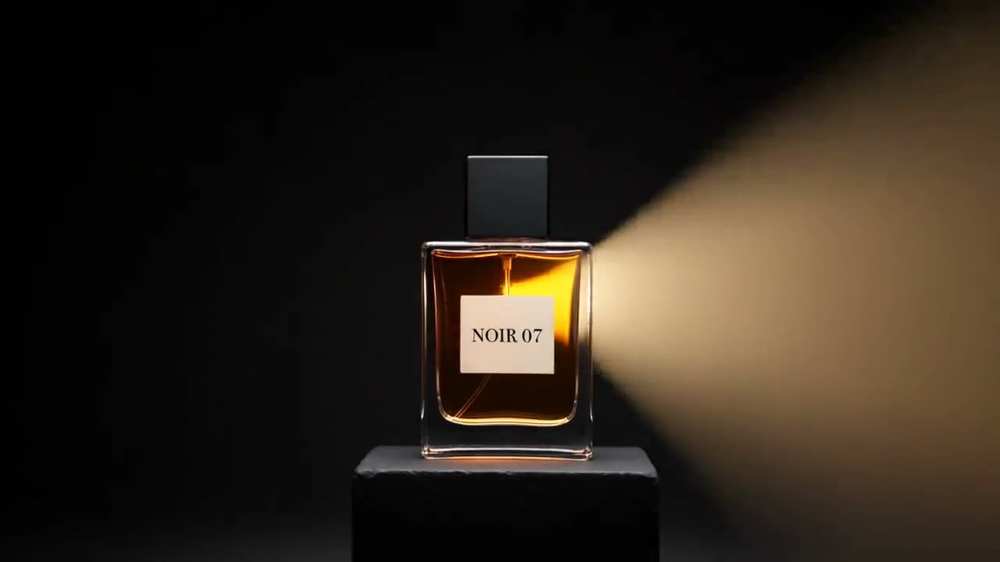</a>
<b>Modell</b>&nbsp; Kling 3.0 Omni<br>
<b>Clip</b>&nbsp; 5 s · 16:9 · ohne Ton<br>
<b>Motive</b>&nbsp; <code>[1]</code> dein Produkt<br><br>
<b>Referenzfotos</b><br>  <br><br>
<a href="https://refvid.com/de/product-hero-reveal"><b>▶ Clip ansehen und mit deinen Fotos erstellen</b></a>
</p>
<br clear="left">

```text
Einstellung 1: Dunkelheit, dann gleitet ein schmaler Strahl warmen Lichts langsam über [1], das auf einem schwarzen Steinpodest steht, und fängt Kanten und Spiegelungen ein. Gedämpft, filmisch, leichte Dunstschleier.
Einstellung 2: Langsame Fahrt auf [1] zu, während sich das Licht setzt, das Etikett scharf und zentriert, tiefschwarzer Hintergrund.
```

<details><summary>Welche Fotos am besten funktionieren</summary><br>Ein schmaler Lichtstrahl streift Kanten und Oberfläche, bevor die Kamera aufs Etikett zufährt. Zeig das Material also ehrlich: ein Frontfoto mit scharfem Etikett und eine Schrägansicht, auf der Licht Kanten, Glanz oder Struktur einfängt.<br><br><sub>Mit RefVid auf Kling 3.0 Omni erstellt, aus 3 Referenzfotos von NOIR 07 (ein KI-generiertes Motiv), mit dem Prompt dieser Vorlage.</sub></details>

### UGC-Werbung

<p>
<a href="https://refvid.com/de/product-in-hand-ugc">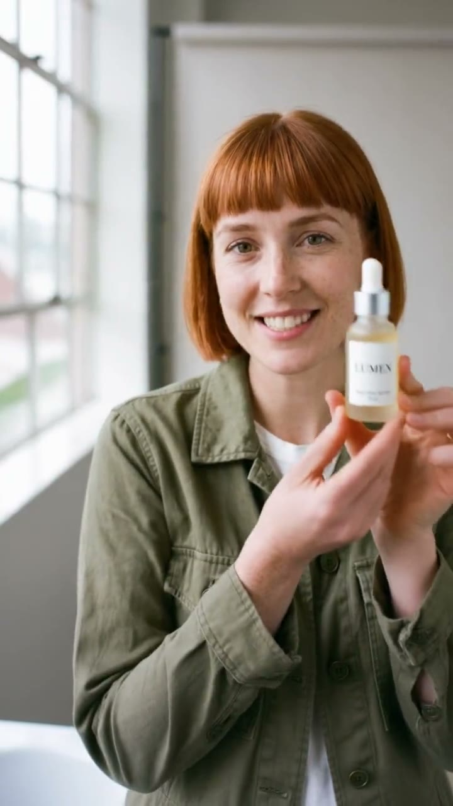</a>
<b>Modell</b>&nbsp; Kling 3.0 Omni<br>
<b>Clip</b>&nbsp; 10 s · 9:16 · mit Ton<br>
<b>Motive</b>&nbsp; <code>[1]</code> der Präsentator · <code>[2]</code> dein Produkt<br><br>
<b>Referenzfotos</b><br>      <br><br>
<a href="https://refvid.com/de/product-in-hand-ugc"><b>▶ Clip ansehen und mit deinen Fotos erstellen</b></a>
</p>
<br clear="left">

```text
Einstellung 1: Handgehaltenes Video im Selfie-Stil in einem hellen Zimmer zu Hause: [1] hält [2] neben das Gesicht, lächelt in die Handykamera und sagt: "Okay, I have to show you this one."
Einstellung 2: Nahaufnahme von [2] in der Hand von [1], langsam gedreht, bis das Etikett zur Kamera zeigt; danach schaut [1] zurück in die Kamera und nickt. Natürliches Tageslicht.
```

<details><summary>Welche Fotos am besten funktionieren</summary><br>Der Präsentator hält dein Produkt neben sein Gesicht und dreht es dann in Nahaufnahme. Gib also ein klares Frontalfoto des Präsentators und ein gerades Etikett-Foto des Produkts; ein Bild des Produkts in einer Hand hilft, die Größe zu treffen.<br><br><sub>Mit RefVid auf Kling 3.0 Omni aus 7 Referenzfotos von Mia und LUMEN (ein KI-erzeugtes Motiv) erstellt, mit einer früheren Formulierung des Prompts dieser Vorlage.</sub></details>

### Zutaten-Splash

<p>
<a href="https://refvid.com/de/product-ingredient-splash"></a>
<b>Modell</b>&nbsp; Kling 4<br>
<b>Clip</b>&nbsp; 5 s · 9:16 · mit Ton<br>
<b>Motive</b>&nbsp; <code>[1]</code> dein Produkt<br><br>
<b>Referenzfotos</b><br> <br><br>
<a href="https://refvid.com/de/product-ingredient-splash"><b>▶ Clip ansehen und mit deinen Fotos erstellen</b></a>
</p>
<br clear="left">

```text
Zeitlupe: [1] steht in der Mitte vor einem hellen Hintergrund in der Hauptfarbe seiner Verpackung, während seine wichtigsten Zutaten, die auf dem Etikett genannt sind, von unten hochschießen und um es herumwirbeln, Tropfen fliegen durchs Licht, dann fällt alles weg und [1] steht sauber da, das Etikett zur Kamera. Helles Studiolicht, scharfe Details.
```

<details><summary>Welche Fotos am besten funktionieren</summary><br>Der Hintergrund übernimmt die Hauptfarbe deiner Verpackung, und die hochfliegenden Zutaten sind die, die darauf stehen. Das wichtigste Foto ist darum die Vorderseite mit lesbaren Zutatennamen und echten Farben, nicht dunkel oder farbstichig.<br><br><sub>Mit RefVid auf Kling 4 aus 2 Referenzfotos von SOL (ein KI-erzeugtes Motiv) erstellt, mit einer früheren Formulierung des Prompts dieser Vorlage.</sub></details>

### Lifestyle zu Hause

<p>
<a href="https://refvid.com/de/product-lifestyle-home"></a>
<b>Modell</b>&nbsp; Kling 3.0 Omni<br>
<b>Clip</b>&nbsp; 5 s · 16:9 · ohne Ton<br>
<b>Motive</b>&nbsp; <code>[1]</code> dein Produkt<br><br>
<b>Referenzfotos</b><br>  <br><br>
<a href="https://refvid.com/de/product-lifestyle-home"><b>▶ Clip ansehen und mit deinen Fotos erstellen</b></a>
</p>
<br clear="left">

```text
Einstellung 1: Ein ruhiges, sonnenbeschienenes Schlafzimmer: Die Kamera gleitet langsam an Leinenvorhängen und einer Topfpflanze vorbei auf [1] zu, das auf einer Holzkommode am Fenster steht.
Einstellung 2: Die Kamera fokussiert [1], das Etikett scharf, weiches Morgenlicht und sanfte Schatten von sich bewegenden Blättern darüber.
```

<details><summary>Welche Fotos am besten funktionieren</summary><br>Die Kamera gleitet durchs Schlafzimmer und bleibt bei deinem Produkt auf der Kommode stehen. Nimm also ein Foto, auf dem es aufrecht auf Augenhöhe steht, Etikett nach vorn; Aufnahmen in weichem Tageslicht lassen es natürlich im Morgenlicht wirken.<br><br><sub>Mit RefVid auf Kling 3.0 Omni erstellt aus 3 Referenzfotos von NOIR 07 (ein KI-generiertes Motiv), mit dem Prompt dieser Vorlage.</sub></details>

### Rosenblätterregen

<p>
<a href="https://refvid.com/de/product-petal-fall"></a>
<b>Modell</b>&nbsp; Kling 4<br>
<b>Clip</b>&nbsp; 5 s · 9:16 · mit Ton<br>
<b>Motive</b>&nbsp; <code>[1]</code> dein Produkt<br><br>
<b>Referenzfotos</b><br>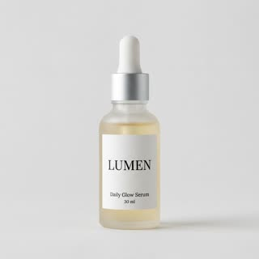  <br><br>
<a href="https://refvid.com/de/product-petal-fall"><b>▶ Clip ansehen und mit deinen Fotos erstellen</b></a>
</p>
<br clear="left">

```text
Zeitlupe: [1] steht auf einem hellen Steinsockel vor einem zartrosa Hintergrund, zartrosa Rosenblätter schweben durch warmes Licht um es herum herab; ein paar Blätter landen daneben, während die Kamera sanft heranfährt, bis das Etikett das Bild füllt. Verträumt, weichgezeichneter Hintergrund, Beauty-Werbestil.
```

<details><summary>Welche Fotos am besten funktionieren</summary><br>Die Kamera fährt heran, bis das Etikett das ganze Bild füllt. Dein Etikett-Foto muss also auch aus der Nähe halten, mit sichtbarem Kleingedrucktem und Finish; ergänze eine Gesamtansicht im Stehen, so wie es auf dem Steinpodest stehen wird.<br><br><sub>Mit RefVid auf Kling 4 aus 3 Referenzfotos von LUMEN (ein KI-generiertes Motiv) erstellt, mit dem Prompt dieser Vorlage.</sub></details>

### Unboxing

<p>
<a href="https://refvid.com/de/product-unboxing">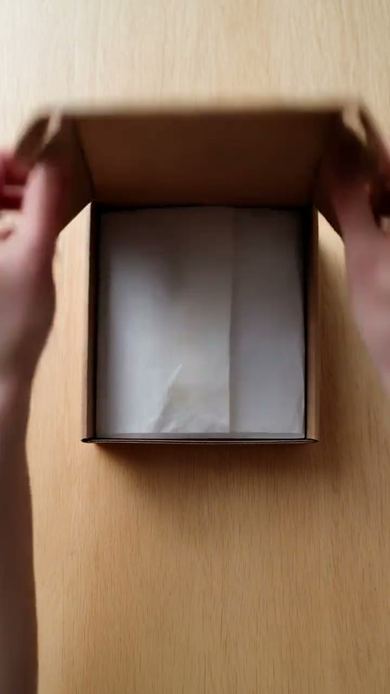</a>
<b>Modell</b>&nbsp; Kling 3.0 Omni<br>
<b>Clip</b>&nbsp; 10 s · 9:16 · mit Ton<br>
<b>Motive</b>&nbsp; <code>[1]</code> dein Produkt<br><br>
<b>Referenzfotos</b><br>  <br><br>
<a href="https://refvid.com/de/product-unboxing"><b>▶ Clip ansehen und mit deinen Fotos erstellen</b></a>
</p>
<br clear="left">

```text
Einstellung 1: Aufnahme von oben auf eine schlichte Kraftpapierbox auf einem hellen Holztisch im weichen Tageslicht; zwei Hände heben den Deckel an und klappen weißes Seidenpapier zurück. Papierrascheln.
Einstellung 2: Nahaufnahme, wie die Hände [1] aus der Box heben, es hochhalten und langsam drehen, sodass das Etikett zur Kamera zeigt.
Einstellung 3: [1] steht auf dem Tisch neben der geöffneten Box, die Kamera fährt sanft heran. Sauber, hell, geringe Schärfentiefe.
```

<details><summary>Welche Fotos am besten funktionieren</summary><br>Hände heben dein Produkt aus einer Kraftpapierschachtel und drehen es zur Kamera. Zeig also jede Seite, die dabei ins Bild kommt: Etikett vorn, Rückseite und Boden, jeweils allein und ohne Schachtel fotografiert.<br><br><sub>Mit RefVid auf Kling 3.0 Omni erstellt, aus 3 Referenzfotos von LUMEN (einem KI-erzeugten Motiv), mit dem Prompt dieser Vorlage.</sub></details>

### Wasserspritzer

<p>
<a href="https://refvid.com/de/product-water-splash">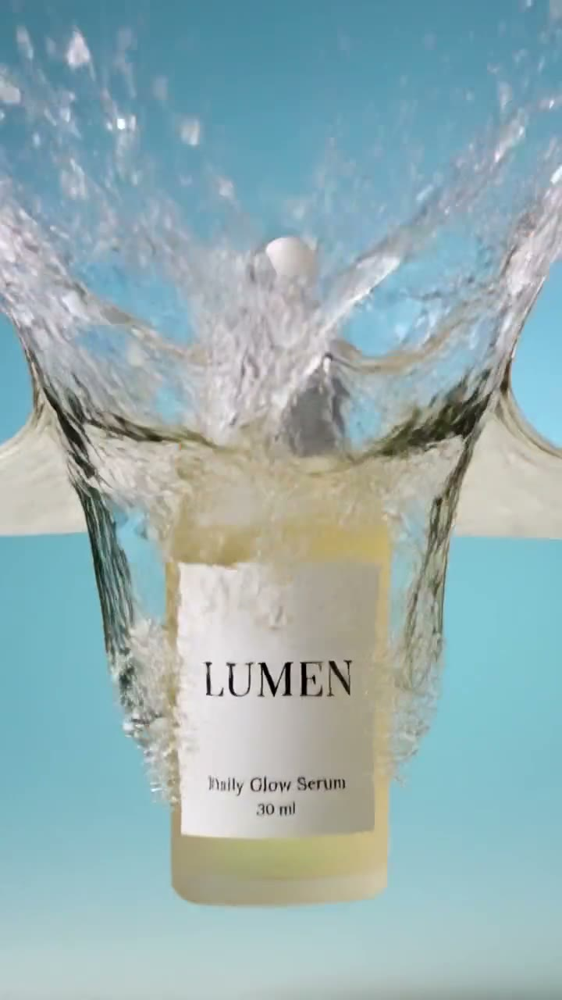</a>
<b>Modell</b>&nbsp; Kling 3.0 Omni<br>
<b>Clip</b>&nbsp; 5 s · 9:16 · ohne Ton<br>
<b>Motive</b>&nbsp; <code>[1]</code> dein Produkt<br><br>
<b>Referenzfotos</b><br>  <br><br>
<a href="https://refvid.com/de/product-water-splash"><b>▶ Clip ansehen und mit deinen Fotos erstellen</b></a>
</p>
<br clear="left">

```text
Zeitlupe: [1] taucht in ein Becken mit kristallklarem Wasser vor einem sanften blauen Verlaufshintergrund ein, eine Explosion aus Blasen und Tropfen spritzt um es herum, dann richtet es sich aufrecht auf, das Etikett zur Kamera gewandt. Helles Studiolicht, feine Makrodetails.
```

<details><summary>Welche Fotos am besten funktionieren</summary><br>Dein Produkt taucht ins Wasser und richtet sich auf, es braucht also eine Ansicht im Stehen vom Deckel bis zum Boden, mit dem Etikett gerade von vorn; lass Fotos weg, auf denen nasser Glanz oder Spiegelungen die Schrift verdecken.<br><br><sub>Mit RefVid auf Kling 3.0 Omni aus 3 Referenzfotos von LUMEN (ein KI-generiertes Motiv) erstellt, mit dem Prompt dieser Vorlage.</sub></details>

### Skincare-Textur

<p>
<a href="https://refvid.com/de/skincare-texture-macro"></a>
<b>Modell</b>&nbsp; Kling 3.0 Omni<br>
<b>Clip</b>&nbsp; 5 s · 9:16 · ohne Ton<br>
<b>Motive</b>&nbsp; <code>[1]</code> dein Produkt<br><br>
<b>Referenzfotos</b><br>  <br><br>
<a href="https://refvid.com/de/skincare-texture-macro"><b>▶ Clip ansehen und mit deinen Fotos erstellen</b></a>
</p>
<br clear="left">

```text
Einstellung 1: Extreme Makroaufnahme: Ein einzelner glänzender Klecks der Formel von [1], in ihrer eigenen Farbe und Textur, landet auf einer glatten hellen Steinfläche und setzt sich langsam. Weiches Tageslicht, cremiger Hintergrund.
Einstellung 2: [1] steht auf dem hellen Stein neben ein paar Stücken seines Hauptinhaltsstoffs, den sein Etikett nennt, im sanften Morgenlicht eines Fensters, die Kamera fährt langsam heran, bis das Etikett den Bildrahmen füllt.
```

<details><summary>Welche Fotos am besten funktionieren</summary><br>Die erste Einstellung zeigt die Formel selbst. Füge also ein Foto eines Swatches oder Kleckses mit echter Farbe und Textur hinzu, dann ein scharfes Frontfoto von Tiegel, Tube oder Flasche, denn am Ende füllt das Etikett das Bild.<br><br><sub>Mit RefVid auf Kling 3.0 Omni aus 3 Referenzfotos von LUMEN (ein KI-erzeugtes Motiv) erstellt, mit einer früheren Formulierung des Prompts dieser Vorlage.</sub></details>

### Sneaker-Werbung

<p>
<a href="https://refvid.com/de/sneaker-street-walk"></a>
<b>Modell</b>&nbsp; Kling 3.0 Omni<br>
<b>Clip</b>&nbsp; 5 s · 9:16 · ohne Ton<br>
<b>Motive</b>&nbsp; <code>[1]</code> deine Schuhe<br><br>
<b>Referenzfotos</b><br>  <br><br>
<a href="https://refvid.com/de/sneaker-street-walk"><b>▶ Clip ansehen und mit deinen Fotos erstellen</b></a>
</p>
<br clear="left">

```text
Einstellung 1: Tiefe Kamera auf Knöchelhöhe, die neben einem Paar Füßen in [1] mitläuft, während sie zügig einen sonnigen Gehweg in der Stadt entlanggehen, Schatten von Passanten, geringe Schärfentiefe.
Einstellung 2: Nahaufnahme von [1], wie sie mitten im Schritt auf dem Pflaster aufsetzen, etwas Staub wirbelt auf, die Kamera bremst neben ihnen ab.
```

<details><summary>Welche Fotos am besten funktionieren</summary><br>Die tiefe Kamera begleitet die Schuhe von der Seite und fängt dann einen beim Aufsetzen in Nahaufnahme ein. Am wichtigsten ist also das äußere Profil samt Sohlenkante; ein Foto des Paars am Fuß lässt Schritt und Sitz natürlich wirken.<br><br><sub>Mit RefVid auf Kling 3.0 Omni aus 3 Referenzfotos von AERO 1 (ein KI-generiertes Motiv) erstellt, mit dem Prompt dieser Vorlage.</sub></details>

### Tech-Enthüllung

<p>
<a href="https://refvid.com/de/tech-gadget-reveal"></a>
<b>Modell</b>&nbsp; Kling 4<br>
<b>Clip</b>&nbsp; 5 s · 16:9 · mit Ton<br>
<b>Motive</b>&nbsp; <code>[1]</code> dein Gerät<br><br>
<b>Referenzfotos</b><br> <br><br>
<a href="https://refvid.com/de/tech-gadget-reveal"><b>▶ Clip ansehen und mit deinen Fotos erstellen</b></a>
</p>
<br clear="left">

```text
[1] liegt fast im Dunkeln auf einer dunklen matten Oberfläche; eine dünne Linie aus kühlem blauem Licht zeichnet seine Kanten nach, dann wird es hell und die Kamera gleitet in einem langsamen Bogen darum, fängt saubere Spiegelungen auf seiner Oberfläche ein und endet frontal mit gestochen scharfen Details. Eleganter Tech-Launch-Stil, tiefschwarzer Hintergrund, leichter Dunst.
```

<details><summary>Welche Fotos am besten funktionieren</summary><br>Erst zeichnet das Licht die Umrisse nach, dann fährt die Kamera im Bogen herum und endet frontal. Gib also ein exakt gerades Frontfoto mit sichtbarem Display oder Logo und eine Schrägansicht, die Kanten, Anschlüsse und Gehäuseoberfläche zeigt.<br><br><sub>Mit RefVid auf Kling 4 aus 2 Referenzfotos von PULSE (ein KI-generiertes Motiv) erstellt, mit dem Prompt dieser Vorlage.</sub></details>

### Uhr in Makro

<p>
<a href="https://refvid.com/de/watch-macro">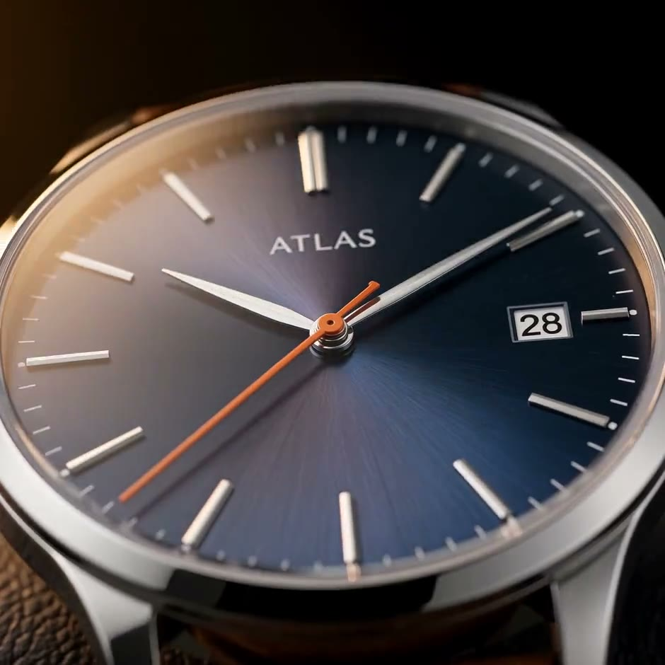</a>
<b>Modell</b>&nbsp; Kling 4<br>
<b>Clip</b>&nbsp; 5 s · 1:1 · mit Ton<br>
<b>Motive</b>&nbsp; <code>[1]</code> deine Uhr<br><br>
<b>Referenzfotos</b><br>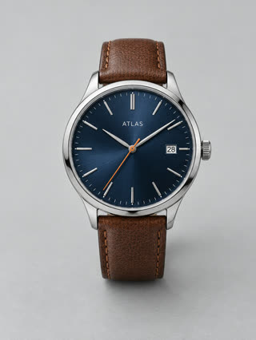 <br><br>
<a href="https://refvid.com/de/watch-macro"><b>▶ Clip ansehen und mit deinen Fotos erstellen</b></a>
</p>
<br clear="left">

```text
Extremes Makro von [1]: Die Kamera gleitet langsam über das Zifferblatt, während der Sekundenzeiger läuft und Licht über das polierte Gehäuse und die Stundenindizes wandert, dann zieht sie zurück und zeigt die ganze Uhr auf dunklem Leder. Warmes, gedämpftes Licht, geringe Schärfentiefe, luxuriöse Details.
```

<details><summary>Welche Fotos am besten funktionieren</summary><br>Die Kamera beginnt ganz nah am Zifferblatt, also leg ein scharfes Foto von oben ohne Spiegelungen vor, auf dem Indizes, Zeiger und Logo lesbar sind; dazu eine Seitenansicht von Gehäuse und Krone und eines mit ausgelegtem Armband.<br><br><sub>Mit RefVid auf Kling 4 aus 2 Referenzfotos von ATLAS (ein KI-generiertes Motiv) erstellt, mit dem Prompt dieser Vorlage.</sub></details>

[↑ Zurück zum Inhalt](#inhalt)

## Personen

Du, ein Freund oder ein Paar in jeder Einstellung, aus wenigen Fotos jedes Gesichts.

### Roadtrip

<p>
<a href="https://refvid.com/de/best-friends-road-trip"></a>
<b>Modell</b>&nbsp; Kling 3.0 Omni<br>
<b>Clip</b>&nbsp; 10 s · 16:9 · mit Ton<br>
<b>Motive</b>&nbsp; <code>[1]</code> du · <code>[2]</code> deine Freundin<br><br>
<b>Referenzfotos</b><br>       <br><br>
<a href="https://refvid.com/de/best-friends-road-trip"><b>▶ Clip ansehen und mit deinen Fotos erstellen</b></a>
</p>
<br clear="left">

```text
Einstellung 1: Ein Vintage-Cabrio fährt auf einer sonnigen Küstenstraße; [1] am Steuer und [2] auf dem Beifahrersitz lachen, die Haare wehen im Wind. Breite Fahrtaufnahme.
Einstellung 2: Nahe Zweieraufnahme im Auto: [2] singt laut mit, während [1] lacht und den Kopf schüttelt. Windgeräusche, warmes Licht.
Einstellung 3: Das Auto parkt bei Sonnenuntergang an einem Aussichtspunkt auf der Klippe, [1] und [2] sitzen von hinten gesehen auf der Motorhaube und blicken aufs Meer.
```

<details><summary>Welche Fotos am besten funktionieren</summary><br>Ihr sitzt nebeneinander vorn im Auto und endet von hinten gesehen auf der Motorhaube, also füge für jede Person ein scharfes Foto von vorn hinzu, eins im Dreiviertelprofil und eins, auf dem Haare und Statur gut zu sehen sind.<br><br><sub>Mit RefVid auf Kling 3.0 Omni erstellt aus 8 Referenzfotos von Mia und Leo (ein KI-erzeugtes Motiv), mit dem Prompt dieser Vorlage.</sub></details>

### Geburtstagsgruß

<p>
<a href="https://refvid.com/de/birthday-greeting"></a>
<b>Modell</b>&nbsp; Kling 3.0 Omni<br>
<b>Clip</b>&nbsp; 5 s · 9:16 · mit Ton<br>
<b>Motive</b>&nbsp; <code>[1]</code> du<br><br>
<b>Referenzfotos</b><br> 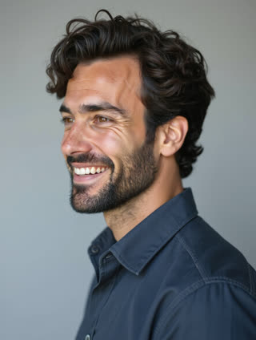  <br><br>
<a href="https://refvid.com/de/birthday-greeting"><b>▶ Clip ansehen und mit deinen Fotos erstellen</b></a>
</p>
<br clear="left">

```text
Halbnahe Aufnahme von [1] in einem gemütlichen Wohnzimmer, die eine kleine Torte mit brennenden Kerzen zur Kamera hält, dann lächelt und herzlich sagt: "Happy birthday! I hope this year is your best one yet." Warmes Abendlicht, Lichterkette im Hintergrund.
```

<details><summary>Welche Fotos am besten funktionieren</summary><br>Es ist eine einzige halbnahe Einstellung, in der du über einer Kerzentorte sprichst, also passt ein scharfes Foto von vorn, auf Brusthöhe gerahmt, am besten; warmes Innenlicht darauf hilft, dass dein Hautton zum Kerzenschein passt.<br><br><sub>Mit RefVid auf Kling 3.0 Omni erstellt, aus 4 Referenzfotos von Leo (ein KI-generiertes Motiv), mit dem Prompt dieser Vorlage.</sub></details>

### Kochshow

<p>
<a href="https://refvid.com/de/chef-cooking-show">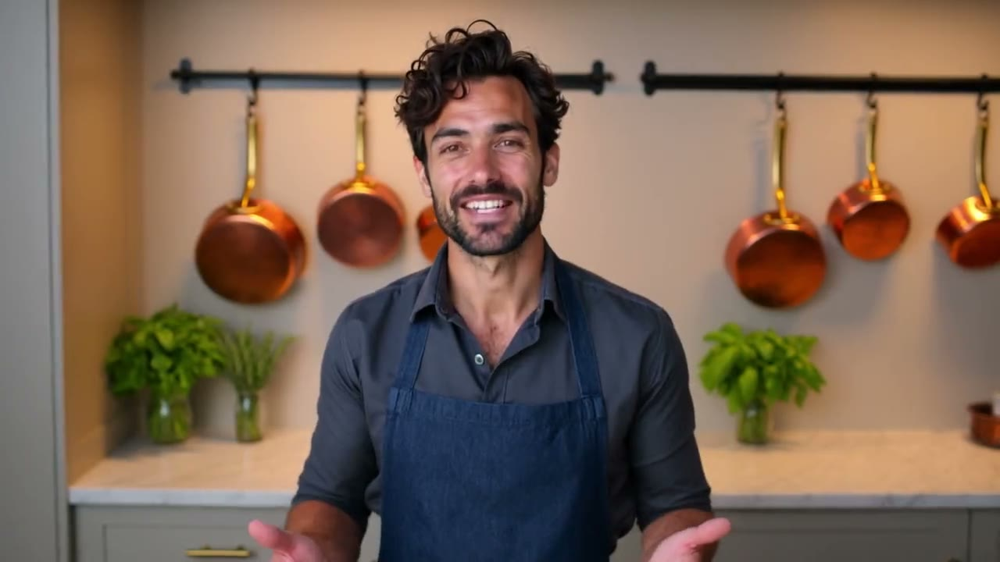</a>
<b>Modell</b>&nbsp; Kling 3.0 Omni<br>
<b>Clip</b>&nbsp; 10 s · 16:9 · mit Ton<br>
<b>Motive</b>&nbsp; <code>[1]</code> du<br><br>
<b>Referenzfotos</b><br>   <br><br>
<a href="https://refvid.com/de/chef-cooking-show"><b>▶ Clip ansehen und mit deinen Fotos erstellen</b></a>
</p>
<br clear="left">

```text
Einstellung 1: Eine warme Heimküche mit Kupferpfannen und Kräutern auf der Arbeitsplatte: [1] in marineblauer Schürze lächelt in die Kamera und sagt: "Welcome back to Sunday Kitchen. Today: the easiest pasta you’ll ever make."
Einstellung 2: Nahaufnahme einer Pfanne auf dem Herd, während [1] Knoblauch und Tomaten in Olivenöl schwenkt und eine Stichflamme aufsteigt. Zischendes Geräusch.
Einstellung 3: [1] stellt einen Teller Spaghetti mit frischem Basilikum vor die Kamera und nickt zufrieden.
```

<details><summary>Welche Fotos am besten funktionieren</summary><br>Du sprichst an der Arbeitsplatte direkt in die Kamera und nickst über dem fertigen Teller, also zählt ein scharfes Foto von vorn mit natürlichem Lächeln am meisten; eins mit zurückgebundenen Haaren, wie beim Kochen, hält dich am Herd gleich.<br><br><sub>Mit RefVid auf Kling 3.0 Omni erstellt, aus 4 Referenzfotos von Leo (ein KI-erzeugtes Motiv), mit dem Prompt dieser Vorlage.</sub></details>

### Weihnachtsmarkt

<p>
<a href="https://refvid.com/de/christmas-market-couple"></a>
<b>Modell</b>&nbsp; Kling 3.0 Omni<br>
<b>Clip</b>&nbsp; 5 s · 16:9 · ohne Ton<br>
<b>Motive</b>&nbsp; <code>[1]</code> du · <code>[2]</code> dein Partner<br><br>
<b>Referenzfotos</b><br>       <br><br>
<a href="https://refvid.com/de/christmas-market-couple"><b>▶ Clip ansehen und mit deinen Fotos erstellen</b></a>
</p>
<br clear="left">

```text
Einstellung 1: Dämmerung auf einem verschneiten Weihnachtsmarkt mit Holzbuden und Lichterketten: [1] und [2] gehen Arm in Arm auf die Kamera zu, beide halten einen dampfenden Becher Glühwein und lachen. Leichter Schneefall.
Einstellung 2: Nahe Zweierszene: [2] streicht [1] eine Schneeflocke aus dem Haar, und sie teilen ein stilles Lächeln, während die Marktlichter weich hinter ihnen leuchten.
```

<details><summary>Welche Fotos am besten funktionieren</summary><br>Ihr geht Arm in Arm auf die Kamera zu und teilt dann einen nahen Moment von Angesicht zu Angesicht, also braucht jede Person ein scharfes Foto von vorn und ein Seitenprofil; zeig die Haare so, wie du sie trägst, denn daraus wird eine Schneeflocke gestrichen.<br><br><sub>Mit RefVid auf Kling 3.0 Omni aus 8 Referenzfotos von Mia und Leo (ein KI-generiertes Motiv) gemacht, mit dem Prompt dieser Vorlage.</sub></details>

### Weihnachtsgruß

<p>
<a href="https://refvid.com/de/christmas-sweater-greeting"></a>
<b>Modell</b>&nbsp; Kling 3.0 Omni<br>
<b>Clip</b>&nbsp; 5 s · 9:16 · mit Ton<br>
<b>Motive</b>&nbsp; <code>[1]</code> dich<br><br>
<b>Referenzfotos</b><br>   <br><br>
<a href="https://refvid.com/de/christmas-sweater-greeting"><b>▶ Clip ansehen und mit deinen Fotos erstellen</b></a>
</p>
<br clear="left">

```text
Einstellung 1: Ein gemütliches Wohnzimmer am Abend: ein Weihnachtsbaum mit warmen Lichterketten und ein knisternder Kamin mit Strümpfen. [1] im roten gestrickten Weihnachtspullover sitzt auf dem Teppich und hält eine Tasse Kakao, während die Kamera langsam näher fährt.
Einstellung 2: [1] blickt mit warmem Lächeln in die Kamera und sagt: "Merry Christmas, I miss you all. See you soon!" Das Feuer knistert leise.
```

<details><summary>Welche Fotos am besten funktionieren</summary><br>Du sitzt auf dem Teppich und schaust zur Kamera hoch, um deinen Wunsch zu sagen, also passt ein Foto von vorn, leicht von oben und in weichem, warmem Licht aufgenommen, am besten; ein Foto im Sitzen lässt den Pullover natürlich fallen.<br><br><sub>Mit RefVid auf Kling 3.0 Omni erstellt, aus 4 Referenzfotos von Mia (ein KI-erzeugtes Motiv), mit dem Prompt dieser Vorlage.</sub></details>

### Strand im Abendrot

<p>
<a href="https://refvid.com/de/couple-beach-sunset"></a>
<b>Modell</b>&nbsp; Kling 3.0 Omni<br>
<b>Clip</b>&nbsp; 10 s · 16:9 · ohne Ton<br>
<b>Motive</b>&nbsp; <code>[1]</code> du · <code>[2]</code> dein Partner<br><br>
<b>Referenzfotos</b><br>       <br><br>
<a href="https://refvid.com/de/couple-beach-sunset"><b>▶ Clip ansehen und mit deinen Fotos erstellen</b></a>
</p>
<br clear="left">

```text
Einstellung 1: Weite Einstellung in der goldenen Stunde: [1] und [2] gehen barfuß am Wasserrand eines ruhigen Strandes auf die Kamera zu, sie reden, sanfte Wellen umspülen ihre Füße.
Einstellung 2: Halbnahe Einstellung von [1] und [2], die zusammen lachen, die warme tiefe Sonne hinter ihnen, die Haare wehen im Meereswind.
Einstellung 3: [1] und [2] stehen nebeneinander, von hinten gesehen, und blicken auf die Sonne, die ins Meer sinkt. Langsame Kamerafahrt auf sie zu, warmer orangefarbener Himmel.
```

<details><summary>Welche Fotos am besten funktionieren</summary><br>In der ersten Einstellung geht ihr auf die Kamera zu, in der letzten seht ihr von hinten in den Sonnenuntergang, also füge für jede Person ein klares Foto von vorn und eins von hinten mit Haaren und Schultern hinzu; Ganzkörperfotos halten eure Größen richtig.<br><br><sub>Mit RefVid auf Kling 3.0 Omni erstellt, aus 8 Referenzfotos von Mia und Leo (ein KI-erzeugtes Motiv), mit dem Prompt dieser Vorlage.</sub></details>

### Mode-Lookbook

<p>
<a href="https://refvid.com/de/fashion-lookbook-walk"></a>
<b>Modell</b>&nbsp; Kling 3.0 Omni<br>
<b>Clip</b>&nbsp; 10 s · 9:16 · ohne Ton<br>
<b>Motive</b>&nbsp; <code>[1]</code> du<br><br>
<b>Referenzfotos</b><br>   <br><br>
<a href="https://refvid.com/de/fashion-lookbook-walk"><b>▶ Clip ansehen und mit deinen Fotos erstellen</b></a>
</p>
<br clear="left">

```text
Einstellung 1: Weite Einstellung: [1] in einem camelfarbenen Trenchcoat über einem weißen Shirt und weiter Jeans geht selbstbewusst auf die Kamera zu, eine ruhige Seitenstraße in Paris entlang, im weichen Morgenlicht.
Einstellung 2: Tiefer Seitenwinkel, der [1] mitten im Schritt begleitet, der Mantel bewegt sich bei jedem Schritt, Schaufenster ziehen vorbei.
Einstellung 3: Nahaufnahme, wie sich [1] über die Schulter zur Kamera dreht, mit einem leichten Lächeln, das Haar fängt das Licht ein.
```

<details><summary>Welche Fotos am besten funktionieren</summary><br>Die drei Einstellungen zeigen dich frontal beim Gehen, aus tiefem seitlichem Winkel und beim Blick über die Schulter, also füge ein Ganzkörperfoto von vorn, eine Seitenansicht und eins mit Blick zurück hinzu, das frontale scharf und gut ausgeleuchtet.<br><br><sub>Mit RefVid auf Kling 3.0 Omni erstellt, aus 4 Referenzfotos von Mia (ein KI-generiertes Motiv), mit dem Prompt dieser Vorlage.</sub></details>

### Fitness-Coach

<p>
<a href="https://refvid.com/de/fitness-coach-demo"></a>
<b>Modell</b>&nbsp; Kling 3.0 Omni<br>
<b>Clip</b>&nbsp; 5 s · 9:16 · mit Ton<br>
<b>Motive</b>&nbsp; <code>[1]</code> du<br><br>
<b>Referenzfotos</b><br>   <br><br>
<a href="https://refvid.com/de/fitness-coach-demo"><b>▶ Clip ansehen und mit deinen Fotos erstellen</b></a>
</p>
<br clear="left">

```text
Einstellung 1: Eine helle, moderne Trainingshalle mit großen Fenstern: [1] in schwarzer Trainingskleidung macht eine langsame Kniebeuge mit dem eigenen Körpergewicht, von der Seite gesehen, Rücken gerade, Arme nach vorn. Stimmung im Fitnessstudio.
Einstellung 2: [1] richtet sich auf, schaut in die Kamera und sagt mit einem aufmunternden Lächeln: "Push the floor away, and keep your chest up."
```

<details><summary>Welche Fotos am besten funktionieren</summary><br>Die Kniebeuge wird von der Seite gefilmt, bevor du frontal sprichst, also füge eine Ganzkörper-Seitenansicht in Trainingskleidung und ein scharfes Foto deines Gesichts von vorn hinzu; ein Foto, das deine Statur zeigt, lässt die Bewegung nach dir aussehen.<br><br><sub>Mit RefVid auf Kling 3.0 Omni erstellt, aus 4 Referenzfotos von Leo (ein KI-generiertes Motiv), mit dem Prompt dieser Vorlage.</sub></details>

### Bettlaken-Geist

<p>
<a href="https://refvid.com/de/halloween-bedsheet-ghost"></a>
<b>Modell</b>&nbsp; Kling 3.0 Omni<br>
<b>Clip</b>&nbsp; 6 s · 9:16 · ohne Ton<br>
<b>Motive</b>&nbsp; <code>[1]</code> du<br><br>
<b>Referenzfotos</b><br>   <br><br>
<a href="https://refvid.com/de/halloween-bedsheet-ghost"><b>▶ Clip ansehen und mit deinen Fotos erstellen</b></a>
</p>
<br clear="left">

```text
Einstellung 1: Eine Gestalt unter einem schlichten weißen Bettlaken mit Sehschlitzen und schwarzer Sonnenbrille steht auf einem laubbedeckten Weg in einem Herbstpark zur goldenen Stunde und dreht sich langsam zur Kamera. Aus der Hand gefilmt, warmes Licht, fallende Blätter.
Einstellung 2: Die Gestalt zieht das Laken ab: Es ist [1], lächelnd, das Laken über dem Arm, Blätter wirbeln auf. Halbnahe Einstellung, weiches goldenes Gegenlicht.
```

<details><summary>Welche Fotos am besten funktionieren</summary><br>Du erscheinst erst, wenn das Laken fällt, lächelnd im goldenen Gegenlicht, also zählt ein scharfes Foto von vorn mit deiner üblichen Frisur am meisten; ein Ganzkörperfoto hält deine Größe unter dem Laken richtig.<br><br><sub>Mit RefVid auf Kling 3.0 Omni erstellt, aus 4 Referenzfotos von Mia (ein KI-generiertes Motiv), mit dem Prompt dieser Vorlage.</sub></details>

### Kostüm-Anprobe

<p>
<a href="https://refvid.com/de/halloween-costume-try-on"></a>
<b>Modell</b>&nbsp; Kling 3.0 Omni<br>
<b>Clip</b>&nbsp; 10 s · 9:16 · ohne Ton<br>
<b>Motive</b>&nbsp; <code>[1]</code> du<br><br>
<b>Referenzfotos</b><br>   <br><br>
<a href="https://refvid.com/de/halloween-costume-try-on"><b>▶ Clip ansehen und mit deinen Fotos erstellen</b></a>
</p>
<br clear="left">

```text
Einstellung 1: [1] in Alltagskleidung dreht sich einmal vor einem hohen Schlafzimmerspiegel und landet frontal zur Kamera als Vampir: Kopf unbedeckt, ein hochgeschlossener schwarzer Umhang mit rotem Futter, kleine Plastik-Fangzähne, das Gesicht vollständig sichtbar. Warmes Lichterkettenlicht, Handykamera-Look.
Einstellung 2: Harter Schnitt: [1] dreht sich erneut, der Umhang ist verschwunden; sie landet in einem runden, puffigen orangefarbenen Kürbiskostüm mit grünem Stiel-Kragen, Kopf unbedeckt, lachend in die Kamera.
Einstellung 3: Harter Schnitt: [1] dreht sich ein drittes Mal, das Kürbiskostüm ist verschwunden; sie landet als Hexe in einem langen schwarzen Kleid und einem spitzen schwarzen Hut und zwinkert verspielt in die Kamera.
```

<details><summary>Welche Fotos am besten funktionieren</summary><br>Jedes Kostüm lässt den Kopf frei und du drehst dich dreimal zur Kamera, also füge ein scharfes Foto von vorn mit ganzem Gesicht und sichtbaren Haaren hinzu, dazu ein Ganzkörperfoto, damit deine Statur in jedem Outfit gleich bleibt.<br><br><sub>Mit RefVid auf Kling 3.0 Omni aus 4 Referenzfotos von Mia (ein KI-generiertes Motiv) erstellt, mit dem Prompt dieser Vorlage.</sub></details>

### Kürbiskopf

<p>
<a href="https://refvid.com/de/halloween-pumpkin-head"></a>
<b>Modell</b>&nbsp; Kling 3.0 Omni<br>
<b>Clip</b>&nbsp; 6 s · 9:16 · ohne Ton<br>
<b>Motive</b>&nbsp; <code>[1]</code> du<br><br>
<b>Referenzfotos</b><br>   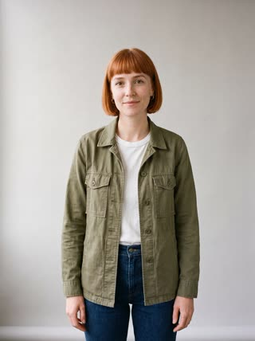<br><br>
<a href="https://refvid.com/de/halloween-pumpkin-head"><b>▶ Clip ansehen und mit deinen Fotos erstellen</b></a>
</p>
<br clear="left">

```text
Einstellung 1: In einem dunklen Studio mit tieforangefarbenem Hintergrund hält eine Person in einem schwarzen Rollkragenpullover einen glühenden geschnitzten Jack-o’-Lantern vor das Gesicht, im Inneren flackert eine Kerze. Langsame Kamerafahrt nach vorn, stimmungsvolles Low-Key-Licht.
Einstellung 2: [1] senkt den Kürbis auf Brusthöhe und blickt mit einem leichten Lächeln direkt in die Kamera, der Kerzenschein beleuchtet das Gesicht von unten. Nahaufnahme, filmisch.
```

<details><summary>Welche Fotos am besten funktionieren</summary><br>Dein Gesicht zeigt sich erst am Ende, in einer Nahaufnahme, von unten vom Kerzenschein beleuchtet, also zählt ein scharfes, gerades Foto von vorn ohne Mütze oder Sonnenbrille am meisten; ein ruhiger Blick oder ein leichtes Lächeln passt zur Einstellung.<br><br><sub>Mit RefVid auf Kling 3.0 Omni erstellt, aus 4 Referenzfotos von Mia (ein KI-generiertes Motiv), mit dem Prompt dieser Vorlage.</sub></details>

### Y2K-Blitz

<p>
<a href="https://refvid.com/de/halloween-y2k-flash"></a>
<b>Modell</b>&nbsp; Kling 3.0 Omni<br>
<b>Clip</b>&nbsp; 5 s · 9:16 · ohne Ton<br>
<b>Motive</b>&nbsp; <code>[1]</code> du<br><br>
<b>Referenzfotos</b><br>   <br><br>
<a href="https://refvid.com/de/halloween-y2k-flash"><b>▶ Clip ansehen und mit deinen Fotos erstellen</b></a>
</p>
<br clear="left">

```text
Der Look eines Partyfotos aus einer Einwegkamera von 2004: eine nächtliche Halloween-Hausparty, helles direktes Kamerablitzlicht, leicht überbelichtete Haut, ein harter Schatten an der Wand dahinter, starkes Filmkorn, Lichterketten im Hintergrund. [1] mit schwarzen Katzenohren steht an der Tür, hält einen roten Pappbecher, dreht sich zur Kamera, lacht und zeigt ein Peace-Zeichen. Kein Lichtreflex auf dem Gesicht.
```

<details><summary>Welche Fotos am besten funktionieren</summary><br>Der harte Aufsteckblitz macht das Licht flach, also liefert ein Foto deines Gesichts von vorn, in gleichmäßigem Licht ohne starke Schatten, das treueste Ergebnis; du drehst dich lachend zur Kamera, ein lächelndes Foto hilft also.<br><br><sub>Mit RefVid auf Kling 3.0 Omni erstellt, aus 4 Referenzfotos von Mia (ein KI-generiertes Motiv), mit dem Prompt dieser Vorlage.</sub></details>

### Zombie-Walk

<p>
<a href="https://refvid.com/de/halloween-zombie-walk"></a>
<b>Modell</b>&nbsp; Kling 3.0 Omni<br>
<b>Clip</b>&nbsp; 5 s · 16:9 · mit Ton<br>
<b>Motive</b>&nbsp; <code>[1]</code> du<br><br>
<b>Referenzfotos</b><br>   <br><br>
<a href="https://refvid.com/de/halloween-zombie-walk"><b>▶ Clip ansehen und mit deinen Fotos erstellen</b></a>
</p>
<br clear="left">

```text
Einstellung 1: Halbnahe Einstellung auf einer nebligen Straße bei Nacht unter einer flackernden Straßenlaterne: [1] als Zombie für Halloween gekleidet, das Gesicht dick mit graugrüner Gesichtsfarbe bemalt, dunkle, eingefallene Schatten um die Augen, Kunstblut in einem Mundwinkel, ein zerrissenes und verschmutztes Flanellhemd, schlurft mit steifen Armen langsam auf die Kamera zu. Kaltes blaues Licht, treibender Nebel.
Einstellung 2: Nahaufnahme von [1], noch in der graugrünen Zombie-Gesichtsfarbe und mit Kunstblut, bleibt unter der Laterne stehen, neigt den Kopf und grinst dann in die Kamera. Tiefes Knurren, entfernter Wind.
```

<details><summary>Welche Fotos am besten funktionieren</summary><br>Graugrüne Farbe und dunkle Schatten bedecken dein Gesicht, also macht dich vor allem die Gesichtsform erkennbar: nimm ein scharfes Foto von vorn und eine Seitenansicht in schlichtem Licht, ohne Make-up oder Brille, denn am Ende grinst du in die Kamera.<br><br><sub>Mit RefVid auf Kling 3.0 Omni erstellt, aus 4 Referenzfotos von Mia (ein KI-generiertes Motiv), mit dem Prompt dieser Vorlage.</sub></details>

### Video-Vorstellung

<p>
<a href="https://refvid.com/de/linkedin-intro"></a>
<b>Modell</b>&nbsp; Kling 3.0 Omni<br>
<b>Clip</b>&nbsp; 5 s · 16:9 · mit Ton<br>
<b>Motive</b>&nbsp; <code>[1]</code> du<br><br>
<b>Referenzfotos</b><br>   <br><br>
<a href="https://refvid.com/de/linkedin-intro"><b>▶ Clip ansehen und mit deinen Fotos erstellen</b></a>
</p>
<br clear="left">

```text
Halbnahe Einstellung von [1], das in einem hellen, modernen Büro mit Pflanzen und einem Fenster im Hintergrund sitzt, direkt in die Kamera blickt und mit ruhigem Lächeln sagt: "Hi, I’m Leo — I help small brands tell their story on video." Weiches Tageslicht.
```

<details><summary>Welche Fotos am besten funktionieren</summary><br>Du sprichst vom Schreibtisch aus direkt in die Kamera, deshalb zählt vor allem ein scharfes Foto frontal auf Augenhöhe mit entspanntem Lächeln; ergänze eines, das deine Schultern und ein Oberteil zeigt, wie du es im Job trägst.<br><br><sub>Mit RefVid auf Kling 3.0 Omni aus 4 Referenzfotos von Leo (ein KI-erstelltes Motiv) erstellt, mit dem Prompt dieser Vorlage.</sub></details>

### Mini-Drama

<p>
<a href="https://refvid.com/de/mini-drama-scene"></a>
<b>Modell</b>&nbsp; Kling 3.0 Omni<br>
<b>Clip</b>&nbsp; 10 s · 9:16 · mit Ton<br>
<b>Motive</b>&nbsp; <code>[1]</code> die erste Hauptfigur · <code>[2]</code> die zweite Hauptfigur<br><br>
<b>Referenzfotos</b><br>       <br><br>
<a href="https://refvid.com/de/mini-drama-scene"><b>▶ Clip ansehen und mit deinen Fotos erstellen</b></a>
</p>
<br clear="left">

```text
Einstellung 1: Regnerischer Abend in einem ruhigen Café: [1] und [2] sitzen sich an einem kleinen Tisch gegenüber, der unberührte Kaffee steht zwischen ihnen. Totale, stimmungsvolles Fensterlicht.
Einstellung 2: Nahaufnahme von [1], der Blick ruhig, leise sagend: "You knew all along, didn’t you?"
Einstellung 3: Nahaufnahme von [2], der nach unten schaut, dann aufsieht und antwortet: "I was going to tell you tonight."
```

<details><summary>Welche Fotos am besten funktionieren</summary><br>Jede Hauptfigur bekommt für ihren Satz eine enge Nahaufnahme, also gib beiden Personen scharfe Frontalfotos mit ruhigem, ernstem Blick statt breitem Grinsen; eine Dreiviertelansicht von jeder hilft, wenn sie sich am Tisch gegenübersitzen.<br><br><sub>Mit RefVid auf Kling 3.0 Omni erstellt, aus 8 Referenzfotos von Mia und Leo (ein KI-generiertes Motiv), mit dem Prompt dieser Vorlage.</sub></details>

### Morgenroutine

<p>
<a href="https://refvid.com/de/morning-routine">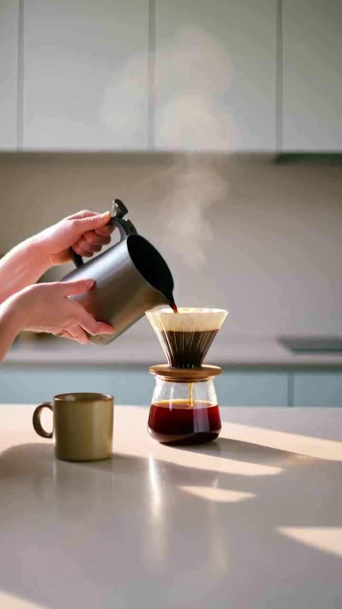</a>
<b>Modell</b>&nbsp; Kling 3.0 Omni<br>
<b>Clip</b>&nbsp; 5 s · 9:16 · ohne Ton<br>
<b>Motive</b>&nbsp; <code>[1]</code> du<br><br>
<b>Referenzfotos</b><br>   <br><br>
<a href="https://refvid.com/de/morning-routine"><b>▶ Clip ansehen und mit deinen Fotos erstellen</b></a>
</p>
<br clear="left">

```text
Einstellung 1: Weiche Morgensonne in einer ruhigen, minimalistischen Küche: [1] in einem lockeren Leinenhemd gießt langsam heißes Wasser über einen Pour-over-Kaffee, Dampf steigt auf, Pflanzen stehen auf dem Fensterbrett.
Einstellung 2: [1] sitzt am Fenster, hält die Tasse mit beiden Händen, nimmt einen langsamen ersten Schluck und schaut hinaus, sanft lächelnd. Warmes Licht, geringe Schärfentiefe.
```

<details><summary>Welche Fotos am besten funktionieren</summary><br>Die zweite Einstellung ist ein ruhiger Blick aus dem Fenster mit der Tasse an den Lippen, also zählt ein scharfes Seiten- oder Dreiviertelfoto deines Gesichts so viel wie ein frontales; ein Foto deiner Hände hilft beim Aufgießen.<br><br><sub>Mit RefVid auf Kling 3.0 Omni erstellt, aus 4 Referenzfotos von Mia (ein KI-generiertes Motiv), mit dem Prompt dieser Vorlage.</sub></details>

### Neujahrs-Countdown

<p>
<a href="https://refvid.com/de/new-year-countdown"></a>
<b>Modell</b>&nbsp; Kling 3.0 Omni<br>
<b>Clip</b>&nbsp; 5 s · 16:9 · mit Ton<br>
<b>Motive</b>&nbsp; <code>[1]</code> du<br><br>
<b>Referenzfotos</b><br>   <br><br>
<a href="https://refvid.com/de/new-year-countdown"><b>▶ Clip ansehen und mit deinen Fotos erstellen</b></a>
</p>
<br clear="left">

```text
Einstellung 1: Halbnahe Einstellung frontal zur Kamera auf einer Dachterrasse um Mitternacht an Silvester, dahinter glitzert die Skyline der Stadt: [1] in einem glitzernden Outfit hebt ein Glas Sekt und zählt mit einem breiten Lächeln zur Kamera herunter: "Three, two, one…"
Einstellung 2: [1] dreht sich zur Kamera und jubelt "Happy New Year!", das Glas erhoben, während hinter der Skyline goldene Feuerwerkskörper explodieren und Konfetti durch die Luft schwebt.
```

<details><summary>Welche Fotos am besten funktionieren</summary><br>Du zählst frontal zur Kamera herunter und jubelst dann mit weit offenem Mund, also zählt vor allem ein scharfes Frontalfoto mit breitem, offenem Lachen; eines mit etwas Abstand, das Haare und Oberkörper zeigt, hilft, dass du im Party-Outfit du selbst bleibst.<br><br><sub>Mit RefVid auf Kling 3.0 Omni aus 4 Referenzfotos von Mia (ein KI-erzeugtes Motiv) erstellt, mit dem Prompt dieser Vorlage.</sub></details>

### Podcast-Host

<p>
<a href="https://refvid.com/de/podcast-host"></a>
<b>Modell</b>&nbsp; Kling 3.0 Omni<br>
<b>Clip</b>&nbsp; 5 s · 16:9 · mit Ton<br>
<b>Motive</b>&nbsp; <code>[1]</code> du<br><br>
<b>Referenzfotos</b><br>   <br><br>
<a href="https://refvid.com/de/podcast-host"><b>▶ Clip ansehen und mit deinen Fotos erstellen</b></a>
</p>
<br clear="left">

```text
Halbnahe Einstellung von [1] an einem Podcast-Studiotisch mit einem Mikrofon an einem Schwenkarm und aufgesetzten Kopfhörern, warmes Lampenlicht und Akustikpaneele im Hintergrund, beugt sich vor und sagt lächelnd: "Welcome back to Small Brands, Big Stories."
```

<details><summary>Welche Fotos am besten funktionieren</summary><br>Kopfhörer sitzen über deinen Ohren und du beugst dich zum Mikrofonarm vor, also zeig Haaransatz und Ohren klar auf einem Frontalfoto und ergänze eine Dreiviertelansicht; trägst du in deiner Show eine Brille, trag sie auch auf den Fotos.<br><br><sub>Mit RefVid auf Kling 3.0 Omni aus 4 Referenzfotos von Leo (ein KI-erzeugtes Motiv) erstellt, mit dem Prompt dieser Vorlage.</sub></details>

### Rap-Duo

<p>
<a href="https://refvid.com/de/rap-duo-booth"></a>
<b>Modell</b>&nbsp; Kling 3.0 Omni<br>
<b>Clip</b>&nbsp; 15 s · 9:16 · mit Ton<br>
<b>Motive</b>&nbsp; <code>[1]</code> du · <code>[2]</code> dein Rap-Partner<br><br>
<b>Referenzfotos</b><br>       <br><br>
<a href="https://refvid.com/de/rap-duo-booth"><b>▶ Clip ansehen und mit deinen Fotos erstellen</b></a>
</p>
<br clear="left">

```text
In einer kleinen Gesangskabine eines Musikstudios mit nahtlos knallorangen Wänden und Boden, gleichmäßig von vorn ausgeleuchtet, zwei Gesangsmikrofone auf Ständern. [1] und [2] stehen in Streetwear nebeneinander, blicken in die Kamera und rappen einen schnellen Vers über einen harten Trap-Beat, nicken und bewegen die Hände im Rhythmus. [1] rappt: "Same face every frame, yeah we never switch it up." Dann rappt [2]: "Two photos in and now the whole world's watching us." Danach rappen beide zusammen und grinsen. Statische vertikale Halbtotale, Live-Performance-Feeling.
```

<details><summary>Welche Fotos am besten funktionieren</summary><br>Ihr steht nebeneinander frontal zur Kamera und rappt in einer halbnahen Einstellung. Jede Person braucht also ein scharfes Frontalfoto mit freiem Mund und dazu ein Bild ab der Hüfte, damit Größe und Statur nebeneinander stimmen.<br><br><sub>Mit RefVid auf Kling 3.0 Omni erstellt aus 8 Referenzfotos von Mia und Leo (ein KI-erzeugtes Motiv), mit dem Prompt dieser Vorlage.</sub></details>

### Superhelden-Landung

<p>
<a href="https://refvid.com/de/superhero-landing"></a>
<b>Modell</b>&nbsp; Kling 3.0 Omni<br>
<b>Clip</b>&nbsp; 5 s · 16:9 · ohne Ton<br>
<b>Motive</b>&nbsp; <code>[1]</code> du<br><br>
<b>Referenzfotos</b><br>   <br><br>
<a href="https://refvid.com/de/superhero-landing"><b>▶ Clip ansehen und mit deinen Fotos erstellen</b></a>
</p>
<br clear="left">

```text
Einstellung 1: Ein stürmischer Abend über einer Stadt: [1] in einer eigenen dunkelblauen Rüstung mit silbernen Linien stürzt aus dem Himmel und landet in einer Dreipunkt-Landung auf einem Hausdach, eine Faust auf dem Beton, Risse breiten sich aus und Staub wirbelt nach außen.
Einstellung 2: [1] richtet sich langsam aus der Landung auf und blickt direkt in die Kamera, der Wind zerrt am Kostüm, hinter ihr zucken Blitze. Untersicht, filmisch.
```

<details><summary>Welche Fotos am besten funktionieren</summary><br>Der Anzug ersetzt deine Kleidung, also trägt dein Gesicht die ganze Ähnlichkeit: ein scharfes Frontalfoto für den Blick in die Kamera am Schluss und eines leicht von unten oder von der Seite, weil das Aufstehen aus der Untersicht gefilmt wird.<br><br><sub>Mit RefVid auf Kling 3.0 Omni erstellt, aus 4 Referenzfotos von Mia (ein KI-generiertes Motiv), mit dem Prompt dieser Vorlage.</sub></details>

### Talking-Head-Werbung

<p>
<a href="https://refvid.com/de/talking-head-ad">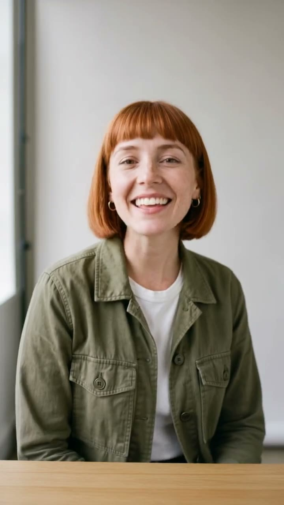</a>
<b>Modell</b>&nbsp; Kling 3.0 Omni<br>
<b>Clip</b>&nbsp; 5 s · 9:16 · mit Ton<br>
<b>Motive</b>&nbsp; <code>[1]</code> der Presenter<br><br>
<b>Referenzfotos</b><br>   <br><br>
<a href="https://refvid.com/de/talking-head-ad"><b>▶ Clip ansehen und mit deinen Fotos erstellen</b></a>
</p>
<br clear="left">

```text
Halbnahe Aufnahme von [1], sitzend in einem hellen Heimbüro, blickt direkt in die Kamera und sagt mit warmem Lächeln: "Here is the one thing I wish I had known sooner." Weiches Fensterlicht, geringe Schärfentiefe.
```

<details><summary>Welche Fotos am besten funktionieren</summary><br>Der Presenter spricht in einer nahen Einstellung direkt in die Linse, Gesicht und Mund tragen also den Clip: Nimm Frontalfotos auf Augenhöhe, ohne Sonnenbrille und ohne Hände am Mund, und eines mit natürlichem Lächeln.<br><br><sub>Mit RefVid auf Kling 3.0 Omni erstellt, aus 4 Referenzfotos von Mia (ein KI-generiertes Motiv), mit dem Prompt dieser Vorlage.</sub></details>

### Thanksgiving-Toast

<p>
<a href="https://refvid.com/de/thanksgiving-table"></a>
<b>Modell</b>&nbsp; Kling 3.0 Omni<br>
<b>Clip</b>&nbsp; 5 s · 16:9 · mit Ton<br>
<b>Motive</b>&nbsp; <code>[1]</code> du<br><br>
<b>Referenzfotos</b><br>   <br><br>
<a href="https://refvid.com/de/thanksgiving-table"><b>▶ Clip ansehen und mit deinen Fotos erstellen</b></a>
</p>
<br clear="left">

```text
Einstellung 1: Eine lange Thanksgiving-Tafel im warmen Kerzenlicht: ein gebratener Truthahn, Schalen mit Beilagen, kleine Kürbisse und Herbstlaub. Die Kamera gleitet langsam daran entlang auf [1] am Kopfende des Tisches zu.
Einstellung 2: [1] steht auf, hebt ein Glas Rotwein in Richtung Kamera und sagt mit warmem Lächeln: "To all of us, and to next year." Weiches Kerzenlicht, leises Klirren der Gläser.
```

<details><summary>Welche Fotos am besten funktionieren</summary><br>Du stehst am Kopfende des Tisches auf und hebst dein Glas zur Kamera, also zählt vor allem ein freundliches Frontalfoto mit natürlichem Lächeln; ein Bild ab der Hüfte hilft, Schultern und Outfit beim Aufstehen richtig zu treffen.<br><br><sub>Mit RefVid auf Kling 3.0 Omni erstellt, aus 4 Referenzfotos von Mia (ein KI-generiertes Motiv), mit dem Prompt dieser Vorlage.</sub></details>

### Reise-Vlog

<p>
<a href="https://refvid.com/de/travel-vlog-walk"></a>
<b>Modell</b>&nbsp; Kling 3.0 Omni<br>
<b>Clip</b>&nbsp; 10 s · 9:16 · mit Ton<br>
<b>Motive</b>&nbsp; <code>[1]</code> du<br><br>
<b>Referenzfotos</b><br>   <br><br>
<a href="https://refvid.com/de/travel-vlog-walk"><b>▶ Clip ansehen und mit deinen Fotos erstellen</b></a>
</p>
<br clear="left">

```text
Einstellung 1: Vlog-Aufnahme aus der Hand: [1] geht eine sonnige Kopfsteinpflaster-Altstadtgasse entlang, gesäumt von Cafés und pastellfarbenen Häusern, hält die Kamera auf Armeslänge und lächelt. Straßengeräusche, leichte Brise.
Einstellung 2: [1] bleibt an einem Brunnen stehen und sagt in die Kamera: "Okay, this little street is my favourite thing so far."
Einstellung 3: [1] dreht die Kamera herum und zeigt einen weiten Blick über terrakottafarbene Dächer bis zum Meer in der goldenen Stunde.
```

<details><summary>Welche Fotos am besten funktionieren</summary><br>Die Kamera bleibt die ganze Zeit auf Armlänge, darum stützt sich der Clip auf Selfie-Fotos deines Gesichts leicht von oben, bei Tageslicht; ergänze ein Ganzkörperfoto, damit Statur und Kleidung beim Gang durch die Gasse bleiben.<br><br><sub>Mit RefVid auf Kling 3.0 Omni aus 4 Referenzfotos von Mia (ein KI-erzeugtes Motiv) erstellt, mit dem Prompt dieser Vorlage.</sub></details>

### Save the Date

<p>
<a href="https://refvid.com/de/wedding-save-the-date"></a>
<b>Modell</b>&nbsp; Kling 3.0 Omni<br>
<b>Clip</b>&nbsp; 10 s · 16:9 · ohne Ton<br>
<b>Motive</b>&nbsp; <code>[1]</code> du · <code>[2]</code> dein Partner<br><br>
<b>Referenzfotos</b><br>       <br><br>
<a href="https://refvid.com/de/wedding-save-the-date"><b>▶ Clip ansehen und mit deinen Fotos erstellen</b></a>
</p>
<br clear="left">

```text
Einstellung 1: Spätnachmittagslicht in einem blühenden Rosengarten: [1] und [2] gehen Hand in Hand auf einem Kiesweg auf die Kamera zu und lächeln sich an.
Einstellung 2: Halbnahe Einstellung: [2] flüstert [1] etwas zu, die lacht und sich vorbeugt; weicher Bokeh-Hintergrund aus Blumen.
Einstellung 3: Nahaufnahme ihrer verschränkten Hände, ein schlichter goldener Verlobungsring fängt das Licht ein.
```

<details><summary>Welche Fotos am besten funktionieren</summary><br>Ihr geht Hand in Hand auf die Kamera zu und lacht dann in einer halbnahen Einstellung zusammen. Jede Person braucht also ein klares, lächelndes Frontalfoto und ein Ganzkörperfoto; für euren echten Ring in der Nahaufnahme kommt ein Foto eurer Hände dazu.<br><br><sub>Mit RefVid auf Kling 3.0 Omni erstellt, aus 8 Referenzfotos von Mia und Leo (ein KI-erzeugtes Motiv), mit dem Prompt dieser Vorlage.</sub></details>

[↑ Zurück zum Inhalt](#inhalt)

## Haustiere

Dein eigener Hund oder deine Katze, in jeder Einstellung dasselbe Tier.

### Hunde-Rap

<p>
<a href="https://refvid.com/de/dog-rap-video"></a>
<b>Modell</b>&nbsp; Kling 3.0 Omni<br>
<b>Clip</b>&nbsp; 10 s · 9:16 · mit Ton<br>
<b>Motive</b>&nbsp; <code>[1]</code> du · <code>[2]</code> dein Hund<br><br>
<b>Referenzfotos</b><br>       <br><br>
<a href="https://refvid.com/de/dog-rap-video"><b>▶ Clip ansehen und mit deinen Fotos erstellen</b></a>
</p>
<br clear="left">

```text
In einer kleinen Gesangskabine eines Musikstudios mit dunklen Akustikschaumwänden und warmem orangem Licht, zwischen ihnen ein Gesangsmikrofon auf einem Ständer. [1] steht mit Kopfhörern und Hoodie neben dem Hund [2], der mit einer winzigen Goldkette auf einem hohen Hocker sitzt und zu einem harten Hip-Hop-Beat mit dem Kopf wippt. [1] rappt in die Kamera: "Me and my dog, yeah we run this block." Dann beugt sich der Hund [2] zum Mikrofon und rappt mit rauer Cartoon-Stimme zurück, das Maul bewegt sich zu den Worten: "Treats on the table and we never stop." [1] lacht. Statische vertikale Halbtotale.
```

<details><summary>Welche Fotos am besten funktionieren</summary><br>Dein Hund rappt mit bewegtem Maul ins Mikrofon, also zählt ein scharfes Foto seines Kopfes von vorn, mit Schnauze und Zeichnung in klarem Licht, am meisten; für dich passt ein Foto von vorn auf Stehhöhe zur Kabine.<br><br><sub>Mit RefVid auf Kling 3.0 Omni erstellt aus 8 Referenzfotos von Leo und Biscuit (ein KI-erzeugtes Motiv), mit dem Prompt dieser Vorlage.</sub></details>

### Haustier im Abendrot

<p>
<a href="https://refvid.com/de/pet-and-owner-sunset"></a>
<b>Modell</b>&nbsp; Kling 3.0 Omni<br>
<b>Clip</b>&nbsp; 10 s · 16:9 · ohne Ton<br>
<b>Motive</b>&nbsp; <code>[1]</code> dein Haustier · <code>[2]</code> du<br><br>
<b>Referenzfotos</b><br>       <br><br>
<a href="https://refvid.com/de/pet-and-owner-sunset"><b>▶ Clip ansehen und mit deinen Fotos erstellen</b></a>
</p>
<br clear="left">

```text
Einstellung 1: Weitaufnahme in der goldenen Stunde: [2] läuft barfuß am Wasserrand eines ruhigen Strands, [1] hält Schritt neben ihr, sanfte Wellen rollen herein, die warme tiefe Sonne steht hinter ihnen.
Einstellung 2: [2] und [1] sitzen nebeneinander im Sand, von hinten gesehen, und blicken aufs Meer, in das die Sonne sinkt. Langsame Kamerafahrt auf sie zu, warmer orangefarbener Himmel.
```

<details><summary>Welche Fotos am besten funktionieren</summary><br>Beide Einstellungen zeigen dich und dein Tier nebeneinander, die zweite von hinten, also füge von euch beiden Ganzkörperfotos von der Seite und von hinten hinzu, nicht nur Gesichter; Rücken und Schwanzzeichnung deines Tiers tragen die Sonnenuntergangsszene.<br><br><sub>Mit RefVid auf Kling 3.0 Omni erstellt, aus 8 Referenzfotos von Biscuit und Mia (ein KI-erzeugtes Motiv), mit dem Prompt dieser Vorlage.</sub></details>

### Haustier-Astronaut

<p>
<a href="https://refvid.com/de/pet-astronaut"></a>
<b>Modell</b>&nbsp; Kling 3.0 Omni<br>
<b>Clip</b>&nbsp; 5 s · 16:9 · ohne Ton<br>
<b>Motive</b>&nbsp; <code>[1]</code> dein Haustier<br><br>
<b>Referenzfotos</b><br>   <br><br>
<a href="https://refvid.com/de/pet-astronaut"><b>▶ Clip ansehen und mit deinen Fotos erstellen</b></a>
</p>
<br clear="left">

```text
Im hellen Inneren einer Raumstation schwebt [1] in einem kleinen weißen Astronautenanzug mit geöffnetem Visier schwerelos auf die Kamera zu, die Pfoten treiben mit, während durch das große Fenster dahinter die blaue Erde leuchtet. Langsame, verträumte Bewegung.
```

<details><summary>Welche Fotos am besten funktionieren</summary><br>Das Gesicht deines Tiers wird vom offenen Helmvisier eingerahmt, während es auf dich zuschwebt, also zählt vor allem ein scharfes Frontalfoto mit klaren Augen und Schnauze; der Anzug verdeckt den Körper, darum trägt die Fellfarbe um das Gesicht die Ähnlichkeit.<br><br><sub>Mit RefVid auf Kling 3.0 Omni erstellt, aus 4 Referenzfotos von Miso (ein KI-generiertes Motiv), mit dem Prompt dieser Vorlage.</sub></details>

### Haustier-Geburtstag

<p>
<a href="https://refvid.com/de/pet-birthday-party"></a>
<b>Modell</b>&nbsp; Kling 3.0 Omni<br>
<b>Clip</b>&nbsp; 5 s · 9:16 · mit Ton<br>
<b>Motive</b>&nbsp; <code>[1]</code> dein Tier<br><br>
<b>Referenzfotos</b><br>   <br><br>
<a href="https://refvid.com/de/pet-birthday-party"><b>▶ Clip ansehen und mit deinen Fotos erstellen</b></a>
</p>
<br clear="left">

```text
Einstellung 1: [1] sitzt an einem kleinen Tisch mit einem winzigen gestreiften Partyhut, bunte Luftballons im Hintergrund, vorne ein kleiner Geburtstagskuchen mit drei brennenden Kerzen. Warmes Licht im Wohnzimmer, sanfte Kamerafahrt nach vorne.
Einstellung 2: [1] blickt neben dem Kuchen in die Kamera, neigt den Kopf und gibt mit seiner eigenen, natürlichen Stimme einen kleinen fröhlichen Laut von sich. Weicher Fokus auf den Kerzen, gemütliche Geburtstagsstimmung.
```

<details><summary>Welche Fotos am besten funktionieren</summary><br>Dein Tier sitzt an einem kleinen Tisch und schaut unter einem winzigen Partyhut zur Kamera hoch, also zählt vor allem ein Foto leicht von oben mit scharfen Ohren und Augen; eines im aufrechten Sitzen zeigt, wie es sich neben dem Kuchen hält.<br><br><sub>Mit RefVid auf Kling 3.0 Omni aus 4 Referenzfotos von Biscuit (ein KI-erzeugtes Motiv) erstellt, mit dem Prompt dieser Vorlage.</sub></details>

### Haustier-Koch

<p>
<a href="https://refvid.com/de/pet-chef">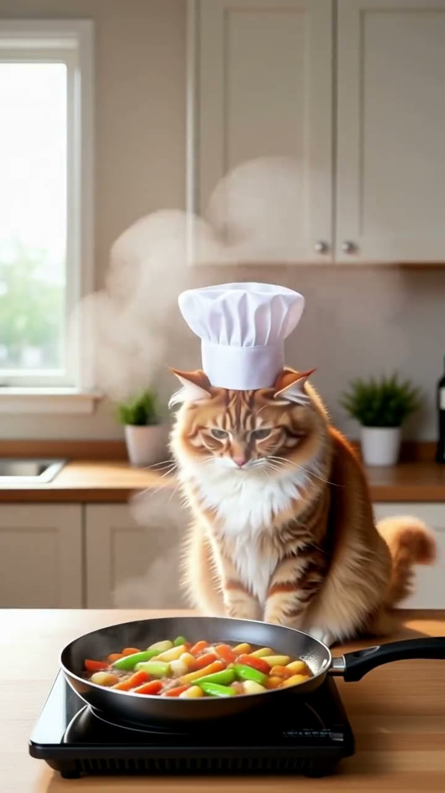</a>
<b>Modell</b>&nbsp; Kling 3.0 Omni<br>
<b>Clip</b>&nbsp; 5 s · 9:16 · mit Ton<br>
<b>Motive</b>&nbsp; <code>[1]</code> dein Haustier<br><br>
<b>Referenzfotos</b><br>   <br><br>
<a href="https://refvid.com/de/pet-chef"><b>▶ Clip ansehen und mit deinen Fotos erstellen</b></a>
</p>
<br clear="left">

```text
Einstellung 1: [1] mit einer kleinen weißen Kochmütze sitzt aufrecht an einer gemütlichen Küchenarbeitsplatte hinter einer Pfanne, in der Gemüse brutzelt, Dampf steigt auf, warmes Morgenlicht. Brutzelgeräusch.
Einstellung 2: [1] sitzt neben einem fertigen Teller mit buntem Gemüse-Wok und schaut stolz in die Kamera, die Kochmütze leicht schief.
```

<details><summary>Welche Fotos am besten funktionieren</summary><br>Die Kochmütze sitzt auf dem Kopf deines Tiers, und die zweite Einstellung ist ein naher, stolzer Blick in die Kamera, also zählt vor allem ein scharfes Frontalfoto mit beiden Ohren im Bild; ergänze eine Seitenansicht, damit Fell und Größe an der Küchentheke stimmen.<br><br><sub>Mit RefVid auf Kling 3.0 Omni aus 4 Referenzfotos von Miso (ein KI-erstelltes Motiv) mit dem Prompt dieser Vorlage erstellt.</sub></details>

### Weihnachten mit Haustier

<p>
<a href="https://refvid.com/de/pet-christmas-morning"></a>
<b>Modell</b>&nbsp; Kling 3.0 Omni<br>
<b>Clip</b>&nbsp; 5 s · 9:16 · ohne Ton<br>
<b>Motive</b>&nbsp; <code>[1]</code> dein Haustier<br><br>
<b>Referenzfotos</b><br>   <br><br>
<a href="https://refvid.com/de/pet-christmas-morning"><b>▶ Clip ansehen und mit deinen Fotos erstellen</b></a>
</p>
<br clear="left">

```text
Einstellung 1: Weihnachtsmorgen in einem gemütlichen Wohnzimmer: [1] mit einem kleinen roten Strickschal sitzt neben einem leuchtenden Weihnachtsbaum und schnuppert neugierig an einem in rotes Papier mit goldener Schleife gewickelten Geschenk. Warme Lichterketten, sanftes Morgenlicht.
Einstellung 2: Nahaufnahme im selben Wohnzimmer, der beleuchtete Weihnachtsbaum glüht im Hintergrund: [1], immer noch im roten Schal, schnappt sich die goldene Schleife und zieht das Geschenkpapier auf, Papierschnipsel fliegen durch die Luft, dann schaut es in die Kamera.
```

<details><summary>Welche Fotos am besten funktionieren</summary><br>Die erste Einstellung zeigt dein Tier von der Seite, wie es am Geschenk schnuppert, und der Schal liegt um seinen Hals, also füge ein klares Profilfoto mit Schnauze und Brust hinzu, dazu ein frontales für den Blick nach oben am Ende.<br><br><sub>Mit RefVid auf Kling 3.0 Omni erstellt aus 4 Referenzfotos von Biscuit (ein KI-erzeugtes Motiv), mit dem Prompt dieser Vorlage.</sub></details>

### Haustier wird lebendig

<p>
<a href="https://refvid.com/de/pet-comes-to-life"></a>
<b>Modell</b>&nbsp; Kling 3.0 Omni<br>
<b>Clip</b>&nbsp; 5 s · 9:16 · ohne Ton<br>
<b>Motive</b>&nbsp; <code>[1]</code> dein Haustier<br><br>
<b>Referenzfotos</b><br>   <br><br>
<a href="https://refvid.com/de/pet-comes-to-life"><b>▶ Clip ansehen und mit deinen Fotos erstellen</b></a>
</p>
<br clear="left">

```text
[1] liegt auf einer weichen Decke auf einem Sofa im warmen Nachmittagslicht, blinzelt langsam, neigt den Kopf und schaut direkt in die Kamera, atmet sanft. Sanfte Kamerafahrt auf das Motiv zu, gemütliches Zuhause, geringe Schärfentiefe.
```

<details><summary>Welche Fotos am besten funktionieren</summary><br>Es ist eine einzige ruhige Nahaufnahme, in der dein Tier liegt und dir in die Augen schaut, also zählt vor allem ein scharfes Foto auf seiner Augenhöhe, auf dem Augenfarbe und Fell rund um die Augen klar sind; ein Foto im Liegen hilft bei der Pose.<br><br><sub>Mit RefVid auf Kling 3.0 Omni aus 4 Referenzfotos von Biscuit (ein KI-erzeugtes Motiv) erstellt, mit einer früheren Formulierung des Prompts dieser Vorlage.</sub></details>

### Haustier-Familienporträt

<p>
<a href="https://refvid.com/de/pet-family-portrait"></a>
<b>Modell</b>&nbsp; Kling 3.0 Omni<br>
<b>Clip</b>&nbsp; 5 s · 1:1 · ohne Ton<br>
<b>Motive</b>&nbsp; <code>[1]</code> dein erstes Haustier · <code>[2]</code> dein zweites Haustier<br><br>
<b>Referenzfotos</b><br>       <br><br>
<a href="https://refvid.com/de/pet-family-portrait"><b>▶ Clip ansehen und mit deinen Fotos erstellen</b></a>
</p>
<br clear="left">

```text
[1] und [2] sitzen nebeneinander auf einem weichen grauen Sofa mit Kissen in einem gemütlichen Wohnzimmer, wie ein Familienporträt; [2] schaut zu [1] hinüber, dann blicken beide direkt in die Kamera. Warmes Lampenlicht, sanfte Kamerafahrt auf das Motiv zu.
```

<details><summary>Welche Fotos am besten funktionieren</summary><br>Zwei Tiere teilen sich ein Sofa, also muss das Studio sie auseinanderhalten: gib jedem ein Frontalfoto und eines, das seine Größe neben etwas Vertrautem zeigt, damit das größere nebeneinander sitzend auch größer bleibt.<br><br><sub>Mit RefVid auf Kling 3.0 Omni erstellt, aus 8 Referenzfotos von Biscuit und Miso (ein KI-erstelltes Motiv), mit dem Prompt dieser Vorlage.</sub></details>

### Haustier-Kostüm

<p>
<a href="https://refvid.com/de/pet-halloween-costume"></a>
<b>Modell</b>&nbsp; Kling 3.0 Omni<br>
<b>Clip</b>&nbsp; 6 s · 9:16 · mit Ton<br>
<b>Motive</b>&nbsp; <code>[1]</code> dein Haustier<br><br>
<b>Referenzfotos</b><br>   <br><br>
<a href="https://refvid.com/de/pet-halloween-costume"><b>▶ Clip ansehen und mit deinen Fotos erstellen</b></a>
</p>
<br clear="left">

```text
Einstellung 1: [1] sitzt bei Dämmerung auf einer Holzveranda in einem weichen orangefarbenen Kürbiskostüm, geschnitzte Kürbislaternen leuchten auf den Stufen, trockene Blätter liegen herum. Langsame Kamerafahrt nach vorn, warmes Kerzenlicht.
Einstellung 2: [1] schaut neben einer Schale mit eingewickelten Süßigkeiten in die Kamera, legt den Kopf schief und macht einen kleinen fröhlichen Laut mit seiner natürlichen Stimme. Gemütliche Halloween-Nacht, geringe Schärfentiefe.
```

<details><summary>Welche Fotos am besten funktionieren</summary><br>Das Kürbiskostüm bedeckt den Körper deines Tiers, also leisten Gesicht und Ohren die ganze Arbeit: nimm ein nahes, gut beleuchtetes Frontalfoto, in dem sich Licht in den Augen fängt, und eines im Sitzen, damit das Kostüm zu seiner echten Form passt.<br><br><sub>Mit RefVid auf Kling 3.0 Omni aus 4 Referenzfotos von Biscuit (ein KI-erzeugtes Motiv) erstellt, mit einer früheren Formulierung des Prompts dieser Vorlage, die ein Bellen verlangte.</sub></details>

### Haustier-Erinnerung

<p>
<a href="https://refvid.com/de/pet-memorial"></a>
<b>Modell</b>&nbsp; Kling 3.0 Omni<br>
<b>Clip</b>&nbsp; 5 s · 16:9 · ohne Ton<br>
<b>Motive</b>&nbsp; <code>[1]</code> dein Tier<br><br>
<b>Referenzfotos</b><br>   <br><br>
<a href="https://refvid.com/de/pet-memorial"><b>▶ Clip ansehen und mit deinen Fotos erstellen</b></a>
</p>
<br clear="left">

```text
Einstellung 1: Eine sonnige Wiese mit hohen Wildblumen unter einem warmen goldenen Himmel, in der Ferne ein sanfter Regenbogen: [1] schießt mit vollem Tempo aus den Blumen direkt auf die Kamera zu, die Ohren flattern, die Zunge hängt heraus, eine rot-weiß gestreifte Socke stolz im Maul.
Einstellung 2: Nahaufnahme auf derselben Wiese in der goldenen Stunde, der Regenbogen leuchtet dahinter: [1] bremst abrupt, legt die gestreifte Socke ins Gras, setzt sich hin, neigt den Kopf zur Kamera und wedelt mit dem Schwanz, sichtlich stolz auf sich selbst.
```

<details><summary>Welche Fotos am besten funktionieren</summary><br>Dein Tier rennt mit fliegenden Ohren und einer Socke im Maul direkt auf die Kamera zu, also hilft am meisten ein Foto, auf dem es rennt oder mit offenem Maul spielt, falls du eines hast; auch alte, leicht unscharfe Handyfotos gehen, solange das Gesicht drauf ist.<br><br><sub>Mit RefVid auf Kling 3.0 Omni erstellt, aus 4 Referenzfotos von Captain (ein KI-generiertes Motiv), mit dem Prompt dieser Vorlage.</sub></details>

### Nachrichten-Haustier

<p>
<a href="https://refvid.com/de/pet-news-anchor"></a>
<b>Modell</b>&nbsp; Kling 3.0 Omni<br>
<b>Clip</b>&nbsp; 5 s · 16:9 · mit Ton<br>
<b>Motive</b>&nbsp; <code>[1]</code> dein Tier<br><br>
<b>Referenzfotos</b><br>   <br><br>
<a href="https://refvid.com/de/pet-news-anchor"><b>▶ Clip ansehen und mit deinen Fotos erstellen</b></a>
</p>
<br clear="left">

```text
Ein TV-Nachrichtenstudio mit hellen Lichtern und einer Stadtsilhouette auf dem Bildschirm dahinter: [1] sitzt aufrecht hinter dem Nachrichtenpult, trägt eine kleine rote Krawatte, blickt in die Kamera und sagt mit ernster Nachrichtensprecherstimme: "Good evening. Tonight’s top story: dinner is late again."
```

<details><summary>Welche Fotos am besten funktionieren</summary><br>Hinter dem Nachrichtentisch sind nur Kopf, Hals und Brust deines Tiers zu sehen, die Krawatte am Hals, also nimm ein Frontalfoto, auf dem es aufrecht sitzt und die Brust sichtbar ist; ein ruhiges, ernstes Gesicht passt besser zur Schlagzeile als ein verspieltes.<br><br><sub>Mit RefVid auf Kling 3.0 Omni aus 4 Referenzfotos von Biscuit (ein KI-generiertes Motiv), mit dem Prompt dieser Vorlage erstellt.</sub></details>

### Haustier-Ringträger

<p>
<a href="https://refvid.com/de/pet-ring-bearer"></a>
<b>Modell</b>&nbsp; Kling 3.0 Omni<br>
<b>Clip</b>&nbsp; 5 s · 16:9 · ohne Ton<br>
<b>Motive</b>&nbsp; <code>[1]</code> dein Haustier<br><br>
<b>Referenzfotos</b><br>   <br><br>
<a href="https://refvid.com/de/pet-ring-bearer"><b>▶ Clip ansehen und mit deinen Fotos erstellen</b></a>
</p>
<br clear="left">

```text
Eine Gartenhochzeit im weichen Nachmittagslicht: [1] mit einem kleinen Blumenhalsband geht den Gang zwischen Reihen weißer Stühle auf die Kamera zu, trägt ein Körbchen mit einer Ringbox im Maul, auf beiden Seiten drehen sich die Gäste lächelnd um, Blütenblätter liegen im Gras.
```

<details><summary>Welche Fotos am besten funktionieren</summary><br>Dein Tier läuft den ganzen Gang auf die Kamera zu, das Körbchen im Maul, also zählt vor allem ein Ganzkörperfoto im Gehen oder Stehen, frontal auf seiner Höhe aufgenommen; ein freier Blick auf den Hals hilft, dass das Blumenhalsband richtig sitzt.<br><br><sub>Mit RefVid auf Kling 3.0 Omni erstellt, aus 4 Referenzfotos von Biscuit (ein KI-erzeugtes Motiv), mit dem Prompt dieser Vorlage.</sub></details>

### Haustier-Laufsteg

<p>
<a href="https://refvid.com/de/pet-runway-walk"></a>
<b>Modell</b>&nbsp; Kling 3.0 Omni<br>
<b>Clip</b>&nbsp; 5 s · 9:16 · mit Ton<br>
<b>Motive</b>&nbsp; <code>[1]</code> dein Tier<br><br>
<b>Referenzfotos</b><br>   <br><br>
<a href="https://refvid.com/de/pet-runway-walk"><b>▶ Clip ansehen und mit deinen Fotos erstellen</b></a>
</p>
<br clear="left">

```text
[1] läuft selbstbewusst über einen glänzenden Laufsteg auf die Kamera zu, unter hellen Scheinwerfern, mit Fotografen auf beiden Seiten, deren Blitzlichter zucken, und bleibt am Ende stehen, um zu posieren. Niedrige Kameraperspektive, Stimmengewirr des Publikums und Auslöseklicks.
```

<details><summary>Welche Fotos am besten funktionieren</summary><br>Die Kamera ist tief, während dein Tier den ganzen Laufsteg entlangstolziert, also tragen Beine und Gang diese Szene: füge ein Ganzkörperfoto von vorn auf Bodenhöhe hinzu und eines von der Seite, damit Statur und Fellmuster mitten im Schritt stimmen.<br><br><sub>Mit RefVid auf Kling 3.0 Omni erstellt, aus 4 Referenzfotos von Biscuit (ein KI-erzeugtes Motiv), mit dem Prompt dieser Vorlage.</sub></details>

### Haustier unter Wasser

<p>
<a href="https://refvid.com/de/pet-underwater-swim"></a>
<b>Modell</b>&nbsp; Kling 3.0 Omni<br>
<b>Clip</b>&nbsp; 5 s · 9:16 · ohne Ton<br>
<b>Motive</b>&nbsp; <code>[1]</code> dein Haustier<br><br>
<b>Referenzfotos</b><br>   <br><br>
<a href="https://refvid.com/de/pet-underwater-swim"><b>▶ Clip ansehen und mit deinen Fotos erstellen</b></a>
</p>
<br clear="left">

```text
Unter Wasser in klarem türkisblauem Meer, [1] schwimmt auf die Kamera zu, die Beine paddelnd und die Augen offen, Sonnenstrahlen wabern über es hinweg, kleine Luftblasen steigen auf, das Fell treibt sanft im Wasser.
```

<details><summary>Welche Fotos am besten funktionieren</summary><br>Unter Wasser treibt das Fell und wirkt dunkler, also müssen Gesicht und Zeichnung unverwechselbar sein: ein scharfes Frontalfoto mit offenen Augen und eines, das Länge und Farbe des Fells bei Tageslicht zeigt, geben dem Studio, was es braucht.<br><br><sub>Mit RefVid auf Kling 3.0 Omni aus 4 Referenzfotos von Biscuit (ein KI-erzeugtes Motiv) gemacht, mit dem Prompt dieser Vorlage.</sub></details>

[↑ Zurück zum Inhalt](#inhalt)

## Dinge & Figuren

Ein Spielzeug, eine Figur, ein Auto oder eine gezeichnete Figur, die gleich bleibt.

### Knetanimation

<p>
<a href="https://refvid.com/de/clay-figure-stopmotion">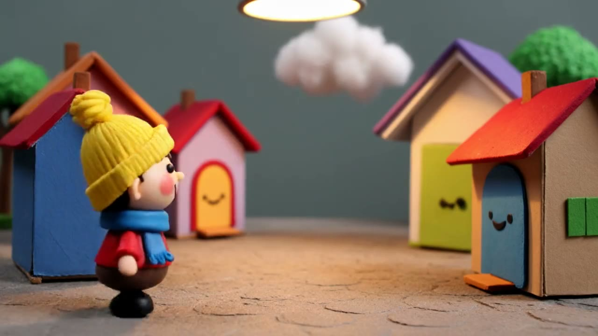</a>
<b>Modell</b>&nbsp; Kling 3.0 Omni<br>
<b>Clip</b>&nbsp; 5 s · 16:9 · ohne Ton<br>
<b>Motive</b>&nbsp; <code>[1]</code> deine Knetfigur<br><br>
<b>Referenzfotos</b><br>   <br><br>
<a href="https://refvid.com/de/clay-figure-stopmotion"><b>▶ Clip ansehen und mit deinen Fotos erstellen</b></a>
</p>
<br clear="left">

```text
Einstellung 1: Claymation-Stil im Stop-Motion-Look, leicht stufenförmige Bewegung: [1] läuft über eine kleine, handgemachte Dorfstraße aus Papier und Filz mit winzigen Häusern und einer Wolke aus Watte, Knetstruktur und Fingerabdrücke sichtbar. Warmes Tischlicht.
Einstellung 2: [1] bleibt stehen, dreht sich zur Kamera und winkt mit einer Knethand, dann macht sie einen kleinen Hüpfer. Stop-Motion-Gefühl, geringe Schärfentiefe.
```

<details><summary>Welche Fotos am besten funktionieren</summary><br>Deine Figur läuft seitlich durch das Set und dreht sich dann zum Winken um, also zeig sie im Profil und von vorn, so nah fotografiert, dass Knettextur und Fingerabdrücke erkennbar sind; eine Rückansicht hält den Gang stimmig.<br><br><sub>Mit RefVid auf Kling 3.0 Omni erstellt, aus 4 Referenzfotos von Momo (ein KI-generiertes Motiv), mit dem Prompt dieser Vorlage.</sub></details>

### Häkel-Showcase

<p>
<a href="https://refvid.com/de/crochet-showcase"></a>
<b>Modell</b>&nbsp; Kling 3.0 Omni<br>
<b>Clip</b>&nbsp; 5 s · 1:1 · ohne Ton<br>
<b>Motive</b>&nbsp; <code>[1]</code> dein Stück<br><br>
<b>Referenzfotos</b><br>   <br><br>
<a href="https://refvid.com/de/crochet-showcase"><b>▶ Clip ansehen und mit deinen Fotos erstellen</b></a>
</p>
<br clear="left">

```text
Einstellung 1: [1] sitzt auf einem warmen Eichentisch neben zwei Knäueln weicher Wolle und einer hölzernen Häkelnadel, Nachmittagslicht am Fenster, die Kamera gleitet langsam um das Stück herum.
Einstellung 2: Makro-Nahaufnahme, die über [1]s Maschen und Gesicht wandert, jede Garnschlaufe sichtbar, geringe Schärfentiefe.
```

<details><summary>Welche Fotos am besten funktionieren</summary><br>Die zweite Einstellung fährt im Makro über Maschen und Gesicht, also mach ein Nahfoto, auf dem einzelne Garnschlaufen scharf sind, dazu Ansichten von vorn und von der Seite, damit die Form hält, während die Kamera um das Stück gleitet.<br><br><sub>Mit RefVid auf Kling 3.0 Omni erstellt, aus 4 Referenzfotos von Bun (ein KI-generiertes Motiv), mit dem Prompt dieser Vorlage.</sub></details>

### Miniatur-Diorama

<p>
<a href="https://refvid.com/de/diorama-miniature"></a>
<b>Modell</b>&nbsp; Kling 3.0 Omni<br>
<b>Clip</b>&nbsp; 5 s · 16:9 · ohne Ton<br>
<b>Motive</b>&nbsp; <code>[1]</code> deine Figur<br><br>
<b>Referenzfotos</b><br>   <br><br>
<a href="https://refvid.com/de/diorama-miniature"><b>▶ Clip ansehen und mit deinen Fotos erstellen</b></a>
</p>
<br clear="left">

```text
Tilt-Shift-Miniatur-Diorama eines winzigen Stadtplatzes mit Modellbäumen, Straßenlaternen und kleinen Häusern; [1] steht in der Mitte, während langsam ein Modellzug dahinter vorbeifährt, die Kamera gleitet auf Augenhöhe vorbei, die Ränder sind sanft unscharf. Helles Tageslicht.
```

<details><summary>Welche Fotos am besten funktionieren</summary><br>Die Kamera gleitet auf Augenhöhe der Figur vorbei, also fotografiere sie gerade von vorn aus genau dieser niedrigen Höhe statt von oben; eine Seitenansicht hilft, dass sie ihre Form behält, während hinten der Zug vorbeifährt.<br><br><sub>Mit RefVid auf Kling 3.0 Omni erstellt, aus 4 Referenzfotos von Pip (ein KI-generiertes Motiv), mit dem Prompt dieser Vorlage.</sub></details>

### Figur 360°

<p>
<a href="https://refvid.com/de/figure-turntable-showcase"></a>
<b>Modell</b>&nbsp; Kling 3.0 Omni<br>
<b>Clip</b>&nbsp; 5 s · 1:1 · ohne Ton<br>
<b>Motive</b>&nbsp; <code>[1]</code> deine Figur<br><br>
<b>Referenzfotos</b><br>   <br><br>
<a href="https://refvid.com/de/figure-turntable-showcase"><b>▶ Clip ansehen und mit deinen Fotos erstellen</b></a>
</p>
<br clear="left">

```text
Einstellung 1: [1] auf einem kleinen runden Drehteller in einer dunklen Vitrine mit weichem Spotlight, die sich langsam einmal vollständig dreht. Saubere Spiegelungen auf dem Glasboden.
Einstellung 2: Makro-Nahaufnahme von [1]s Gesicht und bemalten Details, das Licht gleitet darüber, geringe Tiefenschärfe.
```

<details><summary>Welche Fotos am besten funktionieren</summary><br>Die Figur dreht sich einmal ganz herum, bevor die Kamera an ihr Gesicht heranfährt, also zeig Rücken und beide Seiten ebenso wie die Front und ergänze ein Nahfoto der Gesichtsbemalung, auf dem kleine Details scharf sind.<br><br><sub>Mit RefVid auf Kling 3.0 Omni aus 4 Referenzfotos von Pip (ein KI-generiertes Motiv) erstellt, mit dem Prompt dieser Vorlage.</sub></details>

### Maskottchen sagt Hallo

<p>
<a href="https://refvid.com/de/mascot-wave-hello"></a>
<b>Modell</b>&nbsp; Kling 3.0 Omni<br>
<b>Clip</b>&nbsp; 5 s · 1:1 · mit Ton<br>
<b>Motive</b>&nbsp; <code>[1]</code> dein Maskottchen<br><br>
<b>Referenzfotos</b><br>  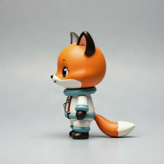 <br><br>
<a href="https://refvid.com/de/mascot-wave-hello"><b>▶ Clip ansehen und mit deinen Fotos erstellen</b></a>
</p>
<br clear="left">

```text
[1] steht auf einem hellen, sauberen Schreibtisch vor einem sanften Hintergrund in Pastelltönen, blickt in die Kamera, winkt mit einem Arm und sagt mit fröhlicher kleiner Stimme: "Hi there, welcome in!" Sanfte Kamerafahrt auf das Motiv zu.
```

<details><summary>Welche Fotos am besten funktionieren</summary><br>Dein Maskottchen winkt mit einem Arm und schaut in die Kamera, also fotografiere es aufrecht stehend von vorn, mit beiden Armen und dem Gesicht ganz im Bild; eine Rücken- oder Seitenansicht hilft, dass seine Form in Bewegung hält.<br><br><sub>Mit RefVid auf Kling 3.0 Omni erstellt, aus 4 Referenzfotos von Pip (ein KI-generiertes Motiv), mit dem Prompt dieser Vorlage.</sub></details>

### Plüschtier-Abenteuer

<p>
<a href="https://refvid.com/de/plush-adventure">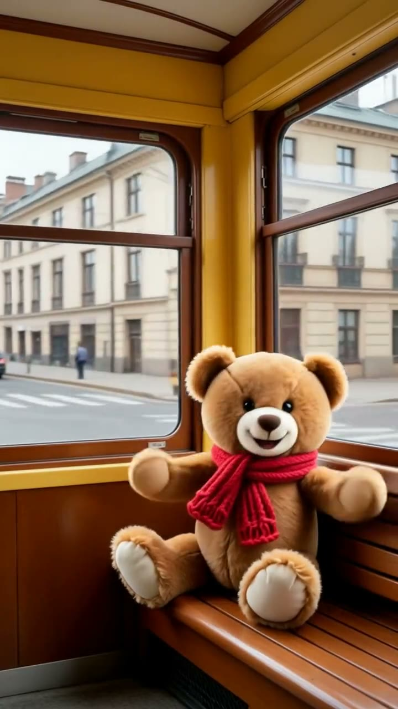</a>
<b>Modell</b>&nbsp; Kling 3.0 Omni<br>
<b>Clip</b>&nbsp; 10 s · 9:16 · ohne Ton<br>
<b>Motive</b>&nbsp; <code>[1]</code> dein Plüschtier<br><br>
<b>Referenzfotos</b><br>   <br><br>
<a href="https://refvid.com/de/plush-adventure"><b>▶ Clip ansehen und mit deinen Fotos erstellen</b></a>
</p>
<br clear="left">

```text
Einstellung 1: Stop-Motion-Look: [1] sitzt auf einer Holzbank in einer alten gelben Straßenbahn am Fenster, draußen zieht die Straße vorbei, Morgenlicht.
Einstellung 2: [1] sitzt an einem winzigen Cafétisch neben einer Tasse Kakao mit Schlagsahne und dreht den Kopf zur Kamera.
Einstellung 3: [1] sitzt auf einem Steingeländer einer Brücke und schaut einem Sonnenuntergang über dem Fluss zu, hinter ihm gehen die Lichter der Stadt an.
```

<details><summary>Welche Fotos am besten funktionieren</summary><br>Dein Kuscheltier sitzt an allen drei Orten, in der Tram von der Seite und auf der Brücke von hinten gesehen, also fotografiere es sitzend von vorn, von der Seite und von hinten; lass Schal, Schleife oder Aufnäher dran, damit diese Details mitreisen.<br><br><sub>Mit RefVid auf Kling 3.0 Omni erstellt, aus 4 Referenzfotos von Bobo (ein KI-generiertes Motiv), mit dem Prompt dieser Vorlage.</sub></details>

### Spielzeug wird lebendig

<p>
<a href="https://refvid.com/de/toy-comes-alive"></a>
<b>Modell</b>&nbsp; Kling 3.0 Omni<br>
<b>Clip</b>&nbsp; 5 s · 9:16 · ohne Ton<br>
<b>Motive</b>&nbsp; <code>[1]</code> dein Figürchen<br><br>
<b>Referenzfotos</b><br>   <br><br>
<a href="https://refvid.com/de/toy-comes-alive"><b>▶ Clip ansehen und mit deinen Fotos erstellen</b></a>
</p>
<br clear="left">

```text
Einstellung 1: [1] steht völlig still auf einem Holzschreibtisch neben einem Stiftebecher und einem Notizbuch im weichen Morgenlicht, wie ein Spielzeug in einer Vitrine. Nahaufnahme auf Augenhöhe des Spielzeugs.
Einstellung 2: [1] erwacht zum Leben: Es blinzelt, schaut neugierig umher und macht dann ein paar kleine, wackelige Schritte auf die Kamera zu und winkt. Es ist immer noch dasselbe kleine bemalte Spielzeug, mit gleichem Material und gleichen Farben. Geringe Schärfentiefe.
```

<details><summary>Welche Fotos am besten funktionieren</summary><br>Die Figur blinzelt, schaut sich um und läuft auf eine Kamera auf ihrer Augenhöhe zu, also fotografiere sie auch auf dieser Höhe: Gesicht und Augen gerade von vorn, dazu Füße oder Sockel, damit die ersten Schritte Form und Bemalung behalten.<br><br><sub>Mit RefVid auf Kling 3.0 Omni aus 4 Referenzfotos von Pip (ein KI-generiertes Motiv) erstellt, mit dem Prompt dieser Vorlage.</sub></details>

[↑ Zurück zum Inhalt](#inhalt)

## Eigene Prompts schreiben

1. **Benenne das Motiv über seine Fotos, nicht über eine Beschreibung.** Schreib `[1]`, wo das Motiv vorkommt, und lass die Referenzfotos Gesicht, Fell oder Produkt tragen; eine zusätzliche Beschreibung arbeitet gegen die Fotos.
2. **Zwei oder drei Einstellungen, je eine Handlung.** Sag, wo die Kamera ist (weit, nah, mitfahrend, von hinten), und eine Sache, die passiert.
3. **Die Fotos entscheiden über die Konsistenz.** 3–4 scharfe Fotos aus verschiedenen Winkeln, ein Motiv pro Satz, schlichter Hintergrund bei Produkten.
4. **Ende mit einem Bild, das man behalten will.** Die letzte Einstellung ist die, die Leute als Screenshot teilen.

Mehr dazu: [RefVid-Tutorials](https://refvid.com/de/tutorials).

## Lizenz

Prompts, Texte, Referenzfotos und Clips: [CC BY 4.0](LICENSE) – für alles nutzbar, mit Nennung „RefVid (refvid.com)“. Personen, Tiere und Produkte auf den Referenzfotos sind KI-generiert; keine echte Person und kein Kundenprodukt.

Beiträge willkommen: Eröffne ein Issue mit Prompt, verwendetem Modell und Ergebnis.

## Star-Verlauf

[](https://star-history.com/#refvid/awesome-reference-to-video-prompts&Date)
