[](README.md) [](README_de-DE.md) [](README_fr-FR.md) [](README_es-ES.md) [](README_pt-BR.md) [](README_ja-JP.md) [](README_ko-KR.md)

---

# Awesome Reference-to-Video Prompts

[](https://awesome.re) [](https://github.com/refvid/awesome-reference-to-video-prompts) [](LICENSE) [](#contenido)

71 prompts probados para vídeos con IA que mantienen **el mismo personaje, mascota o producto en cada plano**. Cada entrada incluye el prompt, las fotos de referencia usadas, el clip final y los ajustes, y cada clip se generó de verdad con ese prompt exacto.

Reference-to-video significa que le das al modelo unas fotos de tu sujeto y mantiene esa cara, ese pelaje o ese producto igual en todo el clip. Estos prompts funcionan con Kling 4, Kling 3.0 Omni, Seedance, Wan, Vidu y otros modelos reference-to-video; `[1]`, `[2]` son el primer y el segundo grupo de fotos de referencia.

Hecho por [RefVid](https://refvid.com/es): cada prompt es también una plantilla lista allí; añade tus fotos y genera. Lista legible por máquina: [`prompts.json`](prompts.json). Skill de agente para Claude Code / Codex: [`skills/reference-to-video-prompts`](skills/reference-to-video-prompts/SKILL.md).

## Ver todos los clips

GitHub solo muestra imágenes fijas. Todos los clips se reproducen en la [galería de plantillas de RefVid](https://refvid.com/es/templates), donde cada prompt se abre listo para usar con tus propias fotos.

## Contenido

<details><summary><b>Productos</b> (26)</summary>

- [Conducción de cine](#conducción-de-cine)
- [Anuncio de comida](#anuncio-de-comida)
- [Bolso por la calle](#bolso-por-la-calle)
- [Bebida helada](#bebida-helada)
- [Joya en la mano](#joya-en-la-mano)
- [Joya brillante](#joya-brillante)
- [Swatch de labial](#swatch-de-labial)
- [Revelación de perfume](#revelación-de-perfume)
- [Producto 360°](#producto-360)
- [Valla publicitaria 3D](#valla-publicitaria-3d)
- [Black Friday](#black-friday)
- [Bullet time](#bullet-time)
- [Regalo de Navidad](#regalo-de-navidad)
- [Flat lay](#flat-lay)
- [Producto flotante](#producto-flotante)
- [Revelación de producto](#revelación-de-producto)
- [Anuncio UGC](#anuncio-ugc)
- [Ingredientes al vuelo](#ingredientes-al-vuelo)
- [Estilo de vida en casa](#estilo-de-vida-en-casa)
- [Lluvia de pétalos](#lluvia-de-pétalos)
- [Unboxing](#unboxing)
- [Salpicadura de agua](#salpicadura-de-agua)
- [Textura de skincare](#textura-de-skincare)
- [Anuncio de zapatillas](#anuncio-de-zapatillas)
- [Revelación tecnológica](#revelación-tecnológica)
- [Reloj en macro](#reloj-en-macro)

</details>

<details><summary><b>Personas</b> (24)</summary>

- [Viaje por carretera](#viaje-por-carretera)
- [Feliz cumpleaños](#feliz-cumpleaños)
- [Programa de cocina](#programa-de-cocina)
- [Mercadillo navideño](#mercadillo-navideño)
- [Felicitación navideña](#felicitación-navideña)
- [Atardecer en la playa](#atardecer-en-la-playa)
- [Lookbook de moda](#lookbook-de-moda)
- [Entrenador fitness](#entrenador-fitness)
- [Fantasma de sábana](#fantasma-de-sábana)
- [Prueba de disfraces](#prueba-de-disfraces)
- [Cabeza de calabaza](#cabeza-de-calabaza)
- [Flash Y2K](#flash-y2k)
- [Marcha zombi](#marcha-zombi)
- [Presentación en vídeo](#presentación-en-vídeo)
- [Minidrama](#minidrama)
- [Rutina matutina](#rutina-matutina)
- [Cuenta atrás](#cuenta-atrás)
- [Presentador de pódcast](#presentador-de-pódcast)
- [Dúo de rap](#dúo-de-rap)
- [Aterrizaje de superhéroe](#aterrizaje-de-superhéroe)
- [Anuncio a cámara](#anuncio-a-cámara)
- [Brindis de Thanksgiving](#brindis-de-thanksgiving)
- [Vlog de viaje](#vlog-de-viaje)
- [Save the date](#save-the-date)

</details>

<details><summary><b>Mascotas</b> (14)</summary>

- [Rap perruno](#rap-perruno)
- [Atardecer con tu mascota](#atardecer-con-tu-mascota)
- [Mascota astronauta](#mascota-astronauta)
- [Cumpleaños de mascota](#cumpleaños-de-mascota)
- [Mascota chef](#mascota-chef)
- [Navidad con tu mascota](#navidad-con-tu-mascota)
- [Mascota que cobra vida](#mascota-que-cobra-vida)
- [Retrato familiar](#retrato-familiar)
- [Disfraz de mascota](#disfraz-de-mascota)
- [Homenaje a tu mascota](#homenaje-a-tu-mascota)
- [Mascota presentadora](#mascota-presentadora)
- [Mascota portaanillos](#mascota-portaanillos)
- [Pasarela de mascota](#pasarela-de-mascota)
- [Mascota bajo el agua](#mascota-bajo-el-agua)

</details>

<details><summary><b>Objetos y personajes</b> (7)</summary>

- [Plastilina](#plastilina)
- [Muestra de ganchillo](#muestra-de-ganchillo)
- [Diorama en miniatura](#diorama-en-miniatura)
- [Figura 360°](#figura-360)
- [Saludo de mascota](#saludo-de-mascota)
- [Aventura de peluche](#aventura-de-peluche)
- [Juguete que cobra vida](#juguete-que-cobra-vida)

</details>

- [Cómo escribir los tuyos](#cómo-escribir-los-tuyos)
- [Licencia](#licencia)
- [Historial de estrellas](#historial-de-estrellas)

## Productos

Anuncios y presentaciones a partir de fotos de un producto.

### Conducción de cine

<p>
<a href="https://refvid.com/es/car-cinematic-drive"></a>
<b>Modelo</b>&nbsp; Kling 3.0 Omni<br>
<b>Clip</b>&nbsp; 5 s · 16:9 · sin sonido<br>
<b>Sujetos</b>&nbsp; <code>[1]</code> tu auto<br><br>
<b>Fotos de referencia</b><br>   <br><br>
<a href="https://refvid.com/es/car-cinematic-drive"><b>▶ Ver el clip y hacerlo con tus fotos</b></a>
</p>
<br clear="left">

```text
Plano 1: Plano de seguimiento bajo junto a [1] mientras avanza por una carretera costera sinuosa al atardecer, con el mar y los acantilados detrás, y la luz del sol reflejándose en la pintura.
Plano 2: [1] pasa despacio muy cerca de la cámara por la misma carretera, con la luz cálida recorriendo la carrocería de delante a atrás, y luego sigue hacia la puesta de sol.
```

<details><summary>Qué fotos funcionan mejor</summary><br>La cámara sigue tu auto de lado y luego lo deja pasar muy cerca, así que lo que más importa es un perfil lateral completo con todas las ruedas en el encuadre; añade una vista frontal de tres cuartos para que la parrilla, los faros y el color de la pintura salgan bien.<br><br><sub>Hecho con RefVid en Kling 3.0 Omni a partir de 4 fotos de referencia de VELA (un sujeto creado con IA), con el prompt de esta plantilla.</sub></details>

### Anuncio de comida

<p>
<a href="https://refvid.com/es/food-pour-steam">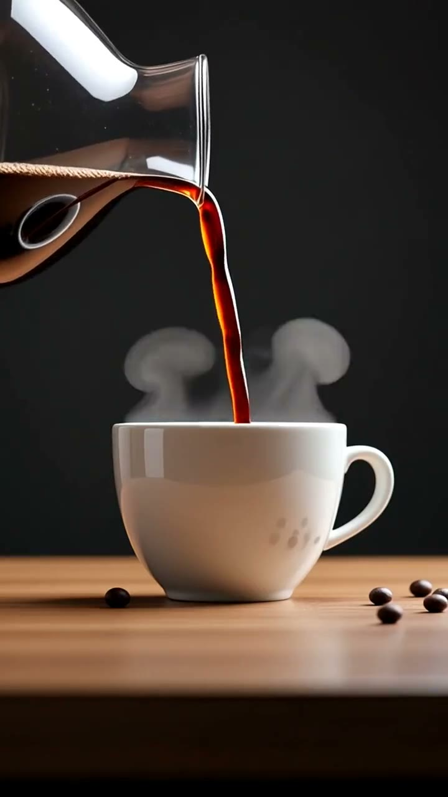</a>
<b>Modelo</b>&nbsp; Kling 3.0 Omni<br>
<b>Clip</b>&nbsp; 5 s · 9:16 · sin sonido<br>
<b>Sujetos</b>&nbsp; <code>[1]</code> tu producto<br><br>
<b>Fotos de referencia</b><br>   <br><br>
<a href="https://refvid.com/es/food-pour-steam"><b>▶ Ver el clip y hacerlo con tus fotos</b></a>
</p>
<br clear="left">

```text
Plano 1: Macro en cámara lenta: la bebida o el plato caliente preparado con [1], brillante y humeante, cae en una taza o un cuenco de cerámica blanca, y el vapor sube en espiral bajo una luz lateral cálida sobre un fondo oscuro.
Plano 2: [1] se sitúa junto a la taza o el cuenco humeante sobre una encimera de madera, con algunos de sus ingredientes esparcidos alrededor, y la cámara avanza lentamente hasta que la etiqueta llena el encuadre.
```

<details><summary>Qué fotos funcionan mejor</summary><br>La cámara termina acercándose hasta que tu etiqueta llena el encuadre, así que lo que más importa es una foto frontal y recta con cada palabra de la etiqueta nítida; añade una vista de lado para que el envase conserve su forma junto a la taza humeante.<br><br><sub>Hecho con RefVid en Kling 3.0 Omni a partir de 4 fotos de referencia de EMBER (un sujeto creado con IA), con una versión anterior del prompt de esta plantilla.</sub></details>

### Bolso por la calle

<p>
<a href="https://refvid.com/es/handbag-street-style"></a>
<b>Modelo</b>&nbsp; Kling 4<br>
<b>Clip</b>&nbsp; 5 s · 9:16 · con sonido<br>
<b>Sujetos</b>&nbsp; <code>[1]</code> tu bolso<br><br>
<b>Fotos de referencia</b><br> <br><br>
<a href="https://refvid.com/es/handbag-street-style"><b>▶ Ver el clip y hacerlo con tus fotos</b></a>
</p>
<br clear="left">

```text
Una mujer con una gabardina color crema camina por una calle soleada de la ciudad con [1] colgado del brazo; la cámara la acompaña a la altura de la cadera para que [1] quede centrado y nítido, balanceándose suavemente a cada paso, con su cara fuera de plano. Luz de hora dorada, poca profundidad de campo, estilo de anuncio de moda.
```

<details><summary>Qué fotos funcionan mejor</summary><br>El bolso se balancea a la altura de la cadera junto a la cámara durante toda la toma, así que se ven el frente y el lateral: fotografía el frente con los herrajes nítidos, el lateral y una vista con el asa o la correa entera.<br><br><sub>Hecho con RefVid en Kling 4 a partir de 2 fotos de referencia de MARA (un sujeto creado con IA), con el prompt de esta plantilla.</sub></details>

### Bebida helada

<p>
<a href="https://refvid.com/es/iced-drink-frost"></a>
<b>Modelo</b>&nbsp; Kling 4<br>
<b>Clip</b>&nbsp; 5 s · 9:16 · con sonido<br>
<b>Sujetos</b>&nbsp; <code>[1]</code> tu bebida<br><br>
<b>Fotos de referencia</b><br> <br><br>
<a href="https://refvid.com/es/iced-drink-frost"><b>▶ Ver el clip y hacerlo con tus fotos</b></a>
</p>
<br clear="left">

```text
[1] está medio enterrado en un lecho de hielo picado; una escarcha blanca sube desde su base por la superficie, un vaho frío se desprende de él y gotas de condensación resbalan despacio junto a la etiqueta. Contraluz azul frío, fondo oscuro, acercamiento lento, detalle macro nítido.
```

<details><summary>Qué fotos funcionan mejor</summary><br>Las gotas de condensación bajan por la etiqueta mientras la cámara se acerca, así que lo que más importa es una foto recta con la etiqueta plana y legible; si la lata o la botella tiene una parte trasera o un tapón distinto, añádelo también para que la escarcha envuelva la forma correcta.<br><br><sub>Hecho con RefVid en Kling 4 a partir de 2 fotos de referencia de SOL (un sujeto creado con IA), con el prompt de esta plantilla.</sub></details>

### Joya en la mano

<p>
<a href="https://refvid.com/es/jewelry-on-hand"></a>
<b>Modelo</b>&nbsp; Kling 4<br>
<b>Clip</b>&nbsp; 5 s · 1:1 · con sonido<br>
<b>Sujetos</b>&nbsp; <code>[1]</code> tu joya<br><br>
<b>Fotos de referencia</b><br>   <br><br>
<a href="https://refvid.com/es/jewelry-on-hand"><b>▶ Ver el clip y hacerlo con tus fotos</b></a>
</p>
<br clear="left">

```text
Primer plano: la mano de una mujer con una manicura natural y suave, que lleva [1], descansa sobre seda color crema y gira despacio hacia la cámara, mientras [1] lanza pequeños destellos con la luz cálida de una ventana. Poca profundidad de campo, acercamiento lento y suave, elegante y natural.
```

<details><summary>Qué fotos funcionan mejor</summary><br>La pieza va puesta en una mano que gira hacia la cámara, así que muéstrala desde el ángulo de quien la lleva, más una vista de lado del aro o la cadena y del engaste; una foto puesta en un dedo o la muñeca ayuda a que el tamaño sea correcto.<br><br><sub>Hecho con RefVid en Kling 4 a partir de 4 fotos de referencia de HALO (un sujeto creado con IA), con el prompt de esta plantilla.</sub></details>

### Joya brillante

<p>
<a href="https://refvid.com/es/jewelry-sparkle"></a>
<b>Modelo</b>&nbsp; Kling 3.0 Omni<br>
<b>Clip</b>&nbsp; 5 s · 1:1 · sin sonido<br>
<b>Sujetos</b>&nbsp; <code>[1]</code> tu pieza<br><br>
<b>Fotos de referencia</b><br>   <br><br>
<a href="https://refvid.com/es/jewelry-sparkle"><b>▶ Ver el clip y hacerlo con tus fotos</b></a>
</p>
<br clear="left">

```text
Toma macro: [1] descansa sobre un terciopelo negro y profundo y gira despacio mientras un haz de luz suave recorre la pieza, que atrapa la luz en destellos y reflejos. Fondo negro intenso, poca profundidad de campo, lujoso.
```

<details><summary>Qué fotos funcionan mejor</summary><br>Un haz de luz recorre la pieza mientras gira sobre terciopelo negro, así que haz fotos de cerca sobre una superficie oscura en las que cada piedra y cada faceta salgan nítidas, y una vista lateral del engaste para que su profundidad se mantenga al girar.<br><br><sub>Hecho con RefVid en Kling 3.0 Omni a partir de 4 fotos de referencia de HALO (un sujeto creado con IA), con una versión anterior del prompt de esta plantilla.</sub></details>

### Swatch de labial

<p>
<a href="https://refvid.com/es/lipstick-swatch"></a>
<b>Modelo</b>&nbsp; Kling 4<br>
<b>Clip</b>&nbsp; 5 s · 9:16 · con sonido<br>
<b>Sujetos</b>&nbsp; <code>[1]</code> tu labial<br><br>
<b>Fotos de referencia</b><br> <br><br>
<a href="https://refvid.com/es/lipstick-swatch"><b>▶ Ver el clip y hacerlo con tus fotos</b></a>
</p>
<br clear="left">

```text
Macro: la barra de [1] se desliza sobre una superficie lisa color crema y deja un único trazo intenso y brillante de su color; luego la cámara sube hasta [1], de pie junto al trazo, con luz de día suave, el color y el estuche en foco nítido. Estilo limpio de anuncio de belleza, poca profundidad de campo.
```

<details><summary>Qué fotos funcionan mejor</summary><br>El macro empieza con la barra deslizándose, así que fotografía el labial destapado, con la punta y el tono real bien nítidos; añade una foto del estuche cerrado y de pie, tal como queda junto al swatch al final.<br><br><sub>Hecho con RefVid en Kling 4 a partir de 2 fotos de referencia de VELOUR (un sujeto creado con IA), con el prompt de esta plantilla.</sub></details>

### Revelación de perfume

<p>
<a href="https://refvid.com/es/perfume-reveal">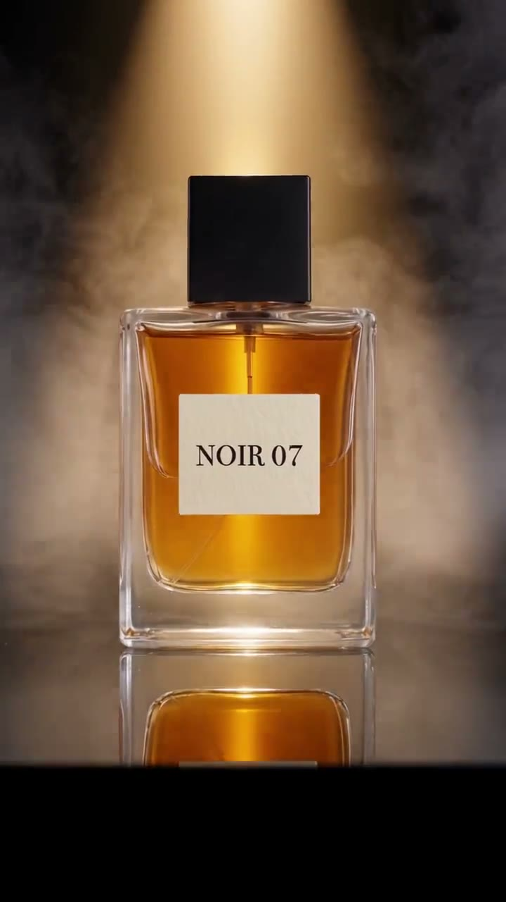</a>
<b>Modelo</b>&nbsp; Kling 4<br>
<b>Clip</b>&nbsp; 5 s · 9:16 · con sonido<br>
<b>Sujetos</b>&nbsp; <code>[1]</code> tu perfume<br><br>
<b>Fotos de referencia</b><br>  <br><br>
<a href="https://refvid.com/es/perfume-reveal"><b>▶ Ver el clip y hacerlo con tus fotos</b></a>
</p>
<br clear="left">

```text
[1] descansa sobre cristal negro brillante envuelto en una bruma suave que flota despacio; un único pulverizado fino de perfume sale de la parte superior y atrapa un contraluz dorado y cálido, luego la bruma se disipa y un haz de luz atraviesa el cristal, para terminar en la etiqueta, nítida y centrada. Clave baja, lujoso, acercamiento lento.
```

<details><summary>Qué fotos funcionan mejor</summary><br>El clip termina con la luz atravesando el cristal hasta la etiqueta centrada, así que fotografía el frasco de frente, con la etiqueta paralela a la cámara y sin reflejos; añade otra sobre fondo claro para que el tapón y el color del líquido se vean bien.<br><br><sub>Hecho con RefVid en Kling 4 a partir de 3 fotos de referencia de NOIR 07 (un sujeto creado con IA), con el prompt de esta plantilla.</sub></details>

### Producto 360°

<p>
<a href="https://refvid.com/es/product-360-turntable"></a>
<b>Modelo</b>&nbsp; Kling 3.0 Omni<br>
<b>Clip</b>&nbsp; 5 s · 1:1 · sin sonido<br>
<b>Sujetos</b>&nbsp; <code>[1]</code> tu producto<br><br>
<b>Fotos de referencia</b><br>  <br><br>
<a href="https://refvid.com/es/product-360-turntable"><b>▶ Ver el clip y hacerlo con tus fotos</b></a>
</p>
<br clear="left">

```text
[1], con el aspecto y las proporciones de las fotos de referencia, está sobre una mesa giratoria de estudio blanca y redonda, fondo gris claro sin costuras, bajo una luz de estudio suave y uniforme, con todo el producto enfocado con nitidez.
```

<details><summary>Qué fotos funcionan mejor</summary><br>Al girar, cada lado mira una vez a la cámara, así que fotografía el producto a la misma altura de frente, por los dos lados y por detrás, sobre un fondo liso; los compradores casi nunca ven la parte trasera, así que inclúyela si lleva etiqueta o algún detalle.<br><br><sub>Hecho con RefVid en Kling 3.0 Omni a partir de 3 fotos de referencia de AERO 1 (un sujeto generado con IA), con el prompt de esta plantilla.</sub></details>

### Valla publicitaria 3D

<p>
<a href="https://refvid.com/es/product-3d-billboard"></a>
<b>Modelo</b>&nbsp; Kling 4<br>
<b>Clip</b>&nbsp; 5 s · 9:16 · con sonido<br>
<b>Sujetos</b>&nbsp; <code>[1]</code> tu producto<br><br>
<b>Fotos de referencia</b><br>   <br><br>
<a href="https://refvid.com/es/product-3d-billboard"><b>▶ Ver el clip y hacerlo con tus fotos</b></a>
</p>
<br clear="left">

```text
Una valla LED 3D curva envuelve la esquina de un edificio alto de la ciudad al anochecer, vista desde la calle: [1], gigante, llena la pantalla, gira despacio y luego parece salir más allá del borde de la pantalla por encima de la calle en perspectiva forzada mientras el tráfico circula abajo. Estilo de anuncio CGI anamórfico, la cámara se inclina despacio hacia arriba, luces de la ciudad.
```

<details><summary>Qué fotos funcionan mejor</summary><br>Tu producto se amplía al tamaño de un edificio y gira antes de salir de la pantalla, así que se nota cualquier desenfoque o mota de polvo: usa fotos muy nítidas y de alta resolución sobre fondo liso, una de frente y otra de tres cuartos para el giro.<br><br><sub>Hecho con RefVid en Kling 4 a partir de 4 fotos de referencia de EMBER (un sujeto creado con IA), con el prompt de esta plantilla.</sub></details>

### Black Friday

<p>
<a href="https://refvid.com/es/product-black-friday"></a>
<b>Modelo</b>&nbsp; Kling 3.0 Omni<br>
<b>Clip</b>&nbsp; 5 s · 9:16 · sin sonido<br>
<b>Sujetos</b>&nbsp; <code>[1]</code> tu producto<br><br>
<b>Fotos de referencia</b><br>  <br><br>
<a href="https://refvid.com/es/product-black-friday"><b>▶ Ver el clip y hacerlo con tus fotos</b></a>
</p>
<br clear="left">

```text
Plano 1: Un plató oscuro iluminado por tubos de neón rosa y azul, con pilas de cajas de regalo negras con cintas de satén; [1] descansa sobre la caja más alta mientras la cámara sube lentamente hacia ella.
Plano 2: Acercamiento lento sobre [1], con reflejos de neón deslizándose por su superficie, la etiqueta nítida y centrada, y confeti brillante cayendo. Brillante, premium, de alto contraste.
```

<details><summary>Qué fotos funcionan mejor</summary><br>La cámara sube hasta tu producto sobre la pila de cajas de regalo y luego se acerca hasta dejar la etiqueta justo en el centro, así que empieza con una foto frontal de la etiqueta, sin reflejos; una vista de arriba y de los lados ayuda a que los reflejos de neón sigan su forma real.<br><br><sub>Hecho con RefVid en Kling 3.0 Omni a partir de 3 fotos de referencia de NOIR 07 (un sujeto creado con IA), con el prompt de esta plantilla.</sub></details>

### Bullet time

<p>
<a href="https://refvid.com/es/product-bullet-time"></a>
<b>Modelo</b>&nbsp; Kling 4<br>
<b>Clip</b>&nbsp; 5 s · 9:16 · con sonido<br>
<b>Sujetos</b>&nbsp; <code>[1]</code> tu producto<br><br>
<b>Fotos de referencia</b><br>  <br><br>
<a href="https://refvid.com/es/product-bullet-time"><b>▶ Ver el clip y hacerlo con tus fotos</b></a>
</p>
<br clear="left">

```text
Bullet time: [1] queda suspendido y congelado en el aire dentro de una explosión de gotas y salpicaduras de agua cristalina, cada gota detenida y totalmente inmóvil, mientras la cámara orbita con suavidad medio círculo a su alrededor y termina con la etiqueta mirando al objetivo. Fondo de degradado suave blanco azulado, luz de estudio brillante, detalle macro nítido.
```

<details><summary>Qué fotos funcionan mejor</summary><br>La cámara da media vuelta alrededor de tu producto y termina en la etiqueta, así que la parte trasera y los lados salen en pantalla: añade fotos de la parte de atrás y de un lado junto a una foto nítida de la etiqueta, sin ninguna mano sujetándolo.<br><br><sub>Hecho con RefVid en Kling 4 a partir de 3 fotos de referencia de LUMEN (un sujeto creado con IA), con el prompt de esta plantilla.</sub></details>

### Regalo de Navidad

<p>
<a href="https://refvid.com/es/product-christmas-gift">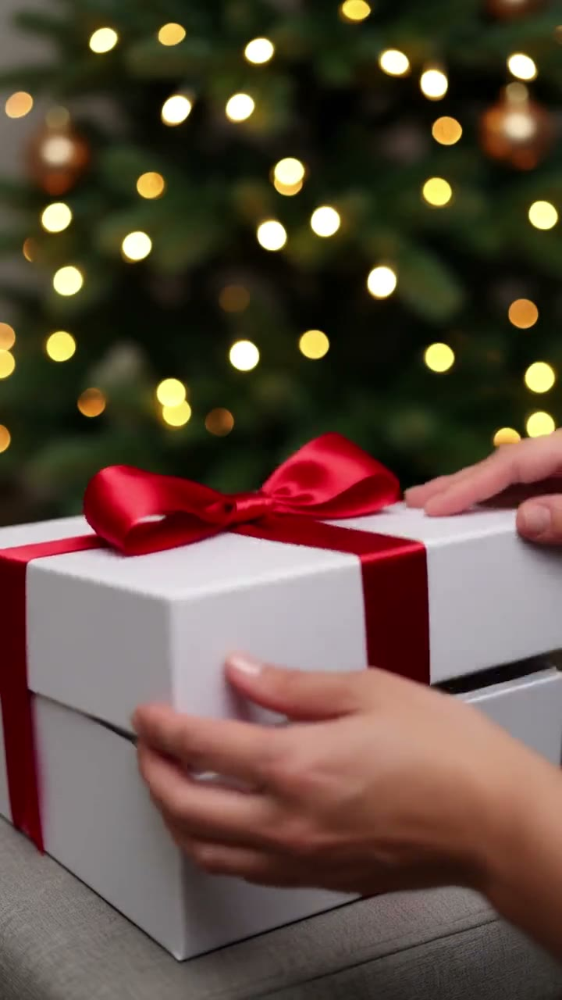</a>
<b>Modelo</b>&nbsp; Kling 3.0 Omni<br>
<b>Clip</b>&nbsp; 5 s · 9:16 · sin sonido<br>
<b>Sujetos</b>&nbsp; <code>[1]</code> tu producto<br><br>
<b>Fotos de referencia</b><br>  <br><br>
<a href="https://refvid.com/es/product-christmas-gift"><b>▶ Ver el clip y hacerlo con tus fotos</b></a>
</p>
<br clear="left">

```text
Plano 1: Una caja de regalo blanca con un lazo de satén rojo descansa bajo un árbol de Navidad iluminado, con desenfoque cálido de luces de cuento; un par de manos tira del lazo para soltarlo y levanta la tapa.
Plano 2: Mirando dentro de la caja abierta: [1] reposa sobre papel de seda blanco y nítido, con la etiqueta bien definida y mirando a cámara, rodeado de luces doradas que centellean mientras la cámara avanza lentamente.
```

<details><summary>Qué fotos funcionan mejor</summary><br>La segunda toma mira desde arriba dentro de la caja de regalo abierta, donde tu producto descansa sobre papel de seda con la etiqueta hacia arriba, así que incluye una foto tomada un poco desde arriba con la etiqueta legible, y fotografíalo solo para que la caja de regalo sea la única caja del vídeo.<br><br><sub>Hecho con RefVid en Kling 3.0 Omni a partir de 3 fotos de referencia de NOIR 07 (un sujeto creado con IA), con el prompt de esta plantilla.</sub></details>

### Flat lay

<p>
<a href="https://refvid.com/es/product-flat-lay">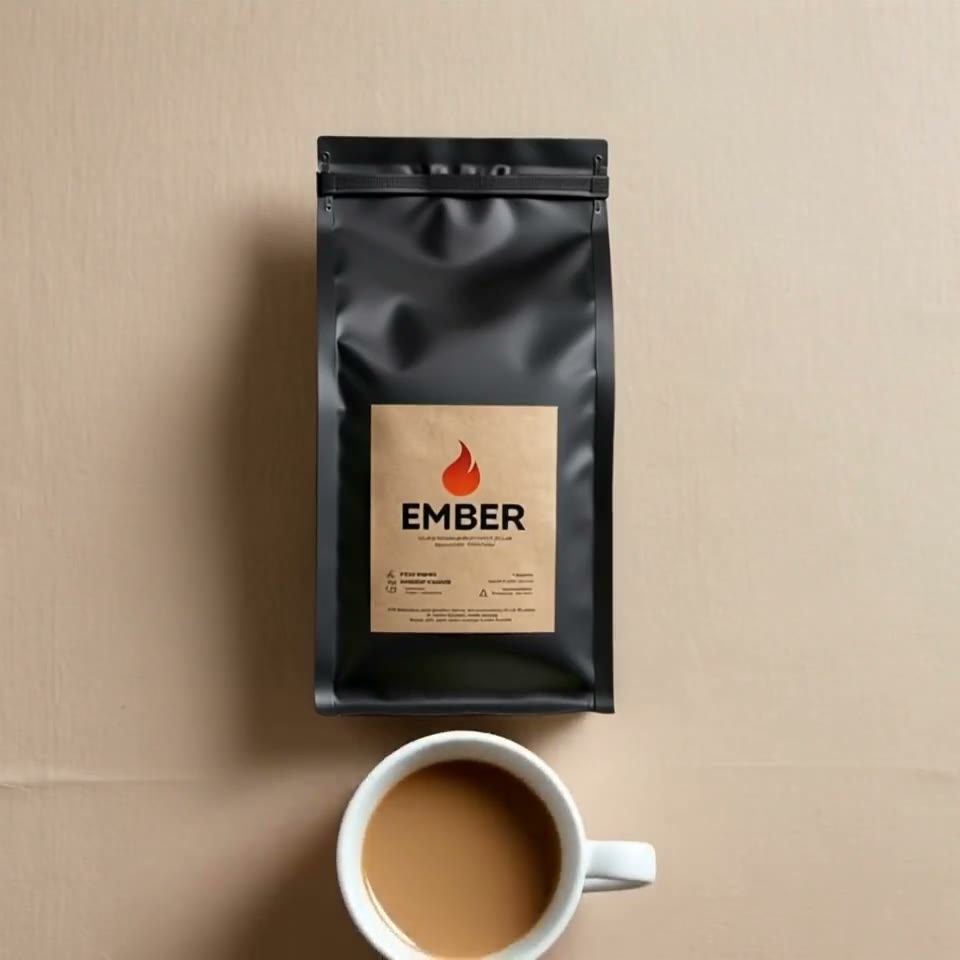</a>
<b>Modelo</b>&nbsp; Kling 3.0 Omni<br>
<b>Clip</b>&nbsp; 5 s · 1:1 · sin sonido<br>
<b>Sujetos</b>&nbsp; <code>[1]</code> tu producto<br><br>
<b>Fotos de referencia</b><br>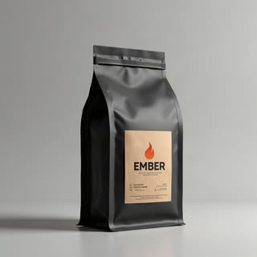   <br><br>
<a href="https://refvid.com/es/product-flat-lay"><b>▶ Ver el clip y hacerlo con tus fotos</b></a>
</p>
<br clear="left">

```text
Flat lay cenital sobre una superficie de lino beige cálido: [1] queda en el centro mientras tres o cuatro pequeños accesorios elegidos para este producto en concreto, objetos cotidianos que sus compradores usan junto a él, en colores que le van bien, entran en el encuadre uno a uno a su alrededor. Luz diurna suave y uniforme.
```

<details><summary>Qué fotos funcionan mejor</summary><br>Todo se graba en picado total, así que la foto clave es tu producto tumbado, tomado justo desde arriba con la etiqueta hacia arriba; una vista lateral ayuda a mantener su grosor y cómo se apoya sobre el lino.<br><br><sub>Hecho con RefVid en Kling 3.0 Omni a partir de 4 fotos de referencia de EMBER (un sujeto creado con IA), con una versión anterior del prompt de esta plantilla.</sub></details>

### Producto flotante

<p>
<a href="https://refvid.com/es/product-floating">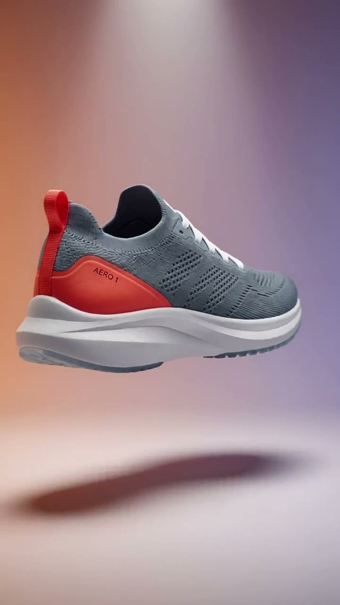</a>
<b>Modelo</b>&nbsp; Kling 4<br>
<b>Clip</b>&nbsp; 5 s · 9:16 · con sonido<br>
<b>Sujetos</b>&nbsp; <code>[1]</code> tu producto<br><br>
<b>Fotos de referencia</b><br>  <br><br>
<a href="https://refvid.com/es/product-floating"><b>▶ Ver el clip y hacerlo con tus fotos</b></a>
</p>
<br clear="left">

```text
[1] flota ingrávido en el aire sobre un fondo de degradado suave de melocotón a lavanda, girando despacio media vuelta mientras sube y baja suavemente, con una sombra redonda y difusa en el suelo. Sin gravedad, luz de estudio brillante y suave, cámara fija, detalle nítido en la etiqueta.
```

<details><summary>Qué fotos funcionan mejor</summary><br>Tu producto da media vuelta mientras flota, así que el clip necesita conocer su parte trasera tanto como la frontal: aporta una foto frontal limpia con la etiqueta y luego la trasera y un lado, mejor sobre fondo liso.<br><br><sub>Hecho con RefVid en Kling 4 a partir de 3 fotos de referencia de AERO 1 (un sujeto creado con IA), con el prompt de esta plantilla.</sub></details>

### Revelación de producto

<p>
<a href="https://refvid.com/es/product-hero-reveal"></a>
<b>Modelo</b>&nbsp; Kling 3.0 Omni<br>
<b>Clip</b>&nbsp; 5 s · 16:9 · sin sonido<br>
<b>Sujetos</b>&nbsp; <code>[1]</code> tu producto<br><br>
<b>Fotos de referencia</b><br>  <br><br>
<a href="https://refvid.com/es/product-hero-reveal"><b>▶ Ver el clip y hacerlo con tus fotos</b></a>
</p>
<br clear="left">

```text
Plano 1: Oscuridad y, después, un haz estrecho de luz cálida que recorre lentamente [1] de pie sobre un pedestal de piedra negra, captando sus bordes y reflejos. Bajo contraste, cinematográfico, con volutas de neblina.
Plano 2: Acercamiento lento sobre [1] mientras la luz se asienta, con la etiqueta nítida y centrada y un fondo negro profundo.
```

<details><summary>Qué fotos funcionan mejor</summary><br>Un haz fino de luz recorre los bordes y el acabado antes de que la cámara se acerque a la etiqueta, así que muestra el material tal como es: una foto frontal con la etiqueta nítida y otra en ángulo donde la luz resalte bordes, brillo o textura.<br><br><sub>Hecho con RefVid en Kling 3.0 Omni a partir de 3 fotos de referencia de NOIR 07 (un sujeto creado con IA), con el prompt de esta plantilla.</sub></details>

### Anuncio UGC

<p>
<a href="https://refvid.com/es/product-in-hand-ugc"></a>
<b>Modelo</b>&nbsp; Kling 3.0 Omni<br>
<b>Clip</b>&nbsp; 10 s · 9:16 · con sonido<br>
<b>Sujetos</b>&nbsp; <code>[1]</code> el presentador · <code>[2]</code> tu producto<br><br>
<b>Fotos de referencia</b><br>      <br><br>
<a href="https://refvid.com/es/product-in-hand-ugc"><b>▶ Ver el clip y hacerlo con tus fotos</b></a>
</p>
<br clear="left">

```text
Plano 1: Video estilo selfie grabado a mano en una habitación luminosa de casa: [1] sostiene [2] junto a la cara, sonríe a la cámara del celular y dice: "Okay, I have to show you this one."
Plano 2: Primer plano de [2] en la mano de [1], girándolo despacio para que la etiqueta mire a la cámara; después [1] mira de nuevo a la cámara y asiente. Luz natural de día.
```

<details><summary>Qué fotos funcionan mejor</summary><br>El presentador sostiene tu producto junto a su cara y luego lo gira en primer plano, así que aporta una foto frontal clara del presentador y una foto recta de la etiqueta; una imagen del producto en una mano ayuda a acertar con su tamaño.<br><br><sub>Hecho con RefVid en Kling 3.0 Omni a partir de 7 fotos de referencia de Mia y LUMEN (un sujeto creado con IA), con una versión anterior del prompt de esta plantilla.</sub></details>

### Ingredientes al vuelo

<p>
<a href="https://refvid.com/es/product-ingredient-splash"></a>
<b>Modelo</b>&nbsp; Kling 4<br>
<b>Clip</b>&nbsp; 5 s · 9:16 · con sonido<br>
<b>Sujetos</b>&nbsp; <code>[1]</code> tu producto<br><br>
<b>Fotos de referencia</b><br> <br><br>
<a href="https://refvid.com/es/product-ingredient-splash"><b>▶ Ver el clip y hacerlo con tus fotos</b></a>
</p>
<br clear="left">

```text
Cámara lenta: [1] está en el centro sobre un fondo brillante del color principal de su envase mientras sus ingredientes principales, los que nombra su etiqueta, salen disparados desde abajo y giran a su alrededor, con gotas volando a través de la luz; luego caen y [1] queda limpio, con la etiqueta hacia la cámara. Luz de estudio brillante, detalle nítido.
```

<details><summary>Qué fotos funcionan mejor</summary><br>El fondo toma el color principal de tu envase y los ingredientes que saltan son los que lleva impresos, así que la foto clave es el frente con los nombres de los ingredientes legibles y los colores reales, sin poca luz ni dominantes de color.<br><br><sub>Hecho con RefVid en Kling 4 a partir de 2 fotos de referencia de SOL (un sujeto creado con IA), con una versión anterior del prompt de esta plantilla.</sub></details>

### Estilo de vida en casa

<p>
<a href="https://refvid.com/es/product-lifestyle-home"></a>
<b>Modelo</b>&nbsp; Kling 3.0 Omni<br>
<b>Clip</b>&nbsp; 5 s · 16:9 · sin sonido<br>
<b>Sujetos</b>&nbsp; <code>[1]</code> tu producto<br><br>
<b>Fotos de referencia</b><br>  <br><br>
<a href="https://refvid.com/es/product-lifestyle-home"><b>▶ Ver el clip y hacerlo con tus fotos</b></a>
</p>
<br clear="left">

```text
Plano 1: Un dormitorio sereno y bañado por el sol: la cámara se desliza despacio junto a cortinas de lino y una planta en maceta hacia [1], colocado sobre una cómoda de madera junto a la ventana.
Plano 2: La cámara se detiene en [1], con la etiqueta nítida, luz suave de la mañana y sombras delicadas de hojas que se mueven sobre él.
```

<details><summary>Qué fotos funcionan mejor</summary><br>La cámara cruza un dormitorio y se detiene en tu producto de pie sobre una cómoda, así que usa una foto de él en vertical, a la altura de los ojos, con la etiqueta hacia fuera; las fotos con luz de día suave ayudan a que encaje en la luz de la mañana.<br><br><sub>Hecho con RefVid en Kling 3.0 Omni a partir de 3 fotos de referencia de NOIR 07 (un sujeto creado con IA), usando el prompt de esta plantilla.</sub></details>

### Lluvia de pétalos

<p>
<a href="https://refvid.com/es/product-petal-fall"></a>
<b>Modelo</b>&nbsp; Kling 4<br>
<b>Clip</b>&nbsp; 5 s · 9:16 · con sonido<br>
<b>Sujetos</b>&nbsp; <code>[1]</code> tu producto<br><br>
<b>Fotos de referencia</b><br>  <br><br>
<a href="https://refvid.com/es/product-petal-fall"><b>▶ Ver el clip y hacerlo con tus fotos</b></a>
</p>
<br clear="left">

```text
Cámara lenta: suaves pétalos de rosa caen a través de una luz cálida alrededor de [1], que descansa sobre un pedestal de piedra clara contra un fondo rosa empolvado; algunos pétalos se posan a su lado mientras la cámara se acerca con suavidad hasta que la etiqueta llena el encuadre. Fondo onírico y desenfocado, estilo de anuncio de belleza.
```

<details><summary>Qué fotos funcionan mejor</summary><br>La cámara se acerca hasta que la etiqueta llena todo el encuadre, así que la foto de la etiqueta tiene que aguantar de cerca, con la letra pequeña y el acabado visibles; añade una vista completa de pie, tal como estará sobre el pedestal de piedra.<br><br><sub>Hecho con RefVid en Kling 4 a partir de 3 fotos de referencia de LUMEN (un sujeto creado con IA), con el prompt de esta plantilla.</sub></details>

### Unboxing

<p>
<a href="https://refvid.com/es/product-unboxing"></a>
<b>Modelo</b>&nbsp; Kling 3.0 Omni<br>
<b>Clip</b>&nbsp; 10 s · 9:16 · con sonido<br>
<b>Sujetos</b>&nbsp; <code>[1]</code> tu producto<br><br>
<b>Fotos de referencia</b><br>  <br><br>
<a href="https://refvid.com/es/product-unboxing"><b>▶ Ver el clip y hacerlo con tus fotos</b></a>
</p>
<br clear="left">

```text
Plano 1: Plano cenital de una caja sencilla de cartón kraft sobre una mesa de madera clara con luz suave de día; dos manos levantan la tapa y apartan el papel de seda blanco. Crujido de papel.
Plano 2: Primer plano de cómo las manos sacan [1] de la caja y lo sostienen en alto, girándolo despacio para que la etiqueta mire a la cámara.
Plano 3: [1] está de pie sobre la mesa, junto a la caja abierta, mientras la cámara avanza suavemente hacia él. Limpio, luminoso, con poca profundidad de campo.
```

<details><summary>Qué fotos funcionan mejor</summary><br>Unas manos sacan tu producto de una caja de kraft y lo giran hacia la cámara, así que muestra cada cara que aparece en el giro: la etiqueta frontal, la parte trasera y la base, cada una fotografiada sola, fuera de cualquier caja.<br><br><sub>Creado con RefVid en Kling 3.0 Omni a partir de 3 fotos de referencia de LUMEN (un sujeto generado con IA), con el prompt de esta plantilla.</sub></details>

### Salpicadura de agua

<p>
<a href="https://refvid.com/es/product-water-splash"></a>
<b>Modelo</b>&nbsp; Kling 3.0 Omni<br>
<b>Clip</b>&nbsp; 5 s · 9:16 · sin sonido<br>
<b>Sujetos</b>&nbsp; <code>[1]</code> tu producto<br><br>
<b>Fotos de referencia</b><br>  <br><br>
<a href="https://refvid.com/es/product-water-splash"><b>▶ Ver el clip y hacerlo con tus fotos</b></a>
</p>
<br clear="left">

```text
Cámara lenta: [1] cae en un tanque de agua cristalina sobre un fondo de degradado azul suave, con una explosión de burbujas y gotas a su alrededor, y luego se posa erguido con la etiqueta mirando a cámara. Luz de estudio brillante, detalle macro.
```

<details><summary>Qué fotos funcionan mejor</summary><br>Tu producto se hunde en el agua y queda de pie, así que necesita una vista completa en vertical, del tapón a la base, con la etiqueta de frente; descarta las fotos en las que brillos o reflejos tapen el texto.<br><br><sub>Hecho con RefVid en Kling 3.0 Omni a partir de 3 fotos de referencia de LUMEN (un sujeto creado con IA), con el prompt de esta plantilla.</sub></details>

### Textura de skincare

<p>
<a href="https://refvid.com/es/skincare-texture-macro"></a>
<b>Modelo</b>&nbsp; Kling 3.0 Omni<br>
<b>Clip</b>&nbsp; 5 s · 9:16 · sin sonido<br>
<b>Sujetos</b>&nbsp; <code>[1]</code> tu producto<br><br>
<b>Fotos de referencia</b><br>  <br><br>
<a href="https://refvid.com/es/skincare-texture-macro"><b>▶ Ver el clip y hacerlo con tus fotos</b></a>
</p>
<br clear="left">

```text
Plano 1: Macro extrema: una sola porción brillante de la fórmula de [1], con su propio color y textura, cae sobre una superficie lisa de piedra clara y se asienta despacio. Luz de día suave, fondo cremoso.
Plano 2: [1] se coloca sobre la piedra clara junto a unos trozos de su ingrediente principal, el que nombra su etiqueta, bajo una luz suave de ventana por la mañana, la cámara avanza lentamente hasta que la etiqueta llena el encuadre.
```

<details><summary>Qué fotos funcionan mejor</summary><br>La primera toma es la propia fórmula, así que añade una foto de una muestra o un toque de producto con su color y textura reales, y luego una foto frontal nítida del tarro, el tubo o el frasco, porque la cámara termina con la etiqueta llenando el encuadre.<br><br><sub>Hecho con RefVid en Kling 3.0 Omni a partir de 3 fotos de referencia de LUMEN (un sujeto creado con IA), con una versión anterior del prompt de esta plantilla.</sub></details>

### Anuncio de zapatillas

<p>
<a href="https://refvid.com/es/sneaker-street-walk"></a>
<b>Modelo</b>&nbsp; Kling 3.0 Omni<br>
<b>Clip</b>&nbsp; 5 s · 9:16 · sin sonido<br>
<b>Sujetos</b>&nbsp; <code>[1]</code> tus zapatillas<br><br>
<b>Fotos de referencia</b><br>  <br><br>
<a href="https://refvid.com/es/sneaker-street-walk"><b>▶ Ver el clip y hacerlo con tus fotos</b></a>
</p>
<br clear="left">

```text
Plano 1: Cámara baja a la altura del tobillo siguiendo a un par de pies calzados con [1] mientras caminan con paso rápido por una acera soleada de la ciudad, con sombras de transeúntes y poca profundidad de campo.
Plano 2: Primer plano de [1] apoyándose a mitad de paso sobre el pavimento, con un poco de polvo levantándose, mientras la cámara frena hasta detenerse junto a ellas.
```

<details><summary>Qué fotos funcionan mejor</summary><br>La cámara baja sigue las zapatillas de lado y luego capta una al apoyarse en primer plano, así que lo más importante es el perfil exterior con el canto de la suela; una foto del par puesto ayuda a que la pisada y el ajuste se vean naturales.<br><br><sub>Hecho con RefVid en Kling 3.0 Omni a partir de 3 fotos de referencia de AERO 1 (un sujeto creado con IA), con el prompt de esta plantilla.</sub></details>

### Revelación tecnológica

<p>
<a href="https://refvid.com/es/tech-gadget-reveal"></a>
<b>Modelo</b>&nbsp; Kling 4<br>
<b>Clip</b>&nbsp; 5 s · 16:9 · con sonido<br>
<b>Sujetos</b>&nbsp; <code>[1]</code> tu dispositivo<br><br>
<b>Fotos de referencia</b><br> <br><br>
<a href="https://refvid.com/es/tech-gadget-reveal"><b>▶ Ver el clip y hacerlo con tus fotos</b></a>
</p>
<br clear="left">

```text
[1] descansa sobre una superficie negra mate casi a oscuras; una fina línea de luz azul fría recorre sus bordes, luego la luz se abre y la cámara traza un arco lento a su alrededor, captando reflejos limpios en su superficie, hasta terminar de frente con cada detalle nítido. Estilo elegante de lanzamiento tecnológico, fondo negro profundo, bruma sutil.
```

<details><summary>Qué fotos funcionan mejor</summary><br>Primero la luz dibuja el contorno y luego la cámara traza un arco hasta quedar de frente, así que aporta una foto frontal bien recta con la pantalla o el logo visibles y otra en ángulo que muestre bordes, puertos y acabado de la carcasa.<br><br><sub>Hecho con RefVid en Kling 4 a partir de 2 fotos de referencia de PULSE (un sujeto creado con IA), con el prompt de esta plantilla.</sub></details>

### Reloj en macro

<p>
<a href="https://refvid.com/es/watch-macro"></a>
<b>Modelo</b>&nbsp; Kling 4<br>
<b>Clip</b>&nbsp; 5 s · 1:1 · con sonido<br>
<b>Sujetos</b>&nbsp; <code>[1]</code> tu reloj<br><br>
<b>Fotos de referencia</b><br> 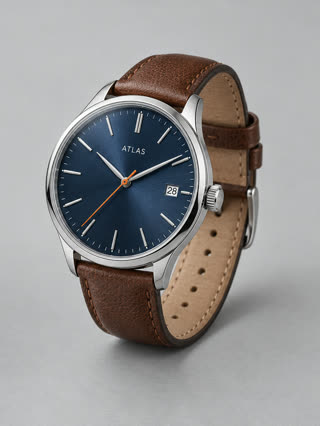<br><br>
<a href="https://refvid.com/es/watch-macro"><b>▶ Ver el clip y hacerlo con tus fotos</b></a>
</p>
<br clear="left">

```text
Macro extremo de [1]: la cámara recorre despacio la esfera mientras el segundero avanza, la luz se desliza sobre la caja pulida y los índices horarios, y luego se aleja para mostrar el reloj entero sobre cuero oscuro. Luz cálida en clave baja, poca profundidad de campo, detalle lujoso.
```

<details><summary>Qué fotos funcionan mejor</summary><br>La cámara empieza en un primerísimo plano de la esfera, así que abre con una vista superior nítida y sin reflejos en la que se lean índices, agujas y logo; añade una vista lateral de la caja y la corona, y otra con la correa extendida.<br><br><sub>Hecho con RefVid en Kling 4 a partir de 2 fotos de referencia de ATLAS (un sujeto creado con IA), con el prompt de esta plantilla.</sub></details>

[↑ Volver al contenido](#contenido)

## Personas

Tú, un amigo o una pareja en cada plano, a partir de unas fotos de cada cara.

### Viaje por carretera

<p>
<a href="https://refvid.com/es/best-friends-road-trip"></a>
<b>Modelo</b>&nbsp; Kling 3.0 Omni<br>
<b>Clip</b>&nbsp; 10 s · 16:9 · con sonido<br>
<b>Sujetos</b>&nbsp; <code>[1]</code> tú · <code>[2]</code> tu amigo<br><br>
<b>Fotos de referencia</b><br>       <br><br>
<a href="https://refvid.com/es/best-friends-road-trip"><b>▶ Ver el clip y hacerlo con tus fotos</b></a>
</p>
<br clear="left">

```text
Plano 1: Un descapotable antiguo recorre una carretera costera soleada; [1] al volante y [2] en el asiento del copiloto ríen, con el pelo al viento. Plano general de seguimiento.
Plano 2: Plano cerrado de dos personas dentro del auto: [2] canta a voz en grito mientras [1] se ríe y niega con la cabeza. Ruido del viento, luz cálida.
Plano 3: El auto estacionado en un mirador sobre el acantilado al atardecer, [1] y [2] sentados sobre el capó vistos de espaldas, mirando el mar.
```

<details><summary>Qué fotos funcionan mejor</summary><br>Van sentados uno al lado del otro adelante y terminan vistos de espaldas sobre el capó, así que añade para cada uno una foto nítida de frente, otra de tres cuartos y otra donde se vean bien el pelo y la complexión.<br><br><sub>Hecho con RefVid en Kling 3.0 Omni a partir de 8 fotos de referencia de Mia y Leo (un sujeto creado con IA), con el prompt de esta plantilla.</sub></details>

### Feliz cumpleaños

<p>
<a href="https://refvid.com/es/birthday-greeting">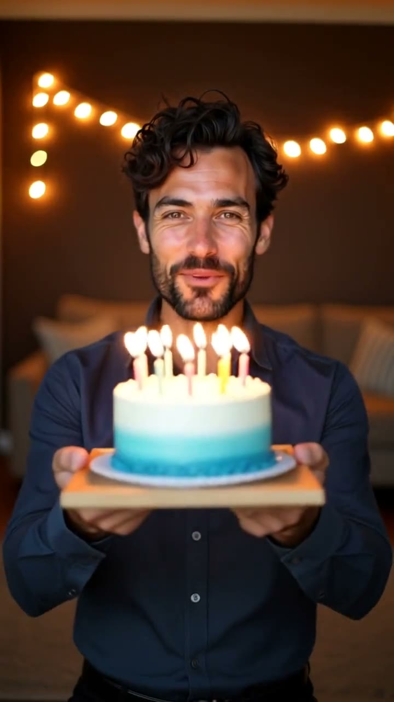</a>
<b>Modelo</b>&nbsp; Kling 3.0 Omni<br>
<b>Clip</b>&nbsp; 5 s · 9:16 · con sonido<br>
<b>Sujetos</b>&nbsp; <code>[1]</code> tú<br><br>
<b>Fotos de referencia</b><br>   <br><br>
<a href="https://refvid.com/es/birthday-greeting"><b>▶ Ver el clip y hacerlo con tus fotos</b></a>
</p>
<br clear="left">

```text
Primer plano medio de [1] en un acogedor salón, sosteniendo hacia la cámara un pastelito con velas encendidas; luego sonríe y dice con calidez: "Happy birthday! I hope this year is your best one yet." Luz cálida de atardecer, con luces de hadas al fondo.
```

<details><summary>Qué fotos funcionan mejor</summary><br>Es un único plano medio corto en el que hablas detrás de una tarta con velas, así que funciona mejor una foto nítida de frente encuadrada a la altura del pecho; una luz interior cálida ayuda a que tu tono de piel encaje con el brillo de las velas.<br><br><sub>Hecho con RefVid en Kling 3.0 Omni a partir de 4 fotos de referencia de Leo (un sujeto creado con IA), con el prompt de esta plantilla.</sub></details>

### Programa de cocina

<p>
<a href="https://refvid.com/es/chef-cooking-show"></a>
<b>Modelo</b>&nbsp; Kling 3.0 Omni<br>
<b>Clip</b>&nbsp; 10 s · 16:9 · con sonido<br>
<b>Sujetos</b>&nbsp; <code>[1]</code> tú<br><br>
<b>Fotos de referencia</b><br>   <br><br>
<a href="https://refvid.com/es/chef-cooking-show"><b>▶ Ver el clip y hacerlo con tus fotos</b></a>
</p>
<br clear="left">

```text
Plano 1: Una cálida cocina de casa con cacerolas de cobre y hierbas sobre la encimera: [1], con un delantal azul marino, sonríe a la cámara y dice: "Welcome back to Sunday Kitchen. Today: the easiest pasta you’ll ever make."
Plano 2: Primer plano de una sartén en la cocina mientras [1] saltea ajo y tomate en aceite de oliva y sube una llamarada. Sonido de chisporroteo.
Plano 3: [1] coloca frente a la cámara un plato de espaguetis con albahaca fresca y asiente con gesto satisfecho.
```

<details><summary>Qué fotos funcionan mejor</summary><br>Hablas mirando a cámara en la encimera y asientes ante el plato terminado, así que lo que más importa es una foto nítida de frente con una sonrisa natural; otra con el pelo recogido, como cuando cocinas, te mantiene igual frente a los fogones.<br><br><sub>Hecho con RefVid en Kling 3.0 Omni a partir de 4 fotos de referencia de Leo (un sujeto creado con IA), con el prompt de esta plantilla.</sub></details>

### Mercadillo navideño

<p>
<a href="https://refvid.com/es/christmas-market-couple"></a>
<b>Modelo</b>&nbsp; Kling 3.0 Omni<br>
<b>Clip</b>&nbsp; 5 s · 16:9 · sin sonido<br>
<b>Sujetos</b>&nbsp; <code>[1]</code> tú · <code>[2]</code> tu pareja<br><br>
<b>Fotos de referencia</b><br>       <br><br>
<a href="https://refvid.com/es/christmas-market-couple"><b>▶ Ver el clip y hacerlo con tus fotos</b></a>
</p>
<br clear="left">

```text
Plano 1: Anochecer en un mercado de Navidad nevado con puestos de madera y guirnaldas de luces cálidas: [1] y [2] caminan del brazo hacia la cámara, cada uno con una taza humeante de vino caliente, riendo. Cae una nevada suave.
Plano 2: Plano de dos en primer plano: [2] retira un copo de nieve del pelo de [1] y se miran con una sonrisa tranquila, con las luces del mercado brillando suavemente detrás de ellos.
```

<details><summary>Qué fotos funcionan mejor</summary><br>Caminan del brazo hacia la cámara y luego comparten un momento cara a cara, así que cada uno necesita una foto nítida de frente y otra de perfil; que se vea el pelo como lo llevan, porque de él se aparta un copo de nieve.<br><br><sub>Hecho con RefVid en Kling 3.0 Omni a partir de 8 fotos de referencia de Mia y Leo (un sujeto creado con IA), con el prompt de esta plantilla.</sub></details>

### Felicitación navideña

<p>
<a href="https://refvid.com/es/christmas-sweater-greeting"></a>
<b>Modelo</b>&nbsp; Kling 3.0 Omni<br>
<b>Clip</b>&nbsp; 5 s · 9:16 · con sonido<br>
<b>Sujetos</b>&nbsp; <code>[1]</code> tú<br><br>
<b>Fotos de referencia</b><br>   <br><br>
<a href="https://refvid.com/es/christmas-sweater-greeting"><b>▶ Ver el clip y hacerlo con tus fotos</b></a>
</p>
<br clear="left">

```text
Plano 1: Un acogedor salón de noche: un árbol de Navidad iluminado con luces cálidas y una chimenea que crepita con calcetines colgados; [1], con un suéter navideño rojo tejido, se sienta sobre la alfombra sosteniendo una taza de chocolate, mientras la cámara se acerca despacio.
Plano 2: [1] levanta la mirada hacia la cámara con una sonrisa cálida y dice: "Merry Christmas, I miss you all. See you soon!" El fuego crepita suavemente.
```

<details><summary>Qué fotos funcionan mejor</summary><br>Te sientas en la alfombra y miras hacia arriba, a la cámara, para decir tu deseo, así que encaja mejor una foto de frente tomada un poco desde arriba, con la cara en luz suave y cálida; una foto sentado ayuda a que el suéter caiga con naturalidad.<br><br><sub>Hecho con RefVid en Kling 3.0 Omni a partir de 4 fotos de referencia de Mia (un sujeto creado con IA), con el prompt de esta plantilla.</sub></details>

### Atardecer en la playa

<p>
<a href="https://refvid.com/es/couple-beach-sunset"></a>
<b>Modelo</b>&nbsp; Kling 3.0 Omni<br>
<b>Clip</b>&nbsp; 10 s · 16:9 · sin sonido<br>
<b>Sujetos</b>&nbsp; <code>[1]</code> tú · <code>[2]</code> tu pareja<br><br>
<b>Fotos de referencia</b><br>       <br><br>
<a href="https://refvid.com/es/couple-beach-sunset"><b>▶ Ver el clip y hacerlo con tus fotos</b></a>
</p>
<br clear="left">

```text
Plano 1: Plano general a la hora dorada: [1] y [2] caminan descalzos por la orilla de una playa tranquila hacia la cámara, hablando, con olas suaves que les rozan los pies.
Plano 2: Plano medio de [1] y [2] riendo juntos, con el sol bajo y cálido detrás de ellos, el pelo moviéndose con la brisa del mar.
Plano 3: [1] y [2] están de pie, uno al lado del otro, vistos de espaldas, mirando cómo el sol se hunde en el mar. Acercamiento lento, cielo naranja cálido.
```

<details><summary>Qué fotos funcionan mejor</summary><br>En la primera toma caminan hacia la cámara y en la última se les ve de espaldas frente al atardecer, así que añade para cada uno una foto nítida de frente y otra de espaldas con el pelo y los hombros; las fotos de cuerpo entero mantienen bien sus estaturas.<br><br><sub>Hecho con RefVid en Kling 3.0 Omni a partir de 8 fotos de referencia de Mia y Leo (un sujeto creado con IA), con el prompt de esta plantilla.</sub></details>

### Lookbook de moda

<p>
<a href="https://refvid.com/es/fashion-lookbook-walk">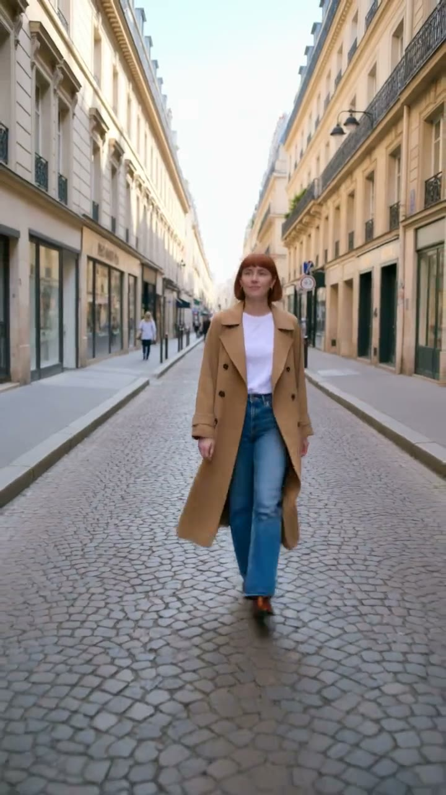</a>
<b>Modelo</b>&nbsp; Kling 3.0 Omni<br>
<b>Clip</b>&nbsp; 10 s · 9:16 · sin sonido<br>
<b>Sujetos</b>&nbsp; <code>[1]</code> tú<br><br>
<b>Fotos de referencia</b><br>   <br><br>
<a href="https://refvid.com/es/fashion-lookbook-walk"><b>▶ Ver el clip y hacerlo con tus fotos</b></a>
</p>
<br clear="left">

```text
Plano 1: Plano general: [1] con un trench color camel sobre una camiseta blanca y pantalón de pierna ancha camina con seguridad hacia la cámara por una tranquila calle lateral de París, con luz suave de la mañana.
Plano 2: Ángulo lateral bajo siguiendo a [1] a mitad de paso, el abrigo se mueve con cada zancada, los escaparates pasan deslizándose.
Plano 3: Primer plano mientras [1] gira el hombro hacia la cámara con una leve sonrisa, el pelo captando la luz.
```

<details><summary>Qué fotos funcionan mejor</summary><br>Las tres tomas te muestran caminando de frente, desde un ángulo lateral bajo y girándote por encima del hombro, así que añade una foto de cuerpo entero de frente, una de lado y otra mirando atrás, la frontal nítida y bien iluminada.<br><br><sub>Hecho con RefVid en Kling 3.0 Omni a partir de 4 fotos de referencia de Mia (un sujeto creado con IA), con el prompt de esta plantilla.</sub></details>

### Entrenador fitness

<p>
<a href="https://refvid.com/es/fitness-coach-demo"></a>
<b>Modelo</b>&nbsp; Kling 3.0 Omni<br>
<b>Clip</b>&nbsp; 5 s · 9:16 · con sonido<br>
<b>Sujetos</b>&nbsp; <code>[1]</code> tú<br><br>
<b>Fotos de referencia</b><br>   <br><br>
<a href="https://refvid.com/es/fitness-coach-demo"><b>▶ Ver el clip y hacerlo con tus fotos</b></a>
</p>
<br clear="left">

```text
Plano 1: Un gimnasio moderno y luminoso con grandes ventanales: [1] con ropa de entrenamiento negra hace una sentadilla lenta con peso corporal vista de perfil, espalda recta, brazos adelante. Ambiente de gimnasio.
Plano 2: [1] se levanta, mira a cámara y dice con una sonrisa animosa: "Push the floor away, and keep your chest up."
```

<details><summary>Qué fotos funcionan mejor</summary><br>La sentadilla se graba de lado antes de que hables de frente, así que añade una vista lateral de cuerpo entero con ropa de entrenar y una foto nítida de tu cara de frente; una foto que muestre tu complexión hace que el movimiento parezca tuyo.<br><br><sub>Hecho con RefVid en Kling 3.0 Omni a partir de 4 fotos de referencia de Leo (un sujeto generado con IA), con el prompt de esta plantilla.</sub></details>

### Fantasma de sábana

<p>
<a href="https://refvid.com/es/halloween-bedsheet-ghost"></a>
<b>Modelo</b>&nbsp; Kling 3.0 Omni<br>
<b>Clip</b>&nbsp; 6 s · 9:16 · sin sonido<br>
<b>Sujetos</b>&nbsp; <code>[1]</code> tú<br><br>
<b>Fotos de referencia</b><br>   <br><br>
<a href="https://refvid.com/es/halloween-bedsheet-ghost"><b>▶ Ver el clip y hacerlo con tus fotos</b></a>
</p>
<br clear="left">

```text
Plano 1: Una figura bajo una sábana blanca lisa con agujeros para los ojos y gafas de sol negras se encuentra en un sendero cubierto de hojas en un parque otoñal a la hora dorada, girándose lentamente hacia la cámara. Cámara en mano, luz cálida, hojas que caen.
Plano 2: La figura se quita la sábana: es [1], sonriendo, con la sábana sobre un brazo y hojas arremolinándose. Plano medio, contraluz dorado y suave.
```

<details><summary>Qué fotos funcionan mejor</summary><br>Solo apareces cuando cae la sábana, sonriendo a contraluz dorado, así que lo que más importa es una foto nítida de frente con el peinado de siempre; una foto de cuerpo entero mantiene bien tu estatura bajo la sábana.<br><br><sub>Hecho con RefVid en Kling 3.0 Omni a partir de 4 fotos de referencia de Mia (un sujeto generado con IA), con el prompt de esta plantilla.</sub></details>

### Prueba de disfraces

<p>
<a href="https://refvid.com/es/halloween-costume-try-on"></a>
<b>Modelo</b>&nbsp; Kling 3.0 Omni<br>
<b>Clip</b>&nbsp; 10 s · 9:16 · sin sonido<br>
<b>Sujetos</b>&nbsp; <code>[1]</code> tú<br><br>
<b>Fotos de referencia</b><br>   <br><br>
<a href="https://refvid.com/es/halloween-costume-try-on"><b>▶ Ver el clip y hacerlo con tus fotos</b></a>
</p>
<br clear="left">

```text
Plano 1: [1] con ropa de todos los días gira una vez frente a un espejo alto de dormitorio y termina mirando a la cámara como un vampiro: cabeza descubierta, una capa negra de cuello alto con forro rojo, colmillos de plástico pequeños, rostro completamente visible. Luces cálidas de hadas, aspecto de cámara de teléfono.
Plano 2: Corte seco: [1] vuelve a girar y la capa desaparece; aparece con un mullido disfraz redondo de calabaza naranja con cuello de tallo verde, cabeza descubierta, riéndose a cámara.
Plano 3: Corte seco: [1] gira una tercera vez y el disfraz de calabaza desaparece; aparece como una bruja con un vestido largo negro y un sombrero puntiagudo negro, guiñándole un ojo a la cámara con picardía.
```

<details><summary>Qué fotos funcionan mejor</summary><br>Ningún disfraz te cubre la cabeza y giras hacia la cámara tres veces, así que añade una foto nítida de frente con toda la cara y el pelo a la vista, y otra de cuerpo entero para que tu figura sea la misma con cada disfraz.<br><br><sub>Hecho con RefVid en Kling 3.0 Omni a partir de 4 fotos de referencia de Mia (un sujeto generado con IA), con el prompt de esta plantilla.</sub></details>

### Cabeza de calabaza

<p>
<a href="https://refvid.com/es/halloween-pumpkin-head">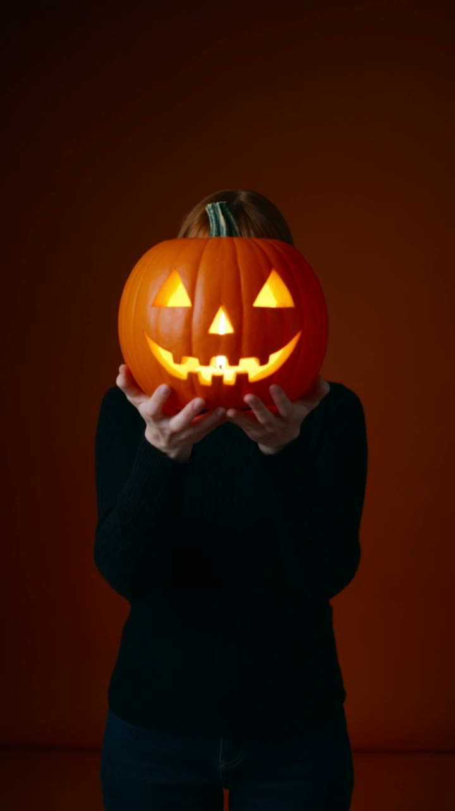</a>
<b>Modelo</b>&nbsp; Kling 3.0 Omni<br>
<b>Clip</b>&nbsp; 6 s · 9:16 · sin sonido<br>
<b>Sujetos</b>&nbsp; <code>[1]</code> tú<br><br>
<b>Fotos de referencia</b><br>   <br><br>
<a href="https://refvid.com/es/halloween-pumpkin-head"><b>▶ Ver el clip y hacerlo con tus fotos</b></a>
</p>
<br clear="left">

```text
Plano 1: En un estudio oscuro con un fondo naranja profundo, una persona con cuello alto negro sostiene frente a su cara una calabaza tallada brillante, con la vela parpadeando dentro. Acercamiento lento, luz tenue y dramática.
Plano 2: [1] baja la calabaza a la altura del pecho y mira directamente a cámara con una leve sonrisa, el brillo de la vela iluminando el rostro desde abajo. Primer plano, cinematográfico.
```

<details><summary>Qué fotos funcionan mejor</summary><br>Tu cara solo aparece al final, en un primer plano iluminado desde abajo por la vela, así que lo que más importa es una foto nítida y recta de frente, sin gorro ni gafas de sol; una mirada tranquila o una leve sonrisa encajan con la toma.<br><br><sub>Hecho con RefVid en Kling 3.0 Omni a partir de 4 fotos de referencia de Mia (un sujeto creado con IA), con el prompt de esta plantilla.</sub></details>

### Flash Y2K

<p>
<a href="https://refvid.com/es/halloween-y2k-flash"></a>
<b>Modelo</b>&nbsp; Kling 3.0 Omni<br>
<b>Clip</b>&nbsp; 5 s · 9:16 · sin sonido<br>
<b>Sujetos</b>&nbsp; <code>[1]</code> tú<br><br>
<b>Fotos de referencia</b><br>   <br><br>
<a href="https://refvid.com/es/halloween-y2k-flash"><b>▶ Ver el clip y hacerlo con tus fotos</b></a>
</p>
<br clear="left">

```text
El look de una foto de fiesta de cámara desechable de 2004: una fiesta nocturna de Halloween en casa, luz de flash directo y brillante, piel ligeramente sobreexpuesta, una sombra dura en la pared de atrás, mucho grano de película, luces de guirnalda al fondo. [1] con orejas de gato negras está junto a la puerta sosteniendo un vaso rojo de papel, se gira hacia la cámara, se ríe y levanta el signo de la paz. Sin reflejo de luz en la cara.
```

<details><summary>Qué fotos funcionan mejor</summary><br>El flash directo aplana la luz, así que una foto de frente con luz uniforme y sin sombras fuertes da el resultado más fiel; te giras hacia la cámara riendo, así que ayuda una foto sonriendo.<br><br><sub>Hecho con RefVid en Kling 3.0 Omni a partir de 4 fotos de referencia de Mia (un sujeto creado con IA), con el prompt de esta plantilla.</sub></details>

### Marcha zombi

<p>
<a href="https://refvid.com/es/halloween-zombie-walk"></a>
<b>Modelo</b>&nbsp; Kling 3.0 Omni<br>
<b>Clip</b>&nbsp; 5 s · 16:9 · con sonido<br>
<b>Sujetos</b>&nbsp; <code>[1]</code> tú<br><br>
<b>Fotos de referencia</b><br>   <br><br>
<a href="https://refvid.com/es/halloween-zombie-walk"><b>▶ Ver el clip y hacerlo con tus fotos</b></a>
</p>
<br clear="left">

```text
Plano 1: Plano medio en una calle con niebla de noche bajo una farola que parpadea: [1] vestido de zombi para Halloween, con el rostro cubierto de pintura gris verdosa espesa, sombras oscuras y hundidas pintadas alrededor de los ojos, sangre falsa en la comisura de la boca, una camisa de franela rasgada y manchada, avanza despacio hacia la cámara con los brazos rígidos. Luz azul fría, niebla que se desplaza.
Plano 2: Primer plano de [1], todavía con la pintura facial gris verdosa de zombi y la sangre falsa, deteniéndose bajo la farola, ladeando la cabeza y luego soltando una sonrisa frente a la cámara. Gruñido bajo, viento lejano.
```

<details><summary>Qué fotos funcionan mejor</summary><br>La pintura gris verdosa y las sombras oscuras te cubren la cara, así que lo que te hace reconocible es la estructura del rostro: usa una foto nítida de frente y otra de perfil con luz neutra, sin maquillaje ni gafas, porque la toma termina en tu sonrisa.<br><br><sub>Hecho con RefVid en Kling 3.0 Omni a partir de 4 fotos de referencia de Mia (un sujeto generado con IA), con el prompt de esta plantilla.</sub></details>

### Presentación en vídeo

<p>
<a href="https://refvid.com/es/linkedin-intro"></a>
<b>Modelo</b>&nbsp; Kling 3.0 Omni<br>
<b>Clip</b>&nbsp; 5 s · 16:9 · con sonido<br>
<b>Sujetos</b>&nbsp; <code>[1]</code> tú<br><br>
<b>Fotos de referencia</b><br>   <br><br>
<a href="https://refvid.com/es/linkedin-intro"><b>▶ Ver el clip y hacerlo con tus fotos</b></a>
</p>
<br clear="left">

```text
Plano medio de [1] sentado en una oficina moderna y luminosa, con plantas y una ventana detrás, mirando directamente a cámara y diciendo con una sonrisa tranquila: "Hi, I’m Leo — I help small brands tell their story on video." Luz natural suave.
```

<details><summary>Qué fotos funcionan mejor</summary><br>Hablas directamente a la cámara desde un escritorio, así que lo que más cuenta es una foto nítida de frente, a la altura de los ojos y con una sonrisa relajada; añade otra que muestre tus hombros y el tipo de prenda que llevas al trabajo.<br><br><sub>Hecho con RefVid en Kling 3.0 Omni a partir de 4 fotos de referencia de Leo (un sujeto creado con IA), usando el prompt de esta plantilla.</sub></details>

### Minidrama

<p>
<a href="https://refvid.com/es/mini-drama-scene"></a>
<b>Modelo</b>&nbsp; Kling 3.0 Omni<br>
<b>Clip</b>&nbsp; 10 s · 9:16 · con sonido<br>
<b>Sujetos</b>&nbsp; <code>[1]</code> el primer protagonista · <code>[2]</code> el segundo protagonista<br><br>
<b>Fotos de referencia</b><br>       <br><br>
<a href="https://refvid.com/es/mini-drama-scene"><b>▶ Ver el clip y hacerlo con tus fotos</b></a>
</p>
<br clear="left">

```text
Plano 1: Tarde lluviosa en una cafetería tranquila: [1] y [2] se sientan frente a frente en una mesa pequeña, con un café sin tocar entre ambos. Plano general, luz de ventana melancólica.
Plano 2: Primer plano de [1], con la mirada firme, diciendo en voz baja: "You knew all along, didn’t you?"
Plano 3: Primer plano de [2], mirando hacia abajo y luego hacia arriba, y respondiendo: "I was going to tell you tonight."
```

<details><summary>Qué fotos funcionan mejor</summary><br>Cada protagonista tiene un primer plano cerrado para su frase, así que da de las dos personas fotos nítidas de frente con gesto tranquilo y serio en vez de una gran sonrisa; una vista de tres cuartos de cada una ayuda cuando se miran frente a frente en la mesa.<br><br><sub>Hecho con RefVid en Kling 3.0 Omni a partir de 8 fotos de referencia de Mia y Leo (un sujeto creado con IA), usando el prompt de esta plantilla.</sub></details>

### Rutina matutina

<p>
<a href="https://refvid.com/es/morning-routine"></a>
<b>Modelo</b>&nbsp; Kling 3.0 Omni<br>
<b>Clip</b>&nbsp; 5 s · 9:16 · sin sonido<br>
<b>Sujetos</b>&nbsp; <code>[1]</code> tú<br><br>
<b>Fotos de referencia</b><br>   <br><br>
<a href="https://refvid.com/es/morning-routine"><b>▶ Ver el clip y hacerlo con tus fotos</b></a>
</p>
<br clear="left">

```text
Plano 1: Sol suave de la mañana en una cocina minimalista y tranquila: [1], con una camisa holgada de lino, vierte despacio agua caliente sobre un café de goteo, con vapor subiendo y plantas en el alféizar.
Plano 2: [1] se sienta junto a la ventana con la taza entre las manos, da un primer sorbo lento y mira hacia fuera con una sonrisa suave. Luz cálida, poca profundidad de campo.
```

<details><summary>Qué fotos funcionan mejor</summary><br>La segunda toma es una mirada tranquila por la ventana con la taza en los labios, así que una foto nítida de tu cara de lado o de tres cuartos cuenta tanto como una de frente; una foto de tus manos ayuda al verter el agua.<br><br><sub>Hecho con RefVid en Kling 3.0 Omni a partir de 4 fotos de referencia de Mia (un sujeto creado con IA), con el prompt de esta plantilla.</sub></details>

### Cuenta atrás

<p>
<a href="https://refvid.com/es/new-year-countdown">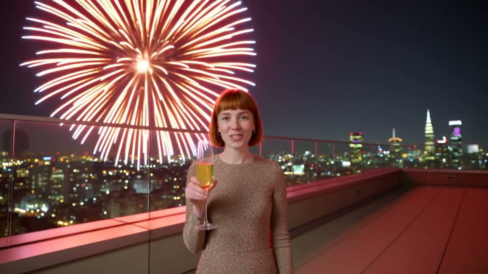</a>
<b>Modelo</b>&nbsp; Kling 3.0 Omni<br>
<b>Clip</b>&nbsp; 5 s · 16:9 · con sonido<br>
<b>Sujetos</b>&nbsp; <code>[1]</code> tú<br><br>
<b>Fotos de referencia</b><br>   <br><br>
<a href="https://refvid.com/es/new-year-countdown"><b>▶ Ver el clip y hacerlo con tus fotos</b></a>
</p>
<br clear="left">

```text
Plano 1: Plano medio de frente a la cámara en una azotea a medianoche de Nochevieja, con el skyline de la ciudad brillando al fondo: [1], con un conjunto brillante, levanta una copa de cava y cuenta hacia la cámara con una gran sonrisa: "Three, two, one…"
Plano 2: [1] se gira hacia la cámara y grita "Happy New Year!", con la copa en alto, mientras fuegos artificiales dorados estallan sobre el skyline y el confeti flota en el aire.
```

<details><summary>Qué fotos funcionan mejor</summary><br>Haces la cuenta atrás de frente a la cámara y luego celebras con la boca bien abierta, así que lo que más cuenta es una foto nítida de frente con una gran sonrisa abierta; otra a un brazo de distancia que muestre tu pelo y el torso te mantiene reconocible con el traje de fiesta.<br><br><sub>Hecho con RefVid en Kling 3.0 Omni a partir de 4 fotos de referencia de Mia (un sujeto creado con IA), con el prompt de esta plantilla.</sub></details>

### Presentador de pódcast

<p>
<a href="https://refvid.com/es/podcast-host"></a>
<b>Modelo</b>&nbsp; Kling 3.0 Omni<br>
<b>Clip</b>&nbsp; 5 s · 16:9 · con sonido<br>
<b>Sujetos</b>&nbsp; <code>[1]</code> tú<br><br>
<b>Fotos de referencia</b><br>   <br><br>
<a href="https://refvid.com/es/podcast-host"><b>▶ Ver el clip y hacerlo con tus fotos</b></a>
</p>
<br clear="left">

```text
Plano medio de [1] en el escritorio de un estudio de podcast, con un micro sobre un brazo articulado y auriculares puestos, luz de lámpara cálida y paneles acústicos detrás, inclinándose hacia delante y diciendo con una sonrisa: "Welcome back to Small Brands, Big Stories."
```

<details><summary>Qué fotos funcionan mejor</summary><br>Los auriculares van sobre tus orejas y te inclinas hacia un micro con brazo, así que muestra bien el nacimiento del pelo y las orejas en una foto de frente y añade una vista de tres cuartos; si llevas gafas en tu programa, llévalas también en las fotos.<br><br><sub>Hecho con RefVid en Kling 3.0 Omni a partir de 4 fotos de referencia de Leo (un sujeto generado con IA), con el prompt de esta plantilla.</sub></details>

### Dúo de rap

<p>
<a href="https://refvid.com/es/rap-duo-booth"></a>
<b>Modelo</b>&nbsp; Kling 3.0 Omni<br>
<b>Clip</b>&nbsp; 15 s · 9:16 · con sonido<br>
<b>Sujetos</b>&nbsp; <code>[1]</code> tú · <code>[2]</code> tu compañero de rap<br><br>
<b>Fotos de referencia</b><br>       <br><br>
<a href="https://refvid.com/es/rap-duo-booth"><b>▶ Ver el clip y hacerlo con tus fotos</b></a>
</p>
<br clear="left">

```text
Dentro de una pequeña cabina de un estudio de música con paredes y suelo continuos de un naranja intenso, iluminada de forma uniforme desde el frente, con dos micrófonos de voz en sus pies. [1] y [2], con ropa urbana, están de pie uno junto al otro de cara a la cámara y rapean un verso rápido sobre un beat de trap contundente, moviendo la cabeza y las manos al ritmo. [1] rapea: "Same face every frame, yeah we never switch it up." Luego [2] rapea: "Two photos in and now the whole world's watching us." Después rapean juntos, sonriendo. Plano medio vertical fijo, sensación de actuación en directo.
```

<details><summary>Qué fotos funcionan mejor</summary><br>Los dos rapean lado a lado mirando a la cámara en un plano medio, así que cada uno necesita una foto frontal nítida con la boca despejada y otra de cintura para arriba para que la altura y la complexión de ambos cuadren juntas.<br><br><sub>Hecho con RefVid en Kling 3.0 Omni a partir de 8 fotos de referencia de Mia y Leo (un sujeto creado con IA), con el prompt de esta plantilla.</sub></details>

### Aterrizaje de superhéroe

<p>
<a href="https://refvid.com/es/superhero-landing">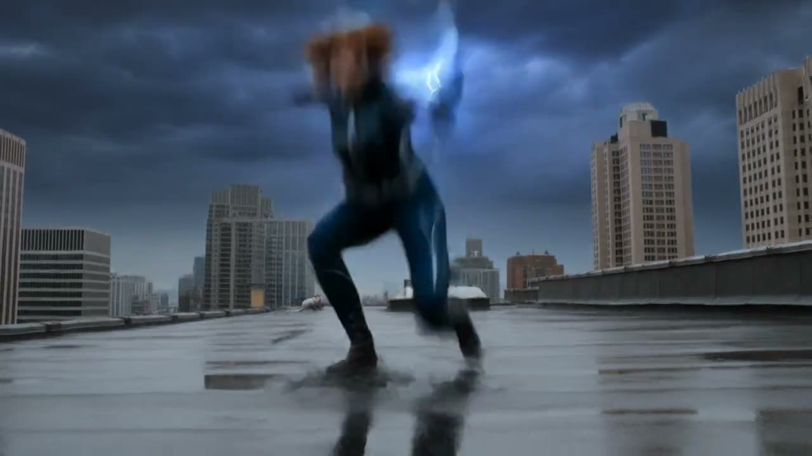</a>
<b>Modelo</b>&nbsp; Kling 3.0 Omni<br>
<b>Clip</b>&nbsp; 5 s · 16:9 · sin sonido<br>
<b>Sujetos</b>&nbsp; <code>[1]</code> tú<br><br>
<b>Fotos de referencia</b><br>   <br><br>
<a href="https://refvid.com/es/superhero-landing"><b>▶ Ver el clip y hacerlo con tus fotos</b></a>
</p>
<br clear="left">

```text
Plano 1: Una tarde tormentosa sobre una ciudad: [1] con un traje blindado original de azul oscuro y líneas plateadas cae desde el cielo y aterriza sobre una azotea en un aterrizaje de tres puntos, con un puño contra el hormigón, grietas que se extienden y polvo que sale hacia fuera.
Plano 2: [1] se alza despacio desde el aterrizaje y mira directamente a cámara, con el viento tirando del traje y relámpagos destellando detrás. Ángulo bajo, cinematográfico.
```

<details><summary>Qué fotos funcionan mejor</summary><br>El traje sustituye tu ropa, así que tu cara sostiene todo el parecido: una foto frontal nítida para la mirada final a cámara y otra un poco desde abajo o de lado, porque al levantarte la toma es en contrapicado.<br><br><sub>Hecho con RefVid en Kling 3.0 Omni a partir de 4 fotos de referencia de Mia (un sujeto creado con IA), con el prompt de esta plantilla.</sub></details>

### Anuncio a cámara

<p>
<a href="https://refvid.com/es/talking-head-ad"></a>
<b>Modelo</b>&nbsp; Kling 3.0 Omni<br>
<b>Clip</b>&nbsp; 5 s · 9:16 · con sonido<br>
<b>Sujetos</b>&nbsp; <code>[1]</code> el presentador<br><br>
<b>Fotos de referencia</b><br>   <br><br>
<a href="https://refvid.com/es/talking-head-ad"><b>▶ Ver el clip y hacerlo con tus fotos</b></a>
</p>
<br clear="left">

```text
Plano medio cercano de [1] sentado en un luminoso despacho en casa, mirando directamente a cámara, que dice con una sonrisa cálida: "Here is the one thing I wish I had known sooner." Luz suave de ventana, profundidad de campo reducida.
```

<details><summary>Qué fotos funcionan mejor</summary><br>El presentador habla directamente a cámara en un plano medio corto, así que la cara y la boca sostienen el clip: usa fotos de frente a la altura de los ojos, sin gafas de sol ni manos cerca de la boca, y una con una sonrisa natural.<br><br><sub>Hecho con RefVid en Kling 3.0 Omni a partir de 4 fotos de referencia de Mia (un sujeto creado con IA), usando el prompt de esta plantilla.</sub></details>

### Brindis de Thanksgiving

<p>
<a href="https://refvid.com/es/thanksgiving-table"></a>
<b>Modelo</b>&nbsp; Kling 3.0 Omni<br>
<b>Clip</b>&nbsp; 5 s · 16:9 · con sonido<br>
<b>Sujetos</b>&nbsp; <code>[1]</code> tú<br><br>
<b>Fotos de referencia</b><br>   <br><br>
<a href="https://refvid.com/es/thanksgiving-table"><b>▶ Ver el clip y hacerlo con tus fotos</b></a>
</p>
<br clear="left">

```text
Plano 1: Una larga mesa de cena de Acción de Gracias bajo la luz cálida de las velas: un pavo asado, cuencos con guarniciones, calabacitas pequeñas y hojas de otoño, con la cámara deslizándose lentamente a lo largo de ella hacia [1], sentado a la cabecera.
Plano 2: [1] se levanta, alza una copa de vino tinto hacia la cámara y dice con una sonrisa cálida: "To all of us, and to next year." Luz suave de velas, tintineo tranquilo de copas.
```

<details><summary>Qué fotos funcionan mejor</summary><br>Te levantas en la cabecera de la mesa y alzas la copa hacia la cámara, así que lo que más cuenta es una foto frontal cálida con una sonrisa natural; una de cintura para arriba ayuda a acertar con tus hombros y tu ropa al ponerte de pie.<br><br><sub>Hecho con RefVid en Kling 3.0 Omni a partir de 4 fotos de referencia de Mia (un sujeto creado con IA), con el prompt de esta plantilla.</sub></details>

### Vlog de viaje

<p>
<a href="https://refvid.com/es/travel-vlog-walk"></a>
<b>Modelo</b>&nbsp; Kling 3.0 Omni<br>
<b>Clip</b>&nbsp; 10 s · 9:16 · con sonido<br>
<b>Sujetos</b>&nbsp; <code>[1]</code> tú<br><br>
<b>Fotos de referencia</b><br>   <br><br>
<a href="https://refvid.com/es/travel-vlog-walk"><b>▶ Ver el clip y hacerlo con tus fotos</b></a>
</p>
<br clear="left">

```text
Plano 1: Toma de vlog en mano: [1] camina por una calle empedrada y soleada del casco antiguo, flanqueada por cafés y casas en tonos pastel, sujetando la cámara con el brazo extendido y sonriendo. Sonidos de la calle, brisa suave.
Plano 2: [1] se detiene junto a una fuente y le dice a la cámara: "Okay, this little street is my favourite thing so far."
Plano 3: [1] gira la cámara para mostrar una amplia vista de los tejados de terracota hasta el mar, a la hora dorada.
```

<details><summary>Qué fotos funcionan mejor</summary><br>La cámara va a la distancia de tu brazo todo el tiempo, así que el clip se apoya en selfis de tu cara tomados un poco desde arriba y con luz de día; añade una de cuerpo entero para que el paseo por la calle mantenga tu figura y tu ropa.<br><br><sub>Hecho con RefVid en Kling 3.0 Omni a partir de 4 fotos de referencia de Mia (un sujeto creado con IA), usando el prompt de esta plantilla.</sub></details>

### Save the date

<p>
<a href="https://refvid.com/es/wedding-save-the-date"></a>
<b>Modelo</b>&nbsp; Kling 3.0 Omni<br>
<b>Clip</b>&nbsp; 10 s · 16:9 · sin sonido<br>
<b>Sujetos</b>&nbsp; <code>[1]</code> tú · <code>[2]</code> tu pareja<br><br>
<b>Fotos de referencia</b><br>       <br><br>
<a href="https://refvid.com/es/wedding-save-the-date"><b>▶ Ver el clip y hacerlo con tus fotos</b></a>
</p>
<br clear="left">

```text
Plano 1: Luz de última hora de la tarde en un jardín de rosas en flor: [1] y [2] caminan de la mano por un sendero de grava hacia la cámara, sonriéndose.
Plano 2: Plano medio: [2] le susurra algo a [1], que se ríe y se inclina hacia él; de fondo, un bokeh suave de flores.
Plano 3: Primer plano de sus manos unidas, con un sencillo anillo de compromiso dorado que capta la luz.
```

<details><summary>Qué fotos funcionan mejor</summary><br>Los dos caminan de la mano hacia la cámara y luego se ríen juntos en un plano medio, así que cada uno necesita una foto frontal clara y sonriente y otra de cuerpo entero; para que el anillo real salga en el primer plano, añade una foto de las manos unidas.<br><br><sub>Hecho con RefVid en Kling 3.0 Omni a partir de 8 fotos de referencia de Mia y Leo (un sujeto creado con IA), con el prompt de esta plantilla.</sub></details>

[↑ Volver al contenido](#contenido)

## Mascotas

Tu propio perro o gato, la misma mascota en cada plano.

### Rap perruno

<p>
<a href="https://refvid.com/es/dog-rap-video"></a>
<b>Modelo</b>&nbsp; Kling 3.0 Omni<br>
<b>Clip</b>&nbsp; 10 s · 9:16 · con sonido<br>
<b>Sujetos</b>&nbsp; <code>[1]</code> tú · <code>[2]</code> tu perro<br><br>
<b>Fotos de referencia</b><br>       <br><br>
<a href="https://refvid.com/es/dog-rap-video"><b>▶ Ver el clip y hacerlo con tus fotos</b></a>
</p>
<br clear="left">

```text
Dentro de una pequeña cabina de un estudio de grabación con paredes de espuma acústica oscura y una cálida luz naranja, con un micrófono de voz en su pie entre los dos. [1], con auriculares y sudadera con capucha, está de pie junto a [2], el perro, que está sentado en un taburete alto con una cadenita de oro y mueve la cabeza al ritmo de un beat de hip-hop contundente. [1] rapea a cámara: "Me and my dog, yeah we run this block." Luego [2], el perro, se inclina hacia el micrófono y le responde rapeando con una voz ronca de dibujos animados, moviendo la boca con las palabras: "Treats on the table and we never stop." [1] se ríe. Plano medio vertical fijo.
```

<details><summary>Qué fotos funcionan mejor</summary><br>Tu perro rapea al micrófono moviendo la boca, así que lo que más importa es una foto nítida de frente de su cabeza, con el hocico y las manchas a buena luz; para ti, una foto de frente de pie encaja con la cabina.<br><br><sub>Hecho con RefVid en Kling 3.0 Omni a partir de 8 fotos de referencia de Leo y Biscuit (un sujeto creado con IA), con el prompt de esta plantilla.</sub></details>

### Atardecer con tu mascota

<p>
<a href="https://refvid.com/es/pet-and-owner-sunset"></a>
<b>Modelo</b>&nbsp; Kling 3.0 Omni<br>
<b>Clip</b>&nbsp; 10 s · 16:9 · sin sonido<br>
<b>Sujetos</b>&nbsp; <code>[1]</code> tu mascota · <code>[2]</code> tú<br><br>
<b>Fotos de referencia</b><br>       <br><br>
<a href="https://refvid.com/es/pet-and-owner-sunset"><b>▶ Ver el clip y hacerlo con tus fotos</b></a>
</p>
<br clear="left">

```text
Plano 1: Plano general a la hora dorada: [2] camina descalzo por la orilla de una playa tranquila, con [1] avanzando a su lado, olas suaves que llegan a la arena y un sol bajo y cálido a sus espaldas.
Plano 2: [2] y [1] están sentados uno junto al otro en la arena, vistos desde atrás, mirando cómo el sol se hunde en el mar. Acercamiento lento, cielo naranja cálido.
```

<details><summary>Qué fotos funcionan mejor</summary><br>Las dos tomas los muestran uno junto al otro, la segunda de espaldas, así que añade de los dos fotos de cuerpo entero de lado y de espaldas, no solo caras; el lomo y la cola de tu mascota sostienen la toma del atardecer.<br><br><sub>Hecho con RefVid en Kling 3.0 Omni a partir de 8 fotos de referencia de Biscuit y Mia (un sujeto generado con IA), con el prompt de esta plantilla.</sub></details>

### Mascota astronauta

<p>
<a href="https://refvid.com/es/pet-astronaut">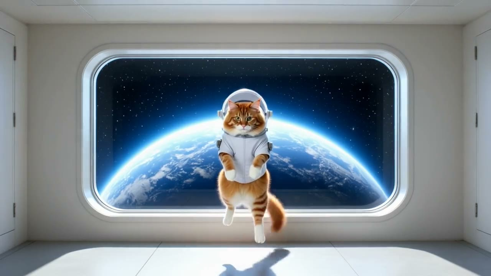</a>
<b>Modelo</b>&nbsp; Kling 3.0 Omni<br>
<b>Clip</b>&nbsp; 5 s · 16:9 · sin sonido<br>
<b>Sujetos</b>&nbsp; <code>[1]</code> tu mascota<br><br>
<b>Fotos de referencia</b><br>   <br><br>
<a href="https://refvid.com/es/pet-astronaut"><b>▶ Ver el clip y hacerlo con tus fotos</b></a>
</p>
<br clear="left">

```text
Dentro de una luminosa estación espacial, [1] con un pequeño traje blanco de astronauta y la visera del casco abierta flota sin peso hacia la cámara, con las patas a la deriva, mientras la Tierra azul brilla por la gran ventana del fondo. Movimiento lento y onírico.
```

<details><summary>Qué fotos funcionan mejor</summary><br>La cara de tu mascota queda enmarcada por el visor abierto del casco mientras flota hacia ti, así que lo que más cuenta es una foto nítida de frente con los ojos y el hocico claros; el traje tapa el cuerpo, por eso el color del pelo alrededor de la cara es lo que la hace reconocible.<br><br><sub>Hecho con RefVid en Kling 3.0 Omni a partir de 4 fotos de referencia de Miso (un sujeto generado con IA), con el prompt de esta plantilla.</sub></details>

### Cumpleaños de mascota

<p>
<a href="https://refvid.com/es/pet-birthday-party"></a>
<b>Modelo</b>&nbsp; Kling 3.0 Omni<br>
<b>Clip</b>&nbsp; 5 s · 9:16 · con sonido<br>
<b>Sujetos</b>&nbsp; <code>[1]</code> tu mascota<br><br>
<b>Fotos de referencia</b><br>   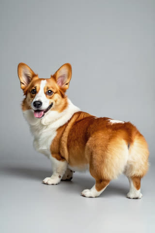<br><br>
<a href="https://refvid.com/es/pet-birthday-party"><b>▶ Ver el clip y hacerlo con tus fotos</b></a>
</p>
<br clear="left">

```text
Plano 1: [1] se sienta a una mesita con un gorrito de fiesta diminuto de rayas, globos de colores detrás y una tarta de cumpleaños pequeña con tres velas encendidas delante. Luz cálida de casa, acercamiento suave.
Plano 2: [1] mira a la cámara junto a la tarta, ladea la cabeza y emite un pequeño sonido de alegría con su propia voz natural. Enfoque suave en las velas, ambiente acogedor de cumpleaños.
```

<details><summary>Qué fotos funcionan mejor</summary><br>Tu mascota se sienta a una mesita y mira hacia arriba a la cámara bajo un gorrito de fiesta, así que lo que más cuenta es una foto tomada un poco desde arriba con orejas y ojos nítidos; una sentada bien erguida muestra cómo se coloca junto a la tarta.<br><br><sub>Hecho con RefVid en Kling 3.0 Omni a partir de 4 fotos de referencia de Biscuit (un sujeto creado con IA), con el prompt de esta plantilla.</sub></details>

### Mascota chef

<p>
<a href="https://refvid.com/es/pet-chef"></a>
<b>Modelo</b>&nbsp; Kling 3.0 Omni<br>
<b>Clip</b>&nbsp; 5 s · 9:16 · con sonido<br>
<b>Sujetos</b>&nbsp; <code>[1]</code> tu mascota<br><br>
<b>Fotos de referencia</b><br>  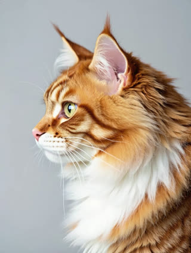 <br><br>
<a href="https://refvid.com/es/pet-chef"><b>▶ Ver el clip y hacerlo con tus fotos</b></a>
</p>
<br clear="left">

```text
Plano 1: [1] con un gorrito de chef blanquito se sienta erguido en una encimera acogedora de cocina, detrás de una sartén con verduras que chisporrotean, vapor subiendo y luz cálida de la mañana. Sonido de chisporroteo.
Plano 2: [1] se sienta junto a un plato terminado de salteado de colores y mira con orgullo a la cámara, con el gorrito de chef ligeramente ladeado.
```

<details><summary>Qué fotos funcionan mejor</summary><br>El gorro de chef va sobre la cabeza de tu mascota y la segunda toma es una mirada orgullosa y cercana a la cámara, así que lo que más cuenta es una foto nítida de frente con las dos orejas en el encuadre; añade una vista de lado para que el pelaje y el tamaño se mantengan en la encimera.<br><br><sub>Hecho con RefVid en Kling 3.0 Omni a partir de 4 fotos de referencia de Miso (un sujeto creado con IA), con el prompt de esta plantilla.</sub></details>

### Navidad con tu mascota

<p>
<a href="https://refvid.com/es/pet-christmas-morning"></a>
<b>Modelo</b>&nbsp; Kling 3.0 Omni<br>
<b>Clip</b>&nbsp; 5 s · 9:16 · sin sonido<br>
<b>Sujetos</b>&nbsp; <code>[1]</code> tu mascota<br><br>
<b>Fotos de referencia</b><br>   <br><br>
<a href="https://refvid.com/es/pet-christmas-morning"><b>▶ Ver el clip y hacerlo con tus fotos</b></a>
</p>
<br clear="left">

```text
Plano 1: Mañana de Navidad en un salón acogedor: [1], con una pequeña bufanda de punto roja, está sentado junto a un árbol de Navidad luminoso y olisquea con curiosidad un regalo envuelto en papel rojo con un lazo dorado. Luces navideñas cálidas, luz suave de la mañana.
Plano 2: Primer plano en el mismo salón, con el árbol iluminado al fondo: [1], todavía con su bufanda roja, agarra el lazo dorado y tira del papel de regalo hasta abrirlo, con trozos de papel rojo volando por el aire, y luego levanta la mirada hacia la cámara.
```

<details><summary>Qué fotos funcionan mejor</summary><br>La primera toma muestra a tu mascota de lado olfateando el regalo y la bufanda le rodea el cuello, así que añade una foto de perfil clara con el hocico y el pecho a la vista, junto a una de frente para la mirada final hacia arriba.<br><br><sub>Hecho con RefVid en Kling 3.0 Omni a partir de 4 fotos de referencia de Biscuit (un sujeto creado con IA), usando la instrucción de esta plantilla.</sub></details>

### Mascota que cobra vida

<p>
<a href="https://refvid.com/es/pet-comes-to-life"></a>
<b>Modelo</b>&nbsp; Kling 3.0 Omni<br>
<b>Clip</b>&nbsp; 5 s · 9:16 · sin sonido<br>
<b>Sujetos</b>&nbsp; <code>[1]</code> tu mascota<br><br>
<b>Fotos de referencia</b><br>   <br><br>
<a href="https://refvid.com/es/pet-comes-to-life"><b>▶ Ver el clip y hacerlo con tus fotos</b></a>
</p>
<br clear="left">

```text
[1] está tumbado sobre una manta suave en un sofá, con la luz cálida de la tarde, parpadea despacio, ladea la cabeza y mira directamente a la cámara, respirando suavemente. Acercamiento lento, hogar acogedor, profundidad de campo poco profunda.
```

<details><summary>Qué fotos funcionan mejor</summary><br>Es una sola toma cercana y tranquila de tu mascota tumbada que te mira a los ojos, así que lo que más cuenta es una foto nítida a la altura de sus ojos, con su color y el pelo de alrededor bien claros; una foto tumbada ayuda con la postura.<br><br><sub>Hecho con RefVid en Kling 3.0 Omni a partir de 4 fotos de referencia de Biscuit (un sujeto creado con IA), con una versión anterior del prompt de esta plantilla.</sub></details>

### Retrato familiar

<p>
<a href="https://refvid.com/es/pet-family-portrait">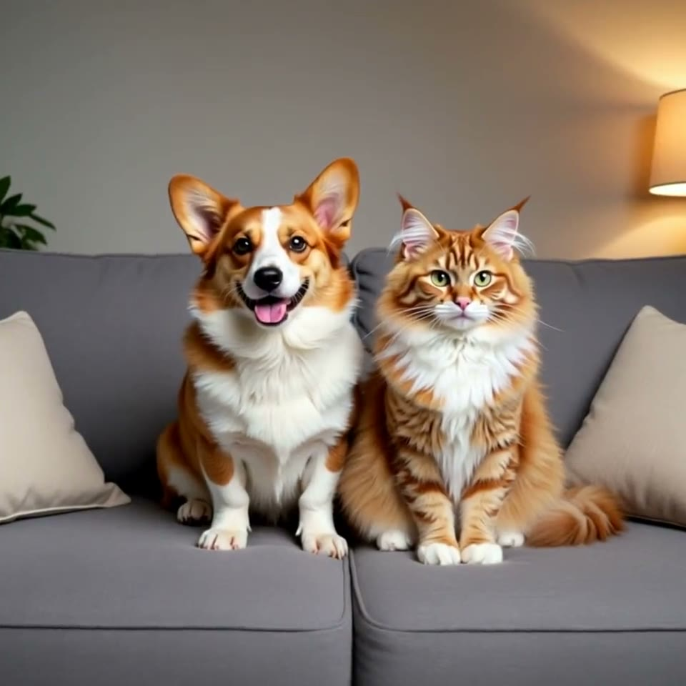</a>
<b>Modelo</b>&nbsp; Kling 3.0 Omni<br>
<b>Clip</b>&nbsp; 5 s · 1:1 · sin sonido<br>
<b>Sujetos</b>&nbsp; <code>[1]</code> tu primera mascota · <code>[2]</code> tu segunda mascota<br><br>
<b>Fotos de referencia</b><br>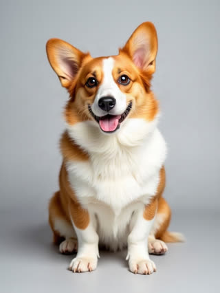       <br><br>
<a href="https://refvid.com/es/pet-family-portrait"><b>▶ Ver el clip y hacerlo con tus fotos</b></a>
</p>
<br clear="left">

```text
[1] y [2] se sientan una junto a la otra en un sofá gris y mullido, con cojines, en un salón acogedor, como en un retrato familiar; [2] mira de reojo a [1] y luego ambas miran directamente a cámara. Luz cálida de lámpara, acercamiento suave.
```

<details><summary>Qué fotos funcionan mejor</summary><br>Dos mascotas comparten un sofá, así que el Estudio tiene que distinguirlas: da de cada una una foto de frente y otra que muestre su tamaño junto a algo conocido, para que la más grande siga siéndolo sentadas una al lado de la otra.<br><br><sub>Hecho con RefVid en Kling 3.0 Omni a partir de 8 fotos de referencia de Biscuit y Miso (un sujeto generado con IA), con el prompt de esta plantilla.</sub></details>

### Disfraz de mascota

<p>
<a href="https://refvid.com/es/pet-halloween-costume"></a>
<b>Modelo</b>&nbsp; Kling 3.0 Omni<br>
<b>Clip</b>&nbsp; 6 s · 9:16 · con sonido<br>
<b>Sujetos</b>&nbsp; <code>[1]</code> tu mascota<br><br>
<b>Fotos de referencia</b><br>   <br><br>
<a href="https://refvid.com/es/pet-halloween-costume"><b>▶ Ver el clip y hacerlo con tus fotos</b></a>
</p>
<br clear="left">

```text
Plano 1: [1] está sentado en un porche de madera al atardecer con un disfraz suave de calabaza naranja, faroles tallados brillando en los escalones y hojas secas alrededor. Acercamiento lento, luz cálida de velas.
Plano 2: [1] mira a cámara junto a un cuenco de caramelos envueltos, ladea la cabeza y emite un pequeño sonido feliz con su voz natural. Noche acogedora de Halloween, poca profundidad de campo.
```

<details><summary>Qué fotos funcionan mejor</summary><br>El disfraz de calabaza cubre el cuerpo de tu mascota, así que la cara y las orejas lo hacen todo: usa una foto de frente cercana y bien iluminada en la que los ojos reflejen la luz, y otra sentada para que el disfraz se ajuste a su forma real.<br><br><sub>Hecho con RefVid en Kling 3.0 Omni a partir de 4 fotos de referencia de Biscuit (un sujeto creado con ia), con una versión anterior del prompt de esta plantilla que pedía un ladrido.</sub></details>

### Homenaje a tu mascota

<p>
<a href="https://refvid.com/es/pet-memorial"></a>
<b>Modelo</b>&nbsp; Kling 3.0 Omni<br>
<b>Clip</b>&nbsp; 5 s · 16:9 · sin sonido<br>
<b>Sujetos</b>&nbsp; <code>[1]</code> tu mascota<br><br>
<b>Fotos de referencia</b><br>  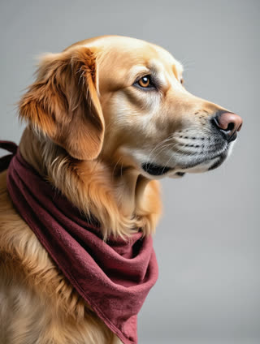 <br><br>
<a href="https://refvid.com/es/pet-memorial"><b>▶ Ver el clip y hacerlo con tus fotos</b></a>
</p>
<br clear="left">

```text
Plano 1: Un prado soleado de flores silvestres altas bajo un cielo dorado y cálido, con un suave arcoíris a lo lejos: [1] sale disparado de entre las flores a toda velocidad hacia la cámara, con las orejas ondeando, la lengua fuera y un calcetín de rayas rojas y blancas bien sujeto en la boca.
Plano 2: Primer plano en el mismo prado a la hora dorada, con el arcoíris brillando detrás: [1] frena en seco, deja caer el calcetín de rayas sobre la hierba, se sienta, ladea la cabeza hacia la cámara y mueve la cola, muy orgullosa de sí misma.
```

<details><summary>Qué fotos funcionan mejor</summary><br>Tu mascota corre directa hacia la cámara con las orejas al viento y un calcetín en la boca, así que, si tienes una, lo que más ayuda es una foto corriendo o jugando con la boca abierta; las fotos antiguas del celular algo borrosas también sirven, mientras se vea la cara.<br><br><sub>Hecho con RefVid en Kling 3.0 Omni a partir de 4 fotos de referencia de Captain (un sujeto creado con IA), con el prompt de esta plantilla.</sub></details>

### Mascota presentadora

<p>
<a href="https://refvid.com/es/pet-news-anchor"></a>
<b>Modelo</b>&nbsp; Kling 3.0 Omni<br>
<b>Clip</b>&nbsp; 5 s · 16:9 · con sonido<br>
<b>Sujetos</b>&nbsp; <code>[1]</code> tu mascota<br><br>
<b>Fotos de referencia</b><br>   <br><br>
<a href="https://refvid.com/es/pet-news-anchor"><b>▶ Ver el clip y hacerlo con tus fotos</b></a>
</p>
<br clear="left">

```text
Un estudio de noticias de TV con luces brillantes y un skyline de ciudad en la pantalla de fondo: [1] se sienta erguido tras el escritorio, con una corbatita roja, mira a la cámara y dice con voz seria de presentador: "Good evening. Tonight’s top story: dinner is late again."
```

<details><summary>Qué fotos funcionan mejor</summary><br>Detrás de la mesa del informativo solo se ven la cabeza, el cuello y el pecho de tu mascota, con la corbata al cuello, así que usa una foto de frente en la que esté sentada bien erguida y se vea el pecho; una cara tranquila y seria encaja mejor con el titular que una juguetona.<br><br><sub>Hecho con RefVid en Kling 3.0 Omni a partir de 4 fotos de referencia de Biscuit (un sujeto creado con IA), con el prompt de esta plantilla.</sub></details>

### Mascota portaanillos

<p>
<a href="https://refvid.com/es/pet-ring-bearer"></a>
<b>Modelo</b>&nbsp; Kling 3.0 Omni<br>
<b>Clip</b>&nbsp; 5 s · 16:9 · sin sonido<br>
<b>Sujetos</b>&nbsp; <code>[1]</code> tu mascota<br><br>
<b>Fotos de referencia</b><br>   <br><br>
<a href="https://refvid.com/es/pet-ring-bearer"><b>▶ Ver el clip y hacerlo con tus fotos</b></a>
</p>
<br clear="left">

```text
Una boda en un jardín con la luz suave de la tarde: [1], con un pequeño collar de flores, avanza por el pasillo entre filas de sillas blancas hacia la cámara, llevando en la boca una cestita con la caja de los anillos; a ambos lados, los invitados se giran para sonreír y hay pétalos sobre la hierba.
```

<details><summary>Qué fotos funcionan mejor</summary><br>Tu mascota recorre todo el pasillo hacia la cámara con la cestita en la boca, así que lo que más cuenta es una foto de cuerpo entero caminando o de pie, tomada de frente a su altura; un cuello bien visible ayuda a que el collar de flores quede bien.<br><br><sub>Hecho con RefVid en Kling 3.0 Omni a partir de 4 fotos de referencia de Biscuit (un sujeto generado con IA), con la instrucción de esta plantilla.</sub></details>

### Pasarela de mascota

<p>
<a href="https://refvid.com/es/pet-runway-walk"></a>
<b>Modelo</b>&nbsp; Kling 3.0 Omni<br>
<b>Clip</b>&nbsp; 5 s · 9:16 · con sonido<br>
<b>Sujetos</b>&nbsp; <code>[1]</code> tu mascota<br><br>
<b>Fotos de referencia</b><br>   <br><br>
<a href="https://refvid.com/es/pet-runway-walk"><b>▶ Ver el clip y hacerlo con tus fotos</b></a>
</p>
<br clear="left">

```text
[1] camina con seguridad por una pasarela de moda brillante hacia la cámara bajo focos intensos, con fotógrafos a ambos lados disparando flashes, y luego se detiene al final y posa. Cámara baja, murmullo de público y clics del obturador.
```

<details><summary>Qué fotos funcionan mejor</summary><br>La cámara va baja mientras tu mascota recorre toda la pasarela, así que las patas y su forma de andar sostienen esta toma: añade una foto de cuerpo entero de frente a ras de suelo y otra de lado para que su complexión y el dibujo del pelaje se mantengan a mitad de paso.<br><br><sub>Hecho con RefVid en Kling 3.0 Omni a partir de 4 fotos de referencia de Biscuit (un sujeto creado con IA), con el prompt de esta plantilla.</sub></details>

### Mascota bajo el agua

<p>
<a href="https://refvid.com/es/pet-underwater-swim"></a>
<b>Modelo</b>&nbsp; Kling 3.0 Omni<br>
<b>Clip</b>&nbsp; 5 s · 9:16 · sin sonido<br>
<b>Sujetos</b>&nbsp; <code>[1]</code> tu mascota<br><br>
<b>Fotos de referencia</b><br>   <br><br>
<a href="https://refvid.com/es/pet-underwater-swim"><b>▶ Ver el clip y hacerlo con tus fotos</b></a>
</p>
<br clear="left">

```text
Bajo el agua, en un mar turquesa cristalino, [1] nada hacia la cámara pataleando con los ojos abiertos, con rayos de sol ondulando sobre su cuerpo, pequeñas burbujas que suben y el pelaje meciéndose suavemente en el agua.
```

<details><summary>Qué fotos funcionan mejor</summary><br>Bajo el agua el pelo flota y se ve más oscuro, así que la cara y las manchas tienen que ser inconfundibles: una foto nítida de frente con los ojos abiertos y otra que muestre el largo y el color reales del pelaje a la luz del día dan al Estudio lo que necesita.<br><br><sub>Hecho con RefVid en Kling 3.0 Omni a partir de 4 fotos de referencia de Biscuit (un sujeto creado con IA), con el prompt de esta plantilla.</sub></details>

[↑ Volver al contenido](#contenido)

## Objetos y personajes

Un juguete, una figura, un coche o un personaje dibujado que se mantiene igual.

### Plastilina

<p>
<a href="https://refvid.com/es/clay-figure-stopmotion"></a>
<b>Modelo</b>&nbsp; Kling 3.0 Omni<br>
<b>Clip</b>&nbsp; 5 s · 16:9 · sin sonido<br>
<b>Sujetos</b>&nbsp; <code>[1]</code> tu personaje de arcilla<br><br>
<b>Fotos de referencia</b><br>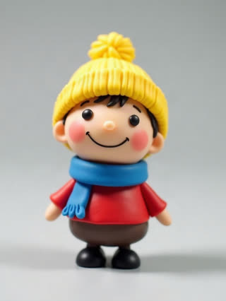   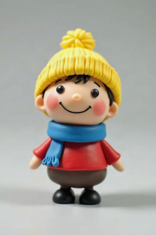<br><br>
<a href="https://refvid.com/es/clay-figure-stopmotion"><b>▶ Ver el clip y hacerlo con tus fotos</b></a>
</p>
<br clear="left">

```text
Plano 1: Estilo claymation de stop-motion, movimiento ligeramente escalonado: [1] camina por un pequeño escenario artesanal de una calle de pueblo de papel y fieltro, con casitas diminutas y una nube de algodón, y se ven su textura de arcilla y sus huellas. Luz cálida de mesa.
Plano 2: [1] se detiene, se gira hacia la cámara y saluda con una mano de arcilla, luego da un pequeño salto. Aspecto de stop-motion, profundidad de campo poco profunda.
```

<details><summary>Qué fotos funcionan mejor</summary><br>Tu personaje cruza el escenario de lado y luego se gira para saludar, así que muéstralo de perfil y de frente, tan cerca que se lean la textura de la arcilla y las huellas; una vista de espaldas mantiene coherente el paseo.<br><br><sub>Hecho con RefVid en Kling 3.0 Omni a partir de 4 fotos de referencia de Momo (un sujeto creado con IA), con el prompt de esta plantilla.</sub></details>

### Muestra de ganchillo

<p>
<a href="https://refvid.com/es/crochet-showcase"></a>
<b>Modelo</b>&nbsp; Kling 3.0 Omni<br>
<b>Clip</b>&nbsp; 5 s · 1:1 · sin sonido<br>
<b>Sujetos</b>&nbsp; <code>[1]</code> tu pieza<br><br>
<b>Fotos de referencia</b><br>   <br><br>
<a href="https://refvid.com/es/crochet-showcase"><b>▶ Ver el clip y hacerlo con tus fotos</b></a>
</p>
<br clear="left">

```text
Plano 1: [1] descansa sobre una mesa de roble cálida junto a dos ovillos de hilo suave y una aguja de ganchillo de madera, luz de ventana de la tarde, la cámara rodea despacio la pieza.
Plano 2: Primer plano macro que recorre los puntos y la cara de [1], cada lazada de hilo visible, profundidad de campo reducida.
```

<details><summary>Qué fotos funcionan mejor</summary><br>La segunda toma recorre en macro los puntos y la cara, así que haz una foto de cerca en la que cada lazada de hilo salga nítida, además de vistas de frente y de lado para que la forma se mantenga mientras la cámara gira alrededor.<br><br><sub>Hecho con RefVid en Kling 3.0 Omni a partir de 4 fotos de referencia de Bun (un sujeto generado con IA), con el prompt de esta plantilla.</sub></details>

### Diorama en miniatura

<p>
<a href="https://refvid.com/es/diorama-miniature"></a>
<b>Modelo</b>&nbsp; Kling 3.0 Omni<br>
<b>Clip</b>&nbsp; 5 s · 16:9 · sin sonido<br>
<b>Sujetos</b>&nbsp; <code>[1]</code> tu figura<br><br>
<b>Fotos de referencia</b><br> 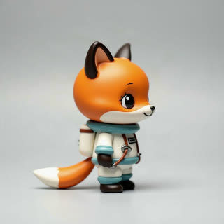  <br><br>
<a href="https://refvid.com/es/diorama-miniature"><b>▶ Ver el clip y hacerlo con tus fotos</b></a>
</p>
<br clear="left">

```text
Maqueta en miniatura con efecto tilt-shift de una pequeña plaza de pueblo con árboles de maqueta, farolas y casitas; [1] está en el centro mientras un tren de juguete pasa despacio por detrás, la cámara se desliza a la altura de sus ojos y los bordes se desenfocan suavemente. Luz de día brillante.
```

<details><summary>Qué fotos funcionan mejor</summary><br>La cámara pasa junto a tu figura a la altura de sus ojos, así que fotografíala de frente desde esa altura baja y no desde arriba; una vista de lado ayuda a que conserve su forma mientras el tren pasa por detrás.<br><br><sub>Hecho con RefVid en Kling 3.0 Omni a partir de 4 fotos de referencia de Pip (un sujeto creado con IA), usando el prompt de esta plantilla.</sub></details>

### Figura 360°

<p>
<a href="https://refvid.com/es/figure-turntable-showcase"></a>
<b>Modelo</b>&nbsp; Kling 3.0 Omni<br>
<b>Clip</b>&nbsp; 5 s · 1:1 · sin sonido<br>
<b>Sujetos</b>&nbsp; <code>[1]</code> tu figura<br><br>
<b>Fotos de referencia</b><br>   <br><br>
<a href="https://refvid.com/es/figure-turntable-showcase"><b>▶ Ver el clip y hacerlo con tus fotos</b></a>
</p>
<br clear="left">

```text
Plano 1: [1] sobre una pequeña plataforma redonda dentro de una vitrina oscura con un foco suave, girando lentamente una vuelta completa. Reflejos limpios en la balda de cristal.
Plano 2: Primer plano macro del rostro de [1] y de sus detalles pintados, con la luz deslizándose sobre ellos y poca profundidad de campo.
```

<details><summary>Qué fotos funcionan mejor</summary><br>La figura da una vuelta completa antes de que la cámara se acerque a su cara, así que cubre la espalda y los dos lados además del frente, y añade una foto de cerca de la pintura de la cara en la que los detalles pequeños salgan nítidos.<br><br><sub>Hecho con RefVid en Kling 3.0 Omni a partir de 4 fotos de referencia de Pip (un sujeto creado con IA), con el prompt de esta plantilla.</sub></details>

### Saludo de mascota

<p>
<a href="https://refvid.com/es/mascot-wave-hello"></a>
<b>Modelo</b>&nbsp; Kling 3.0 Omni<br>
<b>Clip</b>&nbsp; 5 s · 1:1 · con sonido<br>
<b>Sujetos</b>&nbsp; <code>[1]</code> tu mascota<br><br>
<b>Fotos de referencia</b><br>   <br><br>
<a href="https://refvid.com/es/mascot-wave-hello"><b>▶ Ver el clip y hacerlo con tus fotos</b></a>
</p>
<br clear="left">

```text
[1] está de pie sobre un escritorio luminoso y limpio, delante de un fondo suave en tonos pastel, mira a la cámara, agita un brazo y dice con una vocecita alegre: "Hi there, welcome in!" Acercamiento suave.
```

<details><summary>Qué fotos funcionan mejor</summary><br>Tu mascota saluda con un brazo y mira a la cámara, así que fotografíala de pie y de frente, con los dos brazos y la cara bien visibles; una vista de espaldas o de lado ayuda a que su forma se mantenga al moverse.<br><br><sub>Hecho con RefVid en Kling 3.0 Omni a partir de 4 fotos de referencia de Pip (un sujeto creado con IA), con el prompt de esta plantilla.</sub></details>

### Aventura de peluche

<p>
<a href="https://refvid.com/es/plush-adventure"></a>
<b>Modelo</b>&nbsp; Kling 3.0 Omni<br>
<b>Clip</b>&nbsp; 10 s · 9:16 · sin sonido<br>
<b>Sujetos</b>&nbsp; <code>[1]</code> tu peluche<br><br>
<b>Fotos de referencia</b><br>   <br><br>
<a href="https://refvid.com/es/plush-adventure"><b>▶ Ver el clip y hacerlo con tus fotos</b></a>
</p>
<br clear="left">

```text
Plano 1: Aire stop-motion: [1] está sentado en un asiento de madera de un viejo tranvía amarillo, junto a la ventana, con la calle deslizándose fuera, luz de la mañana.
Plano 2: [1] está sentado en una mesita diminuta de cafetería, junto a una taza de chocolate caliente con nata montada, girando la cabeza hacia la cámara.
Plano 3: [1] está sentado en la barandilla de un puente de piedra contemplando la puesta de sol sobre el río, con las luces de la ciudad encendiéndose detrás.
```

<details><summary>Qué fotos funcionan mejor</summary><br>Tu peluche aparece sentado en los tres lugares, de lado en el tranvía y de espaldas en el puente, así que fotografíalo sentado de frente, de lado y de espaldas; déjale la bufanda, el lazo o el parche para que esos detalles viajen con él.<br><br><sub>Hecho con RefVid en Kling 3.0 Omni a partir de 4 fotos de referencia de Bobo (un sujeto creado con IA), con el prompt de esta plantilla.</sub></details>

### Juguete que cobra vida

<p>
<a href="https://refvid.com/es/toy-comes-alive"></a>
<b>Modelo</b>&nbsp; Kling 3.0 Omni<br>
<b>Clip</b>&nbsp; 5 s · 9:16 · sin sonido<br>
<b>Sujetos</b>&nbsp; <code>[1]</code> tu figura<br><br>
<b>Fotos de referencia</b><br>   <br><br>
<a href="https://refvid.com/es/toy-comes-alive"><b>▶ Ver el clip y hacerlo con tus fotos</b></a>
</p>
<br clear="left">

```text
Plano 1: [1] permanece perfectamente quieto sobre una mesa de madera, junto a un portalápices y una libreta, con la luz suave de la mañana, como un juguete expuesto. Primer plano a la altura de los ojos del juguete.
Plano 2: [1] cobra vida: parpadea, mira alrededor con curiosidad y luego da unos pasitos tambaleantes hacia la cámara y saluda. Sigue siendo el mismo pequeño juguete pintado, con el mismo material y los mismos colores. Profundidad de campo reducida.
```

<details><summary>Qué fotos funcionan mejor</summary><br>La figura parpadea, mira a su alrededor y camina hacia una cámara a la altura de sus ojos, así que fotografíala también a esa altura: la cara y los ojos de frente, más los pies o la base, para que sus primeros pasos mantengan su forma y su pintura reales.<br><br><sub>Hecho con RefVid en Kling 3.0 Omni a partir de 4 fotos de referencia de Pip (un sujeto creado con IA), usando el prompt de esta plantilla.</sub></details>

[↑ Volver al contenido](#contenido)

## Cómo escribir los tuyos

1. **Nombra al sujeto por sus fotos, no con una descripción.** Escribe `[1]` donde aparece y deja que las fotos de referencia lleven la cara, el pelaje o el producto; describirlo otra vez con palabras va contra las fotos.
2. **Dos o tres planos, una acción cada uno.** Di dónde está la cámara (general, primer plano, travelling, de espaldas) y una cosa que pasa.
3. **Las fotos deciden la consistencia.** 3–4 fotos nítidas desde ángulos distintos, un sujeto por grupo, fondo liso para productos.
4. **Termina en un fotograma que valga la pena.** El último plano es el que la gente captura y comparte.

Más sobre esto: [tutoriales de RefVid](https://refvid.com/es/tutorials).

## Licencia

Prompts, textos, fotos de referencia y clips: [CC BY 4.0](LICENSE): úsalos para lo que quieras citando «RefVid (refvid.com)». Las personas, mascotas y productos de las fotos de referencia están hechos con IA; ninguno es una persona real ni el producto de un cliente.

Se aceptan contribuciones: abre un issue con el prompt, el modelo que usaste y el resultado.

## Historial de estrellas

[](https://star-history.com/#refvid/awesome-reference-to-video-prompts&Date)
