[](README.md) [](README_de-DE.md) [](README_fr-FR.md) [](README_es-ES.md) [](README_pt-BR.md) [](README_ja-JP.md) [](README_ko-KR.md)

---

# Awesome Reference-to-Video Prompts

[](https://awesome.re) [](https://github.com/refvid/awesome-reference-to-video-prompts) [](LICENSE) [](#sommaire)

71 prompts testés pour des vidéos IA qui gardent **le même personnage, animal ou produit dans chaque plan**. Chaque entrée donne le prompt, les photos de référence utilisées, le clip final et les réglages, et chaque clip a vraiment été généré avec ce prompt exact.

Reference-to-video : vous donnez au modèle quelques photos de votre sujet et il garde ce visage, ce pelage ou ce produit identique sur tout le clip. Ces prompts fonctionnent avec Kling 4, Kling 3.0 Omni, Seedance, Wan, Vidu et d'autres modèles reference-to-video ; `[1]`, `[2]` désignent le premier et le deuxième jeu de photos de référence.

Réalisé par [RefVid](https://refvid.com/fr) — chaque prompt y est aussi un modèle prêt à l'emploi : ajoutez vos photos et générez. Liste lisible par machine : [`prompts.json`](prompts.json). Skill d'agent pour Claude Code / Codex : [`skills/reference-to-video-prompts`](skills/reference-to-video-prompts/SKILL.md).

## Voir tous les clips

GitHub n'affiche que des images fixes. Tous les clips se lisent dans la [galerie de modèles de RefVid](https://refvid.com/fr/templates), où chaque prompt s'ouvre prêt à lancer avec vos propres photos.

## Sommaire

<details><summary><b>Produits</b> (26)</summary>

- [Virée cinéma](#virée-cinéma)
- [Pub culinaire](#pub-culinaire)
- [Sac en ville](#sac-en-ville)
- [Boisson glacée](#boisson-glacée)
- [Bijou porté](#bijou-porté)
- [Bijou scintillant](#bijou-scintillant)
- [Swatch rouge à lèvres](#swatch-rouge-à-lèvres)
- [Révélation parfum](#révélation-parfum)
- [Produit 360°](#produit-360)
- [Billboard 3D](#billboard-3d)
- [Black Friday](#black-friday)
- [Bullet time](#bullet-time)
- [Cadeau de Noël](#cadeau-de-noël)
- [Flat lay](#flat-lay)
- [Produit flottant](#produit-flottant)
- [Révélation produit](#révélation-produit)
- [Pub UGC](#pub-ugc)
- [Explosion d’ingrédients](#explosion-dingrédients)
- [Lifestyle maison](#lifestyle-maison)
- [Pluie de pétales](#pluie-de-pétales)
- [Déballage](#déballage)
- [Éclaboussure](#éclaboussure)
- [Texture de soin](#texture-de-soin)
- [Pub sneakers](#pub-sneakers)
- [Révélation tech](#révélation-tech)
- [Montre en macro](#montre-en-macro)

</details>

<details><summary><b>Personnes</b> (24)</summary>

- [Road trip](#road-trip)
- [Vœux d’anniversaire](#vœux-danniversaire)
- [Émission de cuisine](#émission-de-cuisine)
- [Marché de Noël](#marché-de-noël)
- [Vœux de Noël](#vœux-de-noël)
- [Coucher de soleil](#coucher-de-soleil)
- [Lookbook mode](#lookbook-mode)
- [Coach sportif](#coach-sportif)
- [Fantôme en drap](#fantôme-en-drap)
- [Essayage de costumes](#essayage-de-costumes)
- [Tête de citrouille](#tête-de-citrouille)
- [Flash Y2K](#flash-y2k)
- [Marche zombie](#marche-zombie)
- [Présentation vidéo](#présentation-vidéo)
- [Mini-drame](#mini-drame)
- [Routine du matin](#routine-du-matin)
- [Compte à rebours](#compte-à-rebours)
- [Animateur de podcast](#animateur-de-podcast)
- [Duo de rap](#duo-de-rap)
- [Atterrissage de héros](#atterrissage-de-héros)
- [Pub face caméra](#pub-face-caméra)
- [Toast de Thanksgiving](#toast-de-thanksgiving)
- [Vlog de voyage](#vlog-de-voyage)
- [Save the date](#save-the-date)

</details>

<details><summary><b>Animaux</b> (14)</summary>

- [Rap de chien](#rap-de-chien)
- [Coucher de soleil à deux](#coucher-de-soleil-à-deux)
- [Animal astronaute](#animal-astronaute)
- [Anniversaire d’animal](#anniversaire-danimal)
- [Animal chef](#animal-chef)
- [Noël de l’animal](#noël-de-lanimal)
- [Animal qui s’anime](#animal-qui-sanime)
- [Portrait de famille](#portrait-de-famille)
- [Déguisement d’animal](#déguisement-danimal)
- [Hommage à l’animal](#hommage-à-lanimal)
- [Animal présentateur](#animal-présentateur)
- [Porteur d’alliances](#porteur-dalliances)
- [Défilé d’animal](#défilé-danimal)
- [Animal sous l’eau](#animal-sous-leau)

</details>

<details><summary><b>Objets & personnages</b> (7)</summary>

- [Pâte à modeler](#pâte-à-modeler)
- [Crochet en vedette](#crochet-en-vedette)
- [Diorama miniature](#diorama-miniature)
- [Figurine 360°](#figurine-360)
- [Mascotte qui salue](#mascotte-qui-salue)
- [Aventure en peluche](#aventure-en-peluche)
- [Jouet qui s’anime](#jouet-qui-sanime)

</details>

- [Écrire vos propres prompts](#écrire-vos-propres-prompts)
- [Licence](#licence)
- [Historique des étoiles](#historique-des-étoiles)

## Produits

Publicités et présentations à partir des photos d'un produit.

### Virée cinéma

<p>
<a href="https://refvid.com/fr/car-cinematic-drive">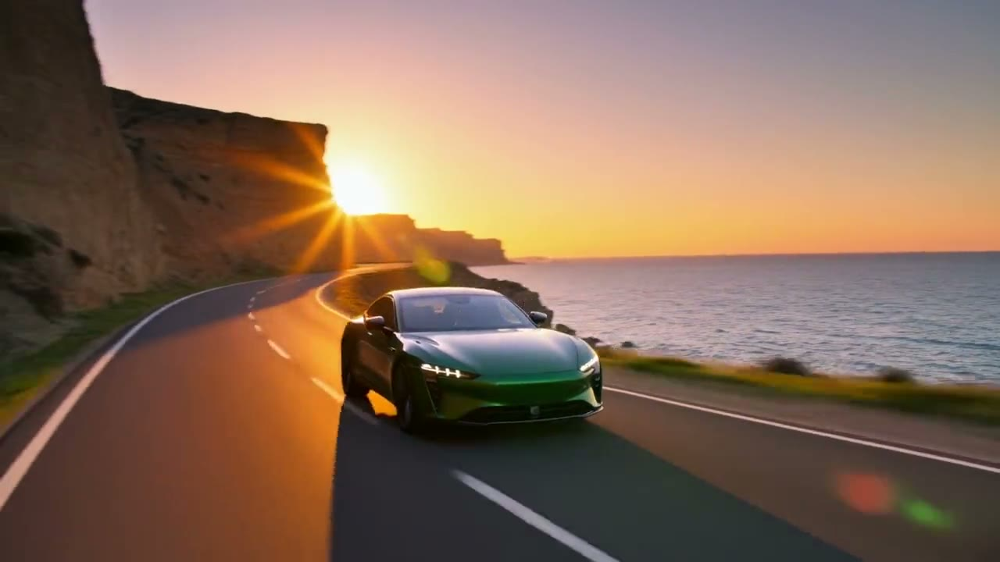</a>
<b>Modèle</b>&nbsp; Kling 3.0 Omni<br>
<b>Clip</b>&nbsp; 5 s · 16:9 · sans son<br>
<b>Sujets</b>&nbsp; <code>[1]</code> votre voiture<br><br>
<b>Photos de référence</b><br> 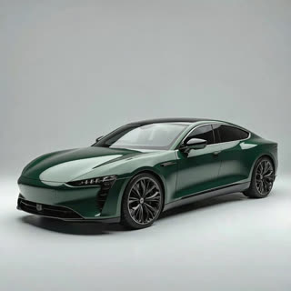  <br><br>
<a href="https://refvid.com/fr/car-cinematic-drive"><b>▶ Voir le clip et le faire avec vos photos</b></a>
</p>
<br clear="left">

```text
Plan 1: Plan de suivi bas à côté de [1] qui roule sur une route côtière sinueuse à l'heure dorée, la mer et les falaises en arrière-plan, la lumière du soleil scintillant sur la carrosserie.
Plan 2: [1] passe lentement tout près de la caméra sur la même route, la lumière chaude glissant le long de la carrosserie de l'avant vers l'arrière, puis poursuit sa route vers le coucher du soleil.
```

<details><summary>Les photos qui marchent le mieux</summary><br>La caméra suit votre voiture de profil puis la laisse passer tout près, donc un profil complet avec toutes les roues dans le cadre compte le plus ; ajoutez une vue de trois quarts avant pour que la calandre, les phares et la teinte restent justes.<br><br><sub>Réalisé avec RefVid sur Kling 3.0 Omni à partir de 4 photos de référence de VELA (un sujet généré par IA), avec le prompt de ce modèle.</sub></details>

### Pub culinaire

<p>
<a href="https://refvid.com/fr/food-pour-steam"></a>
<b>Modèle</b>&nbsp; Kling 3.0 Omni<br>
<b>Clip</b>&nbsp; 5 s · 9:16 · sans son<br>
<b>Sujets</b>&nbsp; <code>[1]</code> votre produit<br><br>
<b>Photos de référence</b><br>   <br><br>
<a href="https://refvid.com/fr/food-pour-steam"><b>▶ Voir le clip et le faire avec vos photos</b></a>
</p>
<br clear="left">

```text
Plan 1: Macro au ralenti : la boisson ou le plat chaud préparé avec [1], brillant et fumant, coule dans une tasse ou un bol en céramique blanche, la vapeur s'enroulant dans une lumière latérale chaude sur fond sombre.
Plan 2: [1] se tient à côté de la tasse ou du bol fumant sur un comptoir en bois, quelques-uns de ses ingrédients éparpillés autour, la caméra se rapproche jusqu'à ce que l'étiquette remplisse le cadre.
```

<details><summary>Les photos qui marchent le mieux</summary><br>La caméra finit par avancer jusqu’à ce que votre étiquette remplisse le cadre : une photo bien de face où chaque mot de l’étiquette est net compte le plus ; ajoutez une vue de profil pour que l’emballage garde sa forme à côté de la tasse fumante.<br><br><sub>Réalisé avec RefVid sur Kling 3.0 Omni à partir de 4 photos de référence d’EMBER (un sujet généré par IA), avec une version antérieure du prompt de ce modèle.</sub></details>

### Sac en ville

<p>
<a href="https://refvid.com/fr/handbag-street-style"></a>
<b>Modèle</b>&nbsp; Kling 4<br>
<b>Clip</b>&nbsp; 5 s · 9:16 · avec son<br>
<b>Sujets</b>&nbsp; <code>[1]</code> votre sac<br><br>
<b>Photos de référence</b><br> 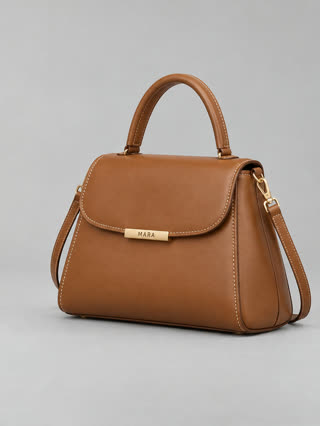<br><br>
<a href="https://refvid.com/fr/handbag-street-style"><b>▶ Voir le clip et le faire avec vos photos</b></a>
</p>
<br clear="left">

```text
Une femme en trench crème marche dans une rue ensoleillée en portant [1] au bras ; la caméra la suit de côté à hauteur de hanche, [1] toujours au centre et au point, se balançant doucement à chaque pas, son visage hors champ. Lumière dorée de fin de journée, faible profondeur de champ, style pub mode.
```

<details><summary>Les photos qui marchent le mieux</summary><br>Le sac se balance à hauteur de hanche à côté de la caméra pendant tout le plan, donc on voit sa face et son flanc : photographiez la face avec les ferrures nettes, le flanc, et une vue avec la bandoulière ou l’anse sur toute sa longueur.<br><br><sub>Réalisé avec RefVid sur Kling 4 à partir de 2 photos de référence de MARA (un sujet créé par IA), avec le prompt de ce modèle.</sub></details>

### Boisson glacée

<p>
<a href="https://refvid.com/fr/iced-drink-frost"></a>
<b>Modèle</b>&nbsp; Kling 4<br>
<b>Clip</b>&nbsp; 5 s · 9:16 · avec son<br>
<b>Sujets</b>&nbsp; <code>[1]</code> votre boisson<br><br>
<b>Photos de référence</b><br> <br><br>
<a href="https://refvid.com/fr/iced-drink-frost"><b>▶ Voir le clip et le faire avec vos photos</b></a>
</p>
<br clear="left">

```text
[1] repose à demi dans un lit de glace pilée ; un givre blanc monte depuis sa base sur toute la surface, une brume froide s’en échappe en volutes et des gouttes de condensation glissent lentement le long de l’étiquette. Contre-jour bleu froid, fond sombre, lent travelling avant, détail macro net.
```

<details><summary>Les photos qui marchent le mieux</summary><br>La condensation coule le long de l’étiquette pendant que la caméra avance : une photo bien de face, l’étiquette à plat et lisible, compte le plus ; si la canette ou la bouteille a un dos ou un bouchon différent, ajoutez-le pour que le givre épouse la bonne forme.<br><br><sub>Réalisé avec RefVid sur Kling 4 à partir de 2 photos de référence de SOL (un sujet créé par IA), avec le prompt de ce modèle.</sub></details>

### Bijou porté

<p>
<a href="https://refvid.com/fr/jewelry-on-hand"></a>
<b>Modèle</b>&nbsp; Kling 4<br>
<b>Clip</b>&nbsp; 5 s · 1:1 · avec son<br>
<b>Sujets</b>&nbsp; <code>[1]</code> votre bijou<br><br>
<b>Photos de référence</b><br>   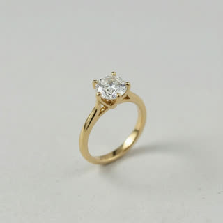<br><br>
<a href="https://refvid.com/fr/jewelry-on-hand"><b>▶ Voir le clip et le faire avec vos photos</b></a>
</p>
<br clear="left">

```text
Gros plan : une main de femme à la manucure naturelle et douce, portant [1], repose sur de la soie crème et se tourne lentement vers la caméra, [1] lançant de petits éclats dans la lumière chaude d’une fenêtre. Faible profondeur de champ, lent travelling avant tout en douceur, élégant et naturel.
```

<details><summary>Les photos qui marchent le mieux</summary><br>Le bijou est porté sur une main qui se tourne vers la caméra : montrez-le sous l’angle de celle qui le porte, plus une vue de profil de l’anneau ou de la chaîne et de la monture ; une photo au doigt ou au poignet aide à garder la bonne taille.<br><br><sub>Réalisé avec RefVid sur Kling 4 à partir de 4 photos de référence de HALO (un sujet créé par IA), avec le prompt de ce modèle.</sub></details>

### Bijou scintillant

<p>
<a href="https://refvid.com/fr/jewelry-sparkle"></a>
<b>Modèle</b>&nbsp; Kling 3.0 Omni<br>
<b>Clip</b>&nbsp; 5 s · 1:1 · sans son<br>
<b>Sujets</b>&nbsp; <code>[1]</code> votre pièce<br><br>
<b>Photos de référence</b><br>   <br><br>
<a href="https://refvid.com/fr/jewelry-sparkle"><b>▶ Voir le clip et le faire avec vos photos</b></a>
</p>
<br clear="left">

```text
Plan macro : [1] repose sur un riche velours noir et tourne lentement pendant qu'un faisceau de lumière douce balaie la pièce, qui accroche la lumière en étincelles et en reflets. Fond noir profond, faible profondeur de champ, luxueux.
```

<details><summary>Les photos qui marchent le mieux</summary><br>Un faisceau de lumière balaie la pièce qui tourne sur le velours noir : prenez des photos rapprochées sur une surface sombre où chaque pierre et chaque facette sont nettes, et une vue de profil de la monture pour que sa profondeur tienne pendant la rotation.<br><br><sub>Réalisé avec RefVid sur Kling 3.0 Omni à partir de 4 photos de référence de HALO (un sujet généré par IA), avec une version antérieure du prompt de ce modèle.</sub></details>

### Swatch rouge à lèvres

<p>
<a href="https://refvid.com/fr/lipstick-swatch">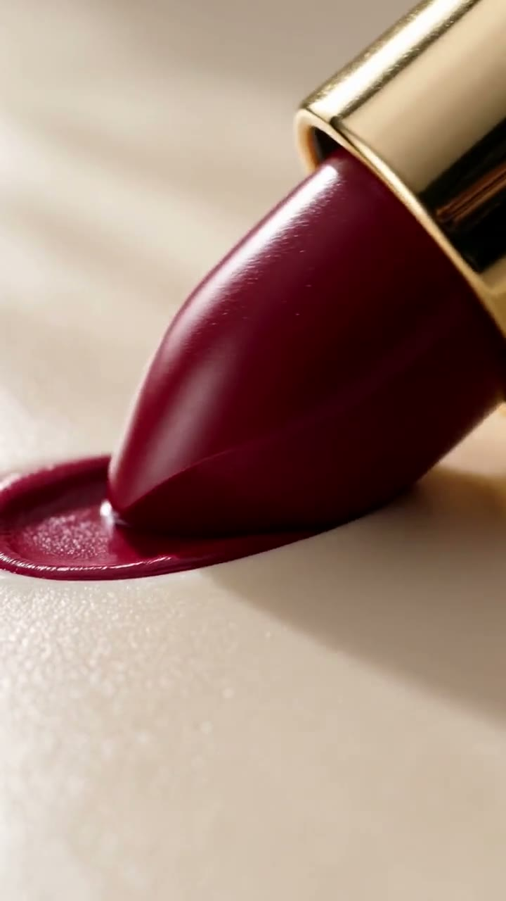</a>
<b>Modèle</b>&nbsp; Kling 4<br>
<b>Clip</b>&nbsp; 5 s · 9:16 · avec son<br>
<b>Sujets</b>&nbsp; <code>[1]</code> votre rouge à lèvres<br><br>
<b>Photos de référence</b><br>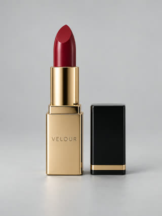 <br><br>
<a href="https://refvid.com/fr/lipstick-swatch"><b>▶ Voir le clip et le faire avec vos photos</b></a>
</p>
<br clear="left">

```text
Macro : la mine de [1] glisse sur une surface crème lisse et laisse un seul swatch brillant et intense de sa couleur, puis la caméra remonte vers [1], debout à côté du swatch dans une douce lumière du jour, la couleur et l’étui parfaitement nets. Style pub beauté épuré, faible profondeur de champ.
```

<details><summary>Les photos qui marchent le mieux</summary><br>Le macro s’ouvre sur la mine qui glisse : photographiez le rouge à lèvres ouvert, la pointe et la vraie teinte bien nettes ; ajoutez une photo de l’étui fermé, debout, comme il se tient à côté du swatch à la fin.<br><br><sub>Réalisé avec RefVid sur Kling 4 à partir de 2 photos de référence de VELOUR (un sujet créé par IA), avec le prompt de ce modèle.</sub></details>

### Révélation parfum

<p>
<a href="https://refvid.com/fr/perfume-reveal"></a>
<b>Modèle</b>&nbsp; Kling 4<br>
<b>Clip</b>&nbsp; 5 s · 9:16 · avec son<br>
<b>Sujets</b>&nbsp; <code>[1]</code> votre parfum<br><br>
<b>Photos de référence</b><br>  <br><br>
<a href="https://refvid.com/fr/perfume-reveal"><b>▶ Voir le clip et le faire avec vos photos</b></a>
</p>
<br clear="left">

```text
[1] repose sur du verre noir brillant, dans une brume douce qui dérive lentement ; une fine bouffée de parfum jaillit du haut et capte un contre-jour doré et chaud, puis la brume se dissipe et un rayon de lumière traverse le verre, pour finir sur l’étiquette, nette et centrée. Clair-obscur, luxueux, lent travelling avant.
```

<details><summary>Les photos qui marchent le mieux</summary><br>Le clip se termine par la lumière qui traverse le verre jusqu’à l’étiquette centrée : photographiez le flacon bien de face, l’étiquette parallèle à l’objectif et sans reflet ; ajoutez-en une sur fond clair pour que le bouchon et la couleur du liquide se lisent nettement.<br><br><sub>Réalisé avec RefVid sur Kling 4 à partir de 3 photos de référence de NOIR 07 (un sujet créé par IA), avec le prompt de ce modèle.</sub></details>

### Produit 360°

<p>
<a href="https://refvid.com/fr/product-360-turntable"></a>
<b>Modèle</b>&nbsp; Kling 3.0 Omni<br>
<b>Clip</b>&nbsp; 5 s · 1:1 · sans son<br>
<b>Sujets</b>&nbsp; <code>[1]</code> votre produit<br><br>
<b>Photos de référence</b><br> 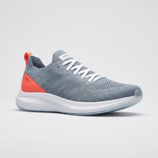 <br><br>
<a href="https://refvid.com/fr/product-360-turntable"><b>▶ Voir le clip et le faire avec vos photos</b></a>
</p>
<br clear="left">

```text
[1], fidèle à l'apparence et aux proportions des photos de référence, est posé sur un plateau tournant de studio blanc et rond, fond gris clair sans couture, sous une lumière de studio douce et uniforme, le produit entier parfaitement net.
```

<details><summary>Les photos qui marchent le mieux</summary><br>Chaque face passe une fois devant l’objectif pendant la rotation : photographiez le produit à la même hauteur, de face, des deux côtés et de dos, sur fond uni ; les clients voient rarement le dos, alors incluez-le s’il porte une étiquette ou un détail.<br><br><sub>Réalisé avec RefVid sur Kling 3.0 Omni à partir de 3 photos de référence d'AERO 1 (sujet créé par IA), avec le prompt de ce modèle.</sub></details>

### Billboard 3D

<p>
<a href="https://refvid.com/fr/product-3d-billboard"></a>
<b>Modèle</b>&nbsp; Kling 4<br>
<b>Clip</b>&nbsp; 5 s · 9:16 · avec son<br>
<b>Sujets</b>&nbsp; <code>[1]</code> votre produit<br><br>
<b>Photos de référence</b><br>   <br><br>
<a href="https://refvid.com/fr/product-3d-billboard"><b>▶ Voir le clip et le faire avec vos photos</b></a>
</p>
<br clear="left">

```text
Un billboard LED 3D incurvé épouse l’angle d’un grand immeuble au crépuscule, vu depuis la rue : [1] en version géante remplit l’écran, tourne lentement, puis semble jaillir au-delà du bord de l’écran au-dessus de la rue en perspective forcée, tandis que la circulation passe en dessous. Style pub CGI anamorphique, caméra qui se relève lentement, lumières de la ville.
```

<details><summary>Les photos qui marchent le mieux</summary><br>Votre produit est agrandi à la taille d’un immeuble et tourne avant de jaillir de l’écran, le moindre flou ou grain de poussière se voit donc : utilisez des photos très nettes en haute résolution sur fond uni, une de face et une de trois quarts pour la rotation.<br><br><sub>Réalisé avec RefVid sur Kling 4 à partir de 4 photos de référence d'EMBER (un sujet créé par IA), avec le prompt de ce modèle.</sub></details>

### Black Friday

<p>
<a href="https://refvid.com/fr/product-black-friday">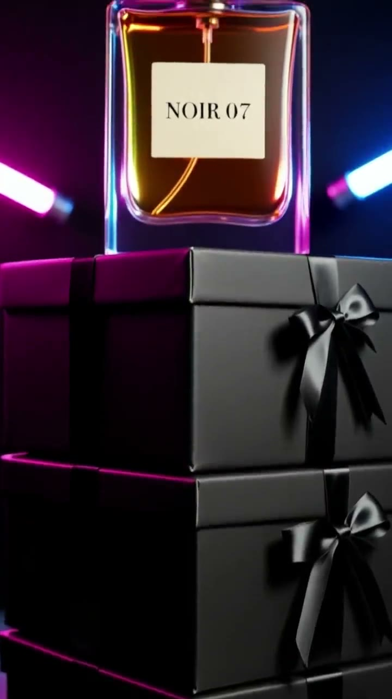</a>
<b>Modèle</b>&nbsp; Kling 3.0 Omni<br>
<b>Clip</b>&nbsp; 5 s · 9:16 · sans son<br>
<b>Sujets</b>&nbsp; <code>[1]</code> votre produit<br><br>
<b>Photos de référence</b><br>  <br><br>
<a href="https://refvid.com/fr/product-black-friday"><b>▶ Voir le clip et le faire avec vos photos</b></a>
</p>
<br clear="left">

```text
Plan 1: Un décor de studio sombre éclairé par des tubes néon rose et bleu, des piles de coffrets cadeaux noirs ornés de rubans satinés ; [1] repose au sommet du plus haut coffret pendant que la caméra s'élève lentement vers lui.
Plan 2: Lent zoom avant sur [1], des reflets néon glissant sur sa surface, l'étiquette nette et centrée, des confettis scintillants qui tombent doucement. Brillant, haut de gamme, contrastes marqués.
```

<details><summary>Les photos qui marchent le mieux</summary><br>La caméra monte vers votre produit posé sur la pile de boîtes cadeaux, puis s’approche jusqu’à placer l’étiquette pile au centre : commencez donc par une photo de face de l’étiquette, sans reflet ; une vue du dessus et des côtés aide les reflets néon à épouser la bonne forme.<br><br><sub>Réalisé avec RefVid sur Kling 3.0 Omni à partir de 3 photos de référence de NOIR 07 (un sujet généré par IA), avec le prompt de ce modèle.</sub></details>

### Bullet time

<p>
<a href="https://refvid.com/fr/product-bullet-time"></a>
<b>Modèle</b>&nbsp; Kling 4<br>
<b>Clip</b>&nbsp; 5 s · 9:16 · avec son<br>
<b>Sujets</b>&nbsp; <code>[1]</code> votre produit<br><br>
<b>Photos de référence</b><br>  <br><br>
<a href="https://refvid.com/fr/product-bullet-time"><b>▶ Voir le clip et le faire avec vos photos</b></a>
</p>
<br clear="left">

```text
Bullet time : [1] flotte dans les airs, immobile au cœur d’une gerbe de gouttelettes et d’éclaboussures d’eau cristalline, chaque goutte en suspension et parfaitement immobile, tandis que la caméra décrit en douceur un demi-cercle autour et finit avec l’étiquette face à l’objectif. Fond en dégradé bleu-blanc doux, lumière de studio vive, détail macro net.
```

<details><summary>Les photos qui marchent le mieux</summary><br>La caméra fait un demi-tour autour de votre produit et s’arrête sur l’étiquette, donc l’arrière et les côtés passent à l’écran : ajoutez une photo de dos et une de profil à côté d’une photo nette de l’étiquette, sans main qui le tienne.<br><br><sub>Réalisé avec RefVid sur Kling 4 à partir de 3 photos de référence de LUMEN (un sujet créé par IA), avec le prompt de ce modèle.</sub></details>

### Cadeau de Noël

<p>
<a href="https://refvid.com/fr/product-christmas-gift"></a>
<b>Modèle</b>&nbsp; Kling 3.0 Omni<br>
<b>Clip</b>&nbsp; 5 s · 9:16 · sans son<br>
<b>Sujets</b>&nbsp; <code>[1]</code> votre produit<br><br>
<b>Photos de référence</b><br>  <br><br>
<a href="https://refvid.com/fr/product-christmas-gift"><b>▶ Voir le clip et le faire avec vos photos</b></a>
</p>
<br clear="left">

```text
Plan 1: Une boîte cadeau blanche ornée d'un ruban de satin rouge repose sous un sapin de Noël illuminé, dans un flou chaleureux de guirlandes ; une paire de mains tire le ruban et soulève le couvercle.
Plan 2: Vue dans la boîte ouverte : [1] repose sur un papier de soie blanc et net, l'étiquette bien lisible face à la caméra, des lumières dorées scintillent autour tandis que la caméra avance lentement.
```

<details><summary>Les photos qui marchent le mieux</summary><br>Le second plan plonge dans la boîte cadeau ouverte, où votre produit repose sur du papier de soie, étiquette vers le haut : ajoutez une photo prise légèrement en plongée, étiquette lisible, et photographiez-le seul pour que la boîte cadeau soit la seule boîte de la vidéo.<br><br><sub>Réalisée avec RefVid sur Kling 3.0 Omni à partir de 3 photos de référence de NOIR 07 (un sujet généré par IA), avec le prompt de ce modèle.</sub></details>

### Flat lay

<p>
<a href="https://refvid.com/fr/product-flat-lay"></a>
<b>Modèle</b>&nbsp; Kling 3.0 Omni<br>
<b>Clip</b>&nbsp; 5 s · 1:1 · sans son<br>
<b>Sujets</b>&nbsp; <code>[1]</code> votre produit<br><br>
<b>Photos de référence</b><br> 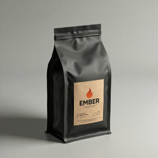  <br><br>
<a href="https://refvid.com/fr/product-flat-lay"><b>▶ Voir le clip et le faire avec vos photos</b></a>
</p>
<br clear="left">

```text
Vue en plongée d'une mise en scène à plat sur une surface de lin beige chaud : [1] repose au centre tandis que trois ou quatre petits accessoires choisis pour ce produit précis, des objets du quotidien que ses acheteurs utilisent avec lui, dans des couleurs qui lui vont, entrent un à un dans le cadre autour de lui. Lumière de jour douce et uniforme.
```

<details><summary>Les photos qui marchent le mieux</summary><br>Tout est filmé à la verticale, donc la photo qui compte est votre produit posé à plat, pris pile au-dessus, étiquette vers le haut ; une vue de profil aide le clip à garder son épaisseur et sa façon de reposer sur le lin.<br><br><sub>Réalisé avec RefVid sur Kling 3.0 Omni à partir de 4 photos de référence d’EMBER (un sujet généré par IA), avec une version antérieure du prompt de ce modèle.</sub></details>

### Produit flottant

<p>
<a href="https://refvid.com/fr/product-floating"></a>
<b>Modèle</b>&nbsp; Kling 4<br>
<b>Clip</b>&nbsp; 5 s · 9:16 · avec son<br>
<b>Sujets</b>&nbsp; <code>[1]</code> votre produit<br><br>
<b>Photos de référence</b><br>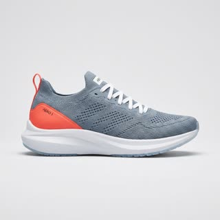  <br><br>
<a href="https://refvid.com/fr/product-floating"><b>▶ Voir le clip et le faire avec vos photos</b></a>
</p>
<br clear="left">

```text
[1] flotte en apesanteur dans les airs devant un fond en dégradé doux pêche-lavande, effectuant lentement un demi-tour tout en montant et descendant doucement, une ombre ronde et douce au sol en dessous. Apesanteur, lumière de studio vive et douce, caméra fixe, détail net sur l’étiquette.
```

<details><summary>Les photos qui marchent le mieux</summary><br>Votre produit fait un demi-tour en flottant, le clip doit donc connaître son dos autant que sa face : donnez une photo de face propre avec l’étiquette, puis le dos et un côté, idéalement sur fond uni.<br><br><sub>Réalisé avec RefVid sur Kling 4 à partir de 3 photos de référence d'AERO 1 (un sujet créé par IA), avec le prompt de ce modèle.</sub></details>

### Révélation produit

<p>
<a href="https://refvid.com/fr/product-hero-reveal"></a>
<b>Modèle</b>&nbsp; Kling 3.0 Omni<br>
<b>Clip</b>&nbsp; 5 s · 16:9 · sans son<br>
<b>Sujets</b>&nbsp; <code>[1]</code> votre produit<br><br>
<b>Photos de référence</b><br>  <br><br>
<a href="https://refvid.com/fr/product-hero-reveal"><b>▶ Voir le clip et le faire avec vos photos</b></a>
</p>
<br clear="left">

```text
Plan 1: Obscurité, puis un faisceau étroit de lumière chaude balaie lentement [1] posé sur un socle en pierre noire, en accrochant ses bords et ses reflets. Éclairage tamisé, cinématographique, volutes de brume.
Plan 2: Lent travelling avant sur [1] pendant que la lumière se stabilise, l'étiquette nette et centrée, fond noir profond.
```

<details><summary>Les photos qui marchent le mieux</summary><br>Un fin faisceau de lumière balaie les arêtes et la finition avant l’approche sur l’étiquette : montrez donc la matière telle qu’elle est, avec une photo de face à l’étiquette nette et une vue de biais où la lumière accroche les arêtes, la brillance ou la texture.<br><br><sub>Réalisé avec RefVid sur Kling 3.0 Omni à partir de 3 photos de référence de NOIR 07 (un sujet créé par IA), avec le prompt de ce modèle.</sub></details>

### Pub UGC

<p>
<a href="https://refvid.com/fr/product-in-hand-ugc"></a>
<b>Modèle</b>&nbsp; Kling 3.0 Omni<br>
<b>Clip</b>&nbsp; 10 s · 9:16 · avec son<br>
<b>Sujets</b>&nbsp; <code>[1]</code> le présentateur · <code>[2]</code> votre produit<br><br>
<b>Photos de référence</b><br> 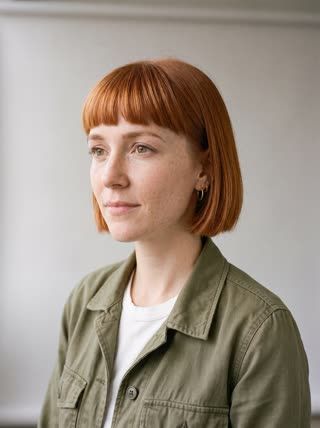     <br><br>
<a href="https://refvid.com/fr/product-in-hand-ugc"><b>▶ Voir le clip et le faire avec vos photos</b></a>
</p>
<br clear="left">

```text
Plan 1: Vidéo tenue à la main, façon selfie, dans une pièce lumineuse de la maison : [1] tient [2] à côté de son visage, sourit à la caméra du téléphone et dit : "Okay, I have to show you this one."
Plan 2: Gros plan de [2] dans la main de [1], tourné lentement pour que l'étiquette fasse face à la caméra ; puis [1] regarde à nouveau la caméra et hoche la tête. Lumière naturelle du jour.
```

<details><summary>Les photos qui marchent le mieux</summary><br>Le présentateur tient votre produit à côté de son visage, puis le fait tourner en gros plan : donnez une photo de face bien nette du présentateur et une photo de l’étiquette prise bien droite ; une photo du produit en main aide à respecter sa taille.<br><br><sub>Réalisé avec RefVid sur Kling 3.0 Omni à partir de 7 photos de référence de Mia et LUMEN (un sujet généré par IA), avec une version antérieure du prompt de ce modèle.</sub></details>

### Explosion d’ingrédients

<p>
<a href="https://refvid.com/fr/product-ingredient-splash"></a>
<b>Modèle</b>&nbsp; Kling 4<br>
<b>Clip</b>&nbsp; 5 s · 9:16 · avec son<br>
<b>Sujets</b>&nbsp; <code>[1]</code> votre produit<br><br>
<b>Photos de référence</b><br>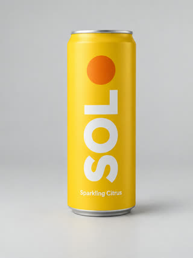 <br><br>
<a href="https://refvid.com/fr/product-ingredient-splash"><b>▶ Voir le clip et le faire avec vos photos</b></a>
</p>
<br clear="left">

```text
Ralenti : [1] se tient au centre devant un fond éclatant de la couleur principale de son emballage tandis que ses principaux ingrédients, ceux que nomme son étiquette, jaillissent d’en bas et virevoltent autour, des gouttes traversant la lumière, puis ils retombent et [1] reste impeccable, l’étiquette face à la caméra. Lumière de studio vive, détail net.
```

<details><summary>Les photos qui marchent le mieux</summary><br>Le fond reprend la couleur principale de votre emballage et les ingrédients qui s’envolent sont ceux qui y sont imprimés : la photo clé est donc la face avant, noms d’ingrédients lisibles et couleurs fidèles, ni sombre ni teintée.<br><br><sub>Réalisé avec RefVid sur Kling 4 à partir de 2 photos de référence de SOL (un sujet généré par IA), avec une version antérieure du prompt de ce modèle.</sub></details>

### Lifestyle maison

<p>
<a href="https://refvid.com/fr/product-lifestyle-home"></a>
<b>Modèle</b>&nbsp; Kling 3.0 Omni<br>
<b>Clip</b>&nbsp; 5 s · 16:9 · sans son<br>
<b>Sujets</b>&nbsp; <code>[1]</code> votre produit<br><br>
<b>Photos de référence</b><br>  <br><br>
<a href="https://refvid.com/fr/product-lifestyle-home"><b>▶ Voir le clip et le faire avec vos photos</b></a>
</p>
<br clear="left">

```text
Plan 1: Une chambre calme et ensoleillée : la caméra glisse lentement devant des rideaux en lin et une plante en pot, jusqu'à [1] posé sur une commode en bois près de la fenêtre.
Plan 2: La caméra se pose sur [1], l'étiquette nette, une lumière douce du matin et les ombres légères des feuilles qui défilent dessus.
```

<details><summary>Les photos qui marchent le mieux</summary><br>La caméra traverse une chambre et se pose sur votre produit debout sur une commode : utilisez une photo où il est droit, à hauteur d’yeux, étiquette face à vous ; des photos en douce lumière du jour l’aident à se fondre dans la lumière du matin.<br><br><sub>Réalisé avec RefVid sur Kling 3.0 Omni à partir de 3 photos de référence de NOIR 07 (un sujet généré par IA), avec le prompt de ce modèle.</sub></details>

### Pluie de pétales

<p>
<a href="https://refvid.com/fr/product-petal-fall"></a>
<b>Modèle</b>&nbsp; Kling 4<br>
<b>Clip</b>&nbsp; 5 s · 9:16 · avec son<br>
<b>Sujets</b>&nbsp; <code>[1]</code> votre produit<br><br>
<b>Photos de référence</b><br>  <br><br>
<a href="https://refvid.com/fr/product-petal-fall"><b>▶ Voir le clip et le faire avec vos photos</b></a>
</p>
<br clear="left">

```text
Ralenti : de doux pétales de rose rose pâle tombent dans une lumière chaude autour de [1], sur un socle en pierre claire devant un fond rose poudré ; quelques pétales se posent à côté tandis que la caméra avance doucement jusqu’à ce que l’étiquette remplisse le cadre. Arrière-plan onirique et flou, style pub beauté.
```

<details><summary>Les photos qui marchent le mieux</summary><br>La caméra s’approche jusqu’à ce que l’étiquette remplisse tout le cadre : votre photo d’étiquette doit tenir de près, petits caractères et finition visibles ; ajoutez une vue entière du produit debout, tel qu’il se tiendra sur le socle en pierre.<br><br><sub>Réalisé avec RefVid sur Kling 4 à partir de 3 photos de référence de LUMEN (un sujet créé par IA), avec le prompt de ce modèle.</sub></details>

### Déballage

<p>
<a href="https://refvid.com/fr/product-unboxing"></a>
<b>Modèle</b>&nbsp; Kling 3.0 Omni<br>
<b>Clip</b>&nbsp; 10 s · 9:16 · avec son<br>
<b>Sujets</b>&nbsp; <code>[1]</code> votre produit<br><br>
<b>Photos de référence</b><br>  <br><br>
<a href="https://refvid.com/fr/product-unboxing"><b>▶ Voir le clip et le faire avec vos photos</b></a>
</p>
<br clear="left">

```text
Plan 1: Plan en plongée d'une boîte kraft unie posée sur une table en bois clair, sous une lumière douce de jour ; deux mains soulèvent le couvercle et replient un papier de soie blanc. Bruissement de papier.
Plan 2: Gros plan au moment où les mains sortent [1] de la boîte et le tiennent en l'air, le tournant lentement pour que l'étiquette fasse face à la caméra.
Plan 3: [1] se tient sur la table à côté de la boîte ouverte, la caméra avance doucement. Propre, lumineux, faible profondeur de champ.
```

<details><summary>Les photos qui marchent le mieux</summary><br>Des mains sortent votre produit d’une boîte en kraft et le tournent vers la caméra : montrez chaque face qui passe à l’écran, l’étiquette avant, le dos et le dessous, photographiés seuls, hors de toute boîte.<br><br><sub>Réalisé avec RefVid sur Kling 3.0 Omni à partir de 3 photos de référence de LUMEN (un sujet créé par IA), avec le prompt de ce modèle.</sub></details>

### Éclaboussure

<p>
<a href="https://refvid.com/fr/product-water-splash"></a>
<b>Modèle</b>&nbsp; Kling 3.0 Omni<br>
<b>Clip</b>&nbsp; 5 s · 9:16 · sans son<br>
<b>Sujets</b>&nbsp; <code>[1]</code> votre produit<br><br>
<b>Photos de référence</b><br>  <br><br>
<a href="https://refvid.com/fr/product-water-splash"><b>▶ Voir le clip et le faire avec vos photos</b></a>
</p>
<br clear="left">

```text
Ralenti : [1] plonge dans une cuve d'eau cristalline sur un fond en dégradé bleu doux, une explosion de bulles et de gouttelettes jaillissant autour de lui, puis il se stabilise debout, l'étiquette face à la caméra. Lumière de studio vive, détail macro.
```

<details><summary>Les photos qui marchent le mieux</summary><br>Votre produit plonge dans l’eau et se redresse : il lui faut une vue debout complète, du bouchon à la base, étiquette bien de face ; écartez les photos où l’eau ou les reflets masquent l’impression.<br><br><sub>Réalisé avec RefVid sur Kling 3.0 Omni à partir de 3 photos de référence de LUMEN (un sujet créé par IA), avec le prompt de ce modèle.</sub></details>

### Texture de soin

<p>
<a href="https://refvid.com/fr/skincare-texture-macro"></a>
<b>Modèle</b>&nbsp; Kling 3.0 Omni<br>
<b>Clip</b>&nbsp; 5 s · 9:16 · sans son<br>
<b>Sujets</b>&nbsp; <code>[1]</code> votre produit<br><br>
<b>Photos de référence</b><br>  <br><br>
<a href="https://refvid.com/fr/skincare-texture-macro"><b>▶ Voir le clip et le faire avec vos photos</b></a>
</p>
<br clear="left">

```text
Plan 1: Macro extrême : une seule noisette brillante de la formule de [1], dans sa couleur et sa texture propres, se pose sur une surface lisse de pierre pâle et s’étale lentement. Lumière du jour douce, arrière-plan crémeux.
Plan 2: [1] se tient sur la pierre pâle à côté de quelques morceaux de son ingrédient principal, celui que nomme son étiquette, dans la lumière douce d’une fenêtre le matin, la caméra avançant doucement jusqu’à ce que l’étiquette remplisse le cadre.
```

<details><summary>Les photos qui marchent le mieux</summary><br>Le premier plan montre la formule elle-même : ajoutez une photo d’un swatch ou d’une noisette qui montre sa vraie couleur et sa texture, puis une photo de face nette du pot, du tube ou du flacon, car la caméra finit sur l’étiquette plein cadre.<br><br><sub>Réalisé avec RefVid sur Kling 3.0 Omni à partir de 3 photos de référence de LUMEN (un sujet généré par IA), avec une version antérieure du prompt de ce modèle.</sub></details>

### Pub sneakers

<p>
<a href="https://refvid.com/fr/sneaker-street-walk"></a>
<b>Modèle</b>&nbsp; Kling 3.0 Omni<br>
<b>Clip</b>&nbsp; 5 s · 9:16 · sans son<br>
<b>Sujets</b>&nbsp; <code>[1]</code> vos chaussures<br><br>
<b>Photos de référence</b><br>  <br><br>
<a href="https://refvid.com/fr/sneaker-street-walk"><b>▶ Voir le clip et le faire avec vos photos</b></a>
</p>
<br clear="left">

```text
Plan 1: Caméra basse à hauteur de cheville qui suit une paire de pieds chaussés de [1] marchant d'un pas vif sur un trottoir urbain ensoleillé, ombres des passants, faible profondeur de champ.
Plan 2: Gros plan sur [1] qui se pose en pleine foulée sur le bitume, un peu de poussière qui se soulève, la caméra ralentissant jusqu'à s'arrêter à côté.
```

<details><summary>Les photos qui marchent le mieux</summary><br>La caméra au ras du sol suit les chaussures de profil, puis capte l’une d’elles qui se pose en gros plan : le profil extérieur, tranche de semelle comprise, compte le plus ; une photo de la paire portée rend la foulée et l’ajustement naturels.<br><br><sub>Réalisé avec RefVid sur Kling 3.0 Omni à partir de 3 photos de référence d'AERO 1 (un sujet créé par IA), avec le prompt de ce modèle.</sub></details>

### Révélation tech

<p>
<a href="https://refvid.com/fr/tech-gadget-reveal"></a>
<b>Modèle</b>&nbsp; Kling 4<br>
<b>Clip</b>&nbsp; 5 s · 16:9 · avec son<br>
<b>Sujets</b>&nbsp; <code>[1]</code> votre appareil<br><br>
<b>Photos de référence</b><br>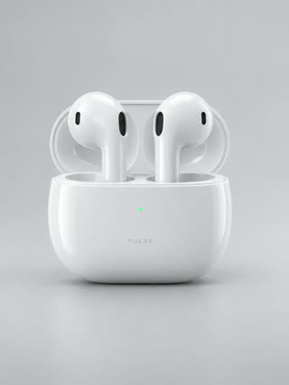 <br><br>
<a href="https://refvid.com/fr/tech-gadget-reveal"><b>▶ Voir le clip et le faire avec vos photos</b></a>
</p>
<br clear="left">

```text
[1] repose sur une surface noire mate dans une quasi-obscurité ; un fin trait de lumière bleue froide souligne ses contours, puis la lumière s’ouvre et la caméra glisse en arc lent autour, captant des reflets nets sur sa surface, pour finir de face avec chaque détail net. Style lancement tech épuré, fond noir profond, légère brume.
```

<details><summary>Les photos qui marchent le mieux</summary><br>La lumière dessine d’abord la silhouette, puis la caméra décrit un arc pour finir de face : donnez une photo de face bien droite, écran ou logo visible, et une vue de biais qui montre les arêtes, les ports et la finition du boîtier.<br><br><sub>Réalisé avec RefVid sur Kling 4 à partir de 2 photos de référence de PULSE (un sujet créé par IA), avec le prompt de ce modèle.</sub></details>

### Montre en macro

<p>
<a href="https://refvid.com/fr/watch-macro"></a>
<b>Modèle</b>&nbsp; Kling 4<br>
<b>Clip</b>&nbsp; 5 s · 1:1 · avec son<br>
<b>Sujets</b>&nbsp; <code>[1]</code> votre montre<br><br>
<b>Photos de référence</b><br> <br><br>
<a href="https://refvid.com/fr/watch-macro"><b>▶ Voir le clip et le faire avec vos photos</b></a>
</p>
<br clear="left">

```text
Macro extrême de [1] : la caméra glisse lentement sur le cadran pendant que la trotteuse balaie, la lumière courant sur le boîtier poli et les index, puis recule pour montrer la montre entière posée sur du cuir sombre. Lumière chaude et tamisée, faible profondeur de champ, détails luxueux.
```

<details><summary>Les photos qui marchent le mieux</summary><br>La caméra démarre en très gros plan sur le cadran : commencez par une vue de dessus nette, sans reflet, où index, aiguilles et logo sont lisibles ; ajoutez une vue de profil du boîtier et de la couronne, et une avec le bracelet déployé.<br><br><sub>Réalisé avec RefVid sur Kling 4 à partir de 2 photos de référence d'ATLAS (un sujet créé par IA), avec le prompt de ce modèle.</sub></details>

[↑ Retour au sommaire](#sommaire)

## Personnes

Vous, un ami ou un couple dans chaque plan, à partir de quelques photos de chaque visage.

### Road trip

<p>
<a href="https://refvid.com/fr/best-friends-road-trip">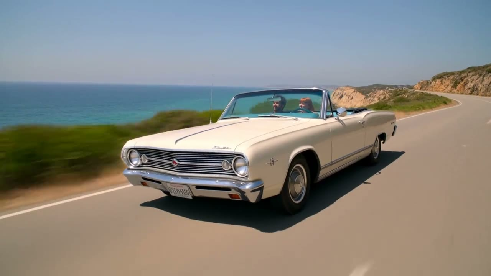</a>
<b>Modèle</b>&nbsp; Kling 3.0 Omni<br>
<b>Clip</b>&nbsp; 10 s · 16:9 · avec son<br>
<b>Sujets</b>&nbsp; <code>[1]</code> vous · <code>[2]</code> votre ami<br><br>
<b>Photos de référence</b><br>       <br><br>
<a href="https://refvid.com/fr/best-friends-road-trip"><b>▶ Voir le clip et le faire avec vos photos</b></a>
</p>
<br clear="left">

```text
Plan 1: Un cabriolet vintage roule le long d'une route côtière ensoleillée ; [1] au volant et [2] sur le siège passager rient, les cheveux soufflés par le vent. Plan large en travelling.
Plan 2: Plan serré à deux à l'intérieur de la voiture : [2] chante à tue-tête pendant que [1] rit et secoue la tête. Bruit du vent, lumière chaleureuse.
Plan 3: La voiture garée sur un belvédère au sommet d'une falaise, au coucher du soleil ; [1] et [2] assis sur le capot, vus de dos, qui regardent la mer.
```

<details><summary>Les photos qui marchent le mieux</summary><br>Vous êtes assis côte à côte à l’avant, puis vus de dos sur le capot : ajoutez pour chacun une photo de face bien nette, une de trois quarts et une qui montre clairement les cheveux et la silhouette.<br><br><sub>Créé avec RefVid sur Kling 3.0 Omni à partir de 8 photos de référence de Mia et Leo (un sujet généré par IA), avec le prompt de ce modèle.</sub></details>

### Vœux d’anniversaire

<p>
<a href="https://refvid.com/fr/birthday-greeting"></a>
<b>Modèle</b>&nbsp; Kling 3.0 Omni<br>
<b>Clip</b>&nbsp; 5 s · 9:16 · avec son<br>
<b>Sujets</b>&nbsp; <code>[1]</code> vous<br><br>
<b>Photos de référence</b><br>   <br><br>
<a href="https://refvid.com/fr/birthday-greeting"><b>▶ Voir le clip et le faire avec vos photos</b></a>
</p>
<br clear="left">

```text
Gros plan moyen de [1] dans un salon chaleureux, tenant face caméra un petit gâteau aux bougies allumées, puis souriant et disant avec tendresse : "Happy birthday! I hope this year is your best one yet." Lumière douce du soir, guirlandes lumineuses en arrière-plan.
```

<details><summary>Les photos qui marchent le mieux</summary><br>C’est un seul plan rapproché où vous parlez derrière un gâteau aux bougies : une photo de face bien nette, cadrée à hauteur de poitrine, fonctionne le mieux, et une lumière intérieure chaude aide votre teint à s’accorder à la lueur des bougies.<br><br><sub>Réalisé avec RefVid sur Kling 3.0 Omni à partir de 4 photos de référence de Leo (un sujet généré par IA), avec le prompt de ce modèle.</sub></details>

### Émission de cuisine

<p>
<a href="https://refvid.com/fr/chef-cooking-show"></a>
<b>Modèle</b>&nbsp; Kling 3.0 Omni<br>
<b>Clip</b>&nbsp; 10 s · 16:9 · avec son<br>
<b>Sujets</b>&nbsp; <code>[1]</code> vous<br><br>
<b>Photos de référence</b><br>   <br><br>
<a href="https://refvid.com/fr/chef-cooking-show"><b>▶ Voir le clip et le faire avec vos photos</b></a>
</p>
<br clear="left">

```text
Plan 1: Une cuisine familiale chaleureuse avec des casseroles en cuivre et des herbes sur le plan de travail : [1], en tablier marine, sourit à la caméra et dit : "Welcome back to Sunday Kitchen. Today: the easiest pasta you’ll ever make."
Plan 2: Gros plan d'une poêle sur la cuisinière pendant que [1] fait sauter ail et tomates dans l'huile d'olive, une flamme jaillit. Son de friture.
Plan 3: [1] pose devant la caméra une assiette de spaghettis au basilic frais et hoche la tête, satisfait.
```

<details><summary>Les photos qui marchent le mieux</summary><br>Vous parlez face caméra au comptoir puis hochez la tête devant l’assiette finie, donc une photo de face bien nette avec un sourire naturel compte le plus ; une autre les cheveux attachés, comme en cuisine, vous garde identique devant le feu.<br><br><sub>Réalisé avec RefVid sur Kling 3.0 Omni à partir de 4 photos de référence de Leo (un sujet généré par IA), avec le prompt de ce modèle.</sub></details>

### Marché de Noël

<p>
<a href="https://refvid.com/fr/christmas-market-couple"></a>
<b>Modèle</b>&nbsp; Kling 3.0 Omni<br>
<b>Clip</b>&nbsp; 5 s · 16:9 · sans son<br>
<b>Sujets</b>&nbsp; <code>[1]</code> vous · <code>[2]</code> votre partenaire<br><br>
<b>Photos de référence</b><br>       <br><br>
<a href="https://refvid.com/fr/christmas-market-couple"><b>▶ Voir le clip et le faire avec vos photos</b></a>
</p>
<br clear="left">

```text
Plan 1: Crépuscule sur un marché de Noël enneigé avec des étals en bois et des guirlandes de lumières chaudes : [1] et [2] avancent bras dessus bras dessous vers la caméra, chacun tenant une tasse fumante de vin chaud, en riant. De la neige légère tombe.
Plan 2: Plan serré à deux : [2] retire un flocon des cheveux de [1] et ils échangent un sourire tranquille, les lumières du marché brillant doucement derrière eux.
```

<details><summary>Les photos qui marchent le mieux</summary><br>Vous marchez bras dessus bras dessous vers la caméra puis partagez un moment tout proche, face à face : il faut à chacun une photo de face bien nette et un profil, avec les cheveux coiffés comme d’habitude, puisqu’on en chasse un flocon.<br><br><sub>Créé avec RefVid sur Kling 3.0 Omni à partir de 8 photos de référence de Mia et Leo (sujet généré par IA), avec le prompt de ce modèle.</sub></details>

### Vœux de Noël

<p>
<a href="https://refvid.com/fr/christmas-sweater-greeting"></a>
<b>Modèle</b>&nbsp; Kling 3.0 Omni<br>
<b>Clip</b>&nbsp; 5 s · 9:16 · avec son<br>
<b>Sujets</b>&nbsp; <code>[1]</code> vous<br><br>
<b>Photos de référence</b><br>   <br><br>
<a href="https://refvid.com/fr/christmas-sweater-greeting"><b>▶ Voir le clip et le faire avec vos photos</b></a>
</p>
<br clear="left">

```text
Plan 1: Un salon douillet le soir : un sapin de Noël illuminé de guirlandes chaleureuses et une cheminée qui crépite, avec des chaussettes accrochées ; [1], en pull de Noël rouge en tricot, est assis sur le tapis et tient une tasse de chocolat chaud, la caméra se rapprochant lentement.
Plan 2: [1] lève les yeux vers la caméra avec un sourire chaleureux et dit : "Merry Christmas, I miss you all. See you soon!" Le feu crépite doucement.
```

<details><summary>Les photos qui marchent le mieux</summary><br>Vous êtes assis sur le tapis et levez les yeux vers la caméra pour dire votre vœu : une photo de face prise un peu en plongée, le visage dans une lumière douce et chaude, colle le mieux au plan ; une photo assise aide le pull à tomber naturellement.<br><br><sub>Réalisé avec RefVid sur Kling 3.0 Omni à partir de 4 photos de référence de Mia (un sujet généré par IA), avec le prompt de ce modèle.</sub></details>

### Coucher de soleil

<p>
<a href="https://refvid.com/fr/couple-beach-sunset">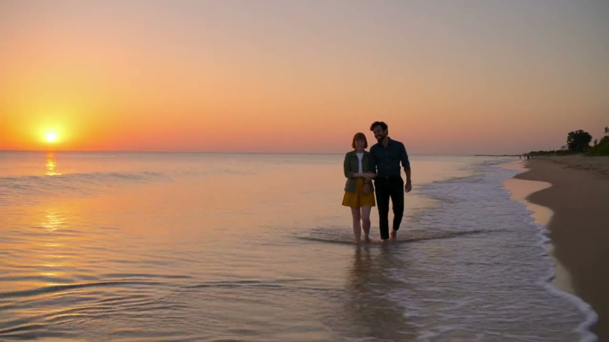</a>
<b>Modèle</b>&nbsp; Kling 3.0 Omni<br>
<b>Clip</b>&nbsp; 10 s · 16:9 · sans son<br>
<b>Sujets</b>&nbsp; <code>[1]</code> vous · <code>[2]</code> votre partenaire<br><br>
<b>Photos de référence</b><br>       <br><br>
<a href="https://refvid.com/fr/couple-beach-sunset"><b>▶ Voir le clip et le faire avec vos photos</b></a>
</p>
<br clear="left">

```text
Plan 1: Plan large à l'heure dorée : [1] et [2] marchent pieds nus le long du rivage d'une plage tranquille, vers la caméra, en discutant, de petites vagues qui viennent mouiller leurs pieds.
Plan 2: Plan moyen de [1] et [2] qui rient ensemble, le soleil bas et chaud derrière eux, les cheveux qui bougent dans la brise marine.
Plan 3: [1] et [2] se tiennent côte à côte, vus de dos, et regardent le soleil plonger dans la mer. Lent travelling avant, ciel orangé et chaleureux.
```

<details><summary>Les photos qui marchent le mieux</summary><br>Le premier plan vous fait marcher vers la caméra et le dernier vous montre de dos face au coucher de soleil : ajoutez pour chacun une photo de face nette et une de dos avec cheveux et épaules ; des photos en pied gardent vos tailles justes.<br><br><sub>Réalisé avec RefVid sur Kling 3.0 Omni à partir de 8 photos de référence de Mia et Leo (un sujet généré par IA), avec le prompt de ce modèle.</sub></details>

### Lookbook mode

<p>
<a href="https://refvid.com/fr/fashion-lookbook-walk"></a>
<b>Modèle</b>&nbsp; Kling 3.0 Omni<br>
<b>Clip</b>&nbsp; 10 s · 9:16 · sans son<br>
<b>Sujets</b>&nbsp; <code>[1]</code> vous<br><br>
<b>Photos de référence</b><br>   <br><br>
<a href="https://refvid.com/fr/fashion-lookbook-walk"><b>▶ Voir le clip et le faire avec vos photos</b></a>
</p>
<br clear="left">

```text
Plan 1: Plan large : [1] en trench camel sur un t-shirt blanc et un jean à jambes larges avance d'un pas assuré vers la caméra dans une calme ruelle parisienne, sous une douce lumière matinale.
Plan 2: Prise de vue latérale en contre-plongée suivant [1] en pleine marche, le manteau ondulant à chaque pas, les vitrines défilant derrière.
Plan 3: Gros plan : [1] se retourne par-dessus l'épaule vers la caméra avec un léger sourire, les cheveux captant la lumière.
```

<details><summary>Les photos qui marchent le mieux</summary><br>Les trois plans vous montrent marchant de face, en contre-plongée de profil puis vous retournant par-dessus l’épaule : ajoutez une photo en pied de face, une de profil et une où vous regardez en arrière, celle de face nette et bien éclairée.<br><br><sub>Réalisé avec RefVid sur Kling 3.0 Omni à partir de 4 photos de référence de Mia (un sujet généré par IA), avec le prompt de ce modèle.</sub></details>

### Coach sportif

<p>
<a href="https://refvid.com/fr/fitness-coach-demo"></a>
<b>Modèle</b>&nbsp; Kling 3.0 Omni<br>
<b>Clip</b>&nbsp; 5 s · 9:16 · avec son<br>
<b>Sujets</b>&nbsp; <code>[1]</code> vous<br><br>
<b>Photos de référence</b><br>   <br><br>
<a href="https://refvid.com/fr/fitness-coach-demo"><b>▶ Voir le clip et le faire avec vos photos</b></a>
</p>
<br clear="left">

```text
Plan 1: Une salle de sport moderne et lumineuse avec de grandes baies vitrées : [1], en tenue d'entraînement noire, effectue un squat lent au poids du corps vu de profil, dos droit, bras tendus vers l'avant. Ambiance de salle de sport.
Plan 2: [1] se redresse, regarde la caméra et dit avec un sourire encourageant : "Push the floor away, and keep your chest up."
```

<details><summary>Les photos qui marchent le mieux</summary><br>Le squat est filmé de profil avant que vous parliez face caméra : ajoutez une vue de profil en pied, en tenue de sport, et une photo de face bien nette du visage ; une photo qui montre votre carrure rend le mouvement fidèle à vous.<br><br><sub>Réalisée avec RefVid sur Kling 3.0 Omni à partir de 4 photos de référence de Leo (un sujet généré par IA), avec le prompt de ce modèle.</sub></details>

### Fantôme en drap

<p>
<a href="https://refvid.com/fr/halloween-bedsheet-ghost"></a>
<b>Modèle</b>&nbsp; Kling 3.0 Omni<br>
<b>Clip</b>&nbsp; 6 s · 9:16 · sans son<br>
<b>Sujets</b>&nbsp; <code>[1]</code> vous<br><br>
<b>Photos de référence</b><br>   <br><br>
<a href="https://refvid.com/fr/halloween-bedsheet-ghost"><b>▶ Voir le clip et le faire avec vos photos</b></a>
</p>
<br clear="left">

```text
Plan 1: Une silhouette sous un simple drap blanc percé de deux trous pour les yeux, avec des lunettes de soleil noires, se tient sur un chemin couvert de feuilles dans un parc d'automne à l'heure dorée, et se tourne lentement vers la caméra. Caméra à l'épaule, lumière chaude, feuilles qui tombent.
Plan 2: La silhouette retire le drap : c'est [1], souriant, le drap sur un bras, des feuilles tourbillonnant. Plan moyen, contre-jour doré et doux.
```

<details><summary>Les photos qui marchent le mieux</summary><br>Vous n’apparaissez qu’une fois le drap retiré, souriant dans un contre-jour doré : une photo de face bien nette, coiffé comme d’habitude, compte le plus ; une photo en pied garde votre taille juste sous le drap.<br><br><sub>Réalisé avec RefVid sur Kling 3.0 Omni à partir de 4 photos de référence de Mia (un sujet généré par IA), avec le prompt de ce modèle.</sub></details>

### Essayage de costumes

<p>
<a href="https://refvid.com/fr/halloween-costume-try-on"></a>
<b>Modèle</b>&nbsp; Kling 3.0 Omni<br>
<b>Clip</b>&nbsp; 10 s · 9:16 · sans son<br>
<b>Sujets</b>&nbsp; <code>[1]</code> vous<br><br>
<b>Photos de référence</b><br>   <br><br>
<a href="https://refvid.com/fr/halloween-costume-try-on"><b>▶ Voir le clip et le faire avec vos photos</b></a>
</p>
<br clear="left">

```text
Plan 1: [1] en vêtements du quotidien fait un tour devant un grand miroir de chambre et se retrouve face caméra en vampire : tête nue, cape noire à col haut doublée de rouge, petites dents de vampire en plastique, visage entièrement visible. Guirlandes lumineuses chaudes, rendu caméra de téléphone.
Plan 2: Coupure franche : [1] tourne à nouveau et la cape a disparu ; elle apparaît dans un costume de citrouille orange rond et bouffant avec un col à tige verte, tête nue, riant à la caméra.
Plan 3: Coupure franche : [1] fait un troisième tour et le costume de citrouille disparaît ; elle apparaît en sorcière, robe noire longue et chapeau pointu noir, lançant à la caméra un clin d'œil espiègle.
```

<details><summary>Les photos qui marchent le mieux</summary><br>Chaque costume laisse la tête nue et vous pivotez trois fois vers la caméra : ajoutez une photo de face nette où tout le visage et les cheveux se voient, plus une photo en pied pour garder votre silhouette dans chaque tenue.<br><br><sub>Réalisé avec RefVid sur Kling 3.0 Omni à partir de 4 photos de référence de Mia (un sujet généré par IA), avec le prompt de ce modèle.</sub></details>

### Tête de citrouille

<p>
<a href="https://refvid.com/fr/halloween-pumpkin-head"></a>
<b>Modèle</b>&nbsp; Kling 3.0 Omni<br>
<b>Clip</b>&nbsp; 6 s · 9:16 · sans son<br>
<b>Sujets</b>&nbsp; <code>[1]</code> vous<br><br>
<b>Photos de référence</b><br>   <br><br>
<a href="https://refvid.com/fr/halloween-pumpkin-head"><b>▶ Voir le clip et le faire avec vos photos</b></a>
</p>
<br clear="left">

```text
Plan 1: Dans un studio sombre au fond orange profond, une personne en col roulé noir tient devant son visage une citrouille sculptée lumineuse, avec la flamme d'une bougie qui vacille à l'intérieur. Lent travelling avant, lumière basse et atmosphérique.
Plan 2: [1] abaisse la citrouille à hauteur de poitrine et regarde droit dans la caméra avec un léger sourire, la lueur de la bougie éclairant le visage par en dessous. Gros plan, style cinématographique.
```

<details><summary>Les photos qui marchent le mieux</summary><br>Votre visage n’apparaît qu’à la fin, en gros plan éclairé par en dessous par la bougie : une photo bien de face, nette, sans chapeau ni lunettes de soleil compte le plus ; un regard calme ou un léger sourire convient au plan.<br><br><sub>Réalisé avec RefVid sur Kling 3.0 Omni à partir de 4 photos de référence de Mia (un sujet généré par IA), avec le prompt de ce modèle.</sub></details>

### Flash Y2K

<p>
<a href="https://refvid.com/fr/halloween-y2k-flash"></a>
<b>Modèle</b>&nbsp; Kling 3.0 Omni<br>
<b>Clip</b>&nbsp; 5 s · 9:16 · sans son<br>
<b>Sujets</b>&nbsp; <code>[1]</code> vous<br><br>
<b>Photos de référence</b><br>   <br><br>
<a href="https://refvid.com/fr/halloween-y2k-flash"><b>▶ Voir le clip et le faire avec vos photos</b></a>
</p>
<br clear="left">

```text
Le rendu d'une photo de fête prise avec un appareil jetable en 2004 : une soirée d'Halloween entre amis, de nuit, lumière directe et vive du flash, peau légèrement surexposée, ombre dure sur le mur derrière, gros grain de pellicule, guirlandes lumineuses en arrière-plan. [1] avec des oreilles de chat noires se tient près de l'encadrement de la porte, un gobelet en carton rouge à la main, se tourne vers la caméra, rit et fait un signe de paix. Pas de reflet de lumière sur le visage.
```

<details><summary>Les photos qui marchent le mieux</summary><br>Le flash direct aplatit la lumière : une photo de face prise sous une lumière uniforme, sans ombres marquées, donne le rendu le plus fidèle ; vous vous tournez vers l’objectif en riant, alors une photo souriante aide.<br><br><sub>Réalisé avec RefVid sur Kling 3.0 Omni à partir de 4 photos de référence de Mia (un sujet créé par IA), avec le prompt de ce modèle.</sub></details>

### Marche zombie

<p>
<a href="https://refvid.com/fr/halloween-zombie-walk"></a>
<b>Modèle</b>&nbsp; Kling 3.0 Omni<br>
<b>Clip</b>&nbsp; 5 s · 16:9 · avec son<br>
<b>Sujets</b>&nbsp; <code>[1]</code> vous<br><br>
<b>Photos de référence</b><br>   <br><br>
<a href="https://refvid.com/fr/halloween-zombie-walk"><b>▶ Voir le clip et le faire avec vos photos</b></a>
</p>
<br clear="left">

```text
Plan 1: Plan américain dans une rue brumeuse la nuit, sous un lampadaire qui vacille : [1] déguisé en zombie pour Halloween, visage recouvert d'une épaisse peinture gris-vert, ombres creuses peintes autour des yeux, faux sang au coin de la bouche, chemise en flanelle déchirée et tachée, avance lentement vers la caméra en raidissant les bras. Lumière bleue froide, brouillard qui dérive.
Plan 2: Gros plan sur [1], toujours avec la peinture zombie gris-vert et le faux sang, qui s'arrête sous le lampadaire, incline la tête, puis esquisse soudain un sourire face à la caméra. Grondement sourd, vent lointain.
```

<details><summary>Les photos qui marchent le mieux</summary><br>Peinture gris-vert et ombres sombres couvrent votre visage, c’est donc l’ossature qui vous rend reconnaissable : utilisez une photo de face nette et un profil sous une lumière neutre, sans maquillage ni lunettes, car le plan finit sur votre sourire.<br><br><sub>Réalisé avec RefVid sur Kling 3.0 Omni à partir de 4 photos de référence de Mia (sujet généré par IA), avec le prompt de ce modèle.</sub></details>

### Présentation vidéo

<p>
<a href="https://refvid.com/fr/linkedin-intro"></a>
<b>Modèle</b>&nbsp; Kling 3.0 Omni<br>
<b>Clip</b>&nbsp; 5 s · 16:9 · avec son<br>
<b>Sujets</b>&nbsp; <code>[1]</code> vous<br><br>
<b>Photos de référence</b><br>   <br><br>
<a href="https://refvid.com/fr/linkedin-intro"><b>▶ Voir le clip et le faire avec vos photos</b></a>
</p>
<br clear="left">

```text
Plan moyen de [1] assis dans un bureau moderne et lumineux, avec des plantes et une fenêtre en arrière-plan, regardant droit vers la caméra et disant avec un sourire calme : "Hi, I’m Leo — I help small brands tell their story on video." Lumière douce du jour.
```

<details><summary>Les photos qui marchent le mieux</summary><br>Vous parlez droit à l’objectif depuis un bureau : une photo nette, de face et à hauteur des yeux, avec un sourire détendu, compte le plus ; ajoutez-en une qui montre vos épaules et le genre de haut que vous portez au travail.<br><br><sub>Réalisé avec RefVid sur Kling 3.0 Omni à partir de 4 photos de référence de Leo (sujet généré par IA), avec le prompt de ce modèle.</sub></details>

### Mini-drame

<p>
<a href="https://refvid.com/fr/mini-drama-scene">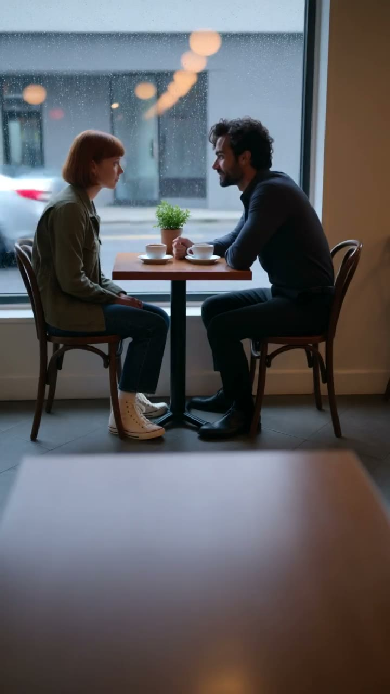</a>
<b>Modèle</b>&nbsp; Kling 3.0 Omni<br>
<b>Clip</b>&nbsp; 10 s · 9:16 · avec son<br>
<b>Sujets</b>&nbsp; <code>[1]</code> le premier personnage principal · <code>[2]</code> le second personnage principal<br><br>
<b>Photos de référence</b><br>       <br><br>
<a href="https://refvid.com/fr/mini-drama-scene"><b>▶ Voir le clip et le faire avec vos photos</b></a>
</p>
<br clear="left">

```text
Plan 1: Soirée pluvieuse dans un café calme : [1] et [2] sont assis de part et d’autre d’une petite table, un café intact entre eux. Plan large, lumière douce et mélancolique venue de la fenêtre.
Plan 2: Gros plan sur [1], regard fixe, qui dit doucement : "You knew all along, didn’t you?"
Plan 3: Gros plan sur [2], qui baisse les yeux, puis les relève, et répond : "I was going to tell you tonight."
```

<details><summary>Les photos qui marchent le mieux</summary><br>Chaque rôle a un gros plan serré pour sa réplique : donnez pour les deux personnes des photos nettes de face, l’expression calme et sérieuse plutôt qu’un grand sourire ; une vue de trois quarts de chacune aide quand elles se font face à table.<br><br><sub>Réalisée avec RefVid sur Kling 3.0 Omni à partir de 8 photos de référence de Mia et Leo (sujet généré par IA), avec le prompt de ce modèle.</sub></details>

### Routine du matin

<p>
<a href="https://refvid.com/fr/morning-routine"></a>
<b>Modèle</b>&nbsp; Kling 3.0 Omni<br>
<b>Clip</b>&nbsp; 5 s · 9:16 · sans son<br>
<b>Sujets</b>&nbsp; <code>[1]</code> vous<br><br>
<b>Photos de référence</b><br>   <br><br>
<a href="https://refvid.com/fr/morning-routine"><b>▶ Voir le clip et le faire avec vos photos</b></a>
</p>
<br clear="left">

```text
Plan 1: Lumière douce du matin dans une cuisine calme et épurée : [1], en chemise de lin ample, verse lentement de l'eau chaude sur un café filtre, la vapeur monte, des plantes sur le rebord de la fenêtre.
Plan 2: [1] est assis près de la fenêtre, la tasse entre les deux mains, prend une première gorgée lente et regarde dehors, avec un léger sourire. Lumière chaude, faible profondeur de champ.
```

<details><summary>Les photos qui marchent le mieux</summary><br>Le second plan est un regard doux par la fenêtre, la tasse aux lèvres : une photo nette de votre visage de profil ou de trois quarts compte autant qu’une de face ; une photo de vos mains aide pour le versement.<br><br><sub>Créé avec RefVid sur Kling 3.0 Omni à partir de 4 photos de référence de Mia (un sujet généré par IA), avec le prompt de ce modèle.</sub></details>

### Compte à rebours

<p>
<a href="https://refvid.com/fr/new-year-countdown"></a>
<b>Modèle</b>&nbsp; Kling 3.0 Omni<br>
<b>Clip</b>&nbsp; 5 s · 16:9 · avec son<br>
<b>Sujets</b>&nbsp; <code>[1]</code> vous<br><br>
<b>Photos de référence</b><br>   <br><br>
<a href="https://refvid.com/fr/new-year-countdown"><b>▶ Voir le clip et le faire avec vos photos</b></a>
</p>
<br clear="left">

```text
Plan 1: Plan américain face caméra sur une terrasse de toit à minuit le soir du réveillon, la skyline scintillant en arrière-plan : [1] en tenue pailletée lève un verre de champagne et compte à rebours vers la caméra avec un grand sourire : "Three, two, one…"
Plan 2: [1] se tourne vers la caméra et crie "Happy New Year!", verre levé, tandis que des feux d’artifice dorés éclatent au-dessus de la skyline, des confettis flottant dans l’air.
```

<details><summary>Les photos qui marchent le mieux</summary><br>Vous faites le compte à rebours face caméra puis criez de joie bouche grande ouverte : une photo nette de face avec un grand sourire ouvert compte le plus ; une photo prise à bout de bras, cheveux et buste visibles, vous garde reconnaissable dans la tenue de fête.<br><br><sub>Réalisé avec RefVid sur Kling 3.0 Omni à partir de 4 photos de référence de Mia (un sujet créé par IA), avec le prompt de ce modèle.</sub></details>

### Animateur de podcast

<p>
<a href="https://refvid.com/fr/podcast-host"></a>
<b>Modèle</b>&nbsp; Kling 3.0 Omni<br>
<b>Clip</b>&nbsp; 5 s · 16:9 · avec son<br>
<b>Sujets</b>&nbsp; <code>[1]</code> vous<br><br>
<b>Photos de référence</b><br>   <br><br>
<a href="https://refvid.com/fr/podcast-host"><b>▶ Voir le clip et le faire avec vos photos</b></a>
</p>
<br clear="left">

```text
Plan américain de [1] à un bureau de studio de podcast, avec un micro sur bras articulé et un casque sur les oreilles, éclairage chaud d’une lampe et panneaux acoustiques en arrière-plan, qui se penche légèrement vers l’avant et dit en souriant : "Welcome back to Small Brands, Big Stories."
```

<details><summary>Les photos qui marchent le mieux</summary><br>Le casque couvre vos oreilles et vous vous penchez vers un micro sur bras articulé : montrez bien la naissance des cheveux et les oreilles sur une photo de face et ajoutez une vue de trois quarts ; si vous portez des lunettes dans votre émission, portez-les aussi sur les photos.<br><br><sub>Réalisé avec RefVid sur Kling 3.0 Omni à partir de 4 photos de référence de Leo (sujet généré par IA), avec le prompt de ce modèle.</sub></details>

### Duo de rap

<p>
<a href="https://refvid.com/fr/rap-duo-booth"></a>
<b>Modèle</b>&nbsp; Kling 3.0 Omni<br>
<b>Clip</b>&nbsp; 15 s · 9:16 · avec son<br>
<b>Sujets</b>&nbsp; <code>[1]</code> vous · <code>[2]</code> votre partenaire de rap<br><br>
<b>Photos de référence</b><br>       <br><br>
<a href="https://refvid.com/fr/rap-duo-booth"><b>▶ Voir le clip et le faire avec vos photos</b></a>
</p>
<br clear="left">

```text
Dans une petite cabine de studio de musique aux murs et au sol orange vif sans raccord, éclairée uniformément de face, deux micros chant sur pied. [1] et [2], en streetwear, se tiennent côte à côte face à la caméra et rappent un couplet rapide sur un beat trap appuyé, en hochant la tête et en bougeant les mains en rythme. [1] rappe : "Same face every frame, yeah we never switch it up." Puis [2] rappe : "Two photos in and now the whole world's watching us." Puis ils rappent ensemble, tout sourire. Plan moyen vertical fixe, ambiance de performance live.
```

<details><summary>Les photos qui marchent le mieux</summary><br>Vous rappez côte à côte face à la caméra, en plan moyen : chacun a besoin d’une photo de face nette, la bouche bien dégagée, et d’une photo à mi-corps pour que vos tailles et vos carrures soient justes l’une à côté de l’autre.<br><br><sub>Créé avec RefVid sur Kling 3.0 Omni à partir de 8 photos de référence de Mia et Leo (un sujet généré par IA), avec le prompt de ce modèle.</sub></details>

### Atterrissage de héros

<p>
<a href="https://refvid.com/fr/superhero-landing"></a>
<b>Modèle</b>&nbsp; Kling 3.0 Omni<br>
<b>Clip</b>&nbsp; 5 s · 16:9 · sans son<br>
<b>Sujets</b>&nbsp; <code>[1]</code> vous<br><br>
<b>Photos de référence</b><br>   <br><br>
<a href="https://refvid.com/fr/superhero-landing"><b>▶ Voir le clip et le faire avec vos photos</b></a>
</p>
<br clear="left">

```text
Plan 1: Un soir d'orage au-dessus d'une ville : [1], vêtu d'une armure originale bleu nuit à reflets argentés, tombe du ciel et atterrit sur un toit en trois appuis, un poing posé sur le béton, les fissures se propageant et la poussière s'envolant vers l'extérieur.
Plan 2: [1] se redresse lentement après l'impact et regarde droit dans la caméra, le vent agitant le costume, des éclairs illuminant le ciel derrière. Contre-plongée, style cinématographique.
```

<details><summary>Les photos qui marchent le mieux</summary><br>Le costume remplace vos vêtements, c’est donc votre visage qui porte toute la ressemblance : une photo de face nette pour le regard final face caméra, plus une prise légèrement d’en bas ou de profil, car vous vous relevez filmé en contre-plongée.<br><br><sub>Réalisé avec RefVid sur Kling 3.0 Omni à partir de 4 photos de référence de Mia (sujet généré par IA), avec le prompt de ce modèle.</sub></details>

### Pub face caméra

<p>
<a href="https://refvid.com/fr/talking-head-ad"></a>
<b>Modèle</b>&nbsp; Kling 3.0 Omni<br>
<b>Clip</b>&nbsp; 5 s · 9:16 · avec son<br>
<b>Sujets</b>&nbsp; <code>[1]</code> le présentateur<br><br>
<b>Photos de référence</b><br>   <br><br>
<a href="https://refvid.com/fr/talking-head-ad"><b>▶ Voir le clip et le faire avec vos photos</b></a>
</p>
<br clear="left">

```text
Plan américain serré de [1] assis dans un bureau à domicile lumineux, regardant droit vers la caméra, qui dit avec un sourire chaleureux : "Here is the one thing I wish I had known sooner." Lumière douce de fenêtre, faible profondeur de champ.
```

<details><summary>Les photos qui marchent le mieux</summary><br>Le présentateur parle droit dans l’objectif en plan rapproché, le visage et la bouche portent donc tout le clip : prenez des photos de face à hauteur d’yeux, sans lunettes de soleil ni main près de la bouche, dont une avec un sourire naturel.<br><br><sub>Réalisé avec RefVid sur Kling 3.0 Omni à partir de 4 photos de référence de Mia (un sujet créé par IA), avec le prompt de ce modèle.</sub></details>

### Toast de Thanksgiving

<p>
<a href="https://refvid.com/fr/thanksgiving-table"></a>
<b>Modèle</b>&nbsp; Kling 3.0 Omni<br>
<b>Clip</b>&nbsp; 5 s · 16:9 · avec son<br>
<b>Sujets</b>&nbsp; <code>[1]</code> vous<br><br>
<b>Photos de référence</b><br>   <br><br>
<a href="https://refvid.com/fr/thanksgiving-table"><b>▶ Voir le clip et le faire avec vos photos</b></a>
</p>
<br clear="left">

```text
Plan 1: Une longue table de Thanksgiving baignée de la lumière chaude des bougies : une dinde rôtie, des bols d'accompagnements, de petites citrouilles et des feuilles d'automne, la caméra glissant lentement le long de la table jusqu'à [1] assis en bout de table.
Plan 2: [1] se lève, lève un verre de vin rouge vers la caméra et dit avec un sourire chaleureux : "To all of us, and to next year." Lumière douce des bougies, léger tintement des verres.
```

<details><summary>Les photos qui marchent le mieux</summary><br>Vous vous levez en bout de table et levez votre verre vers la caméra : une photo de face chaleureuse, avec un sourire naturel, compte le plus ; une photo à mi-corps aide le clip à rendre vos épaules et votre tenue quand vous vous levez.<br><br><sub>Réalisée avec RefVid sur Kling 3.0 Omni à partir de 4 photos de référence de Mia (sujet généré par IA), avec le prompt de ce modèle.</sub></details>

### Vlog de voyage

<p>
<a href="https://refvid.com/fr/travel-vlog-walk"></a>
<b>Modèle</b>&nbsp; Kling 3.0 Omni<br>
<b>Clip</b>&nbsp; 10 s · 9:16 · avec son<br>
<b>Sujets</b>&nbsp; <code>[1]</code> vous<br><br>
<b>Photos de référence</b><br>   <br><br>
<a href="https://refvid.com/fr/travel-vlog-walk"><b>▶ Voir le clip et le faire avec vos photos</b></a>
</p>
<br clear="left">

```text
Plan 1: Plan de vlog caméra à l'épaule : [1] descend une rue ensoleillée de la vieille ville, pavée, bordée de cafés et de maisons pastel, tenant la caméra à bout de bras, le sourire aux lèvres. Bruits de la rue, légère brise.
Plan 2: [1] s'arrête près d'une fontaine et dit face caméra : "Okay, this little street is my favourite thing so far."
Plan 3: [1] retourne la caméra pour révéler une vaste vue sur les toits de tuiles terre cuite jusqu'à la mer, à l'heure dorée.
```

<details><summary>Les photos qui marchent le mieux</summary><br>La caméra reste à bout de bras tout du long : le clip s’appuie donc sur des selfies de votre visage pris légèrement d’en haut, à la lumière du jour ; ajoutez une photo en pied pour que la marche dans la rue garde votre silhouette et vos vêtements.<br><br><sub>Réalisé avec RefVid sur Kling 3.0 Omni à partir de 4 photos de référence de Mia (un sujet généré par IA), avec l'invite de ce modèle.</sub></details>

### Save the date

<p>
<a href="https://refvid.com/fr/wedding-save-the-date"></a>
<b>Modèle</b>&nbsp; Kling 3.0 Omni<br>
<b>Clip</b>&nbsp; 10 s · 16:9 · sans son<br>
<b>Sujets</b>&nbsp; <code>[1]</code> vous · <code>[2]</code> votre partenaire<br><br>
<b>Photos de référence</b><br>       <br><br>
<a href="https://refvid.com/fr/wedding-save-the-date"><b>▶ Voir le clip et le faire avec vos photos</b></a>
</p>
<br clear="left">

```text
Plan 1: Lumière de fin d’après-midi dans une roseraie en fleurs : [1] et [2] marchent main dans la main sur une allée de gravier, vers la caméra, en se souriant.
Plan 2: Plan américain : [2] glisse quelque chose à l’oreille de [1], qui rit et se penche vers lui ; flou doux de fleurs à l’arrière-plan.
Plan 3: Gros plan sur leurs mains jointes, une simple bague de fiançailles en or captant la lumière.
```

<details><summary>Les photos qui marchent le mieux</summary><br>Vous marchez main dans la main vers la caméra, puis riez ensemble en plan moyen : chacun a besoin d’une photo de face nette et souriante et d’une photo en pied ; pour votre vraie bague dans le gros plan, ajoutez une photo de vos mains jointes.<br><br><sub>Réalisé avec RefVid sur Kling 3.0 Omni à partir de 8 photos de référence de Mia et Leo (un sujet généré par IA), avec le prompt de ce modèle.</sub></details>

[↑ Retour au sommaire](#sommaire)

## Animaux

Votre chien ou votre chat, le même animal dans chaque plan.

### Rap de chien

<p>
<a href="https://refvid.com/fr/dog-rap-video"></a>
<b>Modèle</b>&nbsp; Kling 3.0 Omni<br>
<b>Clip</b>&nbsp; 10 s · 9:16 · avec son<br>
<b>Sujets</b>&nbsp; <code>[1]</code> vous · <code>[2]</code> votre chien<br><br>
<b>Photos de référence</b><br>       <br><br>
<a href="https://refvid.com/fr/dog-rap-video"><b>▶ Voir le clip et le faire avec vos photos</b></a>
</p>
<br clear="left">

```text
Dans une petite cabine de studio d'enregistrement aux murs de mousse acoustique sombre, baignée d'une chaude lumière orange, un micro chant sur pied entre eux. [1], casque sur les oreilles et sweat à capuche, se tient à côté de [2] le chien, assis sur un haut tabouret avec une petite chaîne en or, qui hoche la tête sur un beat hip-hop appuyé. [1] rappe face caméra : "Me and my dog, yeah we run this block." Puis [2] le chien se penche vers le micro et lui répond en rappant d'une voix rauque de dessin animé, la gueule bougeant au rythme des mots : "Treats on the table and we never stop." [1] éclate de rire. Plan moyen vertical fixe.
```

<details><summary>Les photos qui marchent le mieux</summary><br>Votre chien rappe dans le micro, la gueule en mouvement : une photo de face bien nette de sa tête, museau et taches en lumière claire, compte le plus ; pour vous, une photo de face prise debout convient à la cabine.<br><br><sub>Créé avec RefVid sur Kling 3.0 Omni à partir de 8 photos de référence de Leo et Biscuit (un sujet généré par IA), avec le prompt de ce modèle.</sub></details>

### Coucher de soleil à deux

<p>
<a href="https://refvid.com/fr/pet-and-owner-sunset"></a>
<b>Modèle</b>&nbsp; Kling 3.0 Omni<br>
<b>Clip</b>&nbsp; 10 s · 16:9 · sans son<br>
<b>Sujets</b>&nbsp; <code>[1]</code> votre animal · <code>[2]</code> vous<br><br>
<b>Photos de référence</b><br>       <br><br>
<a href="https://refvid.com/fr/pet-and-owner-sunset"><b>▶ Voir le clip et le faire avec vos photos</b></a>
</p>
<br clear="left">

```text
Plan 1: Plan large à l’heure dorée : [2] marche pieds nus le long du rivage d’une plage calme, [1] avance à leur côté, de douces vagues viennent mourir sur le sable, le soleil bas et chaud dans leur dos.
Plan 2: [2] et [1] sont assis côte à côte sur le sable, vus de dos, et regardent le soleil plonger dans la mer. Lent travelling avant, ciel orangé et chaud.
```

<details><summary>Les photos qui marchent le mieux</summary><br>Les deux plans vous montrent côte à côte, le second de dos : ajoutez pour vous deux des photos en entier de profil et de dos, pas seulement des visages ; le dos et la queue de votre animal portent le plan du coucher de soleil.<br><br><sub>Réalisé avec RefVid sur Kling 3.0 Omni à partir de 8 photos de référence de Biscuit et Mia (sujet généré par IA), avec le prompt de ce modèle.</sub></details>

### Animal astronaute

<p>
<a href="https://refvid.com/fr/pet-astronaut"></a>
<b>Modèle</b>&nbsp; Kling 3.0 Omni<br>
<b>Clip</b>&nbsp; 5 s · 16:9 · sans son<br>
<b>Sujets</b>&nbsp; <code>[1]</code> votre animal<br><br>
<b>Photos de référence</b><br>   <br><br>
<a href="https://refvid.com/fr/pet-astronaut"><b>▶ Voir le clip et le faire avec vos photos</b></a>
</p>
<br clear="left">

```text
Dans une station spatiale lumineuse, [1] en petite combinaison d'astronaute blanche, casque ouvert, flotte en apesanteur vers la caméra, les pattes en suspension, tandis que la Terre bleue brille à travers le grand hublot derrière. Mouvement lent et onirique.
```

<details><summary>Les photos qui marchent le mieux</summary><br>Le visage de votre animal est encadré par la visière ouverte du casque pendant qu’il flotte vers vous : une photo nette de face, yeux et museau bien visibles, compte le plus ; la combinaison cache le corps, c’est donc le pelage autour du visage qui le rend reconnaissable.<br><br><sub>Réalisé avec RefVid sur Kling 3.0 Omni à partir de 4 photos de référence de Miso (sujet généré par IA), avec le prompt de ce modèle.</sub></details>

### Anniversaire d’animal

<p>
<a href="https://refvid.com/fr/pet-birthday-party"></a>
<b>Modèle</b>&nbsp; Kling 3.0 Omni<br>
<b>Clip</b>&nbsp; 5 s · 9:16 · avec son<br>
<b>Sujets</b>&nbsp; <code>[1]</code> votre animal<br><br>
<b>Photos de référence</b><br>   <br><br>
<a href="https://refvid.com/fr/pet-birthday-party"><b>▶ Voir le clip et le faire avec vos photos</b></a>
</p>
<br clear="left">

```text
Plan 1: [1] est assis à une petite table, coiffé d'un minuscule chapeau de fête rayé, avec des ballons colorés en arrière-plan et un petit gâteau d'anniversaire à trois bougies allumées devant lui. Lumière chaude de maison, léger travelling avant.
Plan 2: [1] lève les yeux vers la caméra à côté du gâteau, penche la tête et émet un petit son joyeux, de sa propre voix naturelle. Mise au point douce sur les bougies, ambiance d'anniversaire cosy.
```

<details><summary>Les photos qui marchent le mieux</summary><br>Votre animal est assis à une petite table et lève les yeux vers l’objectif sous un minuscule chapeau de fête : une photo prise légèrement d’en haut, oreilles et yeux nets, compte le plus ; une photo de lui assis bien droit montre sa posture à côté du gâteau.<br><br><sub>Réalisé avec RefVid sur Kling 3.0 Omni à partir de 4 photos de référence de Biscuit (un sujet généré par IA), avec la consigne de ce modèle.</sub></details>

### Animal chef

<p>
<a href="https://refvid.com/fr/pet-chef"></a>
<b>Modèle</b>&nbsp; Kling 3.0 Omni<br>
<b>Clip</b>&nbsp; 5 s · 9:16 · avec son<br>
<b>Sujets</b>&nbsp; <code>[1]</code> votre animal<br><br>
<b>Photos de référence</b><br> 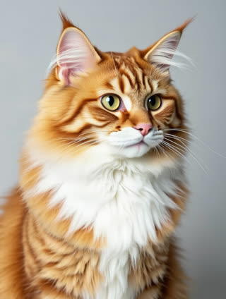  <br><br>
<a href="https://refvid.com/fr/pet-chef"><b>▶ Voir le clip et le faire avec vos photos</b></a>
</p>
<br clear="left">

```text
Plan 1: [1] coiffé d'un petit bonnet de chef blanc est assis bien droit à un plan de travail douillet, derrière une poêle où des légumes crépitent, de la vapeur qui monte, lumière douce du matin. Son de crépitement.
Plan 2: [1] est assis à côté d'une assiette de sauté de légumes colorés et regarde fièrement la caméra, le bonnet de chef légèrement incliné.
```

<details><summary>Les photos qui marchent le mieux</summary><br>La toque est posée sur la tête de votre animal et le second plan est un regard fier, de près, vers l’objectif : une photo nette de face, les deux oreilles dans le cadre, compte le plus ; ajoutez une vue de profil pour que le pelage et la taille tiennent au comptoir.<br><br><sub>Réalisé avec RefVid sur Kling 3.0 Omni à partir de 4 photos de référence de Miso (un sujet généré par IA), avec le prompt de ce modèle.</sub></details>

### Noël de l’animal

<p>
<a href="https://refvid.com/fr/pet-christmas-morning"></a>
<b>Modèle</b>&nbsp; Kling 3.0 Omni<br>
<b>Clip</b>&nbsp; 5 s · 9:16 · sans son<br>
<b>Sujets</b>&nbsp; <code>[1]</code> votre animal<br><br>
<b>Photos de référence</b><br>   <br><br>
<a href="https://refvid.com/fr/pet-christmas-morning"><b>▶ Voir le clip et le faire avec vos photos</b></a>
</p>
<br clear="left">

```text
Plan 1: Matin de Noël dans un salon douillet : [1], coiffé d'une petite écharpe rouge en tricot, est assis à côté d'un sapin de Noël illuminé et flaire avec curiosité un cadeau emballé dans du papier rouge, noué d'un ruban doré. Guirlandes lumineuses chaleureuses, lumière douce du matin.
Plan 2: Gros plan dans le même salon, le sapin illuminé en arrière-plan : [1], toujours avec son écharpe rouge, attrape le ruban doré et tire sur le papier d'emballage ; des morceaux de papier rouge volent, puis il lève les yeux vers la caméra.
```

<details><summary>Les photos qui marchent le mieux</summary><br>Le premier plan montre votre animal de profil, reniflant le cadeau, et l’écharpe entoure son cou : ajoutez une photo de profil nette où l’on voit le museau et le poitrail, avec une de face pour le regard levé final.<br><br><sub>Réalisé avec RefVid sur Kling 3.0 Omni à partir de 4 photos de référence de Biscuit (un sujet généré par IA), avec la consigne de ce modèle.</sub></details>

### Animal qui s’anime

<p>
<a href="https://refvid.com/fr/pet-comes-to-life"></a>
<b>Modèle</b>&nbsp; Kling 3.0 Omni<br>
<b>Clip</b>&nbsp; 5 s · 9:16 · sans son<br>
<b>Sujets</b>&nbsp; <code>[1]</code> votre animal<br><br>
<b>Photos de référence</b><br>   <br><br>
<a href="https://refvid.com/fr/pet-comes-to-life"><b>▶ Voir le clip et le faire avec vos photos</b></a>
</p>
<br clear="left">

```text
[1] est allongé sur une couverture douce, sur un canapé, dans la lumière chaude de l'après-midi ; il cligne lentement des yeux, incline la tête et regarde droit vers la caméra, respirant doucement. Léger rapprochement progressif, intérieur cosy, faible profondeur de champ.
```

<details><summary>Les photos qui marchent le mieux</summary><br>C’est un seul plan rapproché et calme où votre animal, allongé, croise votre regard : la photo qui compte le plus est une photo nette à hauteur de ses yeux, où leur couleur et le poil autour sont bien visibles ; une photo de lui couché aide pour la pose.<br><br><sub>Réalisée avec RefVid sur Kling 3.0 Omni à partir de 4 photos de référence de Biscuit (un sujet généré par IA), avec une version antérieure de la consigne de ce modèle.</sub></details>

### Portrait de famille

<p>
<a href="https://refvid.com/fr/pet-family-portrait"></a>
<b>Modèle</b>&nbsp; Kling 3.0 Omni<br>
<b>Clip</b>&nbsp; 5 s · 1:1 · sans son<br>
<b>Sujets</b>&nbsp; <code>[1]</code> votre premier animal · <code>[2]</code> votre second animal<br><br>
<b>Photos de référence</b><br>       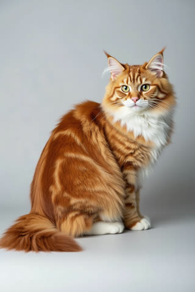<br><br>
<a href="https://refvid.com/fr/pet-family-portrait"><b>▶ Voir le clip et le faire avec vos photos</b></a>
</p>
<br clear="left">

```text
[1] et [2] sont assis côte à côte sur un canapé gris moelleux avec des coussins, dans un salon cosy, comme un portrait de famille ; [2] jette un regard à [1], puis les deux regardent droit vers la caméra. Lumière chaude de lampe, léger travelling avant.
```

<details><summary>Les photos qui marchent le mieux</summary><br>Deux animaux partagent un canapé, le studio doit donc bien les distinguer : donnez pour chacun une photo de face et une qui montre sa taille à côté d’un objet familier, pour que le plus grand le reste une fois assis côte à côte.<br><br><sub>Créé avec RefVid sur Kling 3.0 Omni à partir de 8 photos de référence de Biscuit et Miso (sujets générés par IA), avec le prompt de ce modèle.</sub></details>

### Déguisement d’animal

<p>
<a href="https://refvid.com/fr/pet-halloween-costume">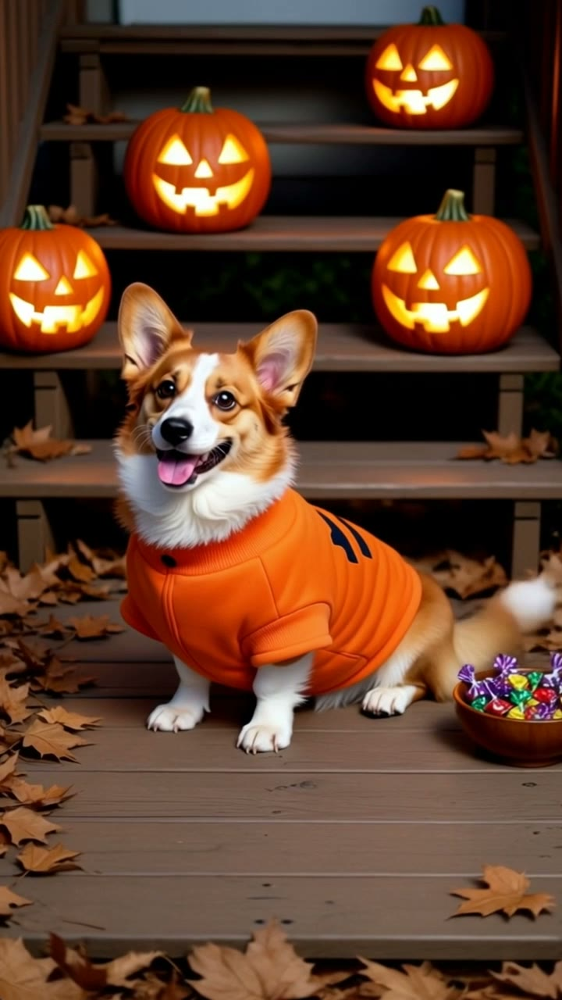</a>
<b>Modèle</b>&nbsp; Kling 3.0 Omni<br>
<b>Clip</b>&nbsp; 6 s · 9:16 · avec son<br>
<b>Sujets</b>&nbsp; <code>[1]</code> votre animal<br><br>
<b>Photos de référence</b><br>   <br><br>
<a href="https://refvid.com/fr/pet-halloween-costume"><b>▶ Voir le clip et le faire avec vos photos</b></a>
</p>
<br clear="left">

```text
Plan 1: [1] est assis sur un perron en bois au crépuscule, vêtu d'un doux costume de citrouille orange, des lanternes sculptées brillant sur les marches, des feuilles mortes autour. Lent travelling avant, lueur chaude des bougies.
Plan 2: [1] lève les yeux vers la caméra à côté d'un bol de bonbons emballés, penche la tête et émet un petit son joyeux avec sa propre voix naturelle. Soirée d'Halloween douillette, faible profondeur de champ.
```

<details><summary>Les photos qui marchent le mieux</summary><br>Le costume de citrouille couvre le corps de votre animal, ce sont donc le visage et les oreilles qui font tout : prenez une photo de face rapprochée et bien éclairée où les yeux captent la lumière, et une de lui assis pour que le costume épouse sa vraie silhouette.<br><br><sub>Réalisé avec RefVid sur Kling 3.0 Omni à partir de 4 photos de référence de Biscuit (un sujet généré par IA), avec une formulation antérieure du prompt de ce modèle qui demandait un aboiement.</sub></details>

### Hommage à l’animal

<p>
<a href="https://refvid.com/fr/pet-memorial"></a>
<b>Modèle</b>&nbsp; Kling 3.0 Omni<br>
<b>Clip</b>&nbsp; 5 s · 16:9 · sans son<br>
<b>Sujets</b>&nbsp; <code>[1]</code> votre animal<br><br>
<b>Photos de référence</b><br>   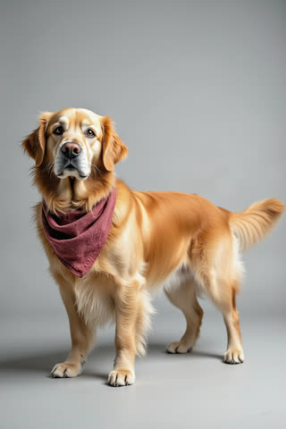<br><br>
<a href="https://refvid.com/fr/pet-memorial"><b>▶ Voir le clip et le faire avec vos photos</b></a>
</p>
<br clear="left">

```text
Plan 1: Une prairie ensoleillée de hautes fleurs sauvages sous un ciel doré et chaud, un arc-en-ciel léger qui se dessine au loin : [1] jaillit des fleurs à toute vitesse en direction de la caméra, les oreilles au vent, la langue pendante, une chaussette à rayures rouges et blanches fièrement serrée entre les dents.
Plan 2: Gros plan dans la même prairie à l'heure dorée, l'arc-en-ciel qui brille derrière : [1] s'arrête net, lâche la chaussette rayée sur l'herbe, s'assoit, incline la tête vers la caméra et remue la queue, très fier de lui.
```

<details><summary>Les photos qui marchent le mieux</summary><br>Votre animal court droit vers l’objectif, oreilles au vent et une chaussette dans la gueule : si vous en avez une, une photo de lui en train de courir ou de jouer, gueule ouverte, aide le plus ; de vieilles photos de téléphone un peu floues conviennent tant que le visage y est.<br><br><sub>Réalisé avec RefVid sur Kling 3.0 Omni à partir de 4 photos de référence de Captain (un sujet généré par IA), avec le prompt de ce modèle.</sub></details>

### Animal présentateur

<p>
<a href="https://refvid.com/fr/pet-news-anchor"></a>
<b>Modèle</b>&nbsp; Kling 3.0 Omni<br>
<b>Clip</b>&nbsp; 5 s · 16:9 · avec son<br>
<b>Sujets</b>&nbsp; <code>[1]</code> votre animal<br><br>
<b>Photos de référence</b><br>   <br><br>
<a href="https://refvid.com/fr/pet-news-anchor"><b>▶ Voir le clip et le faire avec vos photos</b></a>
</p>
<br clear="left">

```text
Un studio de JT aux lumières vives, avec une skyline de ville à l’écran derrière : [1] est assis bien droit derrière le bureau, portant une petite cravate rouge, regarde la caméra et dit d’une voix sérieuse de présentateur : "Good evening. Tonight’s top story: dinner is late again."
```

<details><summary>Les photos qui marchent le mieux</summary><br>Derrière le bureau du JT, on ne voit que la tête, le cou et le poitrail de votre animal, la cravate au cou : prenez une photo de face où il est assis bien droit, le poitrail visible ; un air calme et sérieux colle mieux au titre qu’un air joueur.<br><br><sub>Réalisé avec RefVid sur Kling 3.0 Omni à partir de 4 photos de référence de Biscuit (sujet généré par IA), avec la consigne de ce modèle.</sub></details>

### Porteur d’alliances

<p>
<a href="https://refvid.com/fr/pet-ring-bearer"></a>
<b>Modèle</b>&nbsp; Kling 3.0 Omni<br>
<b>Clip</b>&nbsp; 5 s · 16:9 · sans son<br>
<b>Sujets</b>&nbsp; <code>[1]</code> votre animal<br><br>
<b>Photos de référence</b><br>   <br><br>
<a href="https://refvid.com/fr/pet-ring-bearer"><b>▶ Voir le clip et le faire avec vos photos</b></a>
</p>
<br clear="left">

```text
Un mariage dans un jardin sous la douce lumière de l'après-midi : [1], portant un petit collier de fleurs, avance dans l'allée entre des rangées de chaises blanches vers la caméra, un petit panier contenant une boîte à alliances dans la gueule, des invités de chaque côté qui se retournent en souriant, des pétales sur l'herbe.
```

<details><summary>Les photos qui marchent le mieux</summary><br>Votre animal remonte toute l’allée vers l’objectif, le panier dans la gueule : une photo en entier, en marche ou debout, prise de face à sa hauteur, compte le plus ; un cou bien dégagé aide le collier de fleurs à tomber juste.<br><br><sub>Réalisé avec RefVid sur Kling 3.0 Omni à partir de 4 photos de référence de Biscuit (un sujet généré par IA), avec le prompt de ce modèle.</sub></details>

### Défilé d’animal

<p>
<a href="https://refvid.com/fr/pet-runway-walk"></a>
<b>Modèle</b>&nbsp; Kling 3.0 Omni<br>
<b>Clip</b>&nbsp; 5 s · 9:16 · avec son<br>
<b>Sujets</b>&nbsp; <code>[1]</code> votre animal<br><br>
<b>Photos de référence</b><br>   <br><br>
<a href="https://refvid.com/fr/pet-runway-walk"><b>▶ Voir le clip et le faire avec vos photos</b></a>
</p>
<br clear="left">

```text
[1] avance avec assurance sur un podium de mode brillant, vers la caméra, sous de vifs projecteurs, des photographes de part et d'autre faisant claquer leurs flashs, puis s'arrête au bout et pose. Caméra basse, murmures de la foule et déclenchements d'obturateur.
```

<details><summary>Les photos qui marchent le mieux</summary><br>La caméra est au ras du sol pendant que votre animal défile sur tout le podium, ses pattes et son allure portent donc ce plan : ajoutez une photo en entier de face au niveau du sol et une de profil pour que sa silhouette et les motifs du pelage restent justes en pleine foulée.<br><br><sub>Réalisé avec RefVid sur Kling 3.0 Omni à partir de 4 photos de référence de Biscuit (sujet généré par IA), avec le prompt de ce modèle.</sub></details>

### Animal sous l’eau

<p>
<a href="https://refvid.com/fr/pet-underwater-swim">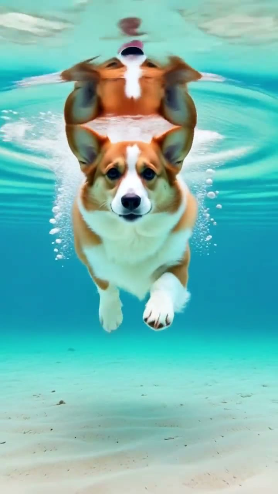</a>
<b>Modèle</b>&nbsp; Kling 3.0 Omni<br>
<b>Clip</b>&nbsp; 5 s · 9:16 · sans son<br>
<b>Sujets</b>&nbsp; <code>[1]</code> votre animal<br><br>
<b>Photos de référence</b><br>  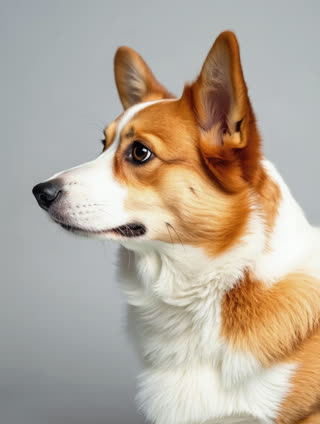 <br><br>
<a href="https://refvid.com/fr/pet-underwater-swim"><b>▶ Voir le clip et le faire avec vos photos</b></a>
</p>
<br clear="left">

```text
Sous l'eau dans une mer turquoise et cristalline, [1] nage vers la caméra en battant des pattes, les yeux ouverts, des rayons de soleil ondulant sur son corps, de petites bulles qui remontent, son pelage flottant doucement dans l'eau.
```

<details><summary>Les photos qui marchent le mieux</summary><br>Sous l’eau, le pelage flotte et paraît plus sombre, le visage et les marques doivent donc être sans équivoque : une photo nette de face, yeux ouverts, plus une qui montre la vraie longueur et la couleur du pelage en plein jour, donnent au studio ce qu’il lui faut.<br><br><sub>Réalisé avec RefVid sur Kling 3.0 Omni à partir de 4 photos de référence de Biscuit (sujet généré par IA), avec le prompt de ce modèle.</sub></details>

[↑ Retour au sommaire](#sommaire)

## Objets & personnages

Un jouet, une figurine, une voiture ou un personnage dessiné qui reste identique.

### Pâte à modeler

<p>
<a href="https://refvid.com/fr/clay-figure-stopmotion"></a>
<b>Modèle</b>&nbsp; Kling 3.0 Omni<br>
<b>Clip</b>&nbsp; 5 s · 16:9 · sans son<br>
<b>Sujets</b>&nbsp; <code>[1]</code> votre personnage en argile<br><br>
<b>Photos de référence</b><br> 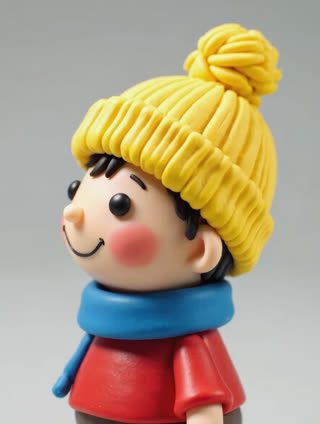 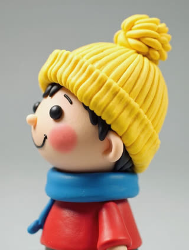 <br><br>
<a href="https://refvid.com/fr/clay-figure-stopmotion"><b>▶ Voir le clip et le faire avec vos photos</b></a>
</p>
<br clear="left">

```text
Plan 1: Style claymation stop-motion, mouvement légèrement saccadé : [1] traverse un petit décor fait main représentant une rue de village en papier et en feutrine, avec de minuscules maisons et un nuage en coton, sa texture d'argile et ses empreintes digitales bien visibles. Lumière chaude de table.
Plan 2: [1] s'arrête, se tourne vers la caméra et salue d'une main en argile, puis fait un petit bond. Rendu stop-motion, faible profondeur de champ.
```

<details><summary>Les photos qui marchent le mieux</summary><br>Votre personnage traverse le décor de profil puis se tourne pour saluer : montrez-le de profil et de face, d’assez près pour que la texture de la pâte et les empreintes se voient ; une vue de dos garde la marche cohérente.<br><br><sub>Réalisé avec RefVid sur Kling 3.0 Omni à partir de 4 photos de référence de Momo (un sujet créé par IA), avec le prompt de ce modèle.</sub></details>

### Crochet en vedette

<p>
<a href="https://refvid.com/fr/crochet-showcase"></a>
<b>Modèle</b>&nbsp; Kling 3.0 Omni<br>
<b>Clip</b>&nbsp; 5 s · 1:1 · sans son<br>
<b>Sujets</b>&nbsp; <code>[1]</code> votre pièce<br><br>
<b>Photos de référence</b><br>   <br><br>
<a href="https://refvid.com/fr/crochet-showcase"><b>▶ Voir le clip et le faire avec vos photos</b></a>
</p>
<br clear="left">

```text
Plan 1: [1] repose sur une table en chêne chaleureuse, à côté de deux pelotes de laine douce et d'un crochet en bois, lumière d'après-midi venant de la fenêtre, la caméra glisse lentement autour.
Plan 2: Gros plan macro qui parcourt les mailles et le visage de [1], chaque boucle de fil visible, faible profondeur de champ.
```

<details><summary>Les photos qui marchent le mieux</summary><br>Le second plan passe en macro sur les mailles et le visage : prenez une photo rapprochée où chaque boucle de fil est nette, plus des vues de face et de profil pour que la forme tienne quand la caméra tourne autour de la pièce.<br><br><sub>Réalisé avec RefVid sur Kling 3.0 Omni à partir de 4 photos de référence de Bun (sujet généré par IA), avec la consigne de ce modèle.</sub></details>

### Diorama miniature

<p>
<a href="https://refvid.com/fr/diorama-miniature"></a>
<b>Modèle</b>&nbsp; Kling 3.0 Omni<br>
<b>Clip</b>&nbsp; 5 s · 16:9 · sans son<br>
<b>Sujets</b>&nbsp; <code>[1]</code> votre figurine<br><br>
<b>Photos de référence</b><br>   <br><br>
<a href="https://refvid.com/fr/diorama-miniature"><b>▶ Voir le clip et le faire avec vos photos</b></a>
</p>
<br clear="left">

```text
Diorama miniature en effet tilt-shift d'une petite place de ville avec des arbres miniatures, des lampadaires et de petites maisons ; [1] se tient au centre pendant qu'un train miniature passe lentement derrière elle, la caméra glissant à sa hauteur de regard, les bords doucement flous. Lumière de jour éclatante.
```

<details><summary>Les photos qui marchent le mieux</summary><br>La caméra passe devant votre figurine à hauteur de ses yeux : photographiez-la de face depuis cette hauteur basse plutôt que d’en haut ; une vue de profil l’aide à garder sa forme quand le train passe derrière.<br><br><sub>Réalisé avec RefVid sur Kling 3.0 Omni à partir de 4 photos de référence de Pip (un sujet généré par IA), avec le prompt de ce modèle.</sub></details>

### Figurine 360°

<p>
<a href="https://refvid.com/fr/figure-turntable-showcase"></a>
<b>Modèle</b>&nbsp; Kling 3.0 Omni<br>
<b>Clip</b>&nbsp; 5 s · 1:1 · sans son<br>
<b>Sujets</b>&nbsp; <code>[1]</code> votre figurine<br><br>
<b>Photos de référence</b><br>   <br><br>
<a href="https://refvid.com/fr/figure-turntable-showcase"><b>▶ Voir le clip et le faire avec vos photos</b></a>
</p>
<br clear="left">

```text
Plan 1: [1] sur un petit plateau tournant rond dans une vitrine sombre éclairée par un projecteur doux, pivotant lentement sur un tour complet. Reflets nets sur l'étagère en verre.
Plan 2: Gros plan macro sur le visage et les détails peints de [1], la lumière glissant sur eux, faible profondeur de champ.
```

<details><summary>Les photos qui marchent le mieux</summary><br>La figurine fait un tour complet avant que la caméra s’approche de son visage : couvrez le dos et les deux côtés autant que la face, et ajoutez un gros plan de la peinture du visage où les petits détails sont nets.<br><br><sub>Réalisé avec RefVid sur Kling 3.0 Omni à partir de 4 photos de référence de Pip (un sujet généré par IA), avec le prompt de ce modèle.</sub></details>

### Mascotte qui salue

<p>
<a href="https://refvid.com/fr/mascot-wave-hello">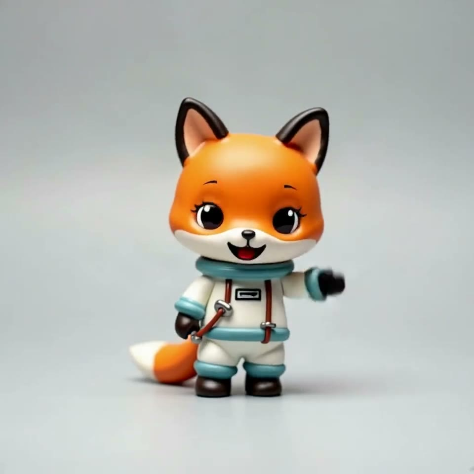</a>
<b>Modèle</b>&nbsp; Kling 3.0 Omni<br>
<b>Clip</b>&nbsp; 5 s · 1:1 · avec son<br>
<b>Sujets</b>&nbsp; <code>[1]</code> votre mascotte<br><br>
<b>Photos de référence</b><br>   <br><br>
<a href="https://refvid.com/fr/mascot-wave-hello"><b>▶ Voir le clip et le faire avec vos photos</b></a>
</p>
<br clear="left">

```text
[1] se tient sur un bureau propre et lumineux devant un fond pastel doux, regarde la caméra, agite un bras et dit d'une petite voix joyeuse : "Hi there, welcome in!" Lent travelling avant.
```

<details><summary>Les photos qui marchent le mieux</summary><br>Votre mascotte agite un bras et regarde l’objectif : photographiez-la debout, de face, les deux bras et le visage entièrement visibles ; une vue de dos ou de profil aide sa forme à tenir quand elle bouge.<br><br><sub>Réalisé avec RefVid sur Kling 3.0 Omni à partir de 4 photos de référence de Pip (un sujet généré par IA), avec le prompt de ce modèle.</sub></details>

### Aventure en peluche

<p>
<a href="https://refvid.com/fr/plush-adventure"></a>
<b>Modèle</b>&nbsp; Kling 3.0 Omni<br>
<b>Clip</b>&nbsp; 10 s · 9:16 · sans son<br>
<b>Sujets</b>&nbsp; <code>[1]</code> votre peluche<br><br>
<b>Photos de référence</b><br> 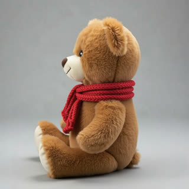  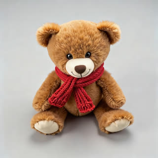<br><br>
<a href="https://refvid.com/fr/plush-adventure"><b>▶ Voir le clip et le faire avec vos photos</b></a>
</p>
<br clear="left">

```text
Plan 1: Rendu stop-motion : [1] est assis sur une banquette en bois d'un vieux tramway jaune de la ville, près de la fenêtre, la rue défilant dehors, lumière du matin.
Plan 2: [1] est assis à une minuscule table de café à côté d'une tasse de chocolat chaud garni de crème fouettée, tournant la tête vers la caméra.
Plan 3: [1] est assis sur la balustrade d'un pont de pierre, contemplant le coucher de soleil sur la rivière, les lumières de la ville s'allumant derrière lui.
```

<details><summary>Les photos qui marchent le mieux</summary><br>Votre peluche est assise dans les trois décors, vue de profil dans le tram et de dos sur le pont : photographiez-la assise de face, de profil et de dos ; laissez-lui écharpe, nœud ou écusson pour que ces détails voyagent avec elle.<br><br><sub>Réalisée avec RefVid sur Kling 3.0 Omni à partir de 4 photos de référence de Bobo (un sujet créé par IA), avec le prompt de ce modèle.</sub></details>

### Jouet qui s’anime

<p>
<a href="https://refvid.com/fr/toy-comes-alive"></a>
<b>Modèle</b>&nbsp; Kling 3.0 Omni<br>
<b>Clip</b>&nbsp; 5 s · 9:16 · sans son<br>
<b>Sujets</b>&nbsp; <code>[1]</code> votre figurine<br><br>
<b>Photos de référence</b><br>   <br><br>
<a href="https://refvid.com/fr/toy-comes-alive"><b>▶ Voir le clip et le faire avec vos photos</b></a>
</p>
<br clear="left">

```text
Plan 1: [1] reste parfaitement immobile sur un bureau en bois, à côté d’un pot à crayons et d’un carnet, dans la douce lumière du matin, comme un jouet exposé. Gros plan à hauteur des yeux du jouet.
Plan 2: [1] prend vie : il cligne des yeux, regarde autour de lui avec curiosité, puis fait quelques petits pas hésitants vers la caméra et salue. C’est toujours le même petit jouet peint, avec la même matière et les mêmes couleurs. Faible profondeur de champ.
```

<details><summary>Les photos qui marchent le mieux</summary><br>La figurine cligne des yeux, regarde autour d’elle et marche vers une caméra placée à hauteur de ses yeux : photographiez-la à cette hauteur aussi, visage et yeux bien de face, plus ses pieds ou son socle, pour que ses premiers pas gardent sa forme et sa peinture.<br><br><sub>Réalisé avec RefVid sur Kling 3.0 Omni à partir de 4 photos de référence de Pip (un sujet créé par IA), avec le prompt de ce modèle.</sub></details>

[↑ Retour au sommaire](#sommaire)

## Écrire vos propres prompts

1. **Désignez le sujet par ses photos, pas par une description.** Écrivez `[1]` là où le sujet apparaît et laissez les photos porter le visage, le pelage ou le produit ; le redécrire en mots contredit les photos.
2. **Deux ou trois plans, une action chacun.** Dites où est la caméra (large, gros plan, travelling, de dos) et une chose qui se passe.
3. **Les photos font la cohérence.** 3 à 4 photos nettes sous différents angles, un sujet par jeu, fond uni pour les produits.
4. **Finissez sur une image qu'on a envie de garder.** C'est le dernier plan que les gens capturent et partagent.

Pour aller plus loin : [tutoriels RefVid](https://refvid.com/fr/tutorials).

## Licence

Prompts, textes, photos de référence et clips : [CC BY 4.0](LICENSE) — utilisables pour tout, avec la mention « RefVid (refvid.com) ». Les personnes, animaux et produits des photos de référence sont générés par IA ; aucun n'est une vraie personne ni le produit d'un client.

Contributions bienvenues : ouvrez une issue avec le prompt, le modèle utilisé et le résultat.

## Historique des étoiles

[](https://star-history.com/#refvid/awesome-reference-to-video-prompts&Date)
