[](README.md) [](README_de-DE.md) [](README_fr-FR.md) [](README_es-ES.md) [](README_pt-BR.md) [](README_ja-JP.md) [](README_ko-KR.md)

---

# Awesome Reference-to-Video Prompts

[](https://awesome.re) [](https://github.com/refvid/awesome-reference-to-video-prompts) [](LICENSE) [](#目次)

**同じ人物・ペット・商品をすべてのカットで保つ** AI 動画のための、検証済みプロンプト 71 本。各項目にプロンプト、使った参照写真、完成クリップ、設定を載せています。どのクリップも、そのプロンプトそのままで実際に生成したものです。

Reference-to-video とは、被写体の写真を数枚モデルに渡すと、その顔・毛並み・商品をクリップ全体で同じに保つ方式です。ここのプロンプトは Kling 4、Kling 3.0 Omni、Seedance、Wan、Vidu などの reference-to-video モデルで使えます。`[1]`、`[2]` は 1 組目・2 組目の参照写真を指します。

制作：[RefVid](https://refvid.com/ja)。どのプロンプトも RefVid ではそのまま使えるテンプレートです。自分の写真を追加して生成するだけ。機械可読リスト：[`prompts.json`](prompts.json)。Claude Code / Codex 用エージェントスキル：[`skills/reference-to-video-prompts`](skills/reference-to-video-prompts/SKILL.md)。

## すべてのクリップを見る

GitHub では静止画しか表示できません。全クリップは [RefVid のテンプレートギャラリー](https://refvid.com/ja/templates) で再生でき、各プロンプトは自分の写真ですぐ使える状態で開きます。

## 目次

<details><summary><b>商品</b> (26)</summary>

- [シネマティック走行](#シネマティック走行)
- [フードCM](#フードcm)
- [街歩きバッグ](#街歩きバッグ)
- [アイスドリンク](#アイスドリンク)
- [手元のジュエリー](#手元のジュエリー)
- [ジュエリーの輝き](#ジュエリーの輝き)
- [リップスウォッチ](#リップスウォッチ)
- [香水のお披露目](#香水のお披露目)
- [商品360°](#商品360)
- [3D看板](#3d看板)
- [ブラックフライデー](#ブラックフライデー)
- [バレットタイム](#バレットタイム)
- [クリスマスギフト](#クリスマスギフト)
- [フラットレイ](#フラットレイ)
- [浮遊する商品](#浮遊する商品)
- [商品お披露目](#商品お披露目)
- [UGC広告](#ugc広告)
- [素材スプラッシュ](#素材スプラッシュ)
- [おうちライフスタイル](#おうちライフスタイル)
- [花びらが舞う](#花びらが舞う)
- [開封動画](#開封動画)
- [水しぶき](#水しぶき)
- [スキンケアの質感](#スキンケアの質感)
- [スニーカー広告](#スニーカー広告)
- [ガジェット発表](#ガジェット発表)
- [腕時計マクロ](#腕時計マクロ)

</details>

<details><summary><b>人物</b> (24)</summary>

- [ロードトリップ](#ロードトリップ)
- [誕生日メッセージ](#誕生日メッセージ)
- [料理番組](#料理番組)
- [クリスマスマーケット](#クリスマスマーケット)
- [クリスマスメッセージ](#クリスマスメッセージ)
- [海辺の夕日](#海辺の夕日)
- [ファッションルックブック](#ファッションルックブック)
- [フィットネスコーチ](#フィットネスコーチ)
- [シーツおばけ](#シーツおばけ)
- [コスチューム試着](#コスチューム試着)
- [パンプキンヘッド](#パンプキンヘッド)
- [Y2Kフラッシュ](#y2kフラッシュ)
- [ゾンビウォーク](#ゾンビウォーク)
- [自己紹介動画](#自己紹介動画)
- [ミニドラマ](#ミニドラマ)
- [モーニングルーティン](#モーニングルーティン)
- [新年カウントダウン](#新年カウントダウン)
- [ポッドキャスト司会](#ポッドキャスト司会)
- [ラップデュオ](#ラップデュオ)
- [ヒーロー着地](#ヒーロー着地)
- [トーキングヘッド広告](#トーキングヘッド広告)
- [感謝祭の乾杯](#感謝祭の乾杯)
- [旅行Vlog](#旅行vlog)
- [セーブ・ザ・デート](#セーブザデート)

</details>

<details><summary><b>ペット</b> (14)</summary>

- [犬のラップ](#犬のラップ)
- [ペットと夕日](#ペットと夕日)
- [宇宙飛行士ペット](#宇宙飛行士ペット)
- [ペットの誕生日](#ペットの誕生日)
- [シェフペット](#シェフペット)
- [ペットのクリスマス](#ペットのクリスマス)
- [ペットが動き出す](#ペットが動き出す)
- [ペット家族写真](#ペット家族写真)
- [ペットの仮装](#ペットの仮装)
- [ペットの思い出](#ペットの思い出)
- [キャスターペット](#キャスターペット)
- [リングドッグ](#リングドッグ)
- [ペットのランウェイ](#ペットのランウェイ)
- [水中ペット](#水中ペット)

</details>

<details><summary><b>モノ・キャラクター</b> (7)</summary>

- [クレイアニメ](#クレイアニメ)
- [あみぐるみ紹介](#あみぐるみ紹介)
- [ミニチュアジオラマ](#ミニチュアジオラマ)
- [フィギュア360°](#フィギュア360)
- [マスコットのあいさつ](#マスコットのあいさつ)
- [ぬいぐるみの冒険](#ぬいぐるみの冒険)
- [動き出すおもちゃ](#動き出すおもちゃ)

</details>

- [自分で書くには](#自分で書くには)
- [ライセンス](#ライセンス)
- [スター推移](#スター推移)

## 商品

1 つの商品の写真から作る広告・紹介動画。

### シネマティック走行

<p>
<a href="https://refvid.com/ja/car-cinematic-drive"></a>
<b>モデル</b>&nbsp; Kling 3.0 Omni<br>
<b>クリップ</b>&nbsp; 5 s · 16:9 · 音声なし<br>
<b>被写体</b>&nbsp; <code>[1]</code> お客様の車<br><br>
<b>参照写真</b><br>   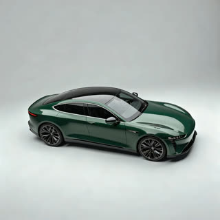<br><br>
<a href="https://refvid.com/ja/car-cinematic-drive"><b>▶ クリップを見て、自分の写真で作る</b></a>
</p>
<br clear="left">

```text
カット 1: ゴールデンアワーのうねる海沿いの道を走る[1]に並走する低い追尾ショット。背後には海と断崖、塗装に反射する日差し。
カット 2: 同じ道で[1]がカメラの近くをゆっくり通過し、車体の前から後ろへ暖かい光が流れていく。その後、夕日に向かって走り去る。
```

<details><summary>うまくいく写真</summary><br>カメラは車を真横から追い、そのあと間近を通り過ぎさせるので、タイヤがすべて入った真横の写真がいちばん大切です。グリル、ライト、塗装の色が正しく出るよう、前方斜めからの写真も加えてください。<br><br><sub>RefVidで作成。Kling 3.0 Omniを使用し、AIで作られた被写体VELAの参照写真4枚と、このテンプレートのプロンプトから生成。</sub></details>

### フードCM

<p>
<a href="https://refvid.com/ja/food-pour-steam"></a>
<b>モデル</b>&nbsp; Kling 3.0 Omni<br>
<b>クリップ</b>&nbsp; 5 s · 9:16 · 音声なし<br>
<b>被写体</b>&nbsp; <code>[1]</code> 自社製品<br><br>
<b>参照写真</b><br>   <br><br>
<a href="https://refvid.com/ja/food-pour-steam"><b>▶ クリップを見て、自分の写真で作る</b></a>
</p>
<br clear="left">

```text
カット 1: スローモーションのマクロ撮影：[1]で作った温かい飲み物や料理が、つややかに湯気を立てながら白い陶器のカップや器へ注がれる。暗い背景の中、温かいサイドライトに照らされて湯気が立ち上る。
カット 2: [1]が木製のカウンターの上で、湯気の立つカップや器の隣に立つ。周りにはその原材料が少し散らばっている。カメラが寄っていき、ラベルがフレームいっぱいに映る。
```

<details><summary>うまくいく写真</summary><br>最後はラベルが画面いっぱいになるまで寄るので、ラベルの文字がすべてくっきり読める真正面の写真がいちばん大切です。湯気の立つカップの横でも形が崩れないよう、横からの写真も加えてください。<br><br><sub>RefVidでKling 3.0 Omniを使って作成。EMBER（AIで作成した被写体）の参照写真4枚から生成。このテンプレートのプロンプトは以前の表現を使用しています。</sub></details>

### 街歩きバッグ

<p>
<a href="https://refvid.com/ja/handbag-street-style"></a>
<b>モデル</b>&nbsp; Kling 4<br>
<b>クリップ</b>&nbsp; 5 s · 9:16 · 音声あり<br>
<b>被写体</b>&nbsp; <code>[1]</code> ご自身のバッグ<br><br>
<b>参照写真</b><br>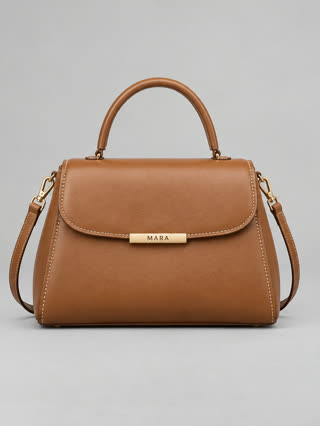 <br><br>
<a href="https://refvid.com/ja/handbag-street-style"><b>▶ クリップを見て、自分の写真で作る</b></a>
</p>
<br clear="left">

```text
クリーム色のトレンチコートを着た女性が、[1]を腕にかけて日差しの差す街の通りを歩いています。カメラは腰の高さで並走し、[1]は一歩ごとに軽く揺れながら常に中央にくっきり映り、女性の顔はフレームの外です。ゴールデンアワーの光、浅い被写界深度、ファッション広告スタイル。
```

<details><summary>うまくいく写真</summary><br>バッグは全編を通して腰の高さでカメラの横を揺れるので、正面も側面も映ります。金具がくっきり写った正面、側面、そしてストラップや持ち手が全部入った写真を撮ってください。<br><br><sub>RefVidでKling 4を使い、MARA（AIで作成した被写体）の参照写真2枚と、このテンプレートのプロンプトから作成しました。</sub></details>

### アイスドリンク

<p>
<a href="https://refvid.com/ja/iced-drink-frost"></a>
<b>モデル</b>&nbsp; Kling 4<br>
<b>クリップ</b>&nbsp; 5 s · 9:16 · 音声あり<br>
<b>被写体</b>&nbsp; <code>[1]</code> ご自身のドリンク<br><br>
<b>参照写真</b><br> 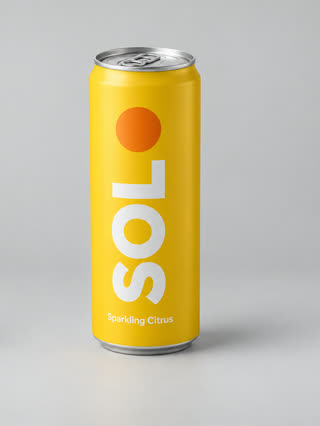<br><br>
<a href="https://refvid.com/ja/iced-drink-frost"><b>▶ クリップを見て、自分の写真で作る</b></a>
</p>
<br clear="left">

```text
[1]がクラッシュアイスの上に半分埋もれるように立っています。底から白い霜が表面をはい上がり、冷気が立ちのぼり、結露の水滴がラベルの横をゆっくり伝い落ちます。クールな青い逆光、暗い背景、ゆっくりとしたプッシュイン、マクロの細部まで鮮明に。
```

<details><summary>うまくいく写真</summary><br>カメラが寄る間、水滴がラベルを伝って流れるので、ラベルが平らに読める真正面の写真がいちばん大切です。缶やボトルの裏面やキャップが違うなら、霜が正しい形を包むようその写真も加えてください。<br><br><sub>RefVidでKling 4を使い、SOL（AIで作成した被写体）の参照写真2枚と、このテンプレートのプロンプトから作成しました。</sub></details>

### 手元のジュエリー

<p>
<a href="https://refvid.com/ja/jewelry-on-hand">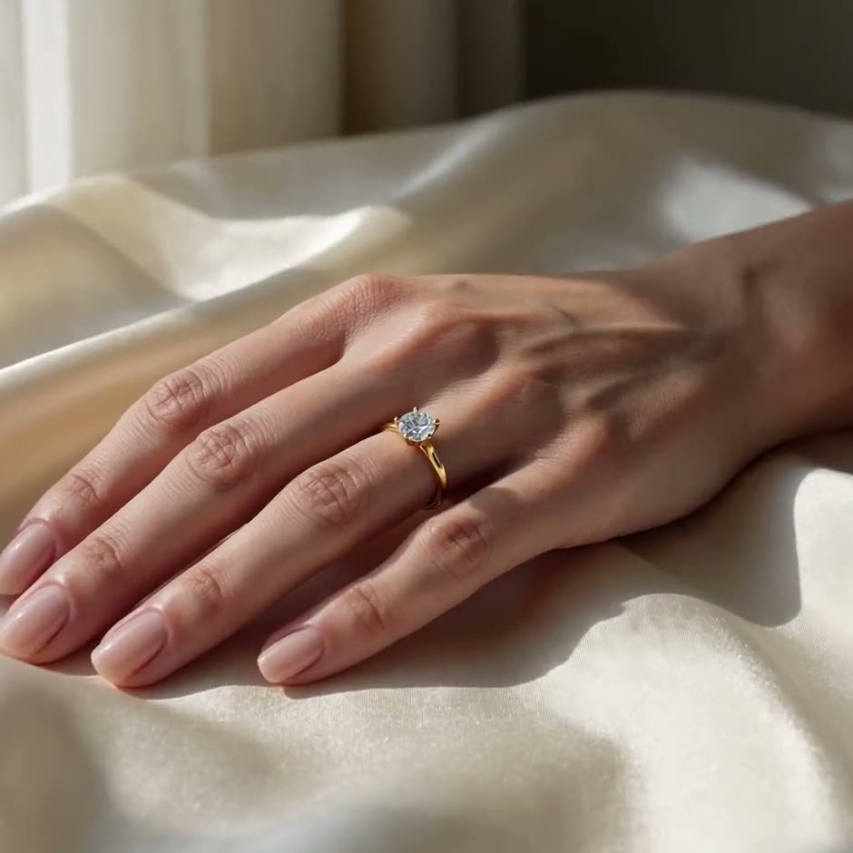</a>
<b>モデル</b>&nbsp; Kling 4<br>
<b>クリップ</b>&nbsp; 5 s · 1:1 · 音声あり<br>
<b>被写体</b>&nbsp; <code>[1]</code> ご自身のジュエリー<br><br>
<b>参照写真</b><br>   <br><br>
<a href="https://refvid.com/ja/jewelry-on-hand"><b>▶ クリップを見て、自分の写真で作る</b></a>
</p>
<br clear="left">

```text
クローズアップ：柔らかなナチュラルネイルの女性の手が[1]をつけてクリーム色のシルクの上に置かれ、ゆっくりとカメラの方へ向きを変えます。暖かな窓の光の中で[1]が小さくきらめきます。浅い被写界深度、穏やかでゆっくりとしたプッシュイン、上品で自然な雰囲気。
```

<details><summary>うまくいく写真</summary><br>アイテムはカメラのほうへ向きを変える手につけて映るので、身につけた人から見える角度の写真に加え、リングやチェーン、石座を横から撮った写真を。指や手首につけた写真があるとサイズ感も正しく出ます。<br><br><sub>RefVidでKling 4を使い、HALO（AIで作成した被写体）の参照写真4枚と、このテンプレートのプロンプトから作成しました。</sub></details>

### ジュエリーの輝き

<p>
<a href="https://refvid.com/ja/jewelry-sparkle">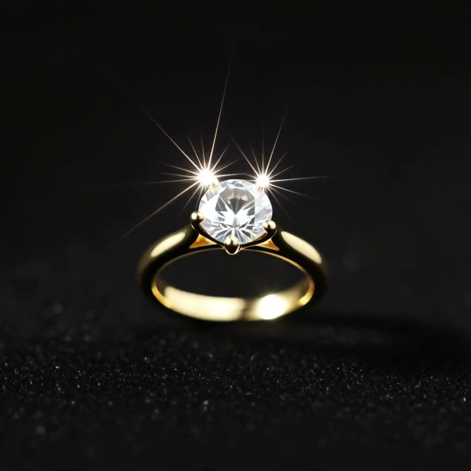</a>
<b>モデル</b>&nbsp; Kling 3.0 Omni<br>
<b>クリップ</b>&nbsp; 5 s · 1:1 · 音声なし<br>
<b>被写体</b>&nbsp; <code>[1]</code> 作品<br><br>
<b>参照写真</b><br>   <br><br>
<a href="https://refvid.com/ja/jewelry-sparkle"><b>▶ クリップを見て、自分の写真で作る</b></a>
</p>
<br clear="left">

```text
マクロ撮影：[1]が濃い黒のベルベットの上に置かれ、ゆっくりと回転します。柔らかな光の筋がゆっくり横切り、ジュエリーが光をとらえてきらめきと輝きを放ちます。深い黒の背景、浅い被写界深度、高級感のある雰囲気。
```

<details><summary>うまくいく写真</summary><br>黒いベルベットの上で回るアイテムを光の筋がなでていくので、石やファセット一つひとつがくっきり写るよう暗い面の上で接写し、回転しても奥行きが保てるよう石座を横から撮った写真も加えてください。<br><br><sub>RefVidでKling 3.0 Omniを使って作成。HALO（AIで作成した被写体）の参照写真4枚から生成。このテンプレートのプロンプトは以前の表現を使用しています。</sub></details>

### リップスウォッチ

<p>
<a href="https://refvid.com/ja/lipstick-swatch"></a>
<b>モデル</b>&nbsp; Kling 4<br>
<b>クリップ</b>&nbsp; 5 s · 9:16 · 音声あり<br>
<b>被写体</b>&nbsp; <code>[1]</code> ご自身のリップ<br><br>
<b>参照写真</b><br> <br><br>
<a href="https://refvid.com/ja/lipstick-swatch"><b>▶ クリップを見て、自分の写真で作る</b></a>
</p>
<br clear="left">

```text
マクロ：[1]の先端がなめらかなクリーム色の面をすべり、その色の深くつややかなスウォッチをひと筋残します。続いてカメラが上がり、柔らかな自然光の中でスウォッチの横にまっすぐ立つ[1]を映し、色とケースにくっきりとピントが合います。洗練されたコスメ広告スタイル、浅い被写界深度。
```

<details><summary>うまくいく写真</summary><br>マクロで最初に映るのは滑っていくリップの先端なので、キャップを外し、先端の形と本来の色がくっきり写った写真を。最後にスウォッチの横に立つので、キャップを閉めて立てたケースの写真も加えてください。<br><br><sub>RefVidでKling 4を使い、VELOUR（AIで作成した被写体）の参照写真2枚と、このテンプレートのプロンプトから作成しました。</sub></details>

### 香水のお披露目

<p>
<a href="https://refvid.com/ja/perfume-reveal"></a>
<b>モデル</b>&nbsp; Kling 4<br>
<b>クリップ</b>&nbsp; 5 s · 9:16 · 音声あり<br>
<b>被写体</b>&nbsp; <code>[1]</code> ご自身の香水<br><br>
<b>参照写真</b><br>  <br><br>
<a href="https://refvid.com/ja/perfume-reveal"><b>▶ クリップを見て、自分の写真で作る</b></a>
</p>
<br clear="left">

```text
[1]が、ゆっくり漂う柔らかなミストに包まれ、つややかな黒いガラスの上に立っています。上部からきめ細かな香水のスプレーがひと吹き弾け、暖かな金色の逆光を受けて輝きます。やがてミストが晴れ、ひと筋の光がガラスを透け、最後にラベルが中央にくっきり映ります。ローキー、上質な雰囲気、ゆっくりとしたプッシュイン。
```

<details><summary>うまくいく写真</summary><br>最後は光がガラスを通り、中央のラベルを照らします。ボトルは真正面から、ラベルをカメラと平行にして映り込みなしで撮影を。キャップと液体の色がわかるよう、明るい背景の写真も加えてください。<br><br><sub>RefVidでKling 4を使い、NOIR 07（AIで作成した被写体）の参照写真3枚と、このテンプレートのプロンプトから作成しました。</sub></details>

### 商品360°

<p>
<a href="https://refvid.com/ja/product-360-turntable"></a>
<b>モデル</b>&nbsp; Kling 3.0 Omni<br>
<b>クリップ</b>&nbsp; 5 s · 1:1 · 音声なし<br>
<b>被写体</b>&nbsp; <code>[1]</code> 商品<br><br>
<b>参照写真</b><br>  <br><br>
<a href="https://refvid.com/ja/product-360-turntable"><b>▶ クリップを見て、自分の写真で作る</b></a>
</p>
<br clear="left">

```text
参考画像どおりの外観とプロポーションの[1]が、白い円形のスタジオ用ターンテーブルの上にある。背景はライトグレーの継ぎ目のないスタジオ背景、柔らかく均一なスタジオ照明、商品全体にピントが合っている。
```

<details><summary>うまくいく写真</summary><br>回転するあいだに全ての面が一度ずつカメラを向くので、無地の背景で、同じ高さから正面・両側面・背面を撮ってください。背面にラベルや細部があれば、普段見られない面だからこそ必ず入れましょう。<br><br><sub>RefVidでKling 3.0 Omniを使い、AERO 1（AIで生成した被写体）の参照写真3枚と、このテンプレートのプロンプトから作成しました。</sub></details>

### 3D看板

<p>
<a href="https://refvid.com/ja/product-3d-billboard">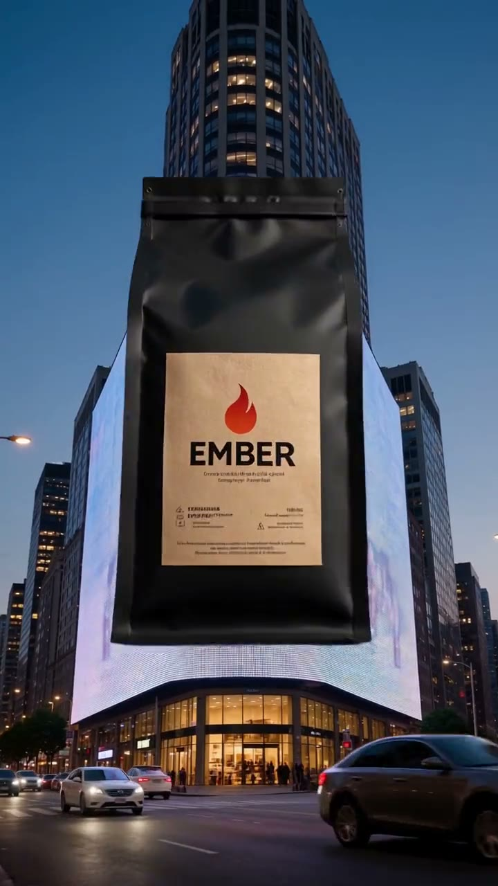</a>
<b>モデル</b>&nbsp; Kling 4<br>
<b>クリップ</b>&nbsp; 5 s · 9:16 · 音声あり<br>
<b>被写体</b>&nbsp; <code>[1]</code> ご自身の商品<br><br>
<b>参照写真</b><br>   <br><br>
<a href="https://refvid.com/ja/product-3d-billboard"><b>▶ クリップを見て、自分の写真で作る</b></a>
</p>
<br clear="left">

```text
夕暮れの街、通りから見上げた高層ビルの角を、湾曲した3D LEDの巨大スクリーンが包んでいます。画面いっぱいに巨大な[1]が映ってゆっくり回転し、やがて錯視によってスクリーンの縁を越え、通りの上へ飛び出してくるように見えます。下では車が行き交っています。アナモルフィックなCG広告スタイル、カメラはゆっくり上へティルト、街の明かり。
```

<details><summary>うまくいく写真</summary><br>商品はビルほどの大きさに拡大され、回転してから画面の外へ飛び出すので、わずかなブレやほこりも目立ちます。無地の背景で撮った高解像度の鮮明な写真を、正面と回転用の斜めから用意してください。<br><br><sub>RefVidでKling 4を使い、EMBER（AIで作成した被写体）の参照写真4枚と、このテンプレートのプロンプトから作成しました。</sub></details>

### ブラックフライデー

<p>
<a href="https://refvid.com/ja/product-black-friday"></a>
<b>モデル</b>&nbsp; Kling 3.0 Omni<br>
<b>クリップ</b>&nbsp; 5 s · 9:16 · 音声なし<br>
<b>被写体</b>&nbsp; <code>[1]</code> あなたの商品<br><br>
<b>参照写真</b><br>  <br><br>
<a href="https://refvid.com/ja/product-black-friday"><b>▶ クリップを見て、自分の写真で作る</b></a>
</p>
<br clear="left">

```text
カット 1: ピンクとブルーのネオンチューブに照らされた暗いスタジオのセット。サテンのリボンが付いた黒いギフトボックスが積み重ねられ、一番高い箱の上に[1]が置かれている。カメラはそれに向かってゆっくりと上昇していく。
カット 2: [1]へのゆっくりとしたプッシュイン。ネオンの反射が表面を滑るように流れ、ラベルは鮮明で中央に配置されている。キラキラと光る紙吹雪がゆっくり舞い落ちる。光沢があり、プレミアムで、コントラストの高い映像。
```

<details><summary>うまくいく写真</summary><br>カメラはギフトボックスの上の商品へと上がり、ラベルが中央に来るまで寄るので、映り込みのないラベル正面の写真を最初に。上面と側面の写真があると、ネオンの反射が正しい形に沿います。<br><br><sub>NOIR 07(AIで作成した被写体)の参考写真3枚を使い、このテンプレートのプロンプトでKling 3.0 OmniによってRefVidで作成。</sub></details>

### バレットタイム

<p>
<a href="https://refvid.com/ja/product-bullet-time"></a>
<b>モデル</b>&nbsp; Kling 4<br>
<b>クリップ</b>&nbsp; 5 s · 9:16 · 音声あり<br>
<b>被写体</b>&nbsp; <code>[1]</code> ご自身の商品<br><br>
<b>参照写真</b><br>  <br><br>
<a href="https://refvid.com/ja/product-bullet-time"><b>▶ クリップを見て、自分の写真で作る</b></a>
</p>
<br clear="left">

```text
バレットタイム：[1]が、透き通った水滴と水しぶきが弾ける中で宙に浮いたまま静止しています。すべての水滴が空中で完全に止まり、カメラはその周りを滑らかに半周して、最後にラベルをレンズに向けた状態で終わります。柔らかな青白いグラデーションの背景、明るいスタジオライト、マクロの細部まで鮮明に。
```

<details><summary>うまくいく写真</summary><br>カメラは商品の周りを半周してラベルで止まるため、途中で背面や側面も映ります。鮮明なラベルの写真に加えて、背面と側面の写真も、手で持たずに撮って追加しましょう。<br><br><sub>RefVidでKling 4を使い、LUMEN（AIで作成した被写体）の参照写真3枚と、このテンプレートのプロンプトから作成しました。</sub></details>

### クリスマスギフト

<p>
<a href="https://refvid.com/ja/product-christmas-gift"></a>
<b>モデル</b>&nbsp; Kling 3.0 Omni<br>
<b>クリップ</b>&nbsp; 5 s · 9:16 · 音声なし<br>
<b>被写体</b>&nbsp; <code>[1]</code> ご自身の商品<br><br>
<b>参照写真</b><br>  <br><br>
<a href="https://refvid.com/ja/product-christmas-gift"><b>▶ クリップを見て、自分の写真で作る</b></a>
</p>
<br clear="left">

```text
カット 1: 光るクリスマスツリーの下に、赤いサテンのリボンをかけた白いギフトボックスが置かれ、温かなイルミネーションのぼけに包まれている。一組の手がリボンをほどき、ふたを持ち上げる。
カット 2: 開いた箱の中をのぞき込むと、[1]がパリッとした白いティッシュペーパーの上に置かれ、ラベルは鮮明にカメラの方を向いている。周囲で金色のライトがきらめく中、カメラがゆっくりと寄っていく。
```

<details><summary>うまくいく写真</summary><br>2カット目は開いたギフトボックスを上からのぞき込み、薄紙の上にラベルを上にして置かれた商品を映します。ラベルが読める、やや上から撮った写真を入れ、商品は箱に入れずに単体で撮りましょう。<br><br><sub>RefVidで、Kling 3.0 Omniを使い、NOIR 07（AIで作成した被写体）の参考写真3枚から、このテンプレートのプロンプトに沿って作成しました。</sub></details>

### フラットレイ

<p>
<a href="https://refvid.com/ja/product-flat-lay"></a>
<b>モデル</b>&nbsp; Kling 3.0 Omni<br>
<b>クリップ</b>&nbsp; 5 s · 1:1 · 音声なし<br>
<b>被写体</b>&nbsp; <code>[1]</code> 商品<br><br>
<b>参照写真</b><br>   <br><br>
<a href="https://refvid.com/ja/product-flat-lay"><b>▶ クリップを見て、自分の写真で作る</b></a>
</p>
<br clear="left">

```text
温かみのあるベージュのリネンの台を真上から捉えたフラットレイ。中央に[1]があり、その周りに、この商品のために選んだ小物が3〜4個、一つずつ画面に入ってくる。購入者が商品と一緒に使う日用品で、色も商品に合うもの。柔らかく均一な日中の光。
```

<details><summary>うまくいく写真</summary><br>すべて真上から撮るので、肝心なのは平らに置いた商品をラベルを上にして真上から撮った写真です。横からの写真が1枚あると、厚みやリネンへの置かれ方が保たれます。<br><br><sub>RefVidでKling 3.0 Omniを使って作成。EMBER（AIで作成した被写体）の参照写真4枚から生成。このテンプレートのプロンプトは以前の表現を使用しています。</sub></details>

### 浮遊する商品

<p>
<a href="https://refvid.com/ja/product-floating"></a>
<b>モデル</b>&nbsp; Kling 4<br>
<b>クリップ</b>&nbsp; 5 s · 9:16 · 音声あり<br>
<b>被写体</b>&nbsp; <code>[1]</code> ご自身の商品<br><br>
<b>参照写真</b><br>  <br><br>
<a href="https://refvid.com/ja/product-floating"><b>▶ クリップを見て、自分の写真で作る</b></a>
</p>
<br clear="left">

```text
[1]が、柔らかなピーチからラベンダーへのグラデーションの背景の前で、重さを失ったように宙に浮かんでいます。上下にゆったり漂いながら半回転し、下の床には柔らかな丸い影が落ちています。無重力、明るく柔らかなスタジオライト、固定カメラ、ラベルの細部まで鮮明に。
```

<details><summary>うまくいく写真</summary><br>商品は浮かびながら半回転するので、正面だけでなく背面の情報も必要です。ラベルが写ったすっきりした正面写真に、背面と側面を、できれば無地の背景で加えましょう。<br><br><sub>RefVidでKling 4を使い、AERO 1（AIで作成した被写体）の参照写真3枚と、このテンプレートのプロンプトから作成しました。</sub></details>

### 商品お披露目

<p>
<a href="https://refvid.com/ja/product-hero-reveal"></a>
<b>モデル</b>&nbsp; Kling 3.0 Omni<br>
<b>クリップ</b>&nbsp; 5 s · 16:9 · 音声なし<br>
<b>被写体</b>&nbsp; <code>[1]</code> 商品<br><br>
<b>参照写真</b><br>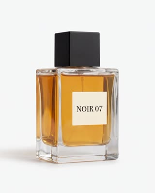  <br><br>
<a href="https://refvid.com/ja/product-hero-reveal"><b>▶ クリップを見て、自分の写真で作る</b></a>
</p>
<br clear="left">

```text
カット 1: 暗闇の中から細く温かい光がゆっくり伸び、黒い石の台座に置かれた[1]の上を横切ります。エッジや映り込みが浮かび上がります。ローキー、シネマティック、かすかなもやが漂う映像。
カット 2: 光が落ち着くにつれて、[1]へゆっくりプッシュインします。ラベルは鮮明で中央に配置され、背景は深い黒です。
```

<details><summary>うまくいく写真</summary><br>ラベルに寄る前に細い光の筋が輪郭と質感をなでるので、素材感をそのまま見せましょう。ラベルが鮮明な正面写真と、光が縁やツヤ、質感をとらえる斜めの写真を1枚ずつ。<br><br><sub>RefVidで、Kling 3.0 Omniを使って作成。NOIR 07（AIで作成した被写体）の参照写真3枚と、このテンプレートのプロンプトから生成しています。</sub></details>

### UGC広告

<p>
<a href="https://refvid.com/ja/product-in-hand-ugc"></a>
<b>モデル</b>&nbsp; Kling 3.0 Omni<br>
<b>クリップ</b>&nbsp; 10 s · 9:16 · 音声あり<br>
<b>被写体</b>&nbsp; <code>[1]</code> プレゼンター · <code>[2]</code> 商品<br><br>
<b>参照写真</b><br>      <br><br>
<a href="https://refvid.com/ja/product-in-hand-ugc"><b>▶ クリップを見て、自分の写真で作る</b></a>
</p>
<br clear="left">

```text
カット 1: 自宅の明るい部屋での手持ちのセルフィー風動画：[1]が[2]を顔の横に掲げ、スマホのカメラに笑顔を向けて"Okay, I have to show you this one."と言う。
カット 2: [1]の手の中にある[2]のクローズアップ。ラベルがカメラに向くようにゆっくり回し、そのあと[1]がカメラの方を見て頷く。自然な日光。
```

<details><summary>うまくいく写真</summary><br>プレゼンターが商品を顔の横に掲げ、アップで回して見せるので、プレゼンターの顔がはっきり写った正面写真と、ラベルを真正面から撮った商品写真を。手に持った写真が1枚あるとサイズ感が合います。<br><br><sub>RefVidでKling 3.0 Omniを使って作成。MiaとLUMEN（AIで作成した被写体）の参照写真7枚から生成。このテンプレートのプロンプトは以前の表現を使用しています。</sub></details>

### 素材スプラッシュ

<p>
<a href="https://refvid.com/ja/product-ingredient-splash">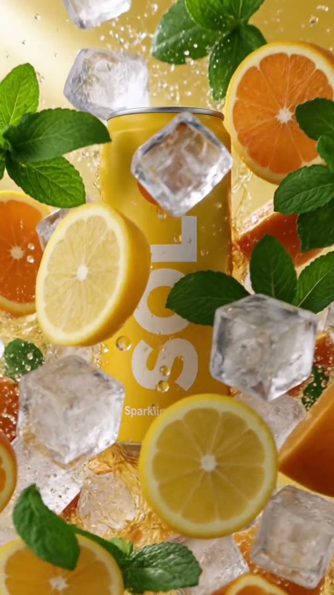</a>
<b>モデル</b>&nbsp; Kling 4<br>
<b>クリップ</b>&nbsp; 5 s · 9:16 · 音声あり<br>
<b>被写体</b>&nbsp; <code>[1]</code> ご自身の商品<br><br>
<b>参照写真</b><br> <br><br>
<a href="https://refvid.com/ja/product-ingredient-splash"><b>▶ クリップを見て、自分の写真で作る</b></a>
</p>
<br clear="left">

```text
スローモーション：[1]がパッケージのメインカラーの明るい背景の前、画面の中央に立っています。ラベルに書かれた主な素材が下から勢いよく舞い上がって周りを転がり、しずくが光の中を飛び散ります。やがてそれらが落ちていき、[1]がラベルをカメラに向けてすっきりと立っています。明るいスタジオライト、細部まで鮮明に。
```

<details><summary>うまくいく写真</summary><br>背景はパッケージのメインカラーになり、舞い上がるのは表示されている原材料です。原材料名と本来の色がはっきりわかる正面写真がいちばん大事で、暗い写真や色かぶりした写真は避けましょう。<br><br><sub>RefVidでKling 4を使って作成。SOL（AIで作成した被写体）の参照写真2枚から生成。このテンプレートのプロンプトは以前の表現を使用しています。</sub></details>

### おうちライフスタイル

<p>
<a href="https://refvid.com/ja/product-lifestyle-home">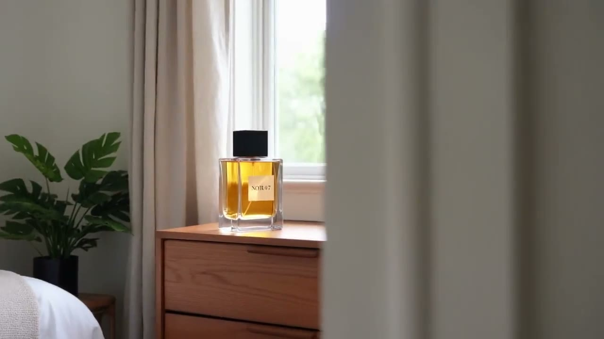</a>
<b>モデル</b>&nbsp; Kling 3.0 Omni<br>
<b>クリップ</b>&nbsp; 5 s · 16:9 · 音声なし<br>
<b>被写体</b>&nbsp; <code>[1]</code> 商品<br><br>
<b>参照写真</b><br>  <br><br>
<a href="https://refvid.com/ja/product-lifestyle-home"><b>▶ クリップを見て、自分の写真で作る</b></a>
</p>
<br clear="left">

```text
カット 1: 日差しが差し込む落ち着いた寝室。カメラがリネンのカーテンと鉢植えの植物の前をゆっくりと滑るように移動し、窓辺の木製チェストの上に立つ[1]へ向かいます。
カット 2: カメラが[1]に寄っていきます。ラベルはくっきりと写り、柔らかな朝の光と、葉の揺れる影がやさしく映り込みます。
```

<details><summary>うまくいく写真</summary><br>カメラは寝室を進み、チェストの上に立つ商品で止まるので、ラベルを前に向けて立てた商品を目の高さで撮った写真を。やわらかな自然光で撮ると朝の光になじみます。<br><br><sub>RefVidでKling 3.0 Omniを使って作成。NOIR 07（AIで作られた被写体）の参照写真3枚と、このテンプレートのプロンプトを使用しています。</sub></details>

### 花びらが舞う

<p>
<a href="https://refvid.com/ja/product-petal-fall"></a>
<b>モデル</b>&nbsp; Kling 4<br>
<b>クリップ</b>&nbsp; 5 s · 9:16 · 音声あり<br>
<b>被写体</b>&nbsp; <code>[1]</code> ご自身の商品<br><br>
<b>参照写真</b><br>  <br><br>
<a href="https://refvid.com/ja/product-petal-fall"><b>▶ クリップを見て、自分の写真で作る</b></a>
</p>
<br clear="left">

```text
スローモーション：淡いピンクの背景の前、淡い色の石の台座の上に立つ[1]の周りを、柔らかなピンクのバラの花びらが暖かな光の中で舞い落ちます。いくつかの花びらがその横に落ち、カメラはラベルが画面いっぱいになるまでゆっくり寄っていきます。夢のような雰囲気、柔らかくぼけた背景、コスメ広告スタイル。
```

<details><summary>うまくいく写真</summary><br>カメラはラベルが画面いっぱいになるまで寄るので、細かな文字や質感まで見える、寄っても耐えるラベル写真を。石の台座に立つときと同じ、立てた状態の全体写真も加えましょう。<br><br><sub>RefVidでKling 4を使い、LUMEN（AIで作成した被写体）の参照写真3枚と、このテンプレートのプロンプトから作成しました。</sub></details>

### 開封動画

<p>
<a href="https://refvid.com/ja/product-unboxing"></a>
<b>モデル</b>&nbsp; Kling 3.0 Omni<br>
<b>クリップ</b>&nbsp; 10 s · 9:16 · 音声あり<br>
<b>被写体</b>&nbsp; <code>[1]</code> お使いの商品<br><br>
<b>参照写真</b><br>  <br><br>
<a href="https://refvid.com/ja/product-unboxing"><b>▶ クリップを見て、自分の写真で作る</b></a>
</p>
<br clear="left">

```text
カット 1: 柔らかい日光が当たる明るい木のテーブルに置かれた無地のクラフト紙の箱を真上から撮影。2つの手がふたを持ち上げ、白い薄葉紙を折り返す。紙のこすれる音。
カット 2: 両手が箱から[1]を持ち上げて掲げ、ラベルがカメラに向くようにゆっくり回すクローズアップ。
カット 3: 開いた箱の横のテーブルに[1]が置かれ、カメラがゆっくり寄っていく。清潔感があり明るく、被写界深度は浅い。
```

<details><summary>うまくいく写真</summary><br>手がクラフトボックスから商品を取り出し、カメラへ向けて回すので、回る途中に映る面をすべて見せましょう。正面のラベル、背面、底面を、それぞれ箱から出した状態で。<br><br><sub>このテンプレートのプロンプトを使い、LUMEN（AIで作成した被写体）の参照写真3枚からKling 3.0 OmniでRefVidを使って作成。</sub></details>

### 水しぶき

<p>
<a href="https://refvid.com/ja/product-water-splash"></a>
<b>モデル</b>&nbsp; Kling 3.0 Omni<br>
<b>クリップ</b>&nbsp; 5 s · 9:16 · 音声なし<br>
<b>被写体</b>&nbsp; <code>[1]</code> ご自身の商品<br><br>
<b>参照写真</b><br>  <br><br>
<a href="https://refvid.com/ja/product-water-splash"><b>▶ クリップを見て、自分の写真で作る</b></a>
</p>
<br clear="left">

```text
スローモーション：[1]が、柔らかな青いグラデーションの背景の前にある透き通った水槽へ落ちていきます。その周りで気泡と水滴が勢いよく弾け、やがてラベルをカメラに向けた状態で、まっすぐ立ち止まります。明るいスタジオライト、マクロの細部まで鮮明に。
```

<details><summary>うまくいく写真</summary><br>商品は水に沈んでからまっすぐ立つので、キャップから底まで写った、ラベルを真正面にした立ち姿の写真が必要です。濡れたテカリや映り込みで文字が隠れた写真は避けましょう。<br><br><sub>RefVidでKling 3.0 Omniを使い、LUMEN（AIで作成した被写体）の参照写真3枚と、このテンプレートのプロンプトから作成しました。</sub></details>

### スキンケアの質感

<p>
<a href="https://refvid.com/ja/skincare-texture-macro">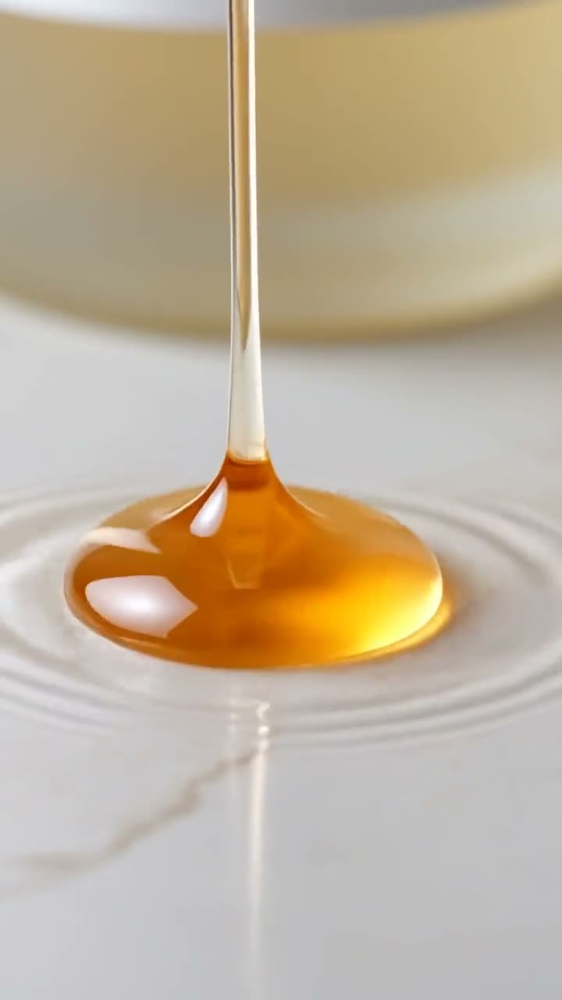</a>
<b>モデル</b>&nbsp; Kling 3.0 Omni<br>
<b>クリップ</b>&nbsp; 5 s · 9:16 · 音声なし<br>
<b>被写体</b>&nbsp; <code>[1]</code> 商品<br><br>
<b>参照写真</b><br>  <br><br>
<a href="https://refvid.com/ja/skincare-texture-macro"><b>▶ クリップを見て、自分の写真で作る</b></a>
</p>
<br clear="left">

```text
カット 1: 極端なマクロ撮影：[1]の中身が、そのままの色と質感で、つややかなひとすくいとなって滑らかな淡い石の面に落ち、ゆっくりとなじんでいく。柔らかい自然光、クリーム色の背景。
カット 2: [1]が、柔らかい朝の窓の光の中で、ラベルにある主成分をいくつか添えた淡い石の上に立つ。カメラがゆっくり寄っていき、ラベルがフレーム全体を埋める。
```

<details><summary>うまくいく写真</summary><br>1カット目は中身そのものなので、本来の色と質感がわかる中身を出した写真を加え、さらにジャー・チューブ・ボトルの鮮明な正面写真を。最後はラベルが画面いっぱいになります。<br><br><sub>RefVidでKling 3.0 Omniを使って作成。LUMEN（AIで作成した被写体）の参照写真3枚から生成。このテンプレートのプロンプトは以前の表現を使用しています。</sub></details>

### スニーカー広告

<p>
<a href="https://refvid.com/ja/sneaker-street-walk"></a>
<b>モデル</b>&nbsp; Kling 3.0 Omni<br>
<b>クリップ</b>&nbsp; 5 s · 9:16 · 音声なし<br>
<b>被写体</b>&nbsp; <code>[1]</code> お手持ちのシューズ<br><br>
<b>参照写真</b><br>  <br><br>
<a href="https://refvid.com/ja/sneaker-street-walk"><b>▶ クリップを見て、自分の写真で作る</b></a>
</p>
<br clear="left">

```text
カット 1: 足首の高さに構えた低いカメラが、[1]を履いた一組の足を並走しながら追いかける。足はひなたの街の歩道を軽快に歩き、通行人の影が差す。被写界深度は浅め。
カット 2: [1]が歩道を踏み出す瞬間のクローズアップ。少し砂ぼこりが舞い上がり、カメラは横でゆっくりと止まる。
```

<details><summary>うまくいく写真</summary><br>低いカメラが横からシューズを追い、着地の瞬間をアップでとらえるので、ソールの縁まで写った外側の真横の写真がいちばん大事です。履いた状態の写真があると歩き方やフィット感が自然になります。<br><br><sub>RefVidでKling 3.0 Omniを使い、AERO 1（AIで作成した被写体）の参考写真3枚とこのテンプレートのプロンプトから作成しました。</sub></details>

### ガジェット発表

<p>
<a href="https://refvid.com/ja/tech-gadget-reveal"></a>
<b>モデル</b>&nbsp; Kling 4<br>
<b>クリップ</b>&nbsp; 5 s · 16:9 · 音声あり<br>
<b>被写体</b>&nbsp; <code>[1]</code> ご自身のデバイス<br><br>
<b>参照写真</b><br> <br><br>
<a href="https://refvid.com/ja/tech-gadget-reveal"><b>▶ クリップを見て、自分の写真で作る</b></a>
</p>
<br clear="left">

```text
[1]が、ほぼ真っ暗な中、黒いマットな面の上に置かれています。細いクールな青い光がその輪郭をなぞり、やがて光が広がると、カメラはゆっくり弧を描いて周りを回り込み、表面にすっきりとした映り込みを捉えながら、最後に細部までくっきりと正面から映します。洗練された新製品発表スタイル、深い黒の背景、ほのかなもや。
```

<details><summary>うまくいく写真</summary><br>まず光が輪郭をなぞり、カメラが弧を描いて正面で止まるので、画面やロゴが見える真正面の写真と、縁や端子、筐体の仕上げがわかる斜めの写真を1枚ずつ用意しましょう。<br><br><sub>RefVidでKling 4を使い、PULSE（AIで作成した被写体）の参照写真2枚と、このテンプレートのプロンプトから作成しました。</sub></details>

### 腕時計マクロ

<p>
<a href="https://refvid.com/ja/watch-macro"></a>
<b>モデル</b>&nbsp; Kling 4<br>
<b>クリップ</b>&nbsp; 5 s · 1:1 · 音声あり<br>
<b>被写体</b>&nbsp; <code>[1]</code> ご自身の腕時計<br><br>
<b>参照写真</b><br> <br><br>
<a href="https://refvid.com/ja/watch-macro"><b>▶ クリップを見て、自分の写真で作る</b></a>
</p>
<br clear="left">

```text
[1]の極端なマクロ：秒針が進む中、カメラが文字盤の上をゆっくりすべり、磨かれたケースやインデックスの上を光が流れます。続いてカメラが引き、ダークレザーの上に置かれた腕時計の全体を映します。暖かなローキーの光、浅い被写界深度、上質な細部。
```

<details><summary>うまくいく写真</summary><br>カメラは文字盤の超アップから始まるので、インデックスや針、ロゴが読める、映り込みのない真上からの写真を最初に。ケースとリューズの側面、ベルトを広げた全体の写真も加えましょう。<br><br><sub>RefVidでKling 4を使い、ATLAS（AIで作成した被写体）の参照写真2枚と、このテンプレートのプロンプトから作成しました。</sub></details>

[↑ 目次に戻る](#目次)

## 人物

数枚の顔写真から、あなた・友人・カップルを全カットに。

### ロードトリップ

<p>
<a href="https://refvid.com/ja/best-friends-road-trip"></a>
<b>モデル</b>&nbsp; Kling 3.0 Omni<br>
<b>クリップ</b>&nbsp; 10 s · 16:9 · 音声あり<br>
<b>被写体</b>&nbsp; <code>[1]</code> あなた · <code>[2]</code> 親友<br><br>
<b>参照写真</b><br>       <br><br>
<a href="https://refvid.com/ja/best-friends-road-trip"><b>▶ クリップを見て、自分の写真で作る</b></a>
</p>
<br clear="left">

```text
カット 1: ヴィンテージのオープンカーが晴れた海沿いの道を走る。ハンドルを握る[1]と助手席の[2]が笑い、髪が風になびいている。ワイドのトラッキングショット。
カット 2: 車内の寄りの二人構図。[2]が大声で一緒に歌い、[1]は笑いながら首を振っている。風の音、温かい光。
カット 3: 夕暮れの断崖の展望台に車が停まっている。[1]と[2]がボンネットに座り、後ろ姿で海を見つめている。
```

<details><summary>うまくいく写真</summary><br>二人は前の座席に並んで座り、最後はボンネットに座る後ろ姿で終わります。それぞれ正面のはっきりした写真、斜め45度の写真、髪型と体格がよくわかる写真を用意してください。<br><br><sub>RefVidでKling 3.0 Omniを使い、MiaとLeoの参照写真8枚（AIで作成した被写体）から、このテンプレートのプロンプトで作成。</sub></details>

### 誕生日メッセージ

<p>
<a href="https://refvid.com/ja/birthday-greeting"></a>
<b>モデル</b>&nbsp; Kling 3.0 Omni<br>
<b>クリップ</b>&nbsp; 5 s · 9:16 · 音声あり<br>
<b>被写体</b>&nbsp; <code>[1]</code> あなた<br><br>
<b>参照写真</b><br>   <br><br>
<a href="https://refvid.com/ja/birthday-greeting"><b>▶ クリップを見て、自分の写真で作る</b></a>
</p>
<br clear="left">

```text
くつろいだリビングで、[1]が火のついた小さなケーキをカメラの方へ持つ中距離のクローズアップ。その後、笑顔になり、温かい声で"Happy birthday! I hope this year is your best one yet."と話す。背景には暖かい夕方の光とフェアリーライト。
```

<details><summary>うまくいく写真</summary><br>ろうそくのケーキを持って話すバストアップのカットなので、胸のあたりまで写った正面の鮮明な写真が最適です。暖かい室内光で撮った写真なら、ろうそくの灯りと肌の色がなじみます。<br><br><sub>RefVidでKling 3.0 Omniを使用し、このテンプレートのプロンプトで、Leoの参照写真4枚（AIで作成した被写体）から作成。</sub></details>

### 料理番組

<p>
<a href="https://refvid.com/ja/chef-cooking-show"></a>
<b>モデル</b>&nbsp; Kling 3.0 Omni<br>
<b>クリップ</b>&nbsp; 10 s · 16:9 · 音声あり<br>
<b>被写体</b>&nbsp; <code>[1]</code> あなた<br><br>
<b>参照写真</b><br>   <br><br>
<a href="https://refvid.com/ja/chef-cooking-show"><b>▶ クリップを見て、自分の写真で作る</b></a>
</p>
<br clear="left">

```text
カット 1: 銅製の鍋とハーブがカウンターに並ぶ温かい家庭のキッチン。紺色のエプロンをつけた[1]がカメラに笑顔を向け、こう話します。"Welcome back to Sunday Kitchen. Today: the easiest pasta you’ll ever make."
カット 2: コンロの上のフライパンのクローズアップ。[1]がオリーブオイルでニンニクとトマトを炒めると、炎がぱっと上がります。ジュージューという音。
カット 3: [1]が新鮮なバジルを添えたスパゲッティの皿をカメラの前に置き、満足そうにうなずきます。
```

<details><summary>うまくいく写真</summary><br>カウンターでカメラに向かって話し、完成した皿の前でうなずくので、自然な笑顔の正面写真がいちばん大切です。料理をするときのように髪をまとめた写真もあると、コンロの前でも同じ顔に保てます。<br><br><sub>RefVidでKling 3.0 Omniを使い、Leo（AIで作成した被写体）の参照写真4枚と、このテンプレートのプロンプトから作成しました。</sub></details>

### クリスマスマーケット

<p>
<a href="https://refvid.com/ja/christmas-market-couple"></a>
<b>モデル</b>&nbsp; Kling 3.0 Omni<br>
<b>クリップ</b>&nbsp; 5 s · 16:9 · 音声なし<br>
<b>被写体</b>&nbsp; <code>[1]</code> あなた · <code>[2]</code> パートナー<br><br>
<b>参照写真</b><br>       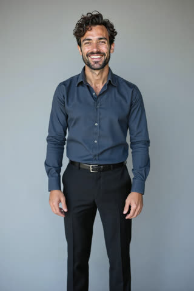<br><br>
<a href="https://refvid.com/ja/christmas-market-couple"><b>▶ クリップを見て、自分の写真で作る</b></a>
</p>
<br clear="left">

```text
カット 1: 雪のクリスマスマーケットの夕暮れ。木製の屋台と連なる温かい灯りのなか、[1]と[2]が腕を組んでカメラに向かって歩いてくる。それぞれ湯気の立つホットワインのカップを手に、笑っている。小雪が舞っている。
カット 2: お二人のクローズ2ショット。[2]が[1]の髪についた雪片を払い、二人は静かにほほえみ合う。背後ではマーケットの灯りがやわらかく輝いている。
```

<details><summary>うまくいく写真</summary><br>腕を組んでカメラへ歩き、そのあと向かい合って寄り添うので、お二人それぞれに正面の鮮明な写真と横顔の写真が必要です。髪から雪をはらう場面があるので、いつもの髪型で写っている写真を。<br><br><sub>RefVidでKling 3.0 Omniを使い、Miaさん・Leoさんの参照写真8枚（AIで作成した被写体）と、このテンプレートのプロンプトから作成しました。</sub></details>

### クリスマスメッセージ

<p>
<a href="https://refvid.com/ja/christmas-sweater-greeting"></a>
<b>モデル</b>&nbsp; Kling 3.0 Omni<br>
<b>クリップ</b>&nbsp; 5 s · 9:16 · 音声あり<br>
<b>被写体</b>&nbsp; <code>[1]</code> あなた<br><br>
<b>参照写真</b><br>   <br><br>
<a href="https://refvid.com/ja/christmas-sweater-greeting"><b>▶ クリップを見て、自分の写真で作る</b></a>
</p>
<br clear="left">

```text
カット 1: 夜のあたたかいリビング。温かみのある電飾で飾られた点灯したクリスマスツリーと、パチパチと燃える暖炉の前にはストッキングが掛けられている。[1]は赤いニットのクリスマスセーター姿で、ホットココアのマグを持ってラグの上に座り、カメラがゆっくりと寄っていく。
カット 2: [1]は温かな笑顔でカメラを見上げ、"Merry Christmas, I miss you all. See you soon!"と話す。暖炉の火が静かにパチパチと鳴っている。
```

<details><summary>うまくいく写真</summary><br>ラグに座ってカメラを見上げ、願いを伝えるので、少し上から柔らかく暖かい光で撮った正面の写真がいちばん合います。座った姿の写真があると、セーターも自然になじみます。<br><br><sub>RefVidでKling 3.0 Omniを使い、Miaの参照写真4枚（AIで作成した被写体）と、このテンプレートのプロンプトから作成。</sub></details>

### 海辺の夕日

<p>
<a href="https://refvid.com/ja/couple-beach-sunset"></a>
<b>モデル</b>&nbsp; Kling 3.0 Omni<br>
<b>クリップ</b>&nbsp; 10 s · 16:9 · 音声なし<br>
<b>被写体</b>&nbsp; <code>[1]</code> あなた · <code>[2]</code> パートナー<br><br>
<b>参照写真</b><br>       <br><br>
<a href="https://refvid.com/ja/couple-beach-sunset"><b>▶ クリップを見て、自分の写真で作る</b></a>
</p>
<br clear="left">

```text
カット 1: ゴールデンアワーの引きのショット：[1]と[2]が静かな浜辺の波打ち際を裸足で、カメラに向かって歩いてくる。話をしながら、穏やかな波が足元に寄せては返す。
カット 2: ミディアムショット：[1]と[2]が一緒に笑っている。背後には低く温かい陽の光があり、海風に髪がなびく。
カット 3: [1]と[2]が並んで立ち、後ろ姿で捉えられている。海に沈んでいく夕日を眺めている。ゆっくりとしたプッシュインで、温かいオレンジ色の空。
```

<details><summary>うまくいく写真</summary><br>最初のカットはカメラへ歩いてくる姿、最後は夕日を見る後ろ姿なので、それぞれ正面の鮮明な写真と、髪と肩が写った後ろ姿の写真を加えてください。全身の写真があると身長差も正しく出ます。<br><br><sub>Kling 3.0 Omniを使い、RefVidでこのテンプレートのプロンプトに沿って、MiaとLeo（AIで作成した被写体）の参照写真8枚から作成。</sub></details>

### ファッションルックブック

<p>
<a href="https://refvid.com/ja/fashion-lookbook-walk"></a>
<b>モデル</b>&nbsp; Kling 3.0 Omni<br>
<b>クリップ</b>&nbsp; 10 s · 9:16 · 音声なし<br>
<b>被写体</b>&nbsp; <code>[1]</code> あなた<br><br>
<b>参照写真</b><br>   <br><br>
<a href="https://refvid.com/ja/fashion-lookbook-walk"><b>▶ クリップを見て、自分の写真で作る</b></a>
</p>
<br clear="left">

```text
カット 1: 広角ショット：[1]が白いTシャツとワイドレッグのジーンズの上にキャメルのトレンチコートを羽織り、柔らかな朝の光の中、静かなパリの裏通りをカメラに向かって自信を持って歩いてくる。
カット 2: 低い横からのアングルで、[1]が歩幅に合わせて動くコートを捉えながら併走し、店先が流れていく。
カット 3: [1]が肩越しに振り返り、わずかに微笑んでカメラの方を向く寄りのショット。髪に光があたる。
```

<details><summary>うまくいく写真</summary><br>3つのカットは、正面から歩く姿、低い横からのアングル、肩越しに振り返る姿なので、全身の正面写真、横からの写真、振り返った写真を加えてください。正面の写真は明るく鮮明に。<br><br><sub>RefVidでKling 3.0 Omniを使い、Mia（AIで作成した被写体）の参照写真4枚から、このテンプレートのプロンプトで作成しました。</sub></details>

### フィットネスコーチ

<p>
<a href="https://refvid.com/ja/fitness-coach-demo">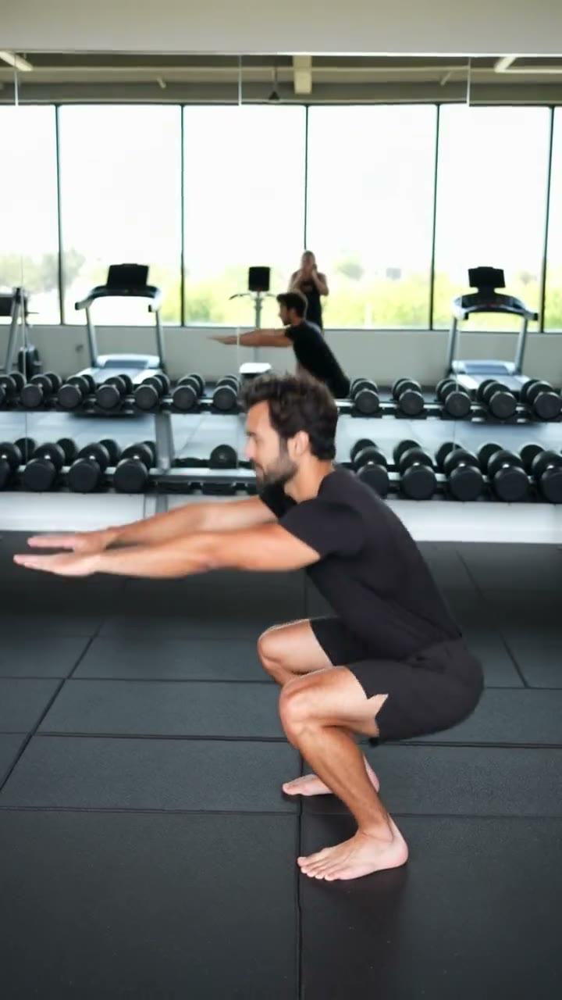</a>
<b>モデル</b>&nbsp; Kling 3.0 Omni<br>
<b>クリップ</b>&nbsp; 5 s · 9:16 · 音声あり<br>
<b>被写体</b>&nbsp; <code>[1]</code> あなた<br><br>
<b>参照写真</b><br>   <br><br>
<a href="https://refvid.com/ja/fitness-coach-demo"><b>▶ クリップを見て、自分の写真で作る</b></a>
</p>
<br clear="left">

```text
カット 1: 明るく大きな窓のある現代的なジム。黒のトレーニングウェアを着た[1]が、横から見てゆっくり自重スクワットをします。背筋を伸ばし、腕は前に出しています。ジムの環境音。
カット 2: [1]が立ち上がり、カメラを見て笑顔で励ますように言います："Push the floor away, and keep your chest up."
```

<details><summary>うまくいく写真</summary><br>スクワットは横から撮り、そのあと正面で話すので、トレーニングウェアの全身を横から撮った写真と、顔の正面の鮮明な写真を加えてください。体型がわかる写真があると、動きもあなたらしくなります。<br><br><sub>このテンプレートのプロンプトを使い、RefVidでKling 3.0 Omniを用いて、Leo（AIで作成した被写体）の参照写真4枚から作成。</sub></details>

### シーツおばけ

<p>
<a href="https://refvid.com/ja/halloween-bedsheet-ghost"></a>
<b>モデル</b>&nbsp; Kling 3.0 Omni<br>
<b>クリップ</b>&nbsp; 6 s · 9:16 · 音声なし<br>
<b>被写体</b>&nbsp; <code>[1]</code> あなた<br><br>
<b>参照写真</b><br>   <br><br>
<a href="https://refvid.com/ja/halloween-bedsheet-ghost"><b>▶ クリップを見て、自分の写真で作る</b></a>
</p>
<br clear="left">

```text
カット 1: 目の穴が開いた無地の白いベッドシーツをかぶり、黒いサングラスをかけた人物が、ゴールデンアワーの秋の公園で落ち葉に覆われた小道に立ち、ゆっくりとカメラの方へ振り向きます。手持ちカメラ、暖かい光、舞い落ちる落ち葉。
カット 2: 人物がシーツを外します。現れるのは[1]で、微笑みながらシーツを片腕に掛けています。落ち葉が舞い上がります。ミディアムショット、柔らかな金色の逆光。
```

<details><summary>うまくいく写真</summary><br>シーツを取った瞬間に、金色の逆光の中で笑顔のあなたが現れるので、いつもの髪型で撮った正面の鮮明な写真がいちばん大切です。全身の写真があると、シーツの下の背丈も正しく出ます。<br><br><sub>RefVidでKling 3.0 Omniを使い、Mia（AIで作成した被写体）の参考写真4枚とこのテンプレートのプロンプトから作成しました。</sub></details>

### コスチューム試着

<p>
<a href="https://refvid.com/ja/halloween-costume-try-on">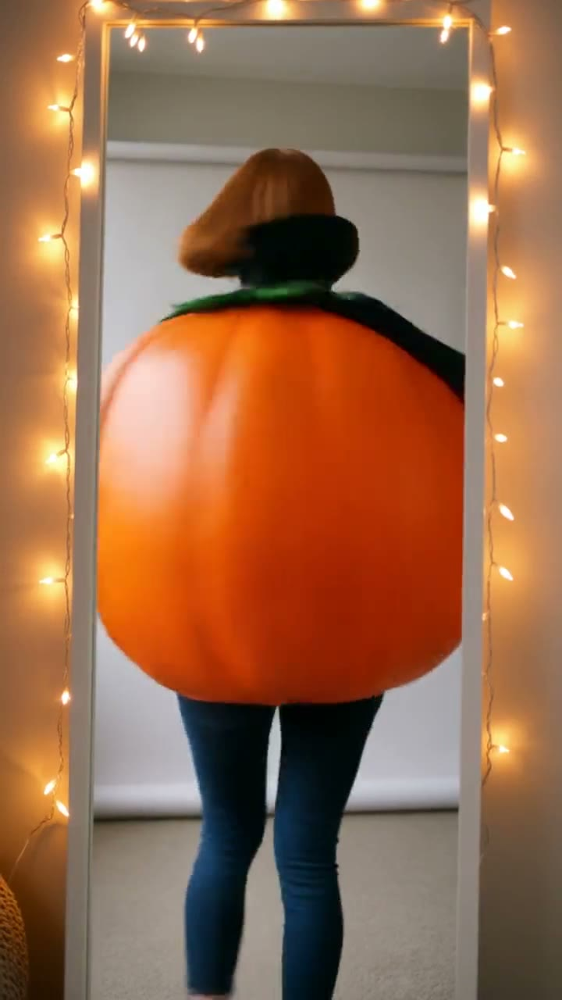</a>
<b>モデル</b>&nbsp; Kling 3.0 Omni<br>
<b>クリップ</b>&nbsp; 10 s · 9:16 · 音声なし<br>
<b>被写体</b>&nbsp; <code>[1]</code> あなた<br><br>
<b>参照写真</b><br>   <br><br>
<a href="https://refvid.com/ja/halloween-costume-try-on"><b>▶ クリップを見て、自分の写真で作る</b></a>
</p>
<br clear="left">

```text
カット 1: [1]が普段着のまま、背の高い寝室の鏡の前で一度くるりと回り、カメラの方を向いて吸血鬼として決まります。頭は素のままで、赤い裏地の付いた黒いハイカラーのケープ、小さなプラスチックの牙を着け、顔は全体が見えています。暖かいフェアリーライト、スマートフォンのカメラで撮ったような雰囲気。
カット 2: ハードカット：[1]がもう一度回ると、ケープは消えています。緑のヘタの襟が付いた、丸くふっくらしたオレンジ色のかぼちゃの衣装になり、頭は素のまま、カメラに向かって笑っています。
カット 3: ハードカット：[1]が3回目に回ると、かぼちゃの衣装は消えています。長い黒のドレスと黒いとんがり帽子をまとった魔女になり、カメラにいたずらっぽくウインクしています。
```

<details><summary>うまくいく写真</summary><br>どの衣装も頭は出したままで、3回カメラのほうへ回るので、顔全体と髪がよく見える正面の鮮明な写真と、どの衣装でも体型が変わらないよう全身の写真を加えてください。<br><br><sub>RefVidでKling 3.0 Omniを使い、Mia（AIで作成した被写体）の参照写真4枚から、このテンプレートのプロンプトで作成しました。</sub></details>

### パンプキンヘッド

<p>
<a href="https://refvid.com/ja/halloween-pumpkin-head"></a>
<b>モデル</b>&nbsp; Kling 3.0 Omni<br>
<b>クリップ</b>&nbsp; 6 s · 9:16 · 音声なし<br>
<b>被写体</b>&nbsp; <code>[1]</code> あなた<br><br>
<b>参照写真</b><br>   <br><br>
<a href="https://refvid.com/ja/halloween-pumpkin-head"><b>▶ クリップを見て、自分の写真で作る</b></a>
</p>
<br clear="left">

```text
カット 1: 深いオレンジ色の背景がある暗いスタジオで、黒いタートルネックの人物が、中のろうそくの炎が揺らめく光るくり抜きジャック・オー・ランタンを顔の前に掲げている。ゆっくりとしたプッシュイン、低めでムーディーなライティング。
カット 2: [1]がカボチャを胸の高さまで下ろし、わずかに微笑みながらカメラをまっすぐ見つめる。ろうそくの光が下から顔を照らす。クローズアップ、シネマティック。
```

<details><summary>うまくいく写真</summary><br>顔が映るのは最後、ろうそくの灯りに下から照らされるアップだけなので、帽子やサングラスのない真正面の鮮明な写真がいちばん大切です。落ち着いた表情か軽い笑顔が合います。<br><br><sub>RefVidで、Kling 3.0 Omniを使い、Mia（AIで作成した被写体）の参照写真4枚とこのテンプレートのプロンプトから作成。</sub></details>

### Y2Kフラッシュ

<p>
<a href="https://refvid.com/ja/halloween-y2k-flash"></a>
<b>モデル</b>&nbsp; Kling 3.0 Omni<br>
<b>クリップ</b>&nbsp; 5 s · 9:16 · 音声なし<br>
<b>被写体</b>&nbsp; <code>[1]</code> あなた<br><br>
<b>参照写真</b><br>   <br><br>
<a href="https://refvid.com/ja/halloween-y2k-flash"><b>▶ クリップを見て、自分の写真で作る</b></a>
</p>
<br clear="left">

```text
2004年の使い捨てカメラで撮ったパーティー写真の雰囲気：夜のハロウィンのハウスパーティー、明るいオンカメラの直接フラッシュ、やや露出オーバーの肌、背後の壁にくっきり落ちる影、強めのフィルムグレイン、背景にはストリングライト。黒い猫耳をつけた[1]が戸口のそばに立ち、赤い紙コップを持って、カメラの方を向いて笑い、ピースサインをします。顔に光のフレアはありません。
```

<details><summary>うまくいく写真</summary><br>強いカメラフラッシュで光が平坦になるので、強い影のない均一な光で撮った正面の顔写真がいちばん忠実に仕上がります。笑いながら振り向くので、笑顔の写真があると効果的です。<br><br><sub>RefVidでKling 3.0 Omniを使用し、Mia（AIで作成された被写体）の参考写真4枚から、このテンプレートのプロンプトで作成しました。</sub></details>

### ゾンビウォーク

<p>
<a href="https://refvid.com/ja/halloween-zombie-walk"></a>
<b>モデル</b>&nbsp; Kling 3.0 Omni<br>
<b>クリップ</b>&nbsp; 5 s · 16:9 · 音声あり<br>
<b>被写体</b>&nbsp; <code>[1]</code> あなた<br><br>
<b>参照写真</b><br>   <br><br>
<a href="https://refvid.com/ja/halloween-zombie-walk"><b>▶ クリップを見て、自分の写真で作る</b></a>
</p>
<br clear="left">

```text
カット 1: 霧に包まれた夜の通り、点滅する街灯一本の下でのミディアムショット。ハロウィンのゾンビの扮装をした[1]が、灰緑色の濃いフェイスペイントをして、目の周りには暗く落ちくぼんだ影が描かれ、口元には作り物の血があり、破れて汚れたフランネルシャツを着ている。硬直した腕でゆっくりとカメラに向かって足を引きずって歩いてくる。冷たい青い光と漂う霧。
カット 2: [1]のクローズアップ。灰緑色のゾンビのフェイスペイントと作り物の血をつけたまま、街灯の下で立ち止まり、首をかしげてから、カメラに向かってにやりと笑う。低いうなり声と遠くの風の音。
```

<details><summary>うまくいく写真</summary><br>灰緑色のメイクと暗い影で顔が覆われるので、あなただとわかるのは骨格です。メイクやメガネなしで、自然な光で撮った正面の鮮明な写真と横顔を使ってください。最後はにやりと笑う顔で終わります。<br><br><sub>RefVidでKling 3.0 Omniを使い、Mia（AIで作成した被写体）の参照写真4枚から、このテンプレートのプロンプトで作成。</sub></details>

### 自己紹介動画

<p>
<a href="https://refvid.com/ja/linkedin-intro"></a>
<b>モデル</b>&nbsp; Kling 3.0 Omni<br>
<b>クリップ</b>&nbsp; 5 s · 16:9 · 音声あり<br>
<b>被写体</b>&nbsp; <code>[1]</code> あなた<br><br>
<b>参照写真</b><br>   <br><br>
<a href="https://refvid.com/ja/linkedin-intro"><b>▶ クリップを見て、自分の写真で作る</b></a>
</p>
<br clear="left">

```text
[1]が、植物と窓のある明るくモダンなオフィスに座っているミディアムショット。カメラをまっすぐ見つめ、落ち着いた笑顔で"Hi, I’m Leo — I help small brands tell their story on video."と話す。やわらかい日の光。
```

<details><summary>うまくいく写真</summary><br>デスクからカメラに向かって話すカットなので、目線の高さで正面から撮った、自然な笑顔の鮮明な写真がいちばん大切です。肩まで写り、仕事で着る服がわかる写真も加えてください。<br><br><sub>RefVidでKling 3.0 Omniを使い、レオ（AIで作成した被写体）の参考写真4枚から、このテンプレートのプロンプトで作成。</sub></details>

### ミニドラマ

<p>
<a href="https://refvid.com/ja/mini-drama-scene"></a>
<b>モデル</b>&nbsp; Kling 3.0 Omni<br>
<b>クリップ</b>&nbsp; 10 s · 9:16 · 音声あり<br>
<b>被写体</b>&nbsp; <code>[1]</code> 1人目の主役 · <code>[2]</code> 2人目の主役<br><br>
<b>参照写真</b><br>       <br><br>
<a href="https://refvid.com/ja/mini-drama-scene"><b>▶ クリップを見て、自分の写真で作る</b></a>
</p>
<br clear="left">

```text
カット 1: 雨の降る夜、静かなカフェ。[1]と[2]が小さなテーブルを挟んで座り、手つかずのコーヒーが間に置かれている。引きの構図で、窓からの雰囲気のある光。
カット 2: [1]の近接ショット。目はまっすぐ据えられ、静かにこう言う："You knew all along, didn’t you?"
カット 3: [2]の近接ショット。うつむいてから顔を上げ、こう答える："I was going to tell you tonight."
```

<details><summary>うまくいく写真</summary><br>2人とも台詞のときに顔のアップになるので、満面の笑みではなく、落ち着いた真顔を正面から撮った鮮明な写真をそれぞれ用意してください。テーブル越しに向き合うため、斜めからの写真もあると安心です。<br><br><sub>Kling 3.0 Omniを使い、RefVidで作成。MiaとLeo（AIで作られた被写体）の参照写真8枚と、このテンプレートのプロンプトを使用。</sub></details>

### モーニングルーティン

<p>
<a href="https://refvid.com/ja/morning-routine"></a>
<b>モデル</b>&nbsp; Kling 3.0 Omni<br>
<b>クリップ</b>&nbsp; 5 s · 9:16 · 音声なし<br>
<b>被写体</b>&nbsp; <code>[1]</code> あなた<br><br>
<b>参照写真</b><br>   <br><br>
<a href="https://refvid.com/ja/morning-routine"><b>▶ クリップを見て、自分の写真で作る</b></a>
</p>
<br clear="left">

```text
カット 1: 穏やかでミニマルなキッチンに、やわらかな朝日が差し込む。[1]が、リネンのゆったりしたシャツ姿で、ドリップコーヒーにゆっくりとお湯を注ぐ。湯気が立ちのぼり、窓辺には植物が置かれている。
カット 2: [1]が窓辺に座り、両手でマグカップを持ってゆっくり最初の一口を味わう。外を眺めて、やわらかく微笑む。暖かい光、被写界深度は浅め。
```

<details><summary>うまくいく写真</summary><br>2カット目はマグを口元に、窓の外を静かに見つめる横顔なので、正面と同じくらい横顔や斜めからの鮮明な写真が大切です。お湯を注ぐ手元のために、手が写った写真もあると安心です。<br><br><sub>RefVidでAIモデルのMia（AIで作成した被写体）の参照写真4枚から、本テンプレートのプロンプトを使ってKling 3.0 Omniで作成しました。</sub></details>

### 新年カウントダウン

<p>
<a href="https://refvid.com/ja/new-year-countdown"></a>
<b>モデル</b>&nbsp; Kling 3.0 Omni<br>
<b>クリップ</b>&nbsp; 5 s · 16:9 · 音声あり<br>
<b>被写体</b>&nbsp; <code>[1]</code> あなた<br><br>
<b>参照写真</b><br>   <br><br>
<a href="https://refvid.com/ja/new-year-countdown"><b>▶ クリップを見て、自分の写真で作る</b></a>
</p>
<br clear="left">

```text
カット 1: 大晦日の真夜中、背後に街のスカイラインがきらめく屋上テラスで、カメラの正面を向いたミディアムショット。きらびやかな衣装の[1]がシャンパンのグラスを掲げ、満面の笑みでカメラに向かってカウントダウンする："Three, two, one…"
カット 2: [1]がカメラの方へ振り向き、グラスを掲げて"Happy New Year!"と歓声を上げる。背後のスカイラインに金色の花火が咲き、紙吹雪が空中を舞う。
```

<details><summary>うまくいく写真</summary><br>カメラに向かってカウントダウンし、口を大きく開けて歓声を上げるので、歯の見える笑顔を正面から撮った鮮明な写真がいちばん大切です。髪と上半身が写る少し引いた写真があると、パーティー衣装でもあなたらしさが残ります。<br><br><sub>このテンプレートのプロンプトを使い、Kling 3.0 OmniでRefVidによって作成（Mia（AIで作られた被写体）の参照写真4枚から）。</sub></details>

### ポッドキャスト司会

<p>
<a href="https://refvid.com/ja/podcast-host"></a>
<b>モデル</b>&nbsp; Kling 3.0 Omni<br>
<b>クリップ</b>&nbsp; 5 s · 16:9 · 音声あり<br>
<b>被写体</b>&nbsp; <code>[1]</code> あなた<br><br>
<b>参照写真</b><br>   <br><br>
<a href="https://refvid.com/ja/podcast-host"><b>▶ クリップを見て、自分の写真で作る</b></a>
</p>
<br clear="left">

```text
[1]がポッドキャストスタジオのデスクに座るミディアムショット。アームに取り付けたマイクとヘッドフォンを着けている。背後には暖かいランプの光と吸音パネル。身を乗り出し、笑顔でこう話す："Welcome back to Small Brands, Big Stories."
```

<details><summary>うまくいく写真</summary><br>ヘッドホンを耳にかけ、アーム付きマイクに身を乗り出すので、正面の写真で生え際と耳をはっきり見せ、斜めからの写真も加えてください。番組でメガネをかけているなら、写真でもかけたままで。<br><br><sub>RefVidでKling 3.0 Omniを使い、Leo（AIで作成した被写体）の参照写真4枚から、このテンプレートのプロンプトで作成しました。</sub></details>

### ラップデュオ

<p>
<a href="https://refvid.com/ja/rap-duo-booth"></a>
<b>モデル</b>&nbsp; Kling 3.0 Omni<br>
<b>クリップ</b>&nbsp; 15 s · 9:16 · 音声あり<br>
<b>被写体</b>&nbsp; <code>[1]</code> あなた · <code>[2]</code> ラップの相方<br><br>
<b>参照写真</b><br>       <br><br>
<a href="https://refvid.com/ja/rap-duo-booth"><b>▶ クリップを見て、自分の写真で作る</b></a>
</p>
<br clear="left">

```text
小さな音楽スタジオのブースの中。継ぎ目のない鮮やかなオレンジ色の壁と床、正面から均一なライティング、スタンドに立てたボーカルマイクが2本。ストリートファッションの[1]と[2]がカメラに向かって並んで立ち、ハードなトラップビートに乗せて速いバースをラップする。リズムに合わせてうなずき、手を動かす。[1]のラップ："Same face every frame, yeah we never switch it up." 続いて[2]のラップ："Two photos in and now the whole world's watching us." 最後に二人で笑みを浮かべながら一緒にラップする。固定カメラの縦型ミディアムショット、ライブパフォーマンスの雰囲気。
```

<details><summary>うまくいく写真</summary><br>二人が並んでカメラに向かい、ミディアムショットでラップするので、それぞれ口元が隠れていない鮮明な正面写真と、身長や体格が並んで自然に見える腰から上の写真を用意しましょう。<br><br><sub>RefVidでKling 3.0 Omniを使い、MiaとLeoの参照写真8枚（AIで作成した被写体）から、このテンプレートのプロンプトで作成。</sub></details>

### ヒーロー着地

<p>
<a href="https://refvid.com/ja/superhero-landing"></a>
<b>モデル</b>&nbsp; Kling 3.0 Omni<br>
<b>クリップ</b>&nbsp; 5 s · 16:9 · 音声なし<br>
<b>被写体</b>&nbsp; <code>[1]</code> あなた<br><br>
<b>参照写真</b><br>   <br><br>
<a href="https://refvid.com/ja/superhero-landing"><b>▶ クリップを見て、自分の写真で作る</b></a>
</p>
<br clear="left">

```text
カット 1: 都会の嵐の夕暮れ。銀のラインが入ったオリジナルのダークブルーのアーマースーツを着た[1]が空から降下し、屋上に三点着地する。片手をコンクリートにつくと、ひびが広がり、砂埃が外側へ舞う。
カット 2: [1]は着地からゆっくり立ち上がり、まっすぐカメラを見つめる。背後で稲妻が光り、風がスーツをなびかせる。ローアングル、シネマティック。
```

<details><summary>うまくいく写真</summary><br>スーツが服に置き換わるので、似せる決め手は顔だけです。最後にカメラを見据える場面のための鮮明な正面写真と、立ち上がりはローアングルなので、やや下からか横からの写真を1枚。<br><br><sub>Kling 3.0 Omniを使い、RefVidでこのテンプレートのプロンプトに基づいて、Miaの参照写真4枚から作成（AIで生成した被写体）。</sub></details>

### トーキングヘッド広告

<p>
<a href="https://refvid.com/ja/talking-head-ad"></a>
<b>モデル</b>&nbsp; Kling 3.0 Omni<br>
<b>クリップ</b>&nbsp; 5 s · 9:16 · 音声あり<br>
<b>被写体</b>&nbsp; <code>[1]</code> プレゼンター<br><br>
<b>参照写真</b><br>   <br><br>
<a href="https://refvid.com/ja/talking-head-ad"><b>▶ クリップを見て、自分の写真で作る</b></a>
</p>
<br clear="left">

```text
明るいホームオフィスに座る[1]のミディアムクローズアップ。まっすぐカメラを見つめ、温かい笑顔で"Here is the one thing I wish I had known sooner."と話す。柔らかい窓の光、浅い被写界深度。
```

<details><summary>うまくいく写真</summary><br>プレゼンターがミディアムクローズアップでレンズに向かって話すので、顔と口元が動画の主役です。サングラスや口元の手がない、目の高さで撮った正面写真と、自然な笑顔の写真を1枚。<br><br><sub>RefVidでKling 3.0 Omniを使い、このテンプレートのプロンプトと、Miaの参照写真4枚（AIで作成した被写体）から作成。</sub></details>

### 感謝祭の乾杯

<p>
<a href="https://refvid.com/ja/thanksgiving-table"></a>
<b>モデル</b>&nbsp; Kling 3.0 Omni<br>
<b>クリップ</b>&nbsp; 5 s · 16:9 · 音声あり<br>
<b>被写体</b>&nbsp; <code>[1]</code> あなた<br><br>
<b>参照写真</b><br>   <br><br>
<a href="https://refvid.com/ja/thanksgiving-table"><b>▶ クリップを見て、自分の写真で作る</b></a>
</p>
<br clear="left">

```text
カット 1: キャンドルの温かな光に包まれた長い感謝祭のディナーテーブル。ローストした七面鳥、いくつもの付け合わせの器、小さなカボチャや秋の落ち葉が並び、カメラがテーブルに沿ってゆっくりと滑るように進み、上座に座る[1]へ向かいます。
カット 2: [1]が立ち上がり、赤ワインのグラスをカメラに向けて掲げ、温かな笑顔で言います："To all of us, and to next year." 柔らかなキャンドルの光、グラスが触れ合う静かな音。
```

<details><summary>うまくいく写真</summary><br>テーブルの上座で立ち上がり、カメラにグラスを掲げるので、自然な笑顔の温かい正面写真がいちばん大事です。腰から上の写真があると、立ち上がるときの肩まわりや服装が正しく出ます。<br><br><sub>RefVidでKling 3.0 Omniを使い、Miaの参照写真4枚（AIで作成した被写体）と、このテンプレートのプロンプトから作成しました。</sub></details>

### 旅行Vlog

<p>
<a href="https://refvid.com/ja/travel-vlog-walk"></a>
<b>モデル</b>&nbsp; Kling 3.0 Omni<br>
<b>クリップ</b>&nbsp; 10 s · 9:16 · 音声あり<br>
<b>被写体</b>&nbsp; <code>[1]</code> あなた<br><br>
<b>参照写真</b><br>   <br><br>
<a href="https://refvid.com/ja/travel-vlog-walk"><b>▶ クリップを見て、自分の写真で作る</b></a>
</p>
<br clear="left">

```text
カット 1: 手持ちのブイログ風ショット：[1]が晴れた石畳の旧市街を歩いています。通りにはカフェやパステルカラーの家々が並び、カメラを腕を伸ばして持ち、笑顔を見せています。通りの音とそよ風が聞こえます。
カット 2: [1]が噴水のそばで立ち止まり、カメラに向かって言います："Okay, this little street is my favourite thing so far."
カット 3: [1]がカメラを振り向けると、ゴールデンアワーの赤茶色の屋根の向こうに海が広がる、見晴らしの良い景色が現れます。
```

<details><summary>うまくいく写真</summary><br>カメラはずっと腕を伸ばした距離にあるので、日中にやや上から撮った自撮りの顔写真が頼りです。通りを歩く姿の体型や服装を保つため、全身写真も1枚加えましょう。<br><br><sub>このテンプレートのプロンプトを使い、Mia（AIで作成した被写体）の参照写真4枚から、Kling 3.0 OmniのRefVidで作成しました。</sub></details>

### セーブ・ザ・デート

<p>
<a href="https://refvid.com/ja/wedding-save-the-date"></a>
<b>モデル</b>&nbsp; Kling 3.0 Omni<br>
<b>クリップ</b>&nbsp; 10 s · 16:9 · 音声なし<br>
<b>被写体</b>&nbsp; <code>[1]</code> あなた · <code>[2]</code> パートナー<br><br>
<b>参照写真</b><br>       <br><br>
<a href="https://refvid.com/ja/wedding-save-the-date"><b>▶ クリップを見て、自分の写真で作る</b></a>
</p>
<br clear="left">

```text
カット 1: 夕方の柔らかな光に包まれた満開のバラ園。[1]と[2]が砂利道を手をつないでカメラに向かって歩き、互いに笑みを交わす。
カット 2: ミディアムショット。[2]が[1]に何かを耳打ちし、[1]が笑いながら身を寄せる。背景には花のぼけ味が広がる。
カット 3: つないだ手のクローズアップ。シンプルなゴールドの婚約指輪が光を受けて輝く。
```

<details><summary>うまくいく写真</summary><br>二人は手をつないでカメラへ歩き、ミディアムショットで笑い合うので、それぞれ笑顔の鮮明な正面写真と全身写真を。クローズアップに実際の指輪を映すなら、つないだ手の写真も加えましょう。<br><br><sub>RefVidでKling 3.0 Omniを使い、Miaと Leo（AIで作成した被写体）の参照写真8枚から、このテンプレートのプロンプトで制作。</sub></details>

[↑ 目次に戻る](#目次)

## ペット

あなたの犬や猫を、全カット同じ姿で。

### 犬のラップ

<p>
<a href="https://refvid.com/ja/dog-rap-video"></a>
<b>モデル</b>&nbsp; Kling 3.0 Omni<br>
<b>クリップ</b>&nbsp; 10 s · 9:16 · 音声あり<br>
<b>被写体</b>&nbsp; <code>[1]</code> あなた · <code>[2]</code> あなたの犬<br><br>
<b>参照写真</b><br>     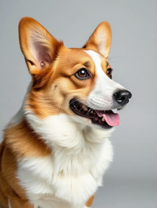  <br><br>
<a href="https://refvid.com/ja/dog-rap-video"><b>▶ クリップを見て、自分の写真で作る</b></a>
</p>
<br clear="left">

```text
小さな音楽スタジオのブースの中。黒い吸音フォームの壁に暖かいオレンジ色の光、二人の間にはスタンドに立てたボーカルマイク。ヘッドホンとパーカー姿で立つ[1]の隣には、背の高いスツールに座った犬の[2]。小さな金のチェーンを着けて、ハードなヒップホップのビートに合わせて頭を揺らしている。[1]がカメラに向かってラップ："Me and my dog, yeah we run this block." 続いて犬の[2]がマイクに身を乗り出し、渋いカートゥーン風の声で、言葉に合わせて口を動かしながらラップを返す："Treats on the table and we never stop." [1]が笑う。固定カメラの縦型ミディアムショット。
```

<details><summary>うまくいく写真</summary><br>犬は口を動かしてマイクに向かってラップするので、口元と毛の模様まで明るく写った、頭の正面の鮮明な写真がいちばん大切です。あなたは、立った高さで撮った正面の写真がブースに合います。<br><br><sub>RefVidでKling 3.0 Omniを使い、LeoとBiscuitの参照写真8枚（AIで作成した被写体）から、このテンプレートのプロンプトで作成。</sub></details>

### ペットと夕日

<p>
<a href="https://refvid.com/ja/pet-and-owner-sunset">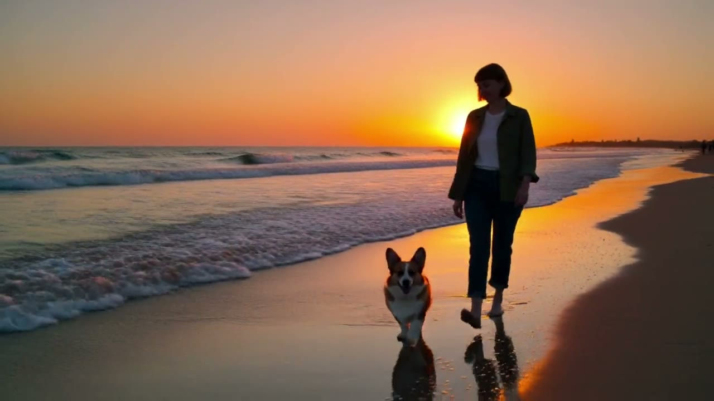</a>
<b>モデル</b>&nbsp; Kling 3.0 Omni<br>
<b>クリップ</b>&nbsp; 10 s · 16:9 · 音声なし<br>
<b>被写体</b>&nbsp; <code>[1]</code> あなたのペット · <code>[2]</code> あなた<br><br>
<b>参照写真</b><br>       <br><br>
<a href="https://refvid.com/ja/pet-and-owner-sunset"><b>▶ クリップを見て、自分の写真で作る</b></a>
</p>
<br clear="left">

```text
カット 1: ゴールデンアワーのワイドショット：[2]が静かなビーチの波打ち際を裸足で歩き、[1]がそばを並んで歩く。穏やかな波が寄せ、背後から低く温かい太陽が照らす。
カット 2: [2]と[1]が砂浜に並んで座り、後ろから撮影される。海へ沈んでいく夕日を眺めている。ゆっくりとしたプッシュイン、オレンジ色の温かい空。
```

<details><summary>うまくいく写真</summary><br>2カットとも並んだ姿で、2カット目は後ろ姿です。顔だけでなく、あなたとペットそれぞれの横からと後ろからの全身写真を加えてください。夕日のカットではペットの背中やしっぽの模様が決め手になります。<br><br><sub>RefVidでKling 3.0 Omniを使い、Biscuitとミアの参照写真8枚（AIで作成した被写体）から、このテンプレートのプロンプトに沿って制作しました。</sub></details>

### 宇宙飛行士ペット

<p>
<a href="https://refvid.com/ja/pet-astronaut"></a>
<b>モデル</b>&nbsp; Kling 3.0 Omni<br>
<b>クリップ</b>&nbsp; 5 s · 16:9 · 音声なし<br>
<b>被写体</b>&nbsp; <code>[1]</code> あなたのペット<br><br>
<b>参照写真</b><br>   <br><br>
<a href="https://refvid.com/ja/pet-astronaut"><b>▶ クリップを見て、自分の写真で作る</b></a>
</p>
<br clear="left">

```text
明るい宇宙ステーションの内部で、[1]が小さな白い宇宙服を着て、ヘルメットのバイザーを開けたまま、カメラに向かって無重力に漂ってきます。前足がふわりと揺れ、背後の大きな窓からは青い地球が輝いています。ゆったりとして夢のような動きです。
```

<details><summary>うまくいく写真</summary><br>開いたヘルメットのバイザー越しに顔が映るので、目と鼻先がはっきりした正面の鮮明な写真がいちばん大切です。体は宇宙服で隠れるため、顔まわりの毛色がその子らしさを決めます。<br><br><sub>RefVidでKling 3.0 Omniを使い、Miso（AIで作成した被写体）の参照写真4枚から、このテンプレートのプロンプトで作成しました。</sub></details>

### ペットの誕生日

<p>
<a href="https://refvid.com/ja/pet-birthday-party"></a>
<b>モデル</b>&nbsp; Kling 3.0 Omni<br>
<b>クリップ</b>&nbsp; 5 s · 9:16 · 音声あり<br>
<b>被写体</b>&nbsp; <code>[1]</code> うちの子<br><br>
<b>参照写真</b><br>   <br><br>
<a href="https://refvid.com/ja/pet-birthday-party"><b>▶ クリップを見て、自分の写真で作る</b></a>
</p>
<br clear="left">

```text
カット 1: [1]が、色とりどりの風船を背景に、小さな縞模様のパーティーハットをかぶって小さなテーブルに座っている。手前には3本のろうそくに火が灯った小さな誕生日ケーキがある。暖かい室内の光で、ゆっくりとカメラが寄っていく。
カット 2: [1]が、ケーキの横でカメラを見上げ、首をかしげてその子らしい自然な声で小さく嬉しそうに鳴く。ろうそくの炎にソフトフォーカスがかかり、心地よい誕生日の雰囲気。
```

<details><summary>うまくいく写真</summary><br>小さなテーブルにつき、パーティー帽の下からカメラを見上げるので、少し上から撮った、耳と目がくっきりした写真がいちばん大切です。背筋を伸ばして座った写真があると、ケーキの横での姿勢も自然になります。<br><br><sub>RefVidでKling 3.0 Omniを使い、このテンプレートのプロンプトに従って、Biscuit（AIで作成した被写体）の参照写真4枚から作成しました。</sub></details>

### シェフペット

<p>
<a href="https://refvid.com/ja/pet-chef"></a>
<b>モデル</b>&nbsp; Kling 3.0 Omni<br>
<b>クリップ</b>&nbsp; 5 s · 9:16 · 音声あり<br>
<b>被写体</b>&nbsp; <code>[1]</code> あなたのペット<br><br>
<b>参照写真</b><br>   <br><br>
<a href="https://refvid.com/ja/pet-chef"><b>▶ クリップを見て、自分の写真で作る</b></a>
</p>
<br clear="left">

```text
カット 1: [1]が小さな白いコックハットをかぶり、温かみのあるキッチンカウンターに座っています。その前のフライパンでは野菜がじゅうじゅういい、湯気が立ち上り、朝の柔らかな光が差し込んでいます。じゅうじゅうという音。
カット 2: [1]が色とりどりの炒め物が盛られた完成したお皿のそばに座り、コックハットをほんの少し傾けて、誇らしげにカメラを見つめています。
```

<details><summary>うまくいく写真</summary><br>コック帽を頭にのせ、2カット目は誇らしげにカメラを見るアップなので、両耳まで入った正面の鮮明な写真がいちばん大切です。カウンターでも毛並みと大きさが変わらないよう、横からの写真も加えてください。<br><br><sub>RefVidでKling 3.0 Omniを使い、AIで作成した被写体Misoの参照写真4枚と、このテンプレートのプロンプトから作成しました。</sub></details>

### ペットのクリスマス

<p>
<a href="https://refvid.com/ja/pet-christmas-morning">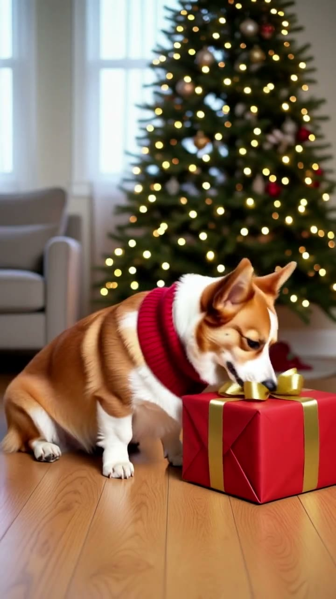</a>
<b>モデル</b>&nbsp; Kling 3.0 Omni<br>
<b>クリップ</b>&nbsp; 5 s · 9:16 · 音声なし<br>
<b>被写体</b>&nbsp; <code>[1]</code> あなたのペット<br><br>
<b>参照写真</b><br>   <br><br>
<a href="https://refvid.com/ja/pet-christmas-morning"><b>▶ クリップを見て、自分の写真で作る</b></a>
</p>
<br clear="left">

```text
カット 1: 居心地のよいリビングのクリスマスの朝。小さな赤いニットのマフラーを巻いた[1]が、光るクリスマスツリーのそばに座り、赤い包み紙に金色のリボンがかかったプレゼントに興味深そうに鼻を寄せている。暖かいイルミネーションと、やわらかな朝の光。
カット 2: 同じリビングでのクローズアップ。背後で光るクリスマスツリー。赤いマフラーを巻いたままの[1]が、金色のリボンをくわえて引っぱり、包装紙をはがしていく。赤い紙切れが舞い、そのあとカメラを見上げる。
```

<details><summary>うまくいく写真</summary><br>1カット目はプレゼントのにおいを嗅ぐ横からの姿で、マフラーは首に巻かれます。鼻先と胸元が見える横顔の鮮明な写真に、最後に見上げるカット用の正面写真を添えてください。<br><br><sub>RefVidで、Kling 3.0 Omniを使い、このテンプレートのプロンプトに従って、Biscuit（AIで作成した被写体）の参考写真4枚から制作しました。</sub></details>

### ペットが動き出す

<p>
<a href="https://refvid.com/ja/pet-comes-to-life"></a>
<b>モデル</b>&nbsp; Kling 3.0 Omni<br>
<b>クリップ</b>&nbsp; 5 s · 9:16 · 音声なし<br>
<b>被写体</b>&nbsp; <code>[1]</code> ペット<br><br>
<b>参照写真</b><br>   <br><br>
<a href="https://refvid.com/ja/pet-comes-to-life"><b>▶ クリップを見て、自分の写真で作る</b></a>
</p>
<br clear="left">

```text
[1]が、午後のやわらかな日差しの中、柔らかい毛布を敷いたソファに横たわっています。ゆっくりまばたきをし、首をかしげてカメラをまっすぐ見つめ、静かに呼吸しています。ゆっくりとしたプッシュイン、くつろいだ室内、浅い被写界深度。
```

<details><summary>うまくいく写真</summary><br>寝そべったまま目を合わせる、静かなアップのワンカットです。その子の目の高さで撮った、目の色と目のまわりの毛並みがはっきりわかる鮮明な写真がいちばん大切。寝そべった姿の写真もあるとポーズが自然になります。<br><br><sub>RefVidでKling 3.0 Omniを使って作成。Biscuit（AIで作成した被写体）の参照写真4枚から生成。このテンプレートのプロンプトは以前の表現を使用しています。</sub></details>

### ペット家族写真

<p>
<a href="https://refvid.com/ja/pet-family-portrait"></a>
<b>モデル</b>&nbsp; Kling 3.0 Omni<br>
<b>クリップ</b>&nbsp; 5 s · 1:1 · 音声なし<br>
<b>被写体</b>&nbsp; <code>[1]</code> 1匹目のペット · <code>[2]</code> 2匹目のペット<br><br>
<b>参照写真</b><br>       <br><br>
<a href="https://refvid.com/ja/pet-family-portrait"><b>▶ クリップを見て、自分の写真で作る</b></a>
</p>
<br clear="left">

```text
[1]と[2]が、居心地のよいリビングで柔らかいグレーのソファにクッションと一緒に並んで座り、ファミリーポートレートのようです。[2]が[1]をちらりと見てから、二人そろってカメラをまっすぐ見つめます。暖かいランプの光、ゆっくりとしたプッシュイン。
```

<details><summary>うまくいく写真</summary><br>1つのソファに2匹が並ぶので、見分けがつくことが大切です。それぞれ正面の写真と、身近な物と並べて大きさがわかる写真を用意すると、並んで座っても大小関係が保たれます。<br><br><sub>RefVidでKling 3.0 Omniを使い、BiscuitとMisoの参照写真8枚（AIで作成した被写体）から、このテンプレートのプロンプトで作成しました。</sub></details>

### ペットの仮装

<p>
<a href="https://refvid.com/ja/pet-halloween-costume"></a>
<b>モデル</b>&nbsp; Kling 3.0 Omni<br>
<b>クリップ</b>&nbsp; 6 s · 9:16 · 音声あり<br>
<b>被写体</b>&nbsp; <code>[1]</code> ペット<br><br>
<b>参照写真</b><br>   <br><br>
<a href="https://refvid.com/ja/pet-halloween-costume"><b>▶ クリップを見て、自分の写真で作る</b></a>
</p>
<br clear="left">

```text
カット 1: [1]が夕暮れの木製ポーチに座り、柔らかいオレンジ色のかぼちゃの衣装を着ています。階段には彫られたジャック・オー・ランタンが光り、周りには乾いた落ち葉が散らばっています。ゆっくりと寄るカメラワーク、温かいろうそくの光。
カット 2: [1]がラッピングされたお菓子のボウルの横でカメラを見上げ、首をかしげてから、自然な声で小さく嬉しそうに鳴きます。ハロウィンの夜の穏やかな雰囲気、浅い被写界深度。
```

<details><summary>うまくいく写真</summary><br>かぼちゃの衣装で体が隠れるので、顔と耳が決め手です。目に光が入る、明るく近い正面の写真と、衣装が実際の体形に合うよう座った姿の写真を用意してください。<br><br><sub>RefVidでKling 3.0 Omniを使い、Biscuit（AIで生成した被写体）の参照写真4枚から作成しました。このテンプレートの初期版のプロンプトでは、鳴き声ではなく吠え声を指定していました。</sub></details>

### ペットの思い出

<p>
<a href="https://refvid.com/ja/pet-memorial"></a>
<b>モデル</b>&nbsp; Kling 3.0 Omni<br>
<b>クリップ</b>&nbsp; 5 s · 16:9 · 音声なし<br>
<b>被写体</b>&nbsp; <code>[1]</code> あなたのペット<br><br>
<b>参照写真</b><br> 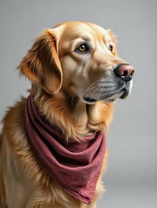  <br><br>
<a href="https://refvid.com/ja/pet-memorial"><b>▶ クリップを見て、自分の写真で作る</b></a>
</p>
<br clear="left">

```text
カット 1: 陽の光に包まれた丈の高い野の花の草原、温かな黄金色の空に、遠くまで柔らかな虹がかかっている。[1]が花の中から全速力で飛び出し、まっすぐカメラに向かって駆けてくる。耳をばたつかせ、舌を出し、赤と白のしま模様の靴下を誇らしげに口にくわえている。
カット 2: 同じ草原、ゴールデンアワーのクローズアップ、背後で虹が輝いている。[1]が急ブレーキをかけて立ち止まり、しま模様の靴下を草の上に落とす。そして座り込み、カメラに向かって首をかしげ、尻尾を振る。とても得意げな表情だ。
```

<details><summary>うまくいく写真</summary><br>耳をなびかせ、靴下をくわえてカメラへ一直線に走ってくるので、走っている姿や口を開けて遊んでいる写真があればいちばん役立ちます。顔さえ写っていれば、少しぼやけた昔のスマホ写真でも大丈夫です。<br><br><sub>RefVidでKling 3.0 Omniを使い、このテンプレートのプロンプトに従って、Captain（AIで作成した被写体）の参照写真4枚から作成。</sub></details>

### キャスターペット

<p>
<a href="https://refvid.com/ja/pet-news-anchor">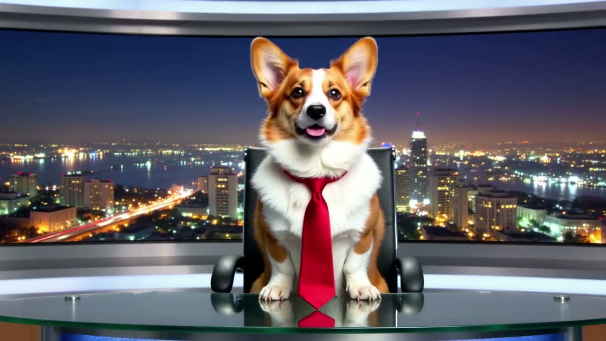</a>
<b>モデル</b>&nbsp; Kling 3.0 Omni<br>
<b>クリップ</b>&nbsp; 5 s · 16:9 · 音声あり<br>
<b>被写体</b>&nbsp; <code>[1]</code> うちの子<br><br>
<b>参照写真</b><br>   <br><br>
<a href="https://refvid.com/ja/pet-news-anchor"><b>▶ クリップを見て、自分の写真で作る</b></a>
</p>
<br clear="left">

```text
明るい照明と、背景の画面に都市の夜景が映るテレビのニューススタジオ。[1]は小さな赤いネクタイを締めてニュースデスクの後ろに姿勢良く座り、カメラを見つめて、真面目なニュースキャスターの声でこう話します。"Good evening. Tonight’s top story: dinner is late again."
```

<details><summary>うまくいく写真</summary><br>ニュースデスクの奥では頭と首、胸元だけが映り、首にネクタイを締めます。胸元まで見える、背筋を伸ばして座った正面の写真を。はしゃいだ顔より落ち着いた真顔のほうがニュースらしくなります。<br><br><sub>RefVidでKling 3.0 Omniを使い、Biscuit（AIで作成した被写体）の参照写真4枚から、このテンプレートのプロンプトで作成しました。</sub></details>

### リングドッグ

<p>
<a href="https://refvid.com/ja/pet-ring-bearer">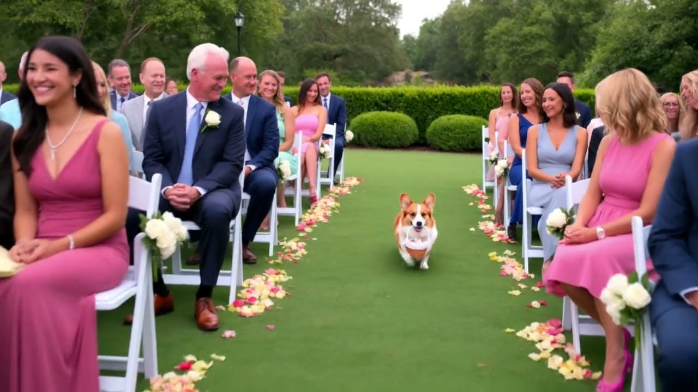</a>
<b>モデル</b>&nbsp; Kling 3.0 Omni<br>
<b>クリップ</b>&nbsp; 5 s · 16:9 · 音声なし<br>
<b>被写体</b>&nbsp; <code>[1]</code> ペット<br><br>
<b>参照写真</b><br>   <br><br>
<a href="https://refvid.com/ja/pet-ring-bearer"><b>▶ クリップを見て、自分の写真で作る</b></a>
</p>
<br clear="left">

```text
柔らかな午後の光に包まれたガーデンウェディング。小さな花飾りの首輪をつけた[1]が、白い椅子が並ぶバージンロードをカメラに向かって歩いてくる。口には小さなバスケットをくわえ、リングボックスを乗せている。両側のゲストが振り向いて微笑み、芝生には花びらが散っている。
```

<details><summary>うまくいく写真</summary><br>バスケットをくわえ、バージンロードをカメラに向かって歩き通すので、その子の高さで正面から撮った、歩くか立っている全身写真がいちばん大切です。首まわりがよく見えると花の首輪も自然に収まります。<br><br><sub>RefVidで、Kling 3.0 Omniを使って作成。被写体Biscuit(AIで作ったキャラクター)の参照写真4枚とこのテンプレートのプロンプトを使用しています。</sub></details>

### ペットのランウェイ

<p>
<a href="https://refvid.com/ja/pet-runway-walk"></a>
<b>モデル</b>&nbsp; Kling 3.0 Omni<br>
<b>クリップ</b>&nbsp; 5 s · 9:16 · 音声あり<br>
<b>被写体</b>&nbsp; <code>[1]</code> ペット<br><br>
<b>参照写真</b><br>   <br><br>
<a href="https://refvid.com/ja/pet-runway-walk"><b>▶ クリップを見て、自分の写真で作る</b></a>
</p>
<br clear="left">

```text
[1]が、明るいスポットライトの下でツヤのあるファッションランウェイを、カメラに向かって自信たっぷりに歩いてくる。両側のフォトグラファーたちのカメラのフラッシュが次々に光り、突き当たりで立ち止まってポーズを決める。ローアングルのカメラ、観客のざわめき、シャッター音。
```

<details><summary>うまくいく写真</summary><br>ローアングルのカメラの前を、ランウェイの端から端まで歩くので、脚と歩き方が見どころです。床の高さで正面から撮った全身写真と横からの写真を加えると、歩いている途中も体つきと毛の模様が変わりません。<br><br><sub>RefVidでKling 3.0 Omniを使い、Biscuit（AIで作ったキャラクター）の参照写真4枚から、このテンプレートのプロンプトで作成しました。</sub></details>

### 水中ペット

<p>
<a href="https://refvid.com/ja/pet-underwater-swim"></a>
<b>モデル</b>&nbsp; Kling 3.0 Omni<br>
<b>クリップ</b>&nbsp; 5 s · 9:16 · 音声なし<br>
<b>被写体</b>&nbsp; <code>[1]</code> あなたのペット<br><br>
<b>参照写真</b><br>   <br><br>
<a href="https://refvid.com/ja/pet-underwater-swim"><b>▶ クリップを見て、自分の写真で作る</b></a>
</p>
<br clear="left">

```text
澄んだターコイズブルーの海の中、[1]がカメラに向かって泳いでくる。足をばたつかせ、目を開けたまま、木漏れ日が体の上でゆらゆらと揺れ、小さなあぶくが立ちのぼり、毛が水中でやわらかくなびいている。
```

<details><summary>うまくいく写真</summary><br>水中では毛がなびいて暗く見えるので、顔と模様がはっきりわかることが大切です。目を開けた正面の鮮明な写真と、日の光の下で本来の毛の長さと色がわかる写真を用意してください。<br><br><sub>このテンプレートのプロンプトを使い、Biscuit（AIで作成した被写体）の参考写真4枚から、Kling 3.0 OmniでRefVidを使って作成しました。</sub></details>

[↑ 目次に戻る](#目次)

## モノ・キャラクター

おもちゃ、フィギュア、車、イラストのキャラクターをそのままに。

### クレイアニメ

<p>
<a href="https://refvid.com/ja/clay-figure-stopmotion"></a>
<b>モデル</b>&nbsp; Kling 3.0 Omni<br>
<b>クリップ</b>&nbsp; 5 s · 16:9 · 音声なし<br>
<b>被写体</b>&nbsp; <code>[1]</code> 粘土キャラクター<br><br>
<b>参照写真</b><br>   <br><br>
<a href="https://refvid.com/ja/clay-figure-stopmotion"><b>▶ クリップを見て、自分の写真で作る</b></a>
</p>
<br clear="left">

```text
カット 1: ストップモーションのクレイアニメ風、わずかにコマ送りのような動き：[1]が、紙とフェルトでできた小さな村の通りを歩きます。小さな家々と綿の雲があり、粘土の質感と指紋が見えます。卓上の暖かな照明。
カット 2: [1]が立ち止まってカメラの方を向き、粘土の片手で手を振ってから、ぴょんと小さく跳ねます。ストップモーションの雰囲気で、被写界深度は浅めです。
```

<details><summary>うまくいく写真</summary><br>キャラクターは横向きにセットを歩き、振り向いて手を振るので、横と正面の写真を、粘土の質感や指の跡が見えるくらい近くで撮ってください。後ろ姿もあると歩く姿が安定します。<br><br><sub>RefVidで、Kling 3.0 Omniを使い、Momo（AIで作成した被写体）の参照写真4枚と、このテンプレートのプロンプトから作成しました。</sub></details>

### あみぐるみ紹介

<p>
<a href="https://refvid.com/ja/crochet-showcase"></a>
<b>モデル</b>&nbsp; Kling 3.0 Omni<br>
<b>クリップ</b>&nbsp; 5 s · 1:1 · 音声なし<br>
<b>被写体</b>&nbsp; <code>[1]</code> あなたの作品<br><br>
<b>参照写真</b><br>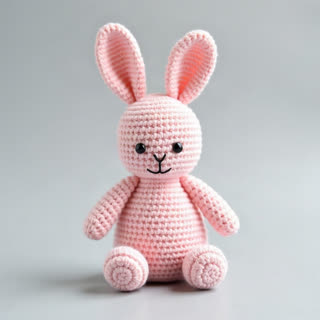 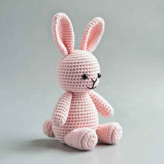  <br><br>
<a href="https://refvid.com/ja/crochet-showcase"><b>▶ クリップを見て、自分の写真で作る</b></a>
</p>
<br clear="left">

```text
カット 1: [1]が、柔らかい毛糸玉2つと木製のかぎ編み針の横に、温かみのあるオーク材のテーブルの上に置かれている。午後の窓からの光が差し込み、カメラがゆっくりと周囲を回る。
カット 2: [1]の編み目と顔の上をマクロ撮影でゆっくり移動する。毛糸の一本一本のループが見え、被写界深度は浅い。
```

<details><summary>うまくいく写真</summary><br>2つ目のカットは編み目と顔をマクロでなぞるので、毛糸のループ一つひとつがくっきり写った接写と、カメラが周りを回っても形が保てるよう正面と横の写真を加えてください。<br><br><sub>RefVidでKling 3.0 Omniを使って制作。Bun（AIで制作した被写体）の参照写真4枚から、このテンプレートのプロンプトで作成しました。</sub></details>

### ミニチュアジオラマ

<p>
<a href="https://refvid.com/ja/diorama-miniature"></a>
<b>モデル</b>&nbsp; Kling 3.0 Omni<br>
<b>クリップ</b>&nbsp; 5 s · 16:9 · 音声なし<br>
<b>被写体</b>&nbsp; <code>[1]</code> 自分のフィギュア<br><br>
<b>参照写真</b><br>   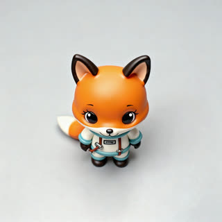<br><br>
<a href="https://refvid.com/ja/diorama-miniature"><b>▶ クリップを見て、自分の写真で作る</b></a>
</p>
<br clear="left">

```text
小さな街の広場を再現したティルトシフト風のミニチュアジオラマ。ミニチュアの木、街灯、小さな家々があり、[1]が中央に立っています。背後をミニチュア列車がゆっくり通過し、カメラはフィギュアの目線の高さをなめらかに移動。縁はやわらかくぼかされ、明るい日中の光に包まれています。
```

<details><summary>うまくいく写真</summary><br>カメラはフィギュアの目の高さで横を通り過ぎるので、上からではなく、その低い高さから正面で撮ってください。横からの写真もあると、後ろを列車が通る間も形が崩れません。<br><br><sub>RefVidで、Kling 3.0 Omniを使い、AIで作成した被写体Pipの参照写真4枚と、このテンプレートのプロンプトから制作。</sub></details>

### フィギュア360°

<p>
<a href="https://refvid.com/ja/figure-turntable-showcase">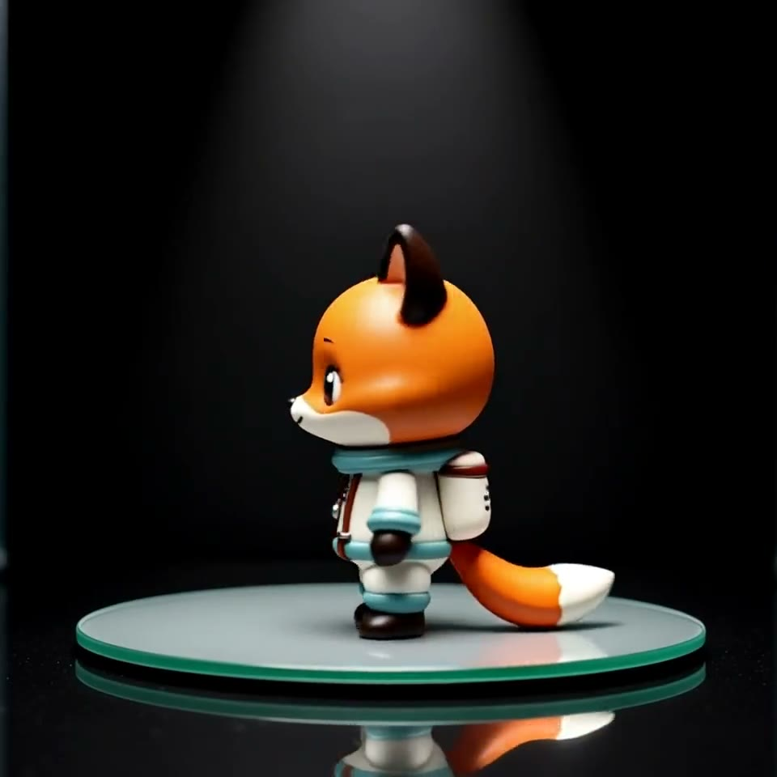</a>
<b>モデル</b>&nbsp; Kling 3.0 Omni<br>
<b>クリップ</b>&nbsp; 5 s · 1:1 · 音声なし<br>
<b>被写体</b>&nbsp; <code>[1]</code> あなたのフィギュア<br><br>
<b>参照写真</b><br>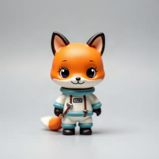   <br><br>
<a href="https://refvid.com/ja/figure-turntable-showcase"><b>▶ クリップを見て、自分の写真で作る</b></a>
</p>
<br clear="left">

```text
カット 1: [1]が、暗いディスプレイキャビネットの中の小さな丸いターンテーブルに乗り、柔らかなスポットライトを浴びながらゆっくりと一周します。ガラス棚に映り込みがきれいに写っています。
カット 2: [1]の顔と塗装のディテールをマクロで撮影。光が表面をなでるように移動し、被写界深度は浅めです。
```

<details><summary>うまくいく写真</summary><br>フィギュアが一回転してから顔に寄っていくので、正面だけでなく背面と両側面も撮り、細部までくっきり写った顔の塗装の接写も加えてください。<br><br><sub>RefVidでKling 3.0 Omniを使い、Pip（AIで作成した被写体）の参照写真4枚から、このテンプレートのプロンプトで作成。</sub></details>

### マスコットのあいさつ

<p>
<a href="https://refvid.com/ja/mascot-wave-hello"></a>
<b>モデル</b>&nbsp; Kling 3.0 Omni<br>
<b>クリップ</b>&nbsp; 5 s · 1:1 · 音声あり<br>
<b>被写体</b>&nbsp; <code>[1]</code> あなたのマスコット<br><br>
<b>参照写真</b><br>   <br><br>
<a href="https://refvid.com/ja/mascot-wave-hello"><b>▶ クリップを見て、自分の写真で作る</b></a>
</p>
<br clear="left">

```text
[1]が明るく清潔なデスクの上、柔らかいパステルカラーの背景の前に立ち、カメラを見つめて片腕を振り、元気な小さな声で話します："Hi there, welcome in!" ゆっくりとプッシュインします。
```

<details><summary>うまくいく写真</summary><br>片腕を振ってカメラを見るので、両腕と顔がすべて写るよう、立たせた状態で正面から撮ってください。背面や横からの写真があると、動いても形が崩れにくくなります。<br><br><sub>RefVidでKling 3.0 Omniを使って作成。Pip（AIで作成した被写体）の参照写真4枚と、このテンプレートのプロンプトから生成しています。</sub></details>

### ぬいぐるみの冒険

<p>
<a href="https://refvid.com/ja/plush-adventure"></a>
<b>モデル</b>&nbsp; Kling 3.0 Omni<br>
<b>クリップ</b>&nbsp; 10 s · 9:16 · 音声なし<br>
<b>被写体</b>&nbsp; <code>[1]</code> ご自身のぬいぐるみ<br><br>
<b>参照写真</b><br>   <br><br>
<a href="https://refvid.com/ja/plush-adventure"><b>▶ クリップを見て、自分の写真で作る</b></a>
</p>
<br clear="left">

```text
カット 1: コマ撮りアニメ風。[1]が、昔ながらの黄色い街の路面電車の木製の座席に、窓際で座っている。外では通りが流れていき、朝の光が差している。
カット 2: [1]が小さなカフェのテーブルに座り、ホイップクリームののったココアのカップの隣で、カメラのほうへ頭を向けている。
カット 3: [1]が石造りの橋の欄干に座り、川に沈む夕日を眺めている。背後では街の明かりが灯り始めている。
```

<details><summary>うまくいく写真</summary><br>3つの場所すべてで座った姿が映り、トラムでは横から、橋では後ろからになります。座らせた状態で正面・横・背面を撮り、マフラーやリボン、ワッペンは付けたままにすると、その細部も一緒に旅します。<br><br><sub>RefVidでKling 3.0 Omniを使い、Bobo（AIで作成した被写体）の参考写真4枚と、このテンプレートのプロンプトから作成しました。</sub></details>

### 動き出すおもちゃ

<p>
<a href="https://refvid.com/ja/toy-comes-alive"></a>
<b>モデル</b>&nbsp; Kling 3.0 Omni<br>
<b>クリップ</b>&nbsp; 5 s · 9:16 · 音声なし<br>
<b>被写体</b>&nbsp; <code>[1]</code> あなたのフィギュア<br><br>
<b>参照写真</b><br>   <br><br>
<a href="https://refvid.com/ja/toy-comes-alive"><b>▶ クリップを見て、自分の写真で作る</b></a>
</p>
<br clear="left">

```text
カット 1: [1]が、柔らかな朝の光が差す木の机の上に、鉛筆立てとノートと並んで、まったく動かずに立っている。おもちゃが陳列されているかのように。カメラはおもちゃの目の高さからのクローズアップ。
カット 2: [1]が命を得る。まばたきをし、興味深そうに周囲を見回し、それからカメラに向かってふらつきながら小さな一歩を何歩か踏み出し、手を振る。あくまで同じ小さな彩色されたおもちゃのままで、素材と色合いも変わらない。背景はぼかした浅い被写界深度。
```

<details><summary>うまくいく写真</summary><br>フィギュアはまばたきし、辺りを見回し、目の高さにあるカメラへ歩いてくるので、写真も同じ高さで。顔と目を真正面から撮り、足元や台座も写すと、最初の数歩で形や塗装が崩れません。<br><br><sub>RefVidで、Kling 3.0 Omniを使用し、Pip（AIで作成した被写体）の参照写真4枚をもとに、このテンプレートのプロンプトで作成。</sub></details>

[↑ 目次に戻る](#目次)

## 自分で書くには

1. **被写体は説明ではなく写真で指定する。** 被写体が出る場所に `[1]` と書き、顔・毛並み・商品は参照写真に任せます。言葉で描写し直すと写真とぶつかります。
2. **2〜3 カット、各カットに動きは 1 つ。** カメラの位置（引き、寄り、追いかけ、背後から）と、起きることを 1 つ書きます。
3. **一貫性は写真で決まる。** 角度の違うシャープな写真を 3〜4 枚、1 組に被写体 1 つ、商品は無地の背景で。
4. **残したくなる 1 枚で終える。** 最後のカットがスクショされ、シェアされます。

詳しくは [RefVid のチュートリアル](https://refvid.com/ja/tutorials)。

## ライセンス

プロンプト、文章、参照写真、クリップ：[CC BY 4.0](LICENSE)。「RefVid (refvid.com)」とクレジットすれば用途は自由です。参照写真の人物・ペット・商品は AI で作ったもので、実在の人物やクライアントの商品ではありません。

投稿歓迎：プロンプト、使ったモデル、結果を issue で送ってください。

## スター推移

[](https://star-history.com/#refvid/awesome-reference-to-video-prompts&Date)
