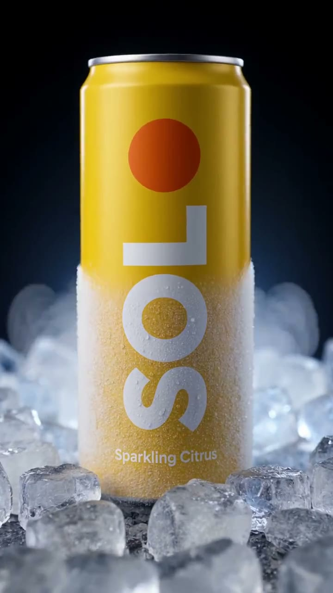
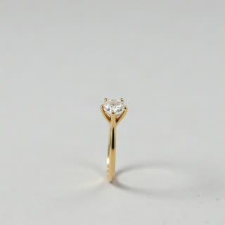
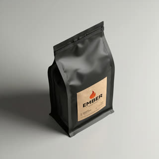
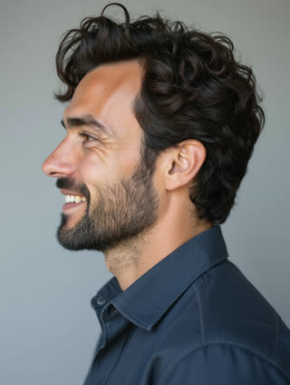
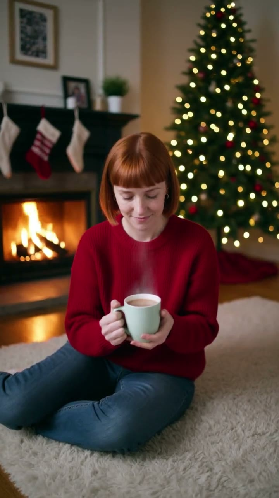
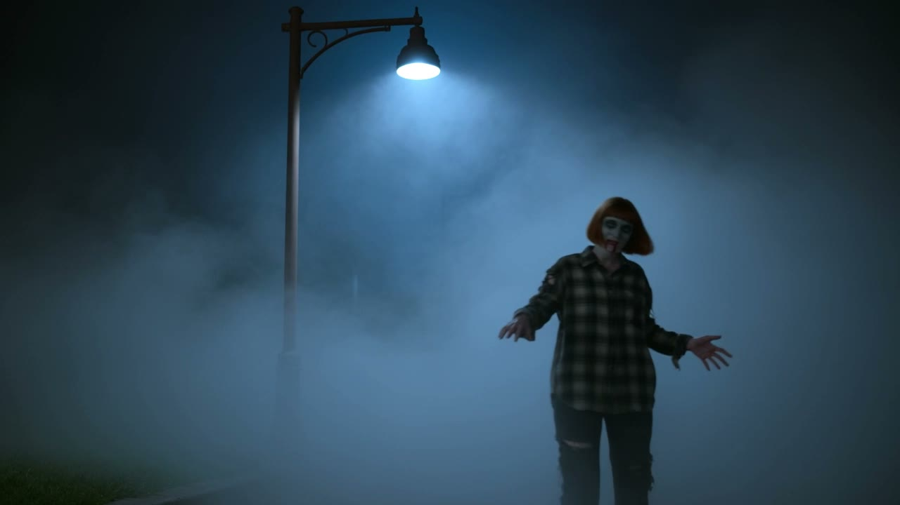
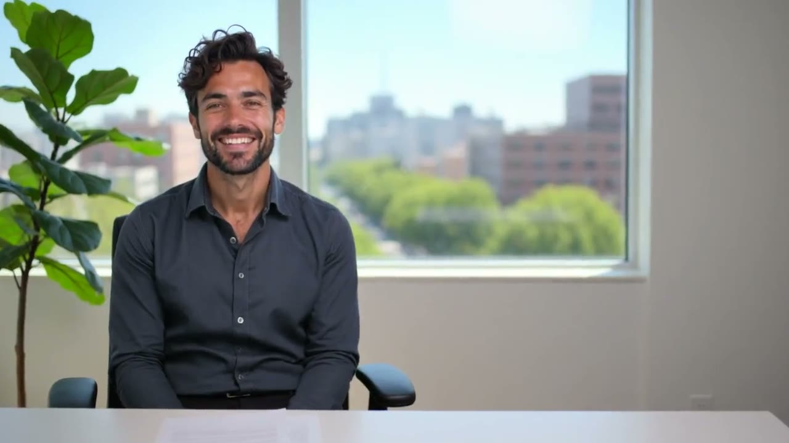
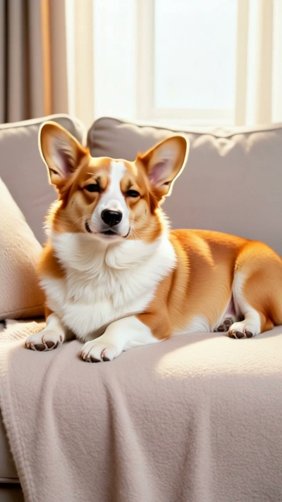
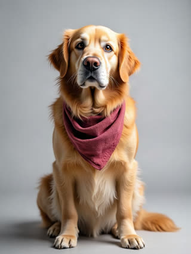
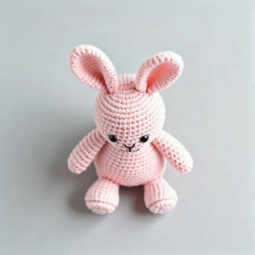

[](README.md) [](README_de-DE.md) [](README_fr-FR.md) [](README_es-ES.md) [](README_pt-BR.md) [](README_ja-JP.md) [](README_ko-KR.md)

---

# Awesome Reference-to-Video Prompts

[](https://awesome.re) [](https://github.com/refvid/awesome-reference-to-video-prompts) [](LICENSE) [](#목차)

**모든 장면에서 같은 인물·반려동물·제품을 유지하는** AI 영상용 검증된 프롬프트 71개. 항목마다 프롬프트, 사용한 참조 사진, 완성 클립, 설정이 있고, 모든 클립은 그 프롬프트 그대로 실제로 생성했습니다.

Reference-to-video는 피사체 사진 몇 장을 모델에 주면 그 얼굴·털·제품을 클립 전체에서 똑같이 유지하는 방식입니다. 이 프롬프트는 Kling 4, Kling 3.0 Omni, Seedance, Wan, Vidu 등 reference-to-video 모델에서 쓸 수 있습니다. `[1]`, `[2]`는 첫 번째·두 번째 참조 사진 묶음입니다.

제작: [RefVid](https://refvid.com/ko). 모든 프롬프트는 RefVid에서 바로 쓸 수 있는 템플릿입니다. 내 사진을 넣고 생성하면 됩니다. 기계 판독용 목록: [`prompts.json`](prompts.json). Claude Code / Codex용 에이전트 스킬: [`skills/reference-to-video-prompts`](skills/reference-to-video-prompts/SKILL.md).

## 모든 클립 보기

GitHub에서는 정지 이미지만 보입니다. 모든 클립은 [RefVid 템플릿 갤러리](https://refvid.com/ko/templates)에서 재생되고, 각 프롬프트는 내 사진으로 바로 쓸 수 있게 열립니다.

## 목차

<details><summary><b>제품</b> (26)</summary>

- [시네마틱 드라이브](#시네마틱-드라이브)
- [푸드 광고](#푸드-광고)
- [핸드백 스트리트](#핸드백-스트리트)
- [아이스 음료](#아이스-음료)
- [손에 낀 주얼리](#손에-낀-주얼리)
- [주얼리 반짝임](#주얼리-반짝임)
- [립스틱 발색](#립스틱-발색)
- [향수 리빌](#향수-리빌)
- [제품 360°](#제품-360)
- [3D 전광판](#3d-전광판)
- [블랙 프라이데이](#블랙-프라이데이)
- [불릿타임](#불릿타임)
- [크리스마스 선물](#크리스마스-선물)
- [플랫레이](#플랫레이)
- [플로팅 제품](#플로팅-제품)
- [제품 공개](#제품-공개)
- [UGC 광고](#ugc-광고)
- [재료 스플래시](#재료-스플래시)
- [홈 라이프스타일](#홈-라이프스타일)
- [꽃잎 흩날림](#꽃잎-흩날림)
- [언박싱](#언박싱)
- [워터 스플래시](#워터-스플래시)
- [스킨케어 텍스처](#스킨케어-텍스처)
- [스니커즈 광고](#스니커즈-광고)
- [테크 리빌](#테크-리빌)
- [시계 매크로](#시계-매크로)

</details>

<details><summary><b>인물</b> (24)</summary>

- [로드 트립](#로드-트립)
- [생일 축하](#생일-축하)
- [요리 쇼](#요리-쇼)
- [크리스마스 마켓](#크리스마스-마켓)
- [크리스마스 인사](#크리스마스-인사)
- [해변의 노을](#해변의-노을)
- [패션 룩북](#패션-룩북)
- [피트니스 코치](#피트니스-코치)
- [이불 유령](#이불-유령)
- [코스튬 피팅](#코스튬-피팅)
- [호박 머리](#호박-머리)
- [Y2K 플래시](#y2k-플래시)
- [좀비 워크](#좀비-워크)
- [자기소개 영상](#자기소개-영상)
- [미니 드라마](#미니-드라마)
- [모닝 루틴](#모닝-루틴)
- [새해 카운트다운](#새해-카운트다운)
- [팟캐스트 호스트](#팟캐스트-호스트)
- [랩 듀오](#랩-듀오)
- [슈퍼히어로 착지](#슈퍼히어로-착지)
- [토킹 헤드 광고](#토킹-헤드-광고)
- [추수감사절 건배](#추수감사절-건배)
- [여행 브이로그](#여행-브이로그)
- [세이브 더 데이트](#세이브-더-데이트)

</details>

<details><summary><b>반려동물</b> (14)</summary>

- [강아지 랩](#강아지-랩)
- [반려동물과 노을](#반려동물과-노을)
- [우주비행사 반려동물](#우주비행사-반려동물)
- [반려동물 생일](#반려동물-생일)
- [셰프 반려동물](#셰프-반려동물)
- [반려동물 크리스마스](#반려동물-크리스마스)
- [살아 움직이는 반려동물](#살아-움직이는-반려동물)
- [반려동물 가족사진](#반려동물-가족사진)
- [반려동물 코스튬](#반려동물-코스튬)
- [반려동물 추모](#반려동물-추모)
- [앵커 반려동물](#앵커-반려동물)
- [반려동물 링베어러](#반려동물-링베어러)
- [반려동물 런웨이](#반려동물-런웨이)
- [물속 반려동물](#물속-반려동물)

</details>

<details><summary><b>사물·캐릭터</b> (7)</summary>

- [클레이 애니메이션](#클레이-애니메이션)
- [코바늘 쇼케이스](#코바늘-쇼케이스)
- [미니어처 디오라마](#미니어처-디오라마)
- [피규어 360°](#피규어-360)
- [마스코트 인사](#마스코트-인사)
- [인형의 모험](#인형의-모험)
- [살아나는 장난감](#살아나는-장난감)

</details>

- [직접 쓰는 법](#직접-쓰는-법)
- [라이선스](#라이선스)
- [스타 추이](#스타-추이)

## 제품

제품 하나의 사진으로 만드는 광고와 쇼케이스.

### 시네마틱 드라이브

<p>
<a href="https://refvid.com/ko/car-cinematic-drive"></a>
<b>모델</b>&nbsp; Kling 3.0 Omni<br>
<b>클립</b>&nbsp; 5 s · 16:9 · 소리 없음<br>
<b>피사체</b>&nbsp; <code>[1]</code> 내 차<br><br>
<b>참조 사진</b><br>   <br><br>
<a href="https://refvid.com/ko/car-cinematic-drive"><b>▶ 클립 보고 내 사진으로 만들기</b></a>
</p>
<br clear="left">

```text
장면 1: 골든아워의 구불구불한 해안도로를 달리는 [1]을 낮은 위치에서 옆으로 따라가는 트래킹 샷, 뒤로 바다와 절벽이 보이고 햇빛이 차체 도장에 반사되어 번쩍여요.
장면 2: 같은 도로에서 [1]이 카메라 곁을 천천히 지나가요. 따뜻한 빛이 앞에서 뒤까지 차체를 따라 흐르고, 이어서 석양을 향해 멀어져 가요.
```

<details><summary>잘 되는 사진</summary><br>카메라가 차 옆을 따라가다가 바로 앞을 지나가게 하므로, 바퀴가 모두 나온 완전한 측면 사진이 가장 중요해요. 그릴, 헤드라이트, 차체 색이 정확하도록 앞쪽 45도 사진도 더해 주세요.<br><br><sub>이 템플릿의 프롬프트를 사용해, VELA(AI로 만든 피사체)의 참조 사진 4장으로 Kling 3.0 Omni 모델에서 RefVid로 제작했어요.</sub></details>

### 푸드 광고

<p>
<a href="https://refvid.com/ko/food-pour-steam"></a>
<b>모델</b>&nbsp; Kling 3.0 Omni<br>
<b>클립</b>&nbsp; 5 s · 9:16 · 소리 없음<br>
<b>피사체</b>&nbsp; <code>[1]</code> 내 제품<br><br>
<b>참조 사진</b><br>   <br><br>
<a href="https://refvid.com/ko/food-pour-steam"><b>▶ 클립 보고 내 사진으로 만들기</b></a>
</p>
<br clear="left">

```text
장면 1: 슬로모션 매크로: [1](으)로 만든 뜨거운 음료나 요리가 윤기 나게 김을 내며 하얀 세라믹 컵이나 그릇으로 흘러들어요. 어두운 배경 위로 따뜻한 측면 빛을 받으며 김이 천천히 피어오릅니다.
장면 2: [1]이(가) 나무 카운터 위에서 김이 나는 컵이나 그릇 옆에 서 있어요. 주변에 그 재료가 조금 흩어져 있고, 카메라가 천천히 다가가 라벨이 화면을 가득 채워요.
```

<details><summary>잘 되는 사진</summary><br>마지막에 라벨이 화면을 가득 채울 때까지 다가가니, 라벨 글자 하나하나가 선명한 정면 사진이 가장 중요해요. 김이 나는 컵 옆에서도 모양이 유지되도록 옆면 사진도 더해 주세요.<br><br><sub>RefVid에서 Kling 3.0 Omni로 만들었어요. EMBER(AI로 만든 피사체)의 참고 사진 4장을 사용했고, 이 템플릿 프롬프트는 이전 문구를 바탕으로 했어요.</sub></details>

### 핸드백 스트리트

<p>
<a href="https://refvid.com/ko/handbag-street-style"></a>
<b>모델</b>&nbsp; Kling 4<br>
<b>클립</b>&nbsp; 5 s · 9:16 · 소리 있음<br>
<b>피사체</b>&nbsp; <code>[1]</code> 내 가방<br><br>
<b>참조 사진</b><br> <br><br>
<a href="https://refvid.com/ko/handbag-street-style"><b>▶ 클립 보고 내 사진으로 만들기</b></a>
</p>
<br clear="left">

```text
크림색 트렌치코트를 입은 여성이 햇살 가득한 도시 거리를 걸으며 팔에 [1]을(를) 걸고 있어요. 카메라가 허리 높이에서 나란히 따라가 [1]이(가) 중앙에 선명하게 담기고, 걸음마다 살짝 흔들려요. 얼굴은 화면 밖. 골든아워 조명, 얕은 피사계 심도, 패션 광고 스타일.
```

<details><summary>잘 되는 사진</summary><br>가방이 장면 내내 허리 높이에서 카메라 옆으로 흔들리니 앞면과 옆면이 모두 보여요. 금속 장식이 선명한 앞면, 옆면, 그리고 스트랩이나 손잡이가 다 나온 사진을 찍어 주세요.<br><br><sub>MARA(AI로 만든 피사체)의 참조 사진 2장과 이 템플릿의 프롬프트를 사용해, Kling 4 모델의 RefVid로 제작했어요.</sub></details>

### 아이스 음료

<p>
<a href="https://refvid.com/ko/iced-drink-frost"></a>
<b>모델</b>&nbsp; Kling 4<br>
<b>클립</b>&nbsp; 5 s · 9:16 · 소리 있음<br>
<b>피사체</b>&nbsp; <code>[1]</code> 내 음료<br><br>
<b>참조 사진</b><br> <br><br>
<a href="https://refvid.com/ko/iced-drink-frost"><b>▶ 클립 보고 내 사진으로 만들기</b></a>
</p>
<br clear="left">

```text
[1]이(가) 잘게 부순 얼음 속에 반쯤 묻힌 채 서 있어요. 밑동에서부터 하얀 성에가 표면을 타고 올라오고, 차가운 냉기가 피어오르며, 맺힌 물방울이 라벨을 지나 천천히 흘러내려요. 차가운 파란 역광, 어두운 배경, 천천히 다가가는 카메라, 선명한 접사 디테일.
```

<details><summary>잘 되는 사진</summary><br>카메라가 다가가는 동안 물방울이 라벨을 타고 흐르니, 라벨이 평평하고 읽히는 정면 사진이 가장 중요해요. 캔이나 병의 뒷면이나 뚜껑이 다르다면 서리가 정확한 형태를 감싸도록 그 사진도 넣어 주세요.<br><br><sub>SOL(AI로 만든 피사체)의 참조 사진 2장과 이 템플릿의 프롬프트를 사용해, Kling 4 모델의 RefVid로 제작했어요.</sub></details>

### 손에 낀 주얼리

<p>
<a href="https://refvid.com/ko/jewelry-on-hand"></a>
<b>모델</b>&nbsp; Kling 4<br>
<b>클립</b>&nbsp; 5 s · 1:1 · 소리 있음<br>
<b>피사체</b>&nbsp; <code>[1]</code> 내 주얼리<br><br>
<b>참조 사진</b><br>   <br><br>
<a href="https://refvid.com/ko/jewelry-on-hand"><b>▶ 클립 보고 내 사진으로 만들기</b></a>
</p>
<br clear="left">

```text
클로즈업: 자연스럽고 은은한 매니큐어를 한 여성의 손이 [1]을(를) 끼고 크림색 실크 위에 놓여 있다가 카메라 쪽으로 천천히 돌고, [1]이(가) 따뜻한 창가 햇살 속에서 작게 반짝여요. 얕은 피사계 심도, 천천히 부드럽게 다가가는 카메라, 우아하고 자연스러운 분위기.
```

<details><summary>잘 되는 사진</summary><br>주얼리는 카메라 쪽으로 돌아가는 손에 착용된 모습으로 나오니, 착용한 사람이 보는 각도의 사진에 링이나 체인, 세팅을 옆에서 찍은 사진을 더해 주세요. 손가락이나 손목에 착용한 사진이 있으면 크기도 정확해요.<br><br><sub>HALO(AI로 만든 피사체)의 참조 사진 4장과 이 템플릿의 프롬프트를 사용해, Kling 4 모델의 RefVid로 제작했어요.</sub></details>

### 주얼리 반짝임

<p>
<a href="https://refvid.com/ko/jewelry-sparkle"></a>
<b>모델</b>&nbsp; Kling 3.0 Omni<br>
<b>클립</b>&nbsp; 5 s · 1:1 · 소리 없음<br>
<b>피사체</b>&nbsp; <code>[1]</code> 제품<br><br>
<b>참조 사진</b><br>   <br><br>
<a href="https://refvid.com/ko/jewelry-sparkle"><b>▶ 클립 보고 내 사진으로 만들기</b></a>
</p>
<br clear="left">

```text
접사 컷: [1]이 짙은 검은 벨벳 위에 놓여 있고, 부드러운 빛줄기가 천천히 가로지르며 제품이 천천히 돌아가요. 주얼리가 빛을 받아 반짝임과 광택을 내요. 짙은 검은 배경, 얕은 심도, 고급스러운 분위기.
```

<details><summary>잘 되는 사진</summary><br>블랙 벨벳 위에서 도는 주얼리를 빛줄기가 훑고 지나가니, 어두운 바닥 위에서 보석과 커팅면 하나하나가 선명하게 근접 촬영하고, 회전해도 깊이가 유지되도록 세팅을 옆에서 찍은 사진도 넣어 주세요.<br><br><sub>RefVid에서 Kling 3.0 Omni로 만들었어요. HALO(AI로 만든 피사체)의 참고 사진 4장을 사용했고, 이 템플릿 프롬프트는 이전 문구를 바탕으로 했어요.</sub></details>

### 립스틱 발색

<p>
<a href="https://refvid.com/ko/lipstick-swatch"></a>
<b>모델</b>&nbsp; Kling 4<br>
<b>클립</b>&nbsp; 5 s · 9:16 · 소리 있음<br>
<b>피사체</b>&nbsp; <code>[1]</code> 내 립스틱<br><br>
<b>참조 사진</b><br> <br><br>
<a href="https://refvid.com/ko/lipstick-swatch"><b>▶ 클립 보고 내 사진으로 만들기</b></a>
</p>
<br clear="left">

```text
접사: [1]의 팁이 매끈한 크림색 바닥 위를 미끄러지며 그 컬러로 진하고 윤기 나는 발색 한 줄을 남기고, 이어서 카메라가 올라가 부드러운 자연광 속에서 발색 옆에 똑바로 세워진 [1]을(를) 보여 줘요. 컬러와 케이스에 선명한 초점. 깔끔한 뷰티 광고 스타일, 얕은 피사계 심도.
```

<details><summary>잘 되는 사진</summary><br>매크로 컷은 미끄러지는 립스틱 끝에서 시작하니, 뚜껑을 열고 끝 모양과 실제 색이 선명하게 보이게 찍어 주세요. 마지막에 발색 옆에 서 있으니 뚜껑을 닫고 세운 케이스 사진도 더해 주세요.<br><br><sub>VELOUR(AI로 만든 피사체)의 참조 사진 2장과 이 템플릿의 프롬프트를 사용해, Kling 4 모델의 RefVid로 제작했어요.</sub></details>

### 향수 리빌

<p>
<a href="https://refvid.com/ko/perfume-reveal"></a>
<b>모델</b>&nbsp; Kling 4<br>
<b>클립</b>&nbsp; 5 s · 9:16 · 소리 있음<br>
<b>피사체</b>&nbsp; <code>[1]</code> 내 향수<br><br>
<b>참조 사진</b><br>  <br><br>
<a href="https://refvid.com/ko/perfume-reveal"><b>▶ 클립 보고 내 사진으로 만들기</b></a>
</p>
<br clear="left">

```text
[1]이(가) 천천히 흐르는 부드러운 안개에 감싸인 채 윤이 나는 검은 유리 위에 서 있어요. 위쪽에서 고운 향수 스프레이가 한 번 뿜어져 나와 따뜻한 황금빛 역광에 빛나고, 이어서 안개가 걷히며 빛줄기가 유리를 통과해 화면 중앙의 선명한 라벨에서 끝나요. 로우키, 고급스러운 분위기, 천천히 다가가는 카메라.
```

<details><summary>잘 되는 사진</summary><br>마지막에 빛이 유리를 지나 가운데 라벨을 비추니, 병을 정면에서 라벨이 카메라와 나란하도록 반사 없이 찍어 주세요. 뚜껑과 향수 색이 잘 보이게 밝은 배경 사진도 더해 주세요.<br><br><sub>NOIR 07(AI로 만든 피사체)의 참조 사진 3장과 이 템플릿의 프롬프트를 사용해, Kling 4 모델의 RefVid로 제작했어요.</sub></details>

### 제품 360°

<p>
<a href="https://refvid.com/ko/product-360-turntable"></a>
<b>모델</b>&nbsp; Kling 3.0 Omni<br>
<b>클립</b>&nbsp; 5 s · 1:1 · 소리 없음<br>
<b>피사체</b>&nbsp; <code>[1]</code> 제품<br><br>
<b>참조 사진</b><br>  <br><br>
<a href="https://refvid.com/ko/product-360-turntable"><b>▶ 클립 보고 내 사진으로 만들기</b></a>
</p>
<br clear="left">

```text
참고 이미지와 같은 외관과 비율의 [1]이(가) 둥근 흰색 스튜디오 턴테이블 위에 놓여 있어요. 배경은 연회색 이음매 없는 배경이며, 부드럽고 고른 스튜디오 조명 속에서 제품 전체에 선명하게 초점이 맞아 있어요.
```

<details><summary>잘 되는 사진</summary><br>회전하는 동안 모든 면이 한 번씩 카메라를 향하니, 단색 배경에서 같은 높이로 정면, 양옆, 뒷면을 찍어 주세요. 뒷면에 라벨이나 디테일이 있다면 평소 잘 안 보이는 면이니 꼭 넣으세요.<br><br><sub>이 템플릿의 프롬프트를 사용해, 참고 사진 3장(AI로 만든 피사체 AERO 1)으로 Kling 3.0 Omni 모델에서 RefVid로 제작한 영상이에요.</sub></details>

### 3D 전광판

<p>
<a href="https://refvid.com/ko/product-3d-billboard"></a>
<b>모델</b>&nbsp; Kling 4<br>
<b>클립</b>&nbsp; 5 s · 9:16 · 소리 있음<br>
<b>피사체</b>&nbsp; <code>[1]</code> 내 제품<br><br>
<b>참조 사진</b><br>   <br><br>
<a href="https://refvid.com/ko/product-3d-billboard"><b>▶ 클립 보고 내 사진으로 만들기</b></a>
</p>
<br clear="left">

```text
해 질 녘 도심의 높은 건물 모서리를 곡면 3D LED 전광판이 감싸고 있고, 아래 거리에서 올려다본 시점이에요. 거대한 [1]이(가) 화면을 가득 채우고 천천히 돌다가, 착시 원근법으로 스크린 가장자리 밖 거리 위로 튀어나오는 것처럼 보이고, 아래로는 차들이 지나가요. 아나몰픽 CGI 광고 스타일, 천천히 위로 틸트하는 카메라, 도시의 불빛.
```

<details><summary>잘 되는 사진</summary><br>제품이 건물만 하게 커지고 회전한 뒤 화면 밖으로 튀어나오니 작은 흔들림이나 먼지도 티가 나요. 단색 배경의 선명한 고해상도 사진을 정면과 회전용 반측면으로 준비하세요.<br><br><sub>EMBER(AI로 만든 피사체)의 참조 사진 4장과 이 템플릿의 프롬프트를 사용해, Kling 4 모델의 RefVid로 제작했어요.</sub></details>

### 블랙 프라이데이

<p>
<a href="https://refvid.com/ko/product-black-friday"></a>
<b>모델</b>&nbsp; Kling 3.0 Omni<br>
<b>클립</b>&nbsp; 5 s · 9:16 · 소리 없음<br>
<b>피사체</b>&nbsp; <code>[1]</code> 제품<br><br>
<b>참조 사진</b><br>  <br><br>
<a href="https://refvid.com/ko/product-black-friday"><b>▶ 클립 보고 내 사진으로 만들기</b></a>
</p>
<br clear="left">

```text
장면 1: 핑크와 블루 네온 튜브로 밝혀진 어두운 스튜디오 세트, 새틴 리본을 맨 검은 선물 상자 더미. [1]이(가) 가장 높은 상자 위에 놓여 있고, 카메라가 천천히 그쪽으로 올라가요.
장면 2: [1]을(를) 향해 천천히 다가가는 카메라, 네온 반사광이 표면을 따라 미끄러지고, 라벨은 선명하고 가운데에 있어요. 반짝이는 색종이 조각이 흩날려요. 광택 있고 프리미엄하며 대비가 강해요.
```

<details><summary>잘 되는 사진</summary><br>카메라가 선물 상자 위의 제품으로 올라간 뒤 라벨이 정중앙에 올 때까지 다가가므로, 반사 없는 라벨 정면 사진을 먼저 넣으세요. 윗면과 옆면 사진이 있으면 네온 반사가 실제 형태를 따라가요.<br><br><sub>이 템플릿의 프롬프트를 사용해, NOIR 07(AI로 만든 피사체)의 참고 사진 3장으로 Kling 3.0 Omni 모델에서 RefVid로 제작했어요.</sub></details>

### 불릿타임

<p>
<a href="https://refvid.com/ko/product-bullet-time"></a>
<b>모델</b>&nbsp; Kling 4<br>
<b>클립</b>&nbsp; 5 s · 9:16 · 소리 있음<br>
<b>피사체</b>&nbsp; <code>[1]</code> 내 제품<br><br>
<b>참조 사진</b><br>  <br><br>
<a href="https://refvid.com/ko/product-bullet-time"><b>▶ 클립 보고 내 사진으로 만들기</b></a>
</p>
<br clear="left">

```text
불릿타임: [1]이(가) 아주 맑은 물방울과 물보라가 터지는 한가운데에서 공중에 멈춘 채 떠 있고, 물방울 하나하나가 완벽하게 정지해 있어요. 카메라가 그 주위를 반 바퀴 부드럽게 돌아 라벨이 렌즈를 향한 채 끝나요. 부드러운 파란빛과 흰빛의 그라데이션 배경, 밝은 스튜디오 조명, 선명한 접사 디테일.
```

<details><summary>잘 되는 사진</summary><br>카메라가 제품 주위를 반 바퀴 돌아 라벨에서 멈추기 때문에 도중에 뒷면과 옆면도 보여요. 선명한 라벨 사진과 함께, 손으로 들지 않은 뒷면과 옆면 사진도 넣으세요.<br><br><sub>LUMEN(AI로 만든 피사체)의 참조 사진 3장과 이 템플릿의 프롬프트를 사용해, Kling 4 모델의 RefVid로 제작했어요.</sub></details>

### 크리스마스 선물

<p>
<a href="https://refvid.com/ko/product-christmas-gift"></a>
<b>모델</b>&nbsp; Kling 3.0 Omni<br>
<b>클립</b>&nbsp; 5 s · 9:16 · 소리 없음<br>
<b>피사체</b>&nbsp; <code>[1]</code> 제품<br><br>
<b>참조 사진</b><br>  <br><br>
<a href="https://refvid.com/ko/product-christmas-gift"><b>▶ 클립 보고 내 사진으로 만들기</b></a>
</p>
<br clear="left">

```text
장면 1: 빨간 새틴 리본이 묶인 흰색 선물 상자가 반짝이는 크리스마스 트리 아래 놓여 있고, 따뜻한 전구 빛 보케가 배경을 채워요. 두 손이 리본을 풀고 뚜껑을 들어 올려요.
장면 2: 열린 상자 안을 들여다보면 [1]이(가) 빳빳한 흰 종이 위에 놓여 있고, 라벨이 선명하게 카메라를 향해 있어요. 주변에서 금빛 조명이 반짝이며 카메라가 천천히 다가가요.
```

<details><summary>잘 되는 사진</summary><br>두 번째 장면은 열린 선물 상자를 위에서 내려다보며 라벨이 위를 향한 채 얇은 포장지 위에 놓인 제품을 보여 줘요. 라벨이 읽히게 살짝 위에서 찍은 사진을 넣고, 제품은 상자 없이 단독으로 찍으세요.<br><br><sub>RefVid에서 Kling 3.0 Omni 모델로 만들었어요. NOIR 07(AI로 만든 피사체)의 참고 사진 3장과 이 템플릿의 프롬프트를 사용했어요.</sub></details>

### 플랫레이

<p>
<a href="https://refvid.com/ko/product-flat-lay"></a>
<b>모델</b>&nbsp; Kling 3.0 Omni<br>
<b>클립</b>&nbsp; 5 s · 1:1 · 소리 없음<br>
<b>피사체</b>&nbsp; <code>[1]</code> 내 제품<br><br>
<b>참조 사진</b><br>   <br><br>
<a href="https://refvid.com/ko/product-flat-lay"><b>▶ 클립 보고 내 사진으로 만들기</b></a>
</p>
<br clear="left">

```text
따뜻한 베이지색 리넨 표면을 위에서 내려다본 플랫레이 구도예요. 가운데에는 [1]이 놓여 있고, 그 주변으로 바로 이 제품에 맞춰 고른 작은 소품 서너 개, 구매자가 제품과 함께 쓰는 일상 물건이 제품과 어울리는 색으로 하나씩 화면 안으로 미끄러져 들어와요. 부드럽고 고른 자연광이에요.
```

<details><summary>잘 되는 사진</summary><br>모든 장면을 바로 위에서 찍기 때문에 라벨이 위를 향하게 눕힌 제품을 정확히 위에서 찍은 사진이 가장 중요해요. 옆면 사진이 있으면 두께와 리넨 위에 놓인 모습이 살아나요.<br><br><sub>RefVid에서 Kling 3.0 Omni로 만들었어요. EMBER(AI로 만든 피사체)의 참고 사진 4장을 사용했고, 이 템플릿 프롬프트는 이전 문구를 바탕으로 했어요.</sub></details>

### 플로팅 제품

<p>
<a href="https://refvid.com/ko/product-floating"></a>
<b>모델</b>&nbsp; Kling 4<br>
<b>클립</b>&nbsp; 5 s · 9:16 · 소리 있음<br>
<b>피사체</b>&nbsp; <code>[1]</code> 내 제품<br><br>
<b>참조 사진</b><br>  <br><br>
<a href="https://refvid.com/ko/product-floating"><b>▶ 클립 보고 내 사진으로 만들기</b></a>
</p>
<br clear="left">

```text
[1]이(가) 피치에서 라벤더로 이어지는 부드러운 그라데이션 배경 앞에서 무중력 상태로 공중에 떠 있어요. 위아래로 살며시 떠다니며 반 바퀴를 천천히 돌고, 아래 바닥에는 부드러운 둥근 그림자가 있어요. 무중력, 밝고 부드러운 스튜디오 조명, 고정된 카메라, 라벨의 선명한 디테일.
```

<details><summary>잘 되는 사진</summary><br>제품이 떠 있는 동안 반 바퀴 돌기 때문에 앞면만큼 뒷면도 알아야 해요. 라벨이 보이는 깔끔한 정면 사진에 뒷면과 옆면 사진을, 가능하면 단색 배경에서 더하세요.<br><br><sub>AERO 1(AI로 만든 피사체)의 참조 사진 3장과 이 템플릿의 프롬프트를 사용해, Kling 4 모델의 RefVid로 제작했어요.</sub></details>

### 제품 공개

<p>
<a href="https://refvid.com/ko/product-hero-reveal"></a>
<b>모델</b>&nbsp; Kling 3.0 Omni<br>
<b>클립</b>&nbsp; 5 s · 16:9 · 소리 없음<br>
<b>피사체</b>&nbsp; <code>[1]</code> 제품<br><br>
<b>참조 사진</b><br>  <br><br>
<a href="https://refvid.com/ko/product-hero-reveal"><b>▶ 클립 보고 내 사진으로 만들기</b></a>
</p>
<br clear="left">

```text
장면 1: 어둠 속에서 따뜻한 빛줄기가 천천히 훑고 지나가며 검은 돌 받침대 위에 선 [1]을 비춰요. 모서리와 반사가 빛을 받아 드러나요. 로우키, 시네마틱, 옅은 연기 기운이 감돌아요.
장면 2: 빛이 자리 잡는 동안 [1]을 천천히 밀고 들어가요. 라벨이 가운데에서 선명하게 보이고, 배경은 짙은 검은색이에요.
```

<details><summary>잘 되는 사진</summary><br>라벨로 다가가기 전에 가는 빛줄기가 모서리와 마감을 훑고 지나가니, 소재를 있는 그대로 보여 주세요. 라벨이 선명한 정면 사진과, 빛이 모서리나 광택, 질감을 잡는 비스듬한 사진이면 돼요.<br><br><sub>RefVid에서 Kling 3.0 Omni 모델로 만들었어요. NOIR 07(AI로 만든 피사체)의 참조 사진 3장과 이 템플릿의 프롬프트를 사용했어요.</sub></details>

### UGC 광고

<p>
<a href="https://refvid.com/ko/product-in-hand-ugc"></a>
<b>모델</b>&nbsp; Kling 3.0 Omni<br>
<b>클립</b>&nbsp; 10 s · 9:16 · 소리 있음<br>
<b>피사체</b>&nbsp; <code>[1]</code> 출연자 · <code>[2]</code> 여러분의 제품<br><br>
<b>참조 사진</b><br>      <br><br>
<a href="https://refvid.com/ko/product-in-hand-ugc"><b>▶ 클립 보고 내 사진으로 만들기</b></a>
</p>
<br clear="left">

```text
장면 1: 집 안의 밝은 방에서 셀카처럼 손에 들고 찍은 영상이에요. [1]이(가) 얼굴 옆에 [2]을(를) 들어 올리고, 휴대폰 카메라를 보며 웃으면서 말해요. "Okay, I have to show you this one."
장면 2: [1]의 손에 들린 [2]을(를) 클로즈업해요. 라벨이 카메라를 향하도록 천천히 돌린 뒤, [1]이(가) 카메라를 돌아보며 고개를 끄덕여요. 자연광이에요.
```

<details><summary>잘 되는 사진</summary><br>출연자가 제품을 얼굴 옆에 들고 클로즈업으로 돌려 보여 주니, 출연자의 또렷한 정면 사진과 라벨을 정면에서 찍은 제품 사진을 넣으세요. 손에 든 사진이 한 장 있으면 크기가 맞아요.<br><br><sub>RefVid에서 Kling 3.0 Omni로 만들었어요. Mia와 LUMEN(AI로 만든 피사체)의 참고 사진 7장을 사용했고, 이 템플릿 프롬프트는 이전 문구를 바탕으로 했어요.</sub></details>

### 재료 스플래시

<p>
<a href="https://refvid.com/ko/product-ingredient-splash"></a>
<b>모델</b>&nbsp; Kling 4<br>
<b>클립</b>&nbsp; 5 s · 9:16 · 소리 있음<br>
<b>피사체</b>&nbsp; <code>[1]</code> 내 제품<br><br>
<b>참조 사진</b><br> <br><br>
<a href="https://refvid.com/ko/product-ingredient-splash"><b>▶ 클립 보고 내 사진으로 만들기</b></a>
</p>
<br clear="left">

```text
슬로모션: [1]이(가) 패키지 메인 컬러의 밝은 배경 앞 한가운데에 서 있고, 라벨에 적힌 주요 재료가 아래에서 솟구쳐 그 주위로 흩날리며 방울이 빛 사이로 튀어요. 이어서 모두 떨어지고 [1]이(가) 라벨이 카메라를 향한 채 깔끔하게 서 있어요. 밝은 스튜디오 조명, 선명한 디테일.
```

<details><summary>잘 되는 사진</summary><br>배경은 패키지의 메인 컬러를 따르고, 솟아오르는 재료는 패키지에 적힌 원료예요. 원료 이름과 실제 색이 잘 보이는 정면 사진이 핵심이고, 어둡거나 색이 틀어진 사진은 피하세요.<br><br><sub>RefVid에서 Kling 4로 만들었어요. SOL(AI로 만든 피사체)의 참고 사진 2장을 사용했고, 이 템플릿 프롬프트는 이전 문구를 바탕으로 했어요.</sub></details>

### 홈 라이프스타일

<p>
<a href="https://refvid.com/ko/product-lifestyle-home"></a>
<b>모델</b>&nbsp; Kling 3.0 Omni<br>
<b>클립</b>&nbsp; 5 s · 16:9 · 소리 없음<br>
<b>피사체</b>&nbsp; <code>[1]</code> 내 제품<br><br>
<b>참조 사진</b><br>  <br><br>
<a href="https://refvid.com/ko/product-lifestyle-home"><b>▶ 클립 보고 내 사진으로 만들기</b></a>
</p>
<br clear="left">

```text
장면 1: 차분하고 햇살 드는 침실이에요. 카메라가 리넨 커튼과 화분을 지나 창가 나무 서랍장 위에 놓인 [1]을 향해 천천히 움직여요.
장면 2: 카메라가 [1]에 멈춰요. 라벨이 선명하게 보이고, 부드러운 아침 빛 속에서 나뭇잎 그림자가 그 위를 천천히 스쳐 지나가요.
```

<details><summary>잘 되는 사진</summary><br>카메라가 침실을 지나 서랍장 위에 세워진 제품에서 멈추니, 라벨이 앞을 향하게 세운 제품을 눈높이에서 찍은 사진을 쓰세요. 부드러운 자연광에서 찍으면 아침 햇살에 자연스럽게 어울려요.<br><br><sub>이 템플릿의 프롬프트를 사용해, NOIR 07(AI로 만든 피사체)의 참고 사진 3장으로 Kling 3.0 Omni 모델에서 RefVid로 만들었어요.</sub></details>

### 꽃잎 흩날림

<p>
<a href="https://refvid.com/ko/product-petal-fall"></a>
<b>모델</b>&nbsp; Kling 4<br>
<b>클립</b>&nbsp; 5 s · 9:16 · 소리 있음<br>
<b>피사체</b>&nbsp; <code>[1]</code> 내 제품<br><br>
<b>참조 사진</b><br>  <br><br>
<a href="https://refvid.com/ko/product-petal-fall"><b>▶ 클립 보고 내 사진으로 만들기</b></a>
</p>
<br clear="left">

```text
슬로모션: 블러시 핑크 배경 앞 연한 돌 받침대 위에 선 [1] 주위로 연분홍 장미 꽃잎이 따뜻한 빛 속에 흩날리고, 꽃잎 몇 장이 그 옆에 내려앉는 동안 카메라가 라벨이 화면을 가득 채울 때까지 부드럽게 다가가요. 몽환적이고 부드럽게 흐려진 배경, 뷰티 광고 스타일.
```

<details><summary>잘 되는 사진</summary><br>카메라가 라벨이 화면을 가득 채울 때까지 다가가니, 작은 글씨와 마감까지 보이는, 가까이서도 버티는 라벨 사진이 필요해요. 돌 받침대 위처럼 세워 둔 전체 사진도 더하세요.<br><br><sub>LUMEN(AI로 만든 피사체)의 참조 사진 3장과 이 템플릿의 프롬프트를 사용해, Kling 4 모델의 RefVid로 제작했어요.</sub></details>

### 언박싱

<p>
<a href="https://refvid.com/ko/product-unboxing"></a>
<b>모델</b>&nbsp; Kling 3.0 Omni<br>
<b>클립</b>&nbsp; 10 s · 9:16 · 소리 있음<br>
<b>피사체</b>&nbsp; <code>[1]</code> 제품<br><br>
<b>참조 사진</b><br>  <br><br>
<a href="https://refvid.com/ko/product-unboxing"><b>▶ 클립 보고 내 사진으로 만들기</b></a>
</p>
<br clear="left">

```text
장면 1: 부드러운 낮 햇빛이 드는 밝은 나무 테이블 위에 놓인 평범한 크라프트 상자를 위에서 내려다본 장면. 두 손이 뚜껑을 들어 올리고 흰 포장지를 젖혀요. 종이 바스락거리는 소리.
장면 2: 두 손이 [1]을(를) 상자에서 꺼내 들어 올리고, 라벨이 카메라를 향하도록 천천히 돌리는 클로즈업.
장면 3: [1]이(가) 열린 상자 옆 테이블 위에 서 있고, 카메라가 천천히 가까이 다가가요. 깨끗하고 밝으며 얕은 심도.
```

<details><summary>잘 되는 사진</summary><br>손이 크라프트 상자에서 제품을 꺼내 카메라 쪽으로 돌리니, 도는 동안 보이는 모든 면을 보여 주세요. 앞면 라벨, 뒷면, 바닥을 각각 상자 없이 찍으면 돼요.<br><br><sub>이 템플릿의 프롬프트로, LUMEN(AI로 만든 피사체)의 참고 사진 3장을 바탕으로 Kling 3.0 Omni 모델에서 RefVid로 만든 영상이에요.</sub></details>

### 워터 스플래시

<p>
<a href="https://refvid.com/ko/product-water-splash"></a>
<b>모델</b>&nbsp; Kling 3.0 Omni<br>
<b>클립</b>&nbsp; 5 s · 9:16 · 소리 없음<br>
<b>피사체</b>&nbsp; <code>[1]</code> 내 제품<br><br>
<b>참조 사진</b><br>  <br><br>
<a href="https://refvid.com/ko/product-water-splash"><b>▶ 클립 보고 내 사진으로 만들기</b></a>
</p>
<br clear="left">

```text
슬로모션: [1]이(가) 부드러운 파란색 그라데이션 배경 앞, 아주 맑은 물이 채워진 수조 속으로 떨어지고, 그 주변으로 거품과 물방울이 폭발하듯 튀어오른 뒤, 라벨이 카메라를 향한 채 똑바로 세워져 가라앉아요. 밝은 스튜디오 조명, 접사 수준의 디테일.
```

<details><summary>잘 되는 사진</summary><br>제품이 물속에 떨어졌다가 똑바로 서므로, 뚜껑부터 바닥까지 라벨을 정면으로 둔 선 모습 전체 사진이 필요해요. 물기 번쩍임이나 반사로 글자가 가려진 사진은 빼세요.<br><br><sub>LUMEN(AI로 만든 피사체)의 참조 사진 3장과 이 템플릿의 프롬프트를 사용해, Kling 3.0 Omni 모델의 RefVid로 제작했어요.</sub></details>

### 스킨케어 텍스처

<p>
<a href="https://refvid.com/ko/skincare-texture-macro"></a>
<b>모델</b>&nbsp; Kling 3.0 Omni<br>
<b>클립</b>&nbsp; 5 s · 9:16 · 소리 없음<br>
<b>피사체</b>&nbsp; <code>[1]</code> 내 제품<br><br>
<b>참조 사진</b><br>  <br><br>
<a href="https://refvid.com/ko/skincare-texture-macro"><b>▶ 클립 보고 내 사진으로 만들기</b></a>
</p>
<br clear="left">

```text
장면 1: 극단적인 매크로: [1]의 제형이 고유의 색과 질감 그대로 윤기 나는 한 덩이가 되어 매끈한 연한 돌 표면에 떨어지고, 천천히 자리를 잡아요. 부드러운 자연광, 크리미한 배경.
장면 2: [1]이(가) 부드러운 아침 창가 빛 속에서 라벨에 적힌 주성분 몇 조각 옆 연한 돌 위에 서 있고, 카메라가 천천히 다가가 라벨이 화면을 가득 채워요.
```

<details><summary>잘 되는 사진</summary><br>첫 장면은 내용물 자체이니, 실제 색과 질감이 보이는 덜어 낸 내용물 사진을 넣고, 이어서 용기, 튜브, 병의 선명한 정면 사진을 더하세요. 마지막엔 라벨이 화면을 가득 채워요.<br><br><sub>RefVid에서 Kling 3.0 Omni로 만들었어요. LUMEN(AI로 만든 피사체)의 참고 사진 3장을 사용했고, 이 템플릿 프롬프트는 이전 문구를 바탕으로 했어요.</sub></details>

### 스니커즈 광고

<p>
<a href="https://refvid.com/ko/sneaker-street-walk"></a>
<b>모델</b>&nbsp; Kling 3.0 Omni<br>
<b>클립</b>&nbsp; 5 s · 9:16 · 소리 없음<br>
<b>피사체</b>&nbsp; <code>[1]</code> 내 신발<br><br>
<b>참조 사진</b><br>  <br><br>
<a href="https://refvid.com/ko/sneaker-street-walk"><b>▶ 클립 보고 내 사진으로 만들기</b></a>
</p>
<br clear="left">

```text
장면 1: 발목 높이의 낮은 카메라가 [1]을(를) 신고 햇볕이 드는 도시 보도를 빠르게 걷는 두 발을 따라가요. 지나가는 사람들의 그림자, 얕은 피사계 심도.
장면 2: 보도 위에서 한 걸음을 내딛는 [1]의 클로즈업. 먼지가 살짝 일고, 카메라가 옆에서 천천히 멈춰 서요.
```

<details><summary>잘 되는 사진</summary><br>낮은 카메라가 옆에서 신발을 따라가다 한 발이 착지하는 순간을 클로즈업하니, 밑창 테두리까지 보이는 바깥쪽 옆모습이 가장 중요해요. 신은 모습 사진이 있으면 걸음과 핏이 자연스러워요.<br><br><sub>AERO 1(AI로 만든 피사체)의 참고 사진 3장으로, 이 템플릿의 프롬프트를 사용해 Kling 3.0 Omni 모델에서 RefVid로 만든 영상이에요.</sub></details>

### 테크 리빌

<p>
<a href="https://refvid.com/ko/tech-gadget-reveal"></a>
<b>모델</b>&nbsp; Kling 4<br>
<b>클립</b>&nbsp; 5 s · 16:9 · 소리 있음<br>
<b>피사체</b>&nbsp; <code>[1]</code> 내 기기<br><br>
<b>참조 사진</b><br> <br><br>
<a href="https://refvid.com/ko/tech-gadget-reveal"><b>▶ 클립 보고 내 사진으로 만들기</b></a>
</p>
<br clear="left">

```text
[1]이(가) 거의 어두운 공간 속 무광 검은 바닥 위에 놓여 있어요. 차가운 파란빛의 가는 선이 가장자리를 따라 그려지고, 이어서 빛이 퍼지며 카메라가 천천히 호를 그리며 주위를 돌아 표면에 깔끔한 반사를 담고, 모든 디테일이 선명한 정면에서 끝나요. 세련된 테크 출시 스타일, 깊은 검은 배경, 은은한 연무.
```

<details><summary>잘 되는 사진</summary><br>빛이 먼저 윤곽을 그리고 카메라가 호를 그리며 돌아 정면에서 멈추니, 화면이나 로고가 보이는 똑바른 정면 사진과 모서리, 포트, 외장 마감이 보이는 비스듬한 사진을 넣으세요.<br><br><sub>PULSE(AI로 만든 피사체)의 참조 사진 2장과 이 템플릿의 프롬프트를 사용해, Kling 4 모델의 RefVid로 제작했어요.</sub></details>

### 시계 매크로

<p>
<a href="https://refvid.com/ko/watch-macro"></a>
<b>모델</b>&nbsp; Kling 4<br>
<b>클립</b>&nbsp; 5 s · 1:1 · 소리 있음<br>
<b>피사체</b>&nbsp; <code>[1]</code> 내 시계<br><br>
<b>참조 사진</b><br> <br><br>
<a href="https://refvid.com/ko/watch-macro"><b>▶ 클립 보고 내 사진으로 만들기</b></a>
</p>
<br clear="left">

```text
[1]의 초접사: 초침이 흐르는 동안 카메라가 다이얼 위를 천천히 미끄러지듯 지나가고, 빛이 광택 나는 케이스와 아워 인덱스 위를 흘러가요. 이어서 뒤로 물러나 어두운 가죽 위에 놓인 시계 전체를 보여 줘요. 따뜻한 로우키 조명, 얕은 피사계 심도, 고급스러운 디테일.
```

<details><summary>잘 되는 사진</summary><br>카메라가 다이얼 초근접에서 시작하니, 인덱스와 핸즈, 로고가 읽히는 반사 없는 위쪽 사진을 먼저 넣으세요. 케이스와 크라운의 옆모습, 스트랩을 펼친 사진도 더하세요.<br><br><sub>ATLAS(AI로 만든 피사체)의 참조 사진 2장과 이 템플릿의 프롬프트를 사용해, Kling 4 모델의 RefVid로 제작했어요.</sub></details>

[↑ 목차로](#목차)

## 인물

얼굴 사진 몇 장으로 나, 친구, 커플을 모든 장면에.

### 로드 트립

<p>
<a href="https://refvid.com/ko/best-friends-road-trip"></a>
<b>모델</b>&nbsp; Kling 3.0 Omni<br>
<b>클립</b>&nbsp; 10 s · 16:9 · 소리 있음<br>
<b>피사체</b>&nbsp; <code>[1]</code> 당신 · <code>[2]</code> 친구<br><br>
<b>참조 사진</b><br>       <br><br>
<a href="https://refvid.com/ko/best-friends-road-trip"><b>▶ 클립 보고 내 사진으로 만들기</b></a>
</p>
<br clear="left">

```text
장면 1: 빈티지 컨버터블이 햇살 가득한 해안 도로를 달려요. 운전대를 잡은 [1]과 조수석의 [2]가 바람에 머리카락을 날리며 웃고 있어요. 차량을 따라가는 와이드 샷이에요.
장면 2: 차 안에서 두 사람을 가까이 잡은 투샷이에요. [1]이 웃으며 고개를 젓는 동안 [2]가 크게 노래를 따라 불러요. 바람 소리와 따뜻한 빛이 감돌아요.
장면 3: 해 질 무렵 절벽 위 전망대에 차가 멈춰 있어요. [1]과 [2]가 보닛에 나란히 앉아 바다를 바라보는 뒷모습이 보여요.
```

<details><summary>잘 되는 사진</summary><br>두 사람은 앞좌석에 나란히 앉고 마지막엔 보닛 위의 뒷모습으로 끝나요. 각자 정면이 선명한 사진, 45도 각도 사진, 머리 모양과 체격이 잘 보이는 사진을 넣어 주세요.<br><br><sub>이 템플릿의 프롬프트를 사용해, Mia와 Leo의 참고 사진 8장(AI로 만든 피사체)으로 Kling 3.0 Omni 모델에서 RefVid로 제작했어요.</sub></details>

### 생일 축하

<p>
<a href="https://refvid.com/ko/birthday-greeting"></a>
<b>모델</b>&nbsp; Kling 3.0 Omni<br>
<b>클립</b>&nbsp; 5 s · 9:16 · 소리 있음<br>
<b>피사체</b>&nbsp; <code>[1]</code> 본인<br><br>
<b>참조 사진</b><br>   <br><br>
<a href="https://refvid.com/ko/birthday-greeting"><b>▶ 클립 보고 내 사진으로 만들기</b></a>
</p>
<br clear="left">

```text
아늑한 거실에서 [1]이(가) 카메라를 향해 촛불을 켠 작은 케이크를 들고 있는 중간 클로즈업. 그다음 미소를 지으며 따뜻하게 말해요: "Happy birthday! I hope this year is your best one yet." 뒤쪽 꼬마전구가 있는 따뜻한 저녁 조명.
```

<details><summary>잘 되는 사진</summary><br>촛불 케이크를 들고 말하는 바스트 샷 한 장면이라, 가슴 높이까지 담긴 선명한 정면 사진이 가장 좋아요. 따뜻한 실내 조명에서 찍은 사진이면 피부 톤이 촛불 빛과 잘 어울려요.<br><br><sub>RefVid에서 Kling 3.0 Omni 모델로 만들었어요. Leo(AI로 만든 피사체)의 참고 사진 4장과 이 템플릿의 프롬프트를 사용했어요.</sub></details>

### 요리 쇼

<p>
<a href="https://refvid.com/ko/chef-cooking-show"></a>
<b>모델</b>&nbsp; Kling 3.0 Omni<br>
<b>클립</b>&nbsp; 10 s · 16:9 · 소리 있음<br>
<b>피사체</b>&nbsp; <code>[1]</code> 본인<br><br>
<b>참조 사진</b><br>   <br><br>
<a href="https://refvid.com/ko/chef-cooking-show"><b>▶ 클립 보고 내 사진으로 만들기</b></a>
</p>
<br clear="left">

```text
장면 1: 구리 냄비와 허브가 놓인 따뜻한 가정 주방, 네이비 앞치마를 입은 [1]이 카메라를 보고 미소 지으며 말합니다: "Welcome back to Sunday Kitchen. Today: the easiest pasta you’ll ever make."
장면 2: 가스레인지 위 팬을 클로즈업한 장면, [1]이 올리브유에 마늘과 토마토를 넣고 뒤적이자 불꽃이 확 올라옵니다. 지글지글 소리.
장면 3: [1]이 신선한 바질을 올린 스파게티 접시를 카메라 앞에 내려놓고 만족스럽게 고개를 끄덕입니다.
```

<details><summary>잘 되는 사진</summary><br>조리대에서 카메라를 보고 말하고 완성된 접시 앞에서 고개를 끄덕이니, 자연스럽게 웃는 선명한 정면 사진이 가장 중요해요. 요리할 때처럼 머리를 묶은 사진도 있으면 화구 앞에서도 같은 모습이 유지돼요.<br><br><sub>Kling 3.0 Omni 모델로 RefVid에서 제작했어요. 피사체 Leo(AI로 만든 인물)의 참고 사진 4장과 이 템플릿의 프롬프트를 사용했어요.</sub></details>

### 크리스마스 마켓

<p>
<a href="https://refvid.com/ko/christmas-market-couple"></a>
<b>모델</b>&nbsp; Kling 3.0 Omni<br>
<b>클립</b>&nbsp; 5 s · 16:9 · 소리 없음<br>
<b>피사체</b>&nbsp; <code>[1]</code> 본인 · <code>[2]</code> 파트너<br><br>
<b>참조 사진</b><br>       <br><br>
<a href="https://refvid.com/ko/christmas-market-couple"><b>▶ 클립 보고 내 사진으로 만들기</b></a>
</p>
<br clear="left">

```text
장면 1: 눈 내리는 크리스마스 마켓의 해 질 녘 풍경이에요. 나무 가판대와 줄지어 켜진 따뜻한 조명이 보이고, [1]와(과) [2]가(이) 김이 나는 뱅쇼 잔을 하나씩 들고 팔짱을 낀 채 웃으며 카메라 쪽으로 걸어와요. 가벼운 눈이 내리고 있어요.
장면 2: 둘이 함께 나오는 가까운 장면이에요. [2]가(이) [1]의 머리에 앉은 눈송이를 살며시 털어 주고, 두 사람은 뒤에서 마켓 조명이 부드럽게 빛나는 가운데 조용히 미소를 나눠요.
```

<details><summary>잘 되는 사진</summary><br>팔짱을 끼고 카메라 쪽으로 걸어온 뒤 마주 보며 가까이 서므로, 두 사람 각자 선명한 정면 사진과 옆모습 사진이 필요해요. 머리카락에서 눈송이를 털어 주는 장면이 있으니 평소 머리 모양 그대로 찍어 주세요.<br><br><sub>RefVid에서 Kling 3.0 Omni 모델로 만들었어요. 참고 사진 8장(Mia와 Leo, AI로 만든 인물)과 이 템플릿의 프롬프트를 사용했어요.</sub></details>

### 크리스마스 인사

<p>
<a href="https://refvid.com/ko/christmas-sweater-greeting"></a>
<b>모델</b>&nbsp; Kling 3.0 Omni<br>
<b>클립</b>&nbsp; 5 s · 9:16 · 소리 있음<br>
<b>피사체</b>&nbsp; <code>[1]</code> 나<br><br>
<b>참조 사진</b><br>   <br><br>
<a href="https://refvid.com/ko/christmas-sweater-greeting"><b>▶ 클립 보고 내 사진으로 만들기</b></a>
</p>
<br clear="left">

```text
장면 1: 포근한 밤의 거실이에요. 따뜻한 전구가 달린 크리스마스 트리와 양말이 걸린 벽난로에서 장작이 타고 있어요. [1]이(가) 빨간 니트 크리스마스 스웨터를 입고 러그 위에 앉아 코코아 머그잔을 들고 있고, 카메라가 천천히 가까이 다가가요.
장면 2: [1]이(가) 따뜻하게 미소 지으며 카메라를 올려다보고 말해요. "Merry Christmas, I miss you all. See you soon!" 벽난로에서 장작이 부드럽게 타닥거려요.
```

<details><summary>잘 되는 사진</summary><br>러그에 앉아 카메라를 올려다보며 소원을 말하니, 부드럽고 따뜻한 빛에서 살짝 위에서 찍은 정면 사진이 가장 잘 맞아요. 앉은 모습의 사진이 있으면 스웨터도 자연스럽게 어울려요.<br><br><sub>이 템플릿의 프롬프트를 사용해, 미아(AI로 만든 피사체)의 참고 사진 4장으로 Kling 3.0 Omni 모델에서 RefVid로 만든 영상이에요.</sub></details>

### 해변의 노을

<p>
<a href="https://refvid.com/ko/couple-beach-sunset"></a>
<b>모델</b>&nbsp; Kling 3.0 Omni<br>
<b>클립</b>&nbsp; 10 s · 16:9 · 소리 없음<br>
<b>피사체</b>&nbsp; <code>[1]</code> 본인 · <code>[2]</code> 파트너<br><br>
<b>참조 사진</b><br>       <br><br>
<a href="https://refvid.com/ko/couple-beach-sunset"><b>▶ 클립 보고 내 사진으로 만들기</b></a>
</p>
<br clear="left">

```text
장면 1: 황금빛 노을의 와이드 장면: [1]과 [2]이 한적한 해변의 물가를 맨발로 카메라 쪽을 향해 걸으며 이야기를 나눠요. 잔잔한 파도가 발끝을 적셔요.
장면 2: 미디엄 샷: [1]과 [2]이 함께 웃고 있어요. 낮게 뜬 따뜻한 햇빛이 뒤에서 비추고, 바닷바람에 머리카락이 흩날려요.
장면 3: [1]과 [2]이 나란히 서서 뒷모습을 보여요. 두 사람은 바다 위로 지는 해를 바라보고 있어요. 천천히 다가가는 카메라 무빙, 따뜻한 주황빛 하늘.
```

<details><summary>잘 되는 사진</summary><br>첫 장면은 카메라 쪽으로 걸어오고 마지막은 노을을 바라보는 뒷모습이라, 각자 선명한 정면 사진과 머리와 어깨가 보이는 뒷모습 사진을 넣어 주세요. 전신 사진이 있으면 키 차이도 정확해요.<br><br><sub>Mia와 Leo(AI로 만든 피사체)의 참고 사진 8장으로 Kling 3.0 Omni 모델을 사용해 RefVid에서 만든 영상이며, 이 템플릿의 프롬프트를 적용했어요.</sub></details>

### 패션 룩북

<p>
<a href="https://refvid.com/ko/fashion-lookbook-walk"></a>
<b>모델</b>&nbsp; Kling 3.0 Omni<br>
<b>클립</b>&nbsp; 10 s · 9:16 · 소리 없음<br>
<b>피사체</b>&nbsp; <code>[1]</code> 당신<br><br>
<b>참조 사진</b><br>   <br><br>
<a href="https://refvid.com/ko/fashion-lookbook-walk"><b>▶ 클립 보고 내 사진으로 만들기</b></a>
</p>
<br clear="left">

```text
장면 1: 와이드 샷: [1]이(가) 카멜색 트렌치코트에 흰 티셔츠와 와이드 청바지를 입고, 부드러운 아침 햇살이 드는 파리의 한적한 뒷골목을 따라 자신감 있게 카메라 쪽으로 걸어옵니다.
장면 2: 낮은 측면 각도에서 [1]이(가) 걸음을 옮기는 모습을 따라가며 촬영합니다. 걸을 때마다 코트가 움직이고, 옆으로 상점 진열창이 지나갑니다.
장면 3: 클로즈업: [1]이(가) 어깨 너머로 몸을 돌려 살짝 미소 지으며 카메라를 바라봅니다. 머리카락에 빛이 반사됩니다.
```

<details><summary>잘 되는 사진</summary><br>세 장면은 정면으로 걷는 모습, 낮은 옆 앵글, 어깨 너머로 돌아보는 모습이라, 전신 정면 사진, 옆모습, 뒤돌아보는 사진을 넣어 주세요. 정면 사진은 밝고 선명하게요.<br><br><sub>RefVid에서 Kling 3.0 Omni 모델로 만들었어요. 미아(AI로 만든 피사체)의 참고 사진 4장과 이 템플릿의 프롬프트를 사용했어요.</sub></details>

### 피트니스 코치

<p>
<a href="https://refvid.com/ko/fitness-coach-demo"></a>
<b>모델</b>&nbsp; Kling 3.0 Omni<br>
<b>클립</b>&nbsp; 5 s · 9:16 · 소리 있음<br>
<b>피사체</b>&nbsp; <code>[1]</code> 본인<br><br>
<b>참조 사진</b><br>   <br><br>
<a href="https://refvid.com/ko/fitness-coach-demo"><b>▶ 클립 보고 내 사진으로 만들기</b></a>
</p>
<br clear="left">

```text
장면 1: 넓은 창이 있는 밝고 현대적인 헬스장. 검은색 트레이닝복을 입은 [1]이(가) 옆모습이 보이게 천천히 맨몸 스쿼트를 해요. 등은 곧게 펴고 팔은 앞으로 뻗어요. 헬스장 분위기.
장면 2: [1]이(가) 일어나서 카메라를 바라보며 격려하는 미소로 말해요: "Push the floor away, and keep your chest up."
```

<details><summary>잘 되는 사진</summary><br>스쿼트는 옆에서 찍고 그다음 정면으로 말하니, 운동복을 입은 전신 옆모습 사진과 선명한 정면 얼굴 사진을 넣어 주세요. 체형이 보이는 사진이 있으면 동작도 나답게 나와요.<br><br><sub>이 템플릿의 프롬프트를 사용해, 레오(AI로 만든 피사체)의 참조 사진 4장으로 Kling 3.0 Omni 모델에서 RefVid로 만든 영상이에요.</sub></details>

### 이불 유령

<p>
<a href="https://refvid.com/ko/halloween-bedsheet-ghost"></a>
<b>모델</b>&nbsp; Kling 3.0 Omni<br>
<b>클립</b>&nbsp; 6 s · 9:16 · 소리 없음<br>
<b>피사체</b>&nbsp; <code>[1]</code> 당신<br><br>
<b>참조 사진</b><br>   <br><br>
<a href="https://refvid.com/ko/halloween-bedsheet-ghost"><b>▶ 클립 보고 내 사진으로 만들기</b></a>
</p>
<br clear="left">

```text
장면 1: 눈 구멍이 뚫린 흰 베드시트와 검은 선글라스를 쓴 인물이 황금빛 노을이 드리운 가을 공원의 낙엽 깔린 길에 서 있고, 천천히 카메라 쪽으로 몸을 돌린다. 손에 든 카메라 느낌, 따뜻한 빛, 떨어지는 낙엽.
장면 2: 인물이 시트를 벗는다. 그 아래에는 [1]이 있고, 미소를 지으며 시트를 한쪽 팔에 걸치고 있다. 낙엽이 흩날린다. 미디엄 샷, 부드러운 금빛 역광.
```

<details><summary>잘 되는 사진</summary><br>시트를 벗는 순간 황금빛 역광 속에서 웃는 내가 나타나니, 평소 머리 모양으로 찍은 선명한 정면 사진이 가장 중요해요. 전신 사진이 있으면 시트 아래 키도 정확하게 나와요.<br><br><sub>Kling 3.0 Omni 모델을 사용해 RefVid에서 만들었어요. 미아(AI로 만든 피사체)의 참조 사진 4장과 이 템플릿의 프롬프트로 제작했어요.</sub></details>

### 코스튬 피팅

<p>
<a href="https://refvid.com/ko/halloween-costume-try-on"></a>
<b>모델</b>&nbsp; Kling 3.0 Omni<br>
<b>클립</b>&nbsp; 10 s · 9:16 · 소리 없음<br>
<b>피사체</b>&nbsp; <code>[1]</code> 본인<br><br>
<b>참조 사진</b><br>   <br><br>
<a href="https://refvid.com/ko/halloween-costume-try-on"><b>▶ 클립 보고 내 사진으로 만들기</b></a>
</p>
<br clear="left">

```text
장면 1: [1]이(가) 평소 옷차림으로 키 큰 침실 거울 앞에서 한 바퀴 돌고, 카메라를 마주 보며 뱀파이어로 자리를 잡아요. 맨머리, 붉은 안감이 달린 높은 깃의 검은 망토, 작은 플라스틱 송곳니, 얼굴이 모두 보여요. 따뜻한 요정 조명, 휴대폰 카메라 느낌.
장면 2: 하드 컷: [1]이(가) 다시 한 바퀴 돌면 망토가 사라지고, 초록색 줄기 칼라가 달린 둥글고 통통한 주황색 호박 코스튬 차림으로 나타나요. 맨머리에 카메라를 보며 웃고 있어요.
장면 3: 하드 컷: [1]이(가) 세 번째로 한 바퀴 돌면 호박 코스튬이 사라지고, 긴 검은 드레스와 검은 뾰족 모자를 쓴 마녀로 나타나요. 카메라를 향해 장난스럽게 윙크해요.
```

<details><summary>잘 되는 사진</summary><br>모든 코스튬에서 머리가 드러나고 카메라 쪽으로 세 번 도니, 얼굴 전체와 머리카락이 잘 보이는 선명한 정면 사진과, 어떤 의상에서도 체형이 같도록 전신 사진을 넣어 주세요.<br><br><sub>이 템플릿의 프롬프트를 사용해, Kling 3.0 Omni 모델로 RefVid에서 Mia(AI로 만든 피사체)의 참고 사진 4장을 바탕으로 제작했어요.</sub></details>

### 호박 머리

<p>
<a href="https://refvid.com/ko/halloween-pumpkin-head"></a>
<b>모델</b>&nbsp; Kling 3.0 Omni<br>
<b>클립</b>&nbsp; 6 s · 9:16 · 소리 없음<br>
<b>피사체</b>&nbsp; <code>[1]</code> 당신<br><br>
<b>참조 사진</b><br>   <br><br>
<a href="https://refvid.com/ko/halloween-pumpkin-head"><b>▶ 클립 보고 내 사진으로 만들기</b></a>
</p>
<br clear="left">

```text
장면 1: 어두운 스튜디오에 짙은 오렌지색 배경이 펼쳐져 있고, 검은 터틀넥을 입은 사람이 빛나는 조각 잭오랜턴을 얼굴 앞에 들고 있어요. 호박 속에서 촛불이 일렁여요. 천천히 다가가는 푸시인, 어둡고 낮은 키 조명.
장면 2: [1]이(가) 호박을 가슴 높이로 내리고 살짝 미소 지으며 카메라를 똑바로 바라봐요. 아래에서 올라오는 촛불 빛이 얼굴을 비춰요. 클로즈업, 영화 같은 연출.
```

<details><summary>잘 되는 사진</summary><br>얼굴은 마지막에 촛불이 아래에서 비추는 클로즈업으로만 나오니, 모자나 선글라스 없이 찍은 선명한 정면 사진이 가장 중요해요. 차분한 표정이나 살짝 웃는 얼굴이 잘 어울려요.<br><br><sub>RefVid에서 Kling 3.0 Omni 모델로 만들었어요. 사용한 것은 Mia(AI로 만든 피사체)의 참고 사진 4장과 이 템플릿의 프롬프트예요.</sub></details>

### Y2K 플래시

<p>
<a href="https://refvid.com/ko/halloween-y2k-flash"></a>
<b>모델</b>&nbsp; Kling 3.0 Omni<br>
<b>클립</b>&nbsp; 5 s · 9:16 · 소리 없음<br>
<b>피사체</b>&nbsp; <code>[1]</code> 본인<br><br>
<b>참조 사진</b><br>   <br><br>
<a href="https://refvid.com/ko/halloween-y2k-flash"><b>▶ 클립 보고 내 사진으로 만들기</b></a>
</p>
<br clear="left">

```text
2004년 일회용 카메라로 찍은 파티 사진의 느낌: 한밤의 할로윈 하우스 파티, 카메라 정면에서 쏘는 밝고 강한 플래시 빛, 살짝 과노출된 피부, 뒤쪽 벽에 드리운 선명한 그림자, 짙은 필름 그레인, 배경에는 가랜드 조명. [1]이(가) 검은 고양이 귀를 쓰고 문 옆에 서서 빨간 종이컵을 들고 있다가 카메라를 향해 돌아서며 웃고 브이 포즈를 취한다. 얼굴에 빛 번짐은 없다.
```

<details><summary>잘 되는 사진</summary><br>강한 카메라 플래시가 빛을 평평하게 만드니, 짙은 그림자 없이 고른 빛에서 찍은 정면 얼굴 사진이 가장 충실하게 나와요. 웃으며 돌아보는 장면이라 웃는 사진이 있으면 좋아요.<br><br><sub>RefVid로 Kling 3.0 Omni 모델을 사용해, Mia(AI로 만든 피사체)의 참고 사진 4장과 이 템플릿의 프롬프트로 만든 영상이에요.</sub></details>

### 좀비 워크

<p>
<a href="https://refvid.com/ko/halloween-zombie-walk"></a>
<b>모델</b>&nbsp; Kling 3.0 Omni<br>
<b>클립</b>&nbsp; 5 s · 16:9 · 소리 있음<br>
<b>피사체</b>&nbsp; <code>[1]</code> 본인<br><br>
<b>참조 사진</b><br>   <br><br>
<a href="https://refvid.com/ko/halloween-zombie-walk"><b>▶ 클립 보고 내 사진으로 만들기</b></a>
</p>
<br clear="left">

```text
장면 1: 어두운 밤 안개 낀 거리에서 깜빡이는 가로등 하나 아래를 담은 미디엄 샷: [1]이(가) 할로윈 좀비 분장을 하고 있어요. 얼굴에는 짙은 회색빛 녹색 분장을 바르고, 눈 주변에는 움푹 팬 어두운 그림자를 그렸으며, 입가에는 가짜 피가 묻어 있어요. 찢어지고 얼룩진 플란넬 셔츠를 입고 뻣뻣한 팔을 흔들며 카메라를 향해 천천히 다가와요. 차가운 푸른빛 조명과 흩날리는 안개가 있어요.
장면 2: [1]의 클로즈업: 여전히 회색빛 녹색 좀비 분장과 가짜 피를 한 채 가로등 아래에서 멈춰 서서 고개를 기울인 뒤, 카메라를 향해 활짝 웃어요. 낮은 으르렁거림과 멀리서 들리는 바람 소리가 있어요.
```

<details><summary>잘 되는 사진</summary><br>회녹색 분장과 어두운 그림자가 얼굴을 덮으니, 나를 알아보게 하는 건 골격이에요. 화장이나 안경 없이 자연광에서 찍은 선명한 정면 사진과 옆모습을 써 주세요. 마지막은 씩 웃는 얼굴로 끝나요.<br><br><sub>RefVid에서 Kling 3.0 Omni 모델로 만든 영상이에요. 참고 사진 4장(AI로 만든 인물인 Mia)과 이 템플릿의 프롬프트를 사용했어요.</sub></details>

### 자기소개 영상

<p>
<a href="https://refvid.com/ko/linkedin-intro"></a>
<b>모델</b>&nbsp; Kling 3.0 Omni<br>
<b>클립</b>&nbsp; 5 s · 16:9 · 소리 있음<br>
<b>피사체</b>&nbsp; <code>[1]</code> 본인<br><br>
<b>참조 사진</b><br>   <br><br>
<a href="https://refvid.com/ko/linkedin-intro"><b>▶ 클립 보고 내 사진으로 만들기</b></a>
</p>
<br clear="left">

```text
밝고 현대적인 사무실에 앉아 있는 [1]의 미디엄 샷이에요. 뒤쪽에는 식물과 창문이 보여요. 카메라를 정면으로 바라보며 차분한 미소로 말해요: "Hi, I’m Leo — I help small brands tell their story on video." 부드러운 낮 햇살.
```

<details><summary>잘 되는 사진</summary><br>책상에 앉아 카메라를 보며 말하는 장면이라, 눈높이에서 정면으로 찍은 편안한 미소의 선명한 사진이 가장 중요해요. 어깨와 출근할 때 입는 옷이 보이는 사진도 더해 주세요.<br><br><sub>Leo(AI로 만든 피사체)의 참조 사진 4장으로, 이 템플릿의 프롬프트를 사용해 Kling 3.0 Omni 모델에서 RefVid로 만든 영상이에요.</sub></details>

### 미니 드라마

<p>
<a href="https://refvid.com/ko/mini-drama-scene"></a>
<b>모델</b>&nbsp; Kling 3.0 Omni<br>
<b>클립</b>&nbsp; 10 s · 9:16 · 소리 있음<br>
<b>피사체</b>&nbsp; <code>[1]</code> 첫 번째 주인공 · <code>[2]</code> 두 번째 주인공<br><br>
<b>참조 사진</b><br>       <br><br>
<a href="https://refvid.com/ko/mini-drama-scene"><b>▶ 클립 보고 내 사진으로 만들기</b></a>
</p>
<br clear="left">

```text
장면 1: 비 오는 저녁, 조용한 카페: [1]과 [2]가 작은 테이블을 사이에 두고 앉아 있어요. 두 사람 사이에는 손대지 않은 커피가 놓여 있어요. 와이드 샷, 창가로 들어오는 분위기 있는 빛.
장면 2: [1]의 클로즈업, 눈빛은 흔들림 없이 조용히 말해요: "You knew all along, didn’t you?"
장면 3: [2]의 클로즈업, 고개를 숙였다가 들어 올리고 대답해요: "I was going to tell you tonight."
```

<details><summary>잘 되는 사진</summary><br>두 주인공 모두 대사할 때 얼굴 클로즈업이 나오니, 활짝 웃는 사진보다 담담하고 진지한 표정을 정면에서 찍은 선명한 사진을 각각 준비하세요. 테이블을 사이에 두고 마주 보니 반측면 사진도 있으면 좋아요.<br><br><sub>Mia와 Leo(AI로 만든 피사체)의 참고 사진 8장과 이 템플릿의 프롬프트로, RefVid에서 Kling 3.0 Omni 모델을 사용해 만들었어요.</sub></details>

### 모닝 루틴

<p>
<a href="https://refvid.com/ko/morning-routine"></a>
<b>모델</b>&nbsp; Kling 3.0 Omni<br>
<b>클립</b>&nbsp; 5 s · 9:16 · 소리 없음<br>
<b>피사체</b>&nbsp; <code>[1]</code> 본인<br><br>
<b>참조 사진</b><br>   <br><br>
<a href="https://refvid.com/ko/morning-routine"><b>▶ 클립 보고 내 사진으로 만들기</b></a>
</p>
<br clear="left">

```text
장면 1: 부드러운 아침 햇살이 드는 차분하고 미니멀한 주방. [1]이(가) 헐거운 린넨 셔츠를 입고 핸드드립 커피 위로 뜨거운 물을 천천히 붓고 있어요. 김이 피어오르고 창틀에는 식물이 놓여 있어요.
장면 2: [1]이(가) 머그잔을 두 손으로 감싸 쥐고 창가에 앉아 천천히 첫 모금을 마셔요. 밖을 바라보며 부드럽게 미소 짓고 있어요. 따뜻한 빛, 얕은 심도.
```

<details><summary>잘 되는 사진</summary><br>두 번째 장면은 머그를 입가에 대고 창밖을 바라보는 모습이라, 정면만큼 옆모습이나 반측면의 선명한 사진이 중요해요. 물을 붓는 손을 위해 손이 보이는 사진도 있으면 좋아요.<br><br><sub>이 템플릿의 프롬프트로, 4장의 레퍼런스 사진(AI로 만든 피사체 Mia)을 사용해 Kling 3.0 Omni 모델에서 RefVid로 만든 영상이에요.</sub></details>

### 새해 카운트다운

<p>
<a href="https://refvid.com/ko/new-year-countdown"></a>
<b>모델</b>&nbsp; Kling 3.0 Omni<br>
<b>클립</b>&nbsp; 5 s · 16:9 · 소리 있음<br>
<b>피사체</b>&nbsp; <code>[1]</code> 당신<br><br>
<b>참조 사진</b><br>   <br><br>
<a href="https://refvid.com/ko/new-year-countdown"><b>▶ 클립 보고 내 사진으로 만들기</b></a>
</p>
<br clear="left">

```text
장면 1: 새해 전야 자정, 반짝이는 도시 스카이라인을 배경으로 한 옥상 테라스에서 카메라를 정면으로 바라보는 미디엄 샷. 반짝이는 옷을 입은 [1]이 샴페인 잔을 들고 환하게 웃으며 카메라를 향해 카운트다운을 해요. "Three, two, one…"
장면 2: [1]이 카메라 쪽으로 몸을 돌리고 잔을 높이 든 채 "Happy New Year!"라고 외쳐요. 뒤편 스카이라인 위로 금빛 불꽃이 터지고 색종이 조각이 공중에 흩날려요.
```

<details><summary>잘 되는 사진</summary><br>카메라를 보며 카운트다운하고 입을 크게 벌려 환호하니, 활짝 웃는 정면의 선명한 사진이 가장 중요해요. 머리와 상반신이 보이게 조금 떨어져 찍은 사진이 있으면 파티 의상에서도 나다움이 그대로예요.<br><br><sub>RefVid에서 Kling 3.0 Omni 모델로 만들었어요. 미아(AI로 만든 피사체)의 참조 사진 4장과 이 템플릿의 프롬프트를 사용했어요.</sub></details>

### 팟캐스트 호스트

<p>
<a href="https://refvid.com/ko/podcast-host"></a>
<b>모델</b>&nbsp; Kling 3.0 Omni<br>
<b>클립</b>&nbsp; 5 s · 16:9 · 소리 있음<br>
<b>피사체</b>&nbsp; <code>[1]</code> 본인<br><br>
<b>참조 사진</b><br>   <br><br>
<a href="https://refvid.com/ko/podcast-host"><b>▶ 클립 보고 내 사진으로 만들기</b></a>
</p>
<br clear="left">

```text
책상 위 팟캐스트 마이크 붐암에 가까이 다가가 헤드폰을 쓴 [1]의 미디엄 샷이에요. 뒤로는 따뜻한 램프 조명과 흡음 패널이 보이고, 몸을 살짝 기울여 미소 지으며 말해요: "Welcome back to Small Brands, Big Stories."
```

<details><summary>잘 되는 사진</summary><br>헤드폰을 귀에 쓰고 붐 암 마이크 쪽으로 몸을 기울이니, 정면 사진에서 헤어라인과 귀가 잘 보이게 하고 반측면 사진도 더해 주세요. 방송에서 안경을 쓴다면 사진에서도 쓰세요.<br><br><sub>이 템플릿의 프롬프트를 사용해, 참조 사진 4장(AI로 만든 피사체 Leo)으로 Kling 3.0 Omni 모델을 기반으로 RefVid에서 제작했어요.</sub></details>

### 랩 듀오

<p>
<a href="https://refvid.com/ko/rap-duo-booth"></a>
<b>모델</b>&nbsp; Kling 3.0 Omni<br>
<b>클립</b>&nbsp; 15 s · 9:16 · 소리 있음<br>
<b>피사체</b>&nbsp; <code>[1]</code> 당신 · <code>[2]</code> 랩 파트너<br><br>
<b>참조 사진</b><br>       <br><br>
<a href="https://refvid.com/ko/rap-duo-booth"><b>▶ 클립 보고 내 사진으로 만들기</b></a>
</p>
<br clear="left">

```text
작은 음악 스튜디오 부스 안, 이음매 없는 밝은 주황색 벽과 바닥에 정면에서 고른 조명이 비치고, 스탠드에 보컬 마이크 두 개가 서 있어요. 스트리트웨어 차림의 [1]과 [2]가 카메라를 향해 나란히 서서 강렬한 트랩 비트에 맞춰 빠른 벌스를 랩하며, 리듬에 맞춰 고개를 끄덕이고 손을 움직여요. [1]의 랩: "Same face every frame, yeah we never switch it up." 이어서 [2]의 랩: "Two photos in and now the whole world's watching us." 그다음 두 사람이 활짝 웃으며 함께 랩해요. 고정된 세로 미디엄 샷, 라이브 공연 같은 느낌이에요.
```

<details><summary>잘 되는 사진</summary><br>두 사람이 나란히 카메라를 보고 미디엄 숏으로 랩을 하니, 각자 입가가 가려지지 않은 선명한 정면 사진과, 나란히 섰을 때 키와 체격이 맞도록 허리 위 사진을 넣으세요.<br><br><sub>이 템플릿의 프롬프트를 사용해, Mia와 Leo의 참고 사진 8장(AI로 만든 피사체)으로 Kling 3.0 Omni 모델에서 RefVid로 제작했어요.</sub></details>

### 슈퍼히어로 착지

<p>
<a href="https://refvid.com/ko/superhero-landing"></a>
<b>모델</b>&nbsp; Kling 3.0 Omni<br>
<b>클립</b>&nbsp; 5 s · 16:9 · 소리 없음<br>
<b>피사체</b>&nbsp; <code>[1]</code> 당신<br><br>
<b>참조 사진</b><br>   <br><br>
<a href="https://refvid.com/ko/superhero-landing"><b>▶ 클립 보고 내 사진으로 만들기</b></a>
</p>
<br clear="left">

```text
장면 1: 폭풍이 몰아치는 도시의 저녁, [1]이(가) 은색 라인이 들어간 짙은 파란색 오리지널 아머 수트를 입고 하늘에서 떨어져 옥상에 세 점 착지를 해요. 한 손이 콘크리트에 닿고, 균열이 사방으로 번지며 먼지가 바깥으로 흩날려요.
장면 2: [1]이(가) 착지 자세에서 천천히 일어나 카메라를 똑바로 바라봐요. 바람에 수트가 펄럭이고 뒤편에서 번개가 번쩍여요. 로우 앵글, 시네마틱한 연출이에요.
```

<details><summary>잘 되는 사진</summary><br>수트가 옷을 대신하니 닮음은 얼굴이 전부예요. 마지막에 카메라를 응시하는 장면을 위한 선명한 정면 사진과, 일어서는 장면이 로우 앵글이라 살짝 아래나 옆에서 찍은 사진을 한 장 넣으세요.<br><br><sub>이 템플릿의 프롬프트를 사용해, AI로 만든 피사체 Mia의 참고 사진 4장으로 Kling 3.0 Omni 모델을 통해 RefVid에서 제작했어요.</sub></details>

### 토킹 헤드 광고

<p>
<a href="https://refvid.com/ko/talking-head-ad"></a>
<b>모델</b>&nbsp; Kling 3.0 Omni<br>
<b>클립</b>&nbsp; 5 s · 9:16 · 소리 있음<br>
<b>피사체</b>&nbsp; <code>[1]</code> 프레젠터<br><br>
<b>참조 사진</b><br>   <br><br>
<a href="https://refvid.com/ko/talking-head-ad"><b>▶ 클립 보고 내 사진으로 만들기</b></a>
</p>
<br clear="left">

```text
홈오피스에 밝게 앉아 있는 [1]의 미디엄 클로즈업이에요. 카메라를 똑바로 바라보며 따뜻하게 미소 지으면서 말해요: "Here is the one thing I wish I had known sooner." 부드러운 창가 빛, 얕은 심도.
```

<details><summary>잘 되는 사진</summary><br>프레젠터가 미디엄 클로즈업으로 렌즈를 보며 말하니 얼굴과 입이 클립의 전부예요. 선글라스나 입가의 손 없이 눈높이에서 찍은 정면 사진과, 자연스럽게 웃는 사진 한 장을 넣으세요.<br><br><sub>이 템플릿의 프롬프트를 사용해, Kling 3.0 Omni 모델로 RefVid에서 Mia(AI로 만든 피사체)의 참고 사진 4장을 바탕으로 만든 영상이에요.</sub></details>

### 추수감사절 건배

<p>
<a href="https://refvid.com/ko/thanksgiving-table"></a>
<b>모델</b>&nbsp; Kling 3.0 Omni<br>
<b>클립</b>&nbsp; 5 s · 16:9 · 소리 있음<br>
<b>피사체</b>&nbsp; <code>[1]</code> 당신<br><br>
<b>참조 사진</b><br>   <br><br>
<a href="https://refvid.com/ko/thanksgiving-table"><b>▶ 클립 보고 내 사진으로 만들기</b></a>
</p>
<br clear="left">

```text
장면 1: 촛불이 따뜻하게 비추는 긴 추수감사절 식탁. 구운 칠면조, 여러 그릇의 곁들임 요리, 작은 호박과 가을 낙엽이 놓여 있고, 카메라가 천천히 식탁을 따라 미끄러지며 상석에 앉은 [1]에게 다가가요.
장면 2: [1]이 일어나 카메라를 향해 붉은 와인 잔을 들어 올리고 따뜻하게 미소 지으며 말해요: "To all of us, and to next year." 부드러운 촛불 빛, 잔이 살짝 부딪히는 조용한 소리.
```

<details><summary>잘 되는 사진</summary><br>식탁 상석에서 일어나 카메라를 향해 잔을 드니, 자연스럽게 웃는 따뜻한 정면 사진이 가장 중요해요. 허리 위 사진이 있으면 일어설 때 어깨와 옷차림이 제대로 나와요.<br><br><sub>이 템플릿의 프롬프트를 사용해, Mia의 참고 사진 4장(AI로 만든 피사체)으로 Kling 3.0 Omni 모델을 통해 RefVid에서 제작했어요.</sub></details>

### 여행 브이로그

<p>
<a href="https://refvid.com/ko/travel-vlog-walk"></a>
<b>모델</b>&nbsp; Kling 3.0 Omni<br>
<b>클립</b>&nbsp; 10 s · 9:16 · 소리 있음<br>
<b>피사체</b>&nbsp; <code>[1]</code> 당신<br><br>
<b>참조 사진</b><br>   <br><br>
<a href="https://refvid.com/ko/travel-vlog-walk"><b>▶ 클립 보고 내 사진으로 만들기</b></a>
</p>
<br clear="left">

```text
장면 1: 핸드헬드 브이로그 장면: [1]이(가) 카페와 파스텔톤 집들이 늘어선 햇살 가득한 자갈길 구시가지 골목을 걸어요. 카메라를 팔 길이만큼 앞에 들고 미소 짓고 있어요. 거리의 소리와 가벼운 바람이 있어요.
장면 2: [1]이(가) 분수대 앞에 멈춰 서서 카메라를 보며 말해요: "Okay, this little street is my favourite thing so far."
장면 3: [1]이(가) 카메라를 돌리면, 황금빛 노을 속 테라코타 지붕들 너머로 바다가 펼쳐지는 넓은 풍경이 나타나요.
```

<details><summary>잘 되는 사진</summary><br>카메라가 내내 팔 길이 거리에 있으니, 낮에 살짝 위에서 찍은 셀카 얼굴 사진이 핵심이에요. 거리를 걷는 모습에서 체형과 옷차림이 유지되도록 전신 사진도 한 장 더하세요.<br><br><sub>이 템플릿의 프롬프트를 사용해, 미아(AI로 만든 피사체)의 참고 사진 4장으로 Kling 3.0 Omni 모델에서 RefVid로 제작했어요.</sub></details>

### 세이브 더 데이트

<p>
<a href="https://refvid.com/ko/wedding-save-the-date"></a>
<b>모델</b>&nbsp; Kling 3.0 Omni<br>
<b>클립</b>&nbsp; 10 s · 16:9 · 소리 없음<br>
<b>피사체</b>&nbsp; <code>[1]</code> 본인 · <code>[2]</code> 파트너<br><br>
<b>참조 사진</b><br>       <br><br>
<a href="https://refvid.com/ko/wedding-save-the-date"><b>▶ 클립 보고 내 사진으로 만들기</b></a>
</p>
<br clear="left">

```text
장면 1: 늦은 오후 햇살이 드는 만개한 장미 정원에서 [1]와 [2]가 자갈길을 손잡고 카메라 쪽으로 걸어오며 서로를 보고 미소 짓는다.
장면 2: 미디엄 샷: [2]가 [1]에게 무언가 속삭이자 [1]이 웃으며 몸을 기울인다. 뒤로 꽃들이 부드럽게 흐려져 있다.
장면 3: 맞잡은 두 손의 클로즈업. 심플한 금색 약혼 반지가 빛을 받아 반짝인다.
```

<details><summary>잘 되는 사진</summary><br>두 사람이 손잡고 카메라 쪽으로 걸어온 뒤 미디엄 숏으로 함께 웃으니, 각자 웃는 선명한 정면 사진과 전신 사진이 필요해요. 클로즈업에 실제 반지를 담으려면 맞잡은 손 사진도 더하세요.<br><br><sub>RefVid에서 Kling 3.0 Omni 모델로 만들었어요. Mia와 Leo의 참고 사진 8장(AI로 만든 피사체)과 이 템플릿의 프롬프트를 사용했어요.</sub></details>

[↑ 목차로](#목차)

## 반려동물

내 강아지나 고양이를 모든 장면에서 똑같이.

### 강아지 랩

<p>
<a href="https://refvid.com/ko/dog-rap-video"></a>
<b>모델</b>&nbsp; Kling 3.0 Omni<br>
<b>클립</b>&nbsp; 10 s · 9:16 · 소리 있음<br>
<b>피사체</b>&nbsp; <code>[1]</code> 당신 · <code>[2]</code> 우리 강아지<br><br>
<b>참조 사진</b><br>       <br><br>
<a href="https://refvid.com/ko/dog-rap-video"><b>▶ 클립 보고 내 사진으로 만들기</b></a>
</p>
<br clear="left">

```text
어두운 흡음 폼 벽과 따뜻한 주황색 조명이 있는 작은 녹음 스튜디오 부스 안, 둘 사이에는 스탠드에 꽂힌 보컬 마이크가 하나 있어요. 헤드폰에 후드티 차림의 [1], 그 옆 높은 스툴에는 작은 금목걸이를 한 강아지 [2]. 강아지는 강렬한 힙합 비트에 맞춰 고개를 까딱여요. 카메라를 보며 하는 [1]의 랩: "Me and my dog, yeah we run this block." 이어서 강아지 [2]의 차례예요. 마이크 쪽으로 몸을 기울여 걸걸한 만화 같은 목소리로 받아치고, 가사에 맞춰 입이 움직여요: "Treats on the table and we never stop." 웃음을 터뜨리는 [1]. 고정된 세로 미디엄 샷.
```

<details><summary>잘 되는 사진</summary><br>강아지가 입을 움직이며 마이크에 랩을 하니, 주둥이와 털 무늬까지 밝게 보이는 선명한 정면 얼굴 사진이 가장 중요해요. 본인은 선 높이에서 찍은 정면 사진이 부스에 잘 맞아요.<br><br><sub>이 템플릿의 프롬프트를 사용해, Leo와 Biscuit의 참고 사진 8장(AI로 만든 피사체)으로 Kling 3.0 Omni 모델에서 RefVid로 제작했어요.</sub></details>

### 반려동물과 노을

<p>
<a href="https://refvid.com/ko/pet-and-owner-sunset"></a>
<b>모델</b>&nbsp; Kling 3.0 Omni<br>
<b>클립</b>&nbsp; 10 s · 16:9 · 소리 없음<br>
<b>피사체</b>&nbsp; <code>[1]</code> 반려동물 · <code>[2]</code> 나<br><br>
<b>참조 사진</b><br>       <br><br>
<a href="https://refvid.com/ko/pet-and-owner-sunset"><b>▶ 클립 보고 내 사진으로 만들기</b></a>
</p>
<br clear="left">

```text
장면 1: 황금빛 노을의 와이드 샷: [2]가 조용한 해변의 물가를 따라 맨발로 걷고, [1]가 옆에서 발맞춰 걸어요. 잔잔한 파도가 밀려오고, 뒤에서 따뜻하고 낮은 햇살이 비춰요.
장면 2: [2]와 [1]가 뒤에서 본 모습으로 모래 위에 나란히 앉아 있어요. 바다 위로 지는 해를 바라봐요. 천천히 다가가는 카메라, 따뜻한 주황빛 하늘.
```

<details><summary>잘 되는 사진</summary><br>두 장면 모두 나란히 있는 모습이고 두 번째는 뒷모습이에요. 얼굴만 말고 나와 반려동물 각각의 옆모습과 뒷모습 전신 사진을 더해 주세요. 노을 장면에서는 등과 꼬리 무늬가 중요해요.<br><br><sub>이 템플릿의 프롬프트를 사용해, Kling 3.0 Omni 모델로 Biscuit과 Mia의 참고 사진 8장(AI로 만든 피사체)을 바탕으로 RefVid에서 만들었어요.</sub></details>

### 우주비행사 반려동물

<p>
<a href="https://refvid.com/ko/pet-astronaut"></a>
<b>모델</b>&nbsp; Kling 3.0 Omni<br>
<b>클립</b>&nbsp; 5 s · 16:9 · 소리 없음<br>
<b>피사체</b>&nbsp; <code>[1]</code> 반려동물<br><br>
<b>참조 사진</b><br>   <br><br>
<a href="https://refvid.com/ko/pet-astronaut"><b>▶ 클립 보고 내 사진으로 만들기</b></a>
</p>
<br clear="left">

```text
밝은 우주정거장 안에서 [1]이(가) 헬멧 바이저를 열어 둔 작은 흰색 우주복 차림으로 무중력 상태에서 카메라 쪽으로 둥실 떠 와요. 발이 천천히 흩날리고, 뒤쪽 커다란 창문 너머로 푸른 지구가 빛나요. 느리고 몽환적인 움직임이에요.
```

<details><summary>잘 되는 사진</summary><br>열린 헬멧 바이저 사이로 얼굴이 보이니, 눈과 코가 또렷한 정면의 선명한 사진이 가장 중요해요. 몸은 우주복에 가려져서 얼굴 주변 털색이 우리 아이다움을 결정해요.<br><br><sub>이 템플릿의 프롬프트를 사용해, AI로 만든 피사체 Miso의 참고 사진 4장으로 Kling 3.0 Omni 모델에서 RefVid로 제작했어요.</sub></details>

### 반려동물 생일

<p>
<a href="https://refvid.com/ko/pet-birthday-party"></a>
<b>모델</b>&nbsp; Kling 3.0 Omni<br>
<b>클립</b>&nbsp; 5 s · 9:16 · 소리 있음<br>
<b>피사체</b>&nbsp; <code>[1]</code> 우리 반려동물<br><br>
<b>참조 사진</b><br>   <br><br>
<a href="https://refvid.com/ko/pet-birthday-party"><b>▶ 클립 보고 내 사진으로 만들기</b></a>
</p>
<br clear="left">

```text
장면 1: [1]이(가) 작은 줄무늬 파티 모자를 쓰고 조그만 테이블에 앉아 있어요. 뒤에는 알록달록한 풍선이 떠 있고, 앞에는 불 켜진 초 세 개가 꽂힌 작은 생일 케이크가 놓여 있어요. 따뜻한 집 안 조명, 천천히 다가가는 카메라 움직임이에요.
장면 2: [1]이(가) 케이크 옆에서 카메라를 올려다보며 고개를 살짝 기울이고, 자기만의 자연스러운 목소리로 짧고 기쁜 소리를 내요. 촛불에는 살짝 초점이 흐려지고, 포근한 생일 분위기가 나요.
```

<details><summary>잘 되는 사진</summary><br>작은 테이블에 앉아 파티 모자 아래로 카메라를 올려다보니, 살짝 위에서 찍은 귀와 눈이 또렷한 사진이 가장 중요해요. 반듯이 앉은 사진이 있으면 케이크 옆 자세도 자연스러워요.<br><br><sub>이 템플릿의 프롬프트를 사용해, 참조 사진 4장(AI로 만든 피사체인 비스킷)으로 Kling 3.0 Omni 모델에서 RefVid로 만든 영상이에요.</sub></details>

### 셰프 반려동물

<p>
<a href="https://refvid.com/ko/pet-chef"></a>
<b>모델</b>&nbsp; Kling 3.0 Omni<br>
<b>클립</b>&nbsp; 5 s · 9:16 · 소리 있음<br>
<b>피사체</b>&nbsp; <code>[1]</code> 우리 반려동물<br><br>
<b>참조 사진</b><br>   <br><br>
<a href="https://refvid.com/ko/pet-chef"><b>▶ 클립 보고 내 사진으로 만들기</b></a>
</p>
<br clear="left">

```text
장면 1: [1]이(가) 작은 흰색 셰프 모자를 쓰고 아늑한 주방 조리대에 앉아 있어요. 앞에는 채소가 지글지글 익는 프라이팬이 있고, 김이 피어오르며 따뜻한 아침 햇살이 비쳐요. 지글거리는 소리.
장면 2: [1]이(가) 알록달록한 볶음 요리가 담긴 완성된 접시 옆에 앉아 카메라를 뿌듯하게 바라봐요. 셰프 모자는 살짝 기울어져 있어요.
```

<details><summary>잘 되는 사진</summary><br>요리사 모자를 머리에 쓰고 두 번째 장면은 뿌듯하게 카메라를 보는 클로즈업이라, 두 귀가 다 들어간 정면의 선명한 사진이 가장 중요해요. 조리대에서도 털과 크기가 유지되게 옆모습도 더해 주세요.<br><br><sub>AI로 만든 피사체 미소(Miso)의 참조 사진 4장으로, 이 템플릿의 프롬프트를 사용해 Kling 3.0 Omni 모델에서 RefVid로 만든 영상이에요.</sub></details>

### 반려동물 크리스마스

<p>
<a href="https://refvid.com/ko/pet-christmas-morning"></a>
<b>모델</b>&nbsp; Kling 3.0 Omni<br>
<b>클립</b>&nbsp; 5 s · 9:16 · 소리 없음<br>
<b>피사체</b>&nbsp; <code>[1]</code> 반려동물<br><br>
<b>참조 사진</b><br>   <br><br>
<a href="https://refvid.com/ko/pet-christmas-morning"><b>▶ 클립 보고 내 사진으로 만들기</b></a>
</p>
<br clear="left">

```text
장면 1: 아늑한 거실에서 맞이하는 크리스마스 아침. 작은 빨간 니트 목도리를 두른 [1]이(가) 반짝이는 크리스마스 트리 옆에 앉아, 빨간 포장지에 금색 리본을 맨 선물을 호기심 가득하게 킁킁거리고 있어요. 따뜻한 요정 조명과 부드러운 아침 햇살.
장면 2: 같은 거실, 뒤에서 빛나는 크리스마스 트리를 클로즈업한 장면. 여전히 빨간 목도리를 한 [1]이(가) 금색 리본을 물어 포장지를 뜯어내면, 빨간 종이 조각이 사방으로 흩날리고, 이윽고 고개를 들어 카메라를 바라봐요.
```

<details><summary>잘 되는 사진</summary><br>첫 장면은 선물 냄새를 맡는 옆모습이고 목도리는 목에 둘러져요. 코와 가슴이 보이는 선명한 옆모습 사진과, 마지막에 올려다보는 장면을 위한 정면 사진을 함께 넣어 주세요.<br><br><sub>이 템플릿의 프롬프트를 사용해, Biscuit(AI로 만든 피사체)의 참고 사진 4장으로 Kling 3.0 Omni 모델을 통해 RefVid에서 만든 영상이에요.</sub></details>

### 살아 움직이는 반려동물

<p>
<a href="https://refvid.com/ko/pet-comes-to-life"></a>
<b>모델</b>&nbsp; Kling 3.0 Omni<br>
<b>클립</b>&nbsp; 5 s · 9:16 · 소리 없음<br>
<b>피사체</b>&nbsp; <code>[1]</code> 우리 아이<br><br>
<b>참조 사진</b><br>   <br><br>
<a href="https://refvid.com/ko/pet-comes-to-life"><b>▶ 클립 보고 내 사진으로 만들기</b></a>
</p>
<br clear="left">

```text
[1]이(가) 오후 따뜻한 햇살 속 소파의 부드러운 담요 위에 누워 있어요. 천천히 눈을 깜빡이고, 고개를 갸웃하며 카메라를 똑바로 바라보고, 숨을 부드럽게 쉬어요. 완만한 푸시인, 아늑한 집 안, 얕은 심도.
```

<details><summary>잘 되는 사진</summary><br>누운 채로 눈을 맞추는 조용한 클로즈업 한 컷이에요. 아이 눈높이에서 찍어 눈 색과 눈가 털이 또렷한 선명한 사진이 가장 중요하고, 누워 있는 사진이 있으면 자세가 자연스러워요.<br><br><sub>RefVid에서 Kling 3.0 Omni로 만들었어요. 참고 사진 4장(AI로 만든 피사체 Biscuit)을 사용했고, 이 템플릿 프롬프트는 이전 문구를 바탕으로 했어요.</sub></details>

### 반려동물 가족사진

<p>
<a href="https://refvid.com/ko/pet-family-portrait"></a>
<b>모델</b>&nbsp; Kling 3.0 Omni<br>
<b>클립</b>&nbsp; 5 s · 1:1 · 소리 없음<br>
<b>피사체</b>&nbsp; <code>[1]</code> 첫 번째 반려동물 · <code>[2]</code> 두 번째 반려동물<br><br>
<b>참조 사진</b><br>       <br><br>
<a href="https://refvid.com/ko/pet-family-portrait"><b>▶ 클립 보고 내 사진으로 만들기</b></a>
</p>
<br clear="left">

```text
[1]와 [2]가 아늑한 거실의 부드러운 회색 소파에 쿠션과 함께 나란히 앉아 가족사진처럼 포즈를 취해요. [2]가 [1]을 곁눈질하다가 둘 다 카메라를 똑바로 바라봐요. 따뜻한 램프 조명, 부드럽게 다가가는 카메라 움직임.
```

<details><summary>잘 되는 사진</summary><br>한 소파에 두 아이가 나란히 앉으니 서로 구분되는 게 중요해요. 각각 정면 사진과 익숙한 물건 옆에서 크기가 보이는 사진을 넣으면, 나란히 앉아도 크기 차이가 유지돼요.<br><br><sub>이 템플릿의 프롬프트를 사용해, Kling 3.0 Omni 모델로 Biscuit과 Miso(AI로 만든 피사체)의 참고 사진 8장을 가지고 RefVid에서 만들었어요.</sub></details>

### 반려동물 코스튬

<p>
<a href="https://refvid.com/ko/pet-halloween-costume"></a>
<b>모델</b>&nbsp; Kling 3.0 Omni<br>
<b>클립</b>&nbsp; 6 s · 9:16 · 소리 있음<br>
<b>피사체</b>&nbsp; <code>[1]</code> 반려동물<br><br>
<b>참조 사진</b><br>   <br><br>
<a href="https://refvid.com/ko/pet-halloween-costume"><b>▶ 클립 보고 내 사진으로 만들기</b></a>
</p>
<br clear="left">

```text
장면 1: [1]이(가) 해질녘 나무 현관에 앉아 부드러운 주황색 호박 코스튬을 입고 있어요. 계단 위에는 잭오랜턴이 환하게 빛나고, 주변에는 마른 낙엽이 깔려 있어요. 천천히 카메라가 다가가고, 따뜻한 촛불빛이 감돌아요.
장면 2: [1]이(가) 포장된 사탕 바구니 옆에서 카메라를 올려다봐요. 고개를 살짝 갸웃하더니 자기만의 목소리로 작고 기쁜 소리를 내요. 아늑한 할로윈 밤, 배경은 흐릿하게 처리돼요.
```

<details><summary>잘 되는 사진</summary><br>호박 의상이 몸을 가리니 얼굴과 귀가 전부예요. 눈에 빛이 맺히는 밝고 가까운 정면 사진과, 의상이 실제 체형에 맞도록 앉아 있는 사진을 준비하세요.<br><br><sub>Biscuit(AI로 만든 피사체)의 참고 사진 4장을 사용해 Kling 3.0 Omni 모델로 RefVid에서 제작했어요. 이 템플릿 프롬프트의 이전 버전에는 짖는 소리가 포함되어 있었어요.</sub></details>

### 반려동물 추모

<p>
<a href="https://refvid.com/ko/pet-memorial"></a>
<b>모델</b>&nbsp; Kling 3.0 Omni<br>
<b>클립</b>&nbsp; 5 s · 16:9 · 소리 없음<br>
<b>피사체</b>&nbsp; <code>[1]</code> 우리 집 반려동물<br><br>
<b>참조 사진</b><br>   <br><br>
<a href="https://refvid.com/ko/pet-memorial"><b>▶ 클립 보고 내 사진으로 만들기</b></a>
</p>
<br clear="left">

```text
장면 1: 햇살이 가득한 초원에 키 큰 야생화가 피어 있고, 따뜻한 황금빛 하늘 아래 멀리 부드러운 무지개가 걸려 있어요. [1]이(가) 꽃밭을 뚫고 전속력으로 카메라를 향해 달려 나오며, 귀는 펄럭이고 혀는 살짝 내밀고 있어요. 빨강과 흰색 줄무늬 양말을 자랑스럽게 입에 물고 있어요.
장면 2: 같은 초원, 황금빛 시간대의 클로즈업이에요. 뒤로 무지개가 빛나고 있어요. [1]이(가) 갑자기 멈춰 서서 줄무늬 양말을 풀밭에 떨어뜨리고 앉아요. 고개를 갸웃하며 카메라를 바라보고 꼬리를 흔들어요. 아주 뿌듯해하는 표정이에요.
```

<details><summary>잘 되는 사진</summary><br>귀를 펄럭이며 양말을 물고 카메라로 곧장 달려오니, 달리거나 입을 벌리고 노는 사진이 있으면 가장 도움이 돼요. 얼굴만 보이면 조금 흐린 옛날 휴대폰 사진도 괜찮아요.<br><br><sub>이 템플릿의 프롬프트를 사용해, AI로 만든 피사체 Captain의 참조 사진 4장을 바탕으로 Kling 3.0 Omni 모델에서 RefVid로 제작한 영상이에요.</sub></details>

### 앵커 반려동물

<p>
<a href="https://refvid.com/ko/pet-news-anchor"></a>
<b>모델</b>&nbsp; Kling 3.0 Omni<br>
<b>클립</b>&nbsp; 5 s · 16:9 · 소리 있음<br>
<b>피사체</b>&nbsp; <code>[1]</code> 우리 펫<br><br>
<b>참조 사진</b><br>   <br><br>
<a href="https://refvid.com/ko/pet-news-anchor"><b>▶ 클립 보고 내 사진으로 만들기</b></a>
</p>
<br clear="left">

```text
밝은 조명의 TV 뉴스 스튜디오, 화면 뒤로 도시 스카이라인이 보여요. [1]이(가) 작은 빨간 넥타이를 매고 뉴스 데스크 뒤에 똑바로 앉아 카메라를 바라보며 진지한 뉴스 앵커 목소리로 말해요: "Good evening. Tonight’s top story: dinner is late again."
```

<details><summary>잘 되는 사진</summary><br>뉴스 데스크 뒤로는 머리와 목, 가슴만 보이고 목에 넥타이를 매요. 가슴까지 보이게 반듯이 앉은 정면 사진을 넣어 주세요. 장난스러운 얼굴보다 차분하고 진지한 얼굴이 헤드라인에 더 잘 어울려요.<br><br><sub>RefVid에서 Kling 3.0 Omni 모델로 만들었어요. 참고 사진 4장(AI로 만든 피사체 Biscuit)과 이 템플릿의 프롬프트를 사용했어요.</sub></details>

### 반려동물 링베어러

<p>
<a href="https://refvid.com/ko/pet-ring-bearer"></a>
<b>모델</b>&nbsp; Kling 3.0 Omni<br>
<b>클립</b>&nbsp; 5 s · 16:9 · 소리 없음<br>
<b>피사체</b>&nbsp; <code>[1]</code> 반려동물<br><br>
<b>참조 사진</b><br>   <br><br>
<a href="https://refvid.com/ko/pet-ring-bearer"><b>▶ 클립 보고 내 사진으로 만들기</b></a>
</p>
<br clear="left">

```text
부드러운 오후 햇살이 내리쬐는 가든 웨딩 장면. 작은 꽃 목걸이를 한 [1]이(가) 흰 의자가 줄지어 놓인 통로를 카메라 쪽으로 걸어오고, 입에는 반지 상자가 담긴 작은 바구니를 물고 있어요. 양옆의 하객들은 뒤돌아 미소 짓고, 잔디 위에는 꽃잎이 흩날려요.
```

<details><summary>잘 되는 사진</summary><br>바구니를 물고 통로를 따라 카메라 쪽으로 쭉 걸어오니, 아이 눈높이에서 정면으로 찍은 걷거나 서 있는 전신 사진이 가장 중요해요. 목이 잘 보이면 꽃 목걸이도 자연스럽게 어울려요.<br><br><sub>이 템플릿의 프롬프트를 사용해, 참조 사진 4장(AI로 만든 피사체 Biscuit)으로 Kling 3.0 Omni 모델을 통해 RefVid에서 제작했어요.</sub></details>

### 반려동물 런웨이

<p>
<a href="https://refvid.com/ko/pet-runway-walk"></a>
<b>모델</b>&nbsp; Kling 3.0 Omni<br>
<b>클립</b>&nbsp; 5 s · 9:16 · 소리 있음<br>
<b>피사체</b>&nbsp; <code>[1]</code> 반려동물<br><br>
<b>참조 사진</b><br>   <br><br>
<a href="https://refvid.com/ko/pet-runway-walk"><b>▶ 클립 보고 내 사진으로 만들기</b></a>
</p>
<br clear="left">

```text
[1]가 밝은 스포트라이트 아래 반짝이는 패션 런웨이를 자신감 있게 카메라 쪽으로 걸어오고, 양옆의 사진가들이 카메라 플래시를 연달아 터뜨려요. 끝에서 멈춰 포즈를 취해요. 낮은 앵글, 웅성이는 관객 소리와 셔터 소리.
```

<details><summary>잘 되는 사진</summary><br>낮은 카메라 앞에서 런웨이 끝까지 걸어오니 다리와 걸음걸이가 핵심이에요. 바닥 높이에서 정면으로 찍은 전신 사진과 옆모습 사진을 더하면 걷는 중에도 체형과 털 무늬가 그대로예요.<br><br><sub>이 템플릿의 프롬프트를 사용해, Biscuit(AI로 만든 피사체)의 참고 사진 4장을 바탕으로 Kling 3.0 Omni 모델에서 RefVid로 만들었어요.</sub></details>

### 물속 반려동물

<p>
<a href="https://refvid.com/ko/pet-underwater-swim"></a>
<b>모델</b>&nbsp; Kling 3.0 Omni<br>
<b>클립</b>&nbsp; 5 s · 9:16 · 소리 없음<br>
<b>피사체</b>&nbsp; <code>[1]</code> 우리 아이<br><br>
<b>참조 사진</b><br>   <br><br>
<a href="https://refvid.com/ko/pet-underwater-swim"><b>▶ 클립 보고 내 사진으로 만들기</b></a>
</p>
<br clear="left">

```text
맑은 청록색 바다 속에서, [1]이(가) 눈을 뜬 채 발을 저으며 카메라 쪽으로 헤엄쳐 와요. 햇살이 몸 위로 일렁이고, 작은 기포가 올라가며, 털이 물속에서 부드럽게 흩날려요.
```

<details><summary>잘 되는 사진</summary><br>물속에서는 털이 떠다니고 어둡게 보여서 얼굴과 무늬가 확실해야 해요. 눈을 뜬 정면의 선명한 사진과, 햇빛 아래에서 실제 털 길이와 색이 보이는 사진을 준비하세요.<br><br><sub>Kling 3.0 Omni 모델로 RefVid에서 만들었어요. 참조 사진 4장(AI로 만든 피사체 Biscuit)과 이 템플릿의 프롬프트를 사용했어요.</sub></details>

[↑ 목차로](#목차)

## 사물·캐릭터

장난감, 피규어, 자동차, 그림 캐릭터를 그대로.

### 클레이 애니메이션

<p>
<a href="https://refvid.com/ko/clay-figure-stopmotion"></a>
<b>모델</b>&nbsp; Kling 3.0 Omni<br>
<b>클립</b>&nbsp; 5 s · 16:9 · 소리 없음<br>
<b>피사체</b>&nbsp; <code>[1]</code> 내 클레이 캐릭터<br><br>
<b>참조 사진</b><br>   <br><br>
<a href="https://refvid.com/ko/clay-figure-stopmotion"><b>▶ 클립 보고 내 사진으로 만들기</b></a>
</p>
<br clear="left">

```text
장면 1: 클레이메이션 스타일의 스톱모션 느낌, 살짝 끊기는 움직임: [1]이(가) 종이와 펠트로 만든 작은 마을 골목을 가로질러 걸어가요. 작은 집들과 솜으로 만든 구름이 보이고, 클레이 질감과 지문이 드러나요. 따뜻한 탁상 조명.
장면 2: [1]이(가) 멈춰 서서 카메라를 향해 돌아보고, 클레이 손 한쪽을 흔든 뒤 작게 한 번 깡총 뛰어요. 스톱모션 느낌, 얕은 심도.
```

<details><summary>잘 되는 사진</summary><br>캐릭터가 세트를 옆으로 걸어가다 돌아서서 손을 흔드니, 옆모습과 정면을 클레이 질감과 지문이 보일 만큼 가까이 찍어 주세요. 뒷모습 사진이 있으면 걷는 모습이 일정하게 유지돼요.<br><br><sub>이 템플릿의 프롬프트를 사용해, 모모(AI로 만든 피사체)의 참고 사진 4장으로 Kling 3.0 Omni 모델에서 RefVid로 만든 영상이에요.</sub></details>

### 코바늘 쇼케이스

<p>
<a href="https://refvid.com/ko/crochet-showcase"></a>
<b>모델</b>&nbsp; Kling 3.0 Omni<br>
<b>클립</b>&nbsp; 5 s · 1:1 · 소리 없음<br>
<b>피사체</b>&nbsp; <code>[1]</code> 여러분의 작품<br><br>
<b>참조 사진</b><br>   <br><br>
<a href="https://refvid.com/ko/crochet-showcase"><b>▶ 클립 보고 내 사진으로 만들기</b></a>
</p>
<br clear="left">

```text
장면 1: [1]이(가) 따뜻한 오크 테이블 위에 놓여 있고, 그 옆에 부드러운 실타래 두 개와 나무 코바늘이 있어요. 오후의 창가 빛이 들고, 카메라가 천천히 주변을 돌아요.
장면 2: 접사 카메라가 [1]의 코와 얼굴을 따라 천천히 움직여요. 실의 한 올 한 올이 선명하게 보이고, 배경은 살짝 흐려요.
```

<details><summary>잘 되는 사진</summary><br>두 번째 장면은 뜨개 코와 얼굴을 매크로로 훑으니, 실 고리 하나하나가 선명한 근접 사진과, 카메라가 주위를 돌아도 형태가 유지되도록 정면과 옆면 사진을 넣어 주세요.<br><br><sub>Kling 3.0 Omni 모델로 RefVid에서 만들었어요. 참조 사진 4장(AI로 만든 피사체 Bun)과 이 템플릿의 프롬프트를 사용했어요.</sub></details>

### 미니어처 디오라마

<p>
<a href="https://refvid.com/ko/diorama-miniature"></a>
<b>모델</b>&nbsp; Kling 3.0 Omni<br>
<b>클립</b>&nbsp; 5 s · 16:9 · 소리 없음<br>
<b>피사체</b>&nbsp; <code>[1]</code> 내 피규어<br><br>
<b>참조 사진</b><br>   <br><br>
<a href="https://refvid.com/ko/diorama-miniature"><b>▶ 클립 보고 내 사진으로 만들기</b></a>
</p>
<br clear="left">

```text
작은 마을 광장을 담은 틸트시프트 미니어처 디오라마. 모형 나무, 가로등, 작은 집들이 있어요. [1]이(가) 한가운데 서 있고, 그 뒤로 모형 기차가 천천히 지나가요. 카메라는 피규어 눈높이에서 옆으로 미끄러지듯 움직이고, 화면 가장자리는 부드럽게 흐려져 있어요. 밝은 낮 햇살이에요.
```

<details><summary>잘 되는 사진</summary><br>카메라가 피규어의 눈높이로 지나가니, 위에서가 아니라 그 낮은 높이에서 정면으로 찍어 주세요. 옆모습 사진도 있으면 뒤로 기차가 지나가는 동안 형태가 유지돼요.<br><br><sub>RefVid에서 Kling 3.0 Omni 모델로 만들었어요. AI로 만든 피사체 Pip의 참조 사진 4장과 이 템플릿의 프롬프트를 사용했어요.</sub></details>

### 피규어 360°

<p>
<a href="https://refvid.com/ko/figure-turntable-showcase"></a>
<b>모델</b>&nbsp; Kling 3.0 Omni<br>
<b>클립</b>&nbsp; 5 s · 1:1 · 소리 없음<br>
<b>피사체</b>&nbsp; <code>[1]</code> 내 피규어<br><br>
<b>참조 사진</b><br>   <br><br>
<a href="https://refvid.com/ko/figure-turntable-showcase"><b>▶ 클립 보고 내 사진으로 만들기</b></a>
</p>
<br clear="left">

```text
장면 1: [1]이(가) 어두운 진열장 안의 작은 원형 턴테이블 위에 놓여 있고, 부드러운 스포트라이트를 받으며 천천히 한 바퀴 돌아요. 유리 선반에 깔끔한 반사가 비쳐요.
장면 2: [1]의 얼굴과 도색된 디테일을 접사로 담아요. 빛이 표면을 따라 미끄러지고, 피사계 심도는 얕아요.
```

<details><summary>잘 되는 사진</summary><br>피규어가 한 바퀴 돈 뒤 카메라가 얼굴로 다가가니, 정면뿐 아니라 뒷면과 양옆도 찍고, 작은 디테일까지 선명한 얼굴 도색 근접 사진도 넣어 주세요.<br><br><sub>RefVid에서 Kling 3.0 Omni 모델로 만들었어요. 참조 사진 4장(AI로 만든 피사체 Pip)과 이 템플릿의 프롬프트를 사용했어요.</sub></details>

### 마스코트 인사

<p>
<a href="https://refvid.com/ko/mascot-wave-hello"></a>
<b>모델</b>&nbsp; Kling 3.0 Omni<br>
<b>클립</b>&nbsp; 5 s · 1:1 · 소리 있음<br>
<b>피사체</b>&nbsp; <code>[1]</code> 내 마스코트<br><br>
<b>참조 사진</b><br>   <br><br>
<a href="https://refvid.com/ko/mascot-wave-hello"><b>▶ 클립 보고 내 사진으로 만들기</b></a>
</p>
<br clear="left">

```text
[1]이(가) 밝고 깨끗한 책상 위에서 부드러운 파스텔 배경을 등지고 서 있어요. 카메라를 바라보며 한 팔을 흔들고, 밝고 경쾌한 목소리로 "Hi there, welcome in!"이라고 말해요. 부드럽게 화면이 다가가는 연출이에요.
```

<details><summary>잘 되는 사진</summary><br>한쪽 팔을 흔들며 카메라를 보니, 두 팔과 얼굴이 모두 보이게 세운 채 정면에서 찍어 주세요. 뒷모습이나 옆모습이 있으면 움직여도 모양이 유지돼요.<br><br><sub>이 템플릿의 프롬프트를 사용해, Pip(AI로 만든 피사체)의 참고 사진 4장으로 Kling 3.0 Omni 모델에서 RefVid로 제작했어요.</sub></details>

### 인형의 모험

<p>
<a href="https://refvid.com/ko/plush-adventure"></a>
<b>모델</b>&nbsp; Kling 3.0 Omni<br>
<b>클립</b>&nbsp; 10 s · 9:16 · 소리 없음<br>
<b>피사체</b>&nbsp; <code>[1]</code> 내 인형<br><br>
<b>참조 사진</b><br>   <br><br>
<a href="https://refvid.com/ko/plush-adventure"><b>▶ 클립 보고 내 사진으로 만들기</b></a>
</p>
<br clear="left">

```text
장면 1: 스톱모션 느낌으로, [1]이(가) 오래된 노란 도시 트램의 나무 좌석에 창가를 보고 앉아 있어요. 바깥 거리가 천천히 지나가고 아침 햇살이 비쳐요.
장면 2: [1]이(가) 휘핑크림을 올린 코코아 잔 옆의 작은 카페 테이블에 앉아 있어요. 카메라 쪽으로 고개를 돌려요.
장면 3: [1]이(가) 돌다리 난간에 앉아 강 위로 지는 노을을 바라봐요. 뒤편으로 도시의 불빛이 하나둘 켜져요.
```

<details><summary>잘 되는 사진</summary><br>세 장소 모두 앉은 모습이 나오고 트램에서는 옆모습, 다리에서는 뒷모습이에요. 앉힌 채로 정면, 옆, 뒤를 찍고 목도리나 리본, 패치는 그대로 두면 그 디테일도 함께 여행해요.<br><br><sub>AI로 만든 피사체 Bobo의 참고 사진 4장으로, 이 템플릿의 프롬프트를 사용해 Kling 3.0 Omni 모델에서 RefVid로 만들었어요.</sub></details>

### 살아나는 장난감

<p>
<a href="https://refvid.com/ko/toy-comes-alive"></a>
<b>모델</b>&nbsp; Kling 3.0 Omni<br>
<b>클립</b>&nbsp; 5 s · 9:16 · 소리 없음<br>
<b>피사체</b>&nbsp; <code>[1]</code> 내 피규어<br><br>
<b>참조 사진</b><br>   <br><br>
<a href="https://refvid.com/ko/toy-comes-alive"><b>▶ 클립 보고 내 사진으로 만들기</b></a>
</p>
<br clear="left">

```text
장면 1: [1]이(가) 아침 부드러운 햇빛이 드는 나무 책상 위, 연필꽂이와 노트 옆에서 진열된 장난감처럼 완전히 가만히 서 있어요. 장난감의 눈높이에 맞춘 클로즈업.
장면 2: [1]이(가) 살아나요. 눈을 깜빡이고 호기심 어린 듯 주위를 둘러보다가, 카메라 쪽으로 작고 비틀거리는 걸음을 몇 번 떼고 손을 흔들어요. 여전히 같은 작은 도색 장난감이고 재질과 색도 그대로예요. 얕은 피사계 심도.
```

<details><summary>잘 되는 사진</summary><br>피규어가 눈을 깜빡이고 주위를 둘러본 뒤 눈높이의 카메라로 걸어오니, 사진도 그 높이에서 찍으세요. 얼굴과 눈을 정면에서, 발이나 받침대까지 담으면 첫걸음에도 형태와 도색이 유지돼요.<br><br><sub>Kling 3.0 Omni 모델로 RefVid에서 만들었어요. 참고 사진 4장(Pip, AI로 만든 피사체)과 이 템플릿의 프롬프트를 사용했어요.</sub></details>

[↑ 목차로](#목차)

## 직접 쓰는 법

1. **피사체는 설명이 아니라 사진으로 지정하세요.** 피사체가 나오는 곳에 `[1]`을 쓰고 얼굴·털·제품은 참조 사진에 맡기세요. 말로 다시 묘사하면 사진과 충돌합니다.
2. **장면은 두세 개, 장면마다 동작 하나.** 카메라 위치(와이드, 클로즈업, 트래킹, 뒤에서)와 일어나는 일 하나를 쓰세요.
3. **일관성은 사진이 정합니다.** 각도가 다른 선명한 사진 3–4장, 묶음마다 피사체 하나, 제품은 단색 배경으로.
4. **남기고 싶은 한 장면으로 끝내세요.** 사람들이 캡처해 공유하는 건 마지막 장면입니다.

더 알아보기: [RefVid 튜토리얼](https://refvid.com/ko/tutorials).

## 라이선스

프롬프트, 글, 참조 사진, 클립: [CC BY 4.0](LICENSE). "RefVid (refvid.com)"을 표기하면 어디에든 쓸 수 있습니다. 참조 사진 속 인물·반려동물·제품은 AI로 만든 것으로, 실제 인물이나 고객 제품이 아닙니다.

기여 환영: 프롬프트, 사용한 모델, 결과를 issue로 올려 주세요.

## 스타 추이

[](https://star-history.com/#refvid/awesome-reference-to-video-prompts&Date)
