[](README.md) [](README_de-DE.md) [](README_fr-FR.md) [](README_es-ES.md) [](README_pt-BR.md) [](README_ja-JP.md) [](README_ko-KR.md)

---

# Awesome Reference-to-Video Prompts

[](https://awesome.re) [](https://github.com/refvid/awesome-reference-to-video-prompts) [](LICENSE) [](#conteúdo)

71 prompts testados para vídeos com IA que mantêm **o mesmo personagem, pet ou produto em cada cena**. Cada item traz o prompt, as fotos de referência usadas, o clipe pronto e as configurações, e cada clipe foi mesmo gerado com esse prompt exato.

Reference-to-video quer dizer que você dá ao modelo algumas fotos do seu sujeito e ele mantém aquele rosto, pelagem ou produto igual no clipe inteiro. Estes prompts funcionam com Kling 4, Kling 3.0 Omni, Seedance, Wan, Vidu e outros modelos reference-to-video; `[1]`, `[2]` são o primeiro e o segundo conjunto de fotos de referência.

Feito pelo [RefVid](https://refvid.com/pt): cada prompt também é um template pronto lá; adicione suas fotos e gere. Lista legível por máquina: [`prompts.json`](prompts.json). Skill de agente para Claude Code / Codex: [`skills/reference-to-video-prompts`](skills/reference-to-video-prompts/SKILL.md).

## Assista a todos os clipes

O GitHub mostra só imagens paradas. Todos os clipes rodam na [galeria de templates do RefVid](https://refvid.com/pt/templates), onde cada prompt abre pronto para usar com as suas fotos.

## Conteúdo

<details><summary><b>Produtos</b> (26)</summary>

- [Direção cinematográfica](#direção-cinematográfica)
- [Comercial de comida](#comercial-de-comida)
- [Bolsa na rua](#bolsa-na-rua)
- [Bebida gelada](#bebida-gelada)
- [Joia na mão](#joia-na-mão)
- [Joia brilhante](#joia-brilhante)
- [Swatch de batom](#swatch-de-batom)
- [Revelação de perfume](#revelação-de-perfume)
- [Produto 360°](#produto-360)
- [Outdoor 3D](#outdoor-3d)
- [Black Friday](#black-friday)
- [Bullet time](#bullet-time)
- [Presente de Natal](#presente-de-natal)
- [Flat lay](#flat-lay)
- [Produto flutuando](#produto-flutuando)
- [Revelação do produto](#revelação-do-produto)
- [Anúncio UGC](#anúncio-ugc)
- [Splash de ingredientes](#splash-de-ingredientes)
- [Lifestyle em casa](#lifestyle-em-casa)
- [Chuva de pétalas](#chuva-de-pétalas)
- [Unboxing](#unboxing)
- [Respingo d’água](#respingo-dágua)
- [Textura de skincare](#textura-de-skincare)
- [Anúncio de tênis](#anúncio-de-tênis)
- [Revelação tech](#revelação-tech)
- [Relógio em macro](#relógio-em-macro)

</details>

<details><summary><b>Pessoas</b> (24)</summary>

- [Viagem de carro](#viagem-de-carro)
- [Parabéns](#parabéns)
- [Programa de culinária](#programa-de-culinária)
- [Feira de Natal](#feira-de-natal)
- [Mensagem de Natal](#mensagem-de-natal)
- [Pôr do sol na praia](#pôr-do-sol-na-praia)
- [Lookbook de moda](#lookbook-de-moda)
- [Treino fitness](#treino-fitness)
- [Fantasma de lençol](#fantasma-de-lençol)
- [Provador de fantasias](#provador-de-fantasias)
- [Cabeça de abóbora](#cabeça-de-abóbora)
- [Flash Y2K](#flash-y2k)
- [Caminhada zumbi](#caminhada-zumbi)
- [Apresentação em vídeo](#apresentação-em-vídeo)
- [Minidrama](#minidrama)
- [Rotina matinal](#rotina-matinal)
- [Contagem de Ano Novo](#contagem-de-ano-novo)
- [Apresentador de podcast](#apresentador-de-podcast)
- [Dupla de rap](#dupla-de-rap)
- [Pouso de super-herói](#pouso-de-super-herói)
- [Anúncio falado](#anúncio-falado)
- [Brinde de Ação de Graças](#brinde-de-ação-de-graças)
- [Vlog de viagem](#vlog-de-viagem)
- [Save the date](#save-the-date)

</details>

<details><summary><b>Pets</b> (14)</summary>

- [Rap do cachorro](#rap-do-cachorro)
- [Pôr do sol com o pet](#pôr-do-sol-com-o-pet)
- [Pet astronauta](#pet-astronauta)
- [Aniversário do pet](#aniversário-do-pet)
- [Pet chef](#pet-chef)
- [Natal do pet](#natal-do-pet)
- [Pet ganha vida](#pet-ganha-vida)
- [Retrato de família](#retrato-de-família)
- [Fantasia de pet](#fantasia-de-pet)
- [Homenagem ao pet](#homenagem-ao-pet)
- [Pet âncora](#pet-âncora)
- [Pet porta-alianças](#pet-porta-alianças)
- [Passarela do pet](#passarela-do-pet)
- [Pet debaixo d’água](#pet-debaixo-dágua)

</details>

<details><summary><b>Objetos e personagens</b> (7)</summary>

- [Massinha animada](#massinha-animada)
- [Vitrine de crochê](#vitrine-de-crochê)
- [Diorama em miniatura](#diorama-em-miniatura)
- [Figura 360°](#figura-360)
- [Mascote acenando](#mascote-acenando)
- [Aventura de pelúcia](#aventura-de-pelúcia)
- [Brinquedo ganha vida](#brinquedo-ganha-vida)

</details>

- [Como escrever os seus](#como-escrever-os-seus)
- [Licença](#licença)
- [Histórico de estrelas](#histórico-de-estrelas)

## Produtos

Anúncios e vitrines a partir de fotos de um produto.

### Direção cinematográfica

<p>
<a href="https://refvid.com/pt/car-cinematic-drive"></a>
<b>Modelo</b>&nbsp; Kling 3.0 Omni<br>
<b>Clipe</b>&nbsp; 5 s · 16:9 · sem som<br>
<b>Sujeitos</b>&nbsp; <code>[1]</code> seu carro<br><br>
<b>Fotos de referência</b><br>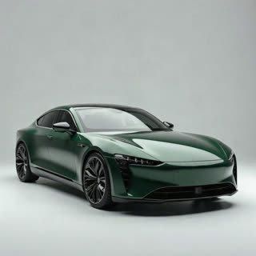  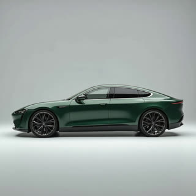 <br><br>
<a href="https://refvid.com/pt/car-cinematic-drive"><b>▶ Assistir ao clipe e fazer com as suas fotos</b></a>
</p>
<br clear="left">

```text
Cena 1: Plano baixo de acompanhamento ao lado de [1] enquanto ele dirige por uma estrada sinuosa à beira-mar na hora dourada, com o mar e os penhascos ao fundo e a luz do sol refletindo na pintura.
Cena 2: [1] passa devagar bem perto da câmera na mesma estrada, com a luz quente percorrendo a carroceria da frente para trás, e depois segue em direção ao pôr do sol.
```

<details><summary>Quais fotos funcionam melhor</summary><br>A câmera acompanha seu carro de lado e depois o deixa passar bem perto, então o que mais importa é um perfil lateral completo com todas as rodas no quadro; adicione uma vista dianteira em três quartos para a grade, os faróis e a cor da pintura saírem certos.<br><br><sub>Feito com o RefVid no Kling 3.0 Omni a partir de 4 fotos de referência de VELA (um elemento criado por IA), usando o prompt deste modelo.</sub></details>

### Comercial de comida

<p>
<a href="https://refvid.com/pt/food-pour-steam"></a>
<b>Modelo</b>&nbsp; Kling 3.0 Omni<br>
<b>Clipe</b>&nbsp; 5 s · 9:16 · sem som<br>
<b>Sujeitos</b>&nbsp; <code>[1]</code> seu produto<br><br>
<b>Fotos de referência</b><br>   <br><br>
<a href="https://refvid.com/pt/food-pour-steam"><b>▶ Assistir ao clipe e fazer com as suas fotos</b></a>
</p>
<br clear="left">

```text
Cena 1: Macro em câmera lenta: a bebida ou o prato quente feito com [1], brilhante e fumegante, escorre para uma xícara ou tigela de cerâmica branca, com vapor subindo em espiral sob uma luz lateral quente contra um fundo escuro.
Cena 2: [1] fica ao lado da xícara ou tigela fumegante sobre um balcão de madeira, com alguns dos seus ingredientes espalhados ao redor, a câmera avançando até que o rótulo preencha o quadro.
```

<details><summary>Quais fotos funcionam melhor</summary><br>A câmera termina se aproximando até o rótulo encher o quadro, então o que mais importa é uma foto bem de frente com cada palavra do rótulo nítida; adicione uma vista de lado para a embalagem manter a forma ao lado da xícara fumegante.<br><br><sub>Feito com o RefVid no Kling 3.0 Omni a partir de 4 fotos de referência de EMBER (um elemento criado por IA), com uma versão anterior do prompt deste modelo.</sub></details>

### Bolsa na rua

<p>
<a href="https://refvid.com/pt/handbag-street-style">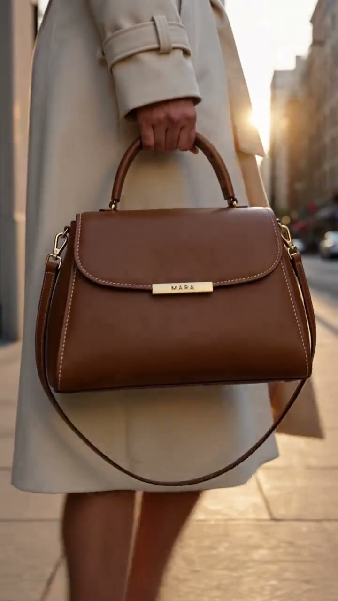</a>
<b>Modelo</b>&nbsp; Kling 4<br>
<b>Clipe</b>&nbsp; 5 s · 9:16 · com som<br>
<b>Sujeitos</b>&nbsp; <code>[1]</code> sua bolsa<br><br>
<b>Fotos de referência</b><br> <br><br>
<a href="https://refvid.com/pt/handbag-street-style"><b>▶ Assistir ao clipe e fazer com as suas fotos</b></a>
</p>
<br clear="left">

```text
Uma mulher de trench coat creme caminha por uma rua ensolarada da cidade carregando [1] no braço; a câmera acompanha ao lado, na altura do quadril, para que [1] fique centralizada e nítida, balançando de leve a cada passo, com o rosto dela fora do quadro. Luz de golden hour, profundidade de campo rasa, estilo de anúncio de moda.
```

<details><summary>Quais fotos funcionam melhor</summary><br>A bolsa balança na altura do quadril ao lado da câmera durante toda a cena, então aparecem a frente e a lateral: fotografe a frente com as ferragens nítidas, a lateral e uma vista com a alça inteira.<br><br><sub>Feito com o RefVid no Kling 4 a partir de 2 fotos de referência de MARA (um personagem criado por IA), usando o prompt deste modelo.</sub></details>

### Bebida gelada

<p>
<a href="https://refvid.com/pt/iced-drink-frost"></a>
<b>Modelo</b>&nbsp; Kling 4<br>
<b>Clipe</b>&nbsp; 5 s · 9:16 · com som<br>
<b>Sujeitos</b>&nbsp; <code>[1]</code> sua bebida<br><br>
<b>Fotos de referência</b><br> <br><br>
<a href="https://refvid.com/pt/iced-drink-frost"><b>▶ Assistir ao clipe e fazer com as suas fotos</b></a>
</p>
<br clear="left">

```text
[1] repousa em uma cama de gelo picado, com metade enterrada no gelo; uma geada branca sobe pela superfície a partir da base, uma névoa fria se desprende e gotas de condensação escorrem devagar pelo rótulo. Contraluz azul e fria, fundo escuro, aproximação lenta da câmera, detalhe macro nítido.
```

<details><summary>Quais fotos funcionam melhor</summary><br>A condensação escorre pelo rótulo enquanto a câmera se aproxima, então o que mais importa é uma foto bem de frente com o rótulo plano e legível; se a lata ou garrafa tiver um verso ou tampa diferente, adicione também para a geada cobrir o formato certo.<br><br><sub>Feito com o RefVid no Kling 4 a partir de 2 fotos de referência de SOL (um personagem criado por IA), usando o prompt deste modelo.</sub></details>

### Joia na mão

<p>
<a href="https://refvid.com/pt/jewelry-on-hand"></a>
<b>Modelo</b>&nbsp; Kling 4<br>
<b>Clipe</b>&nbsp; 5 s · 1:1 · com som<br>
<b>Sujeitos</b>&nbsp; <code>[1]</code> sua joia<br><br>
<b>Fotos de referência</b><br>  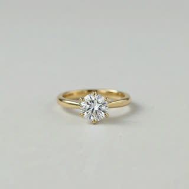 <br><br>
<a href="https://refvid.com/pt/jewelry-on-hand"><b>▶ Assistir ao clipe e fazer com as suas fotos</b></a>
</p>
<br clear="left">

```text
Close-up: a mão de uma mulher, com manicure natural e suave, usando [1], repousa sobre seda creme e gira devagar em direção à câmera, e [1] capta pequenos brilhos na luz quente da janela. Profundidade de campo rasa, aproximação lenta e suave, elegante e natural.
```

<details><summary>Quais fotos funcionam melhor</summary><br>A peça é usada numa mão que gira em direção à câmera, então mostre-a do ângulo de quem a usa, mais uma vista lateral do aro ou da corrente e do engaste; uma foto dela no dedo ou no pulso ajuda o tamanho a ficar certo.<br><br><sub>Feito com o RefVid no Kling 4 a partir de 4 fotos de referência de HALO (um personagem criado por IA), usando o prompt deste modelo.</sub></details>

### Joia brilhante

<p>
<a href="https://refvid.com/pt/jewelry-sparkle"></a>
<b>Modelo</b>&nbsp; Kling 3.0 Omni<br>
<b>Clipe</b>&nbsp; 5 s · 1:1 · sem som<br>
<b>Sujeitos</b>&nbsp; <code>[1]</code> sua peça<br><br>
<b>Fotos de referência</b><br>   <br><br>
<a href="https://refvid.com/pt/jewelry-sparkle"><b>▶ Assistir ao clipe e fazer com as suas fotos</b></a>
</p>
<br clear="left">

```text
Plano macro: [1] repousa sobre veludo preto rico e gira lentamente enquanto um feixe suave de luz passa por ela, a peça captando a luz em brilhos e reflexos. Fundo preto profundo, profundidade de campo rasa, luxuoso.
```

<details><summary>Quais fotos funcionam melhor</summary><br>Um feixe de luz percorre a peça enquanto ela gira sobre veludo preto, então tire fotos de perto numa superfície escura em que cada pedra e cada faceta apareçam nítidas, e uma vista lateral do engaste para a profundidade se manter enquanto gira.<br><br><sub>Feito com o RefVid no Kling 3.0 Omni a partir de 4 fotos de referência de HALO (um elemento criado por IA), com uma versão anterior do prompt deste modelo.</sub></details>

### Swatch de batom

<p>
<a href="https://refvid.com/pt/lipstick-swatch"></a>
<b>Modelo</b>&nbsp; Kling 4<br>
<b>Clipe</b>&nbsp; 5 s · 9:16 · com som<br>
<b>Sujeitos</b>&nbsp; <code>[1]</code> seu batom<br><br>
<b>Fotos de referência</b><br> <br><br>
<a href="https://refvid.com/pt/lipstick-swatch"><b>▶ Assistir ao clipe e fazer com as suas fotos</b></a>
</p>
<br clear="left">

```text
Macro: a ponta de [1] desliza sobre uma superfície creme lisa e deixa um único swatch intenso e brilhante da sua cor; depois a câmera sobe até [1], em pé ao lado do swatch na luz suave do dia, com a cor e a embalagem em foco nítido. Estilo limpo de anúncio de beleza, profundidade de campo rasa.
```

<details><summary>Quais fotos funcionam melhor</summary><br>O macro começa com a bala do batom deslizando, então fotografe o batom aberto, com a ponta e o tom real bem nítidos; inclua uma foto da embalagem fechada em pé, como ela fica ao lado do swatch no fim.<br><br><sub>Feito com o RefVid no Kling 4 a partir de 2 fotos de referência de VELOUR (um personagem criado por IA), usando o prompt deste modelo.</sub></details>

### Revelação de perfume

<p>
<a href="https://refvid.com/pt/perfume-reveal"></a>
<b>Modelo</b>&nbsp; Kling 4<br>
<b>Clipe</b>&nbsp; 5 s · 9:16 · com som<br>
<b>Sujeitos</b>&nbsp; <code>[1]</code> seu perfume<br><br>
<b>Fotos de referência</b><br>  <br><br>
<a href="https://refvid.com/pt/perfume-reveal"><b>▶ Assistir ao clipe e fazer com as suas fotos</b></a>
</p>
<br clear="left">

```text
[1] fica sobre vidro preto brilhante, envolto em uma névoa suave que se move devagar; um único borrifo fino de perfume sai do topo e capta uma contraluz dourada e quente, então a névoa se dissipa e um feixe de luz atravessa o vidro, terminando no rótulo nítido e centralizado. Clima escuro e luxuoso, aproximação lenta da câmera.
```

<details><summary>Quais fotos funcionam melhor</summary><br>O clipe termina com a luz atravessando o vidro até o rótulo centralizado, então fotografe o frasco bem de frente, com o rótulo reto para a câmera e sem reflexo; inclua uma sobre fundo claro para que a tampa e a cor do líquido fiquem nítidas.<br><br><sub>Feito com o RefVid no Kling 4 a partir de 3 fotos de referência de NOIR 07 (um personagem criado por IA), usando o prompt deste modelo.</sub></details>

### Produto 360°

<p>
<a href="https://refvid.com/pt/product-360-turntable">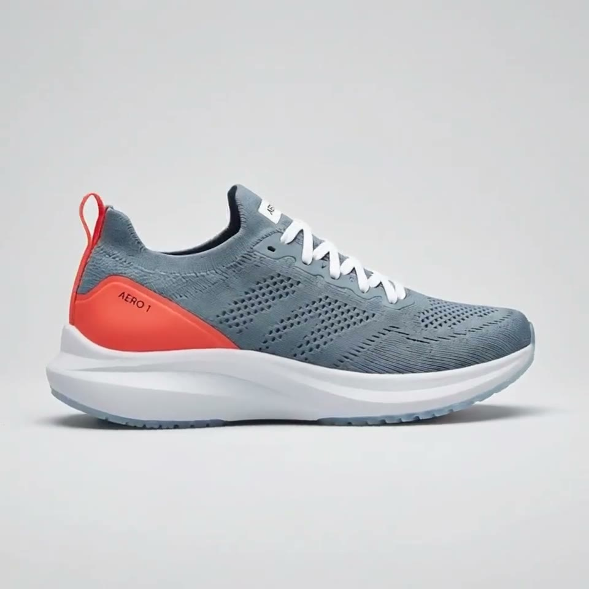</a>
<b>Modelo</b>&nbsp; Kling 3.0 Omni<br>
<b>Clipe</b>&nbsp; 5 s · 1:1 · sem som<br>
<b>Sujeitos</b>&nbsp; <code>[1]</code> seu produto<br><br>
<b>Fotos de referência</b><br>  <br><br>
<a href="https://refvid.com/pt/product-360-turntable"><b>▶ Assistir ao clipe e fazer com as suas fotos</b></a>
</p>
<br clear="left">

```text
[1], com a aparência e as proporções das fotos de referência, está numa mesa giratória de estúdio branca e redonda, fundo cinza claro sem emendas, sob luz de estúdio suave e uniforme, com o produto inteiro em foco nítido.
```

<details><summary>Quais fotos funcionam melhor</summary><br>Ao girar, cada lado passa uma vez pela câmera, então fotografe o produto na mesma altura, de frente, dos dois lados e de costas, num fundo liso; o cliente quase nunca vê o verso, então inclua-o se ele tiver rótulo ou algum detalhe.<br><br><sub>Feito com o RefVid no Kling 3.0 Omni a partir de 3 fotos de referência de AERO 1 (um sujeito criado por IA), com o prompt deste modelo.</sub></details>

### Outdoor 3D

<p>
<a href="https://refvid.com/pt/product-3d-billboard"></a>
<b>Modelo</b>&nbsp; Kling 4<br>
<b>Clipe</b>&nbsp; 5 s · 9:16 · com som<br>
<b>Sujeitos</b>&nbsp; <code>[1]</code> seu produto<br><br>
<b>Fotos de referência</b><br>  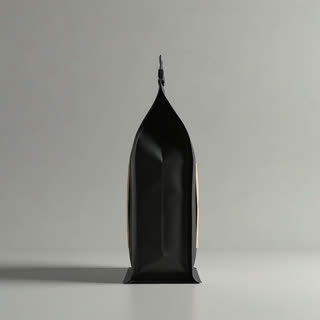 <br><br>
<a href="https://refvid.com/pt/product-3d-billboard"><b>▶ Assistir ao clipe e fazer com as suas fotos</b></a>
</p>
<br clear="left">

```text
Um outdoor de LED 3D curvo envolve a esquina de um prédio alto da cidade ao entardecer, visto da rua lá embaixo: [1], em tamanho gigante, ocupa a tela, gira devagar e então parece saltar para fora da borda da tela, por cima da rua, em perspectiva forçada, enquanto o trânsito passa embaixo. Estilo de anúncio CGI anamórfico, câmera inclinando devagar para cima, luzes da cidade.
```

<details><summary>Quais fotos funcionam melhor</summary><br>Seu produto é ampliado ao tamanho de um prédio e gira antes de saltar da tela, então qualquer desfoque ou poeira aparece: use fotos bem nítidas e em alta resolução num fundo liso, uma de frente e outra de três quartos para o giro.<br><br><sub>Feito com o RefVid no Kling 4 a partir de 4 fotos de referência de EMBER (um personagem criado por IA), usando o prompt deste modelo.</sub></details>

### Black Friday

<p>
<a href="https://refvid.com/pt/product-black-friday"></a>
<b>Modelo</b>&nbsp; Kling 3.0 Omni<br>
<b>Clipe</b>&nbsp; 5 s · 9:16 · sem som<br>
<b>Sujeitos</b>&nbsp; <code>[1]</code> seu produto<br><br>
<b>Fotos de referência</b><br>  <br><br>
<a href="https://refvid.com/pt/product-black-friday"><b>▶ Assistir ao clipe e fazer com as suas fotos</b></a>
</p>
<br clear="left">

```text
Cena 1: Um cenário de estúdio escuro iluminado por tubos de neon rosa e azul, com pilhas de caixas de presente pretas com fitas de cetim; [1] fica em cima da caixa mais alta enquanto a câmera sobe lentamente em sua direção.
Cena 2: Aproximação lenta em [1], com reflexos de neon deslizando sobre ele, o rótulo nítido e centralizado, confetes brilhantes caindo suavemente. Brilhante, premium, de alto contraste.
```

<details><summary>Quais fotos funcionam melhor</summary><br>A câmera sobe até o seu produto em cima da pilha de caixas de presente e depois se aproxima até o rótulo ficar bem no centro, então comece com uma foto frontal do rótulo, sem reflexo; uma vista de cima e das laterais ajuda os reflexos de neon a acompanhar a forma certa.<br><br><sub>Feito com o RefVid no Kling 3.0 Omni a partir de 3 fotos de referência de NOIR 07 (um sujeito criado com IA), usando o prompt deste modelo.</sub></details>

### Bullet time

<p>
<a href="https://refvid.com/pt/product-bullet-time"></a>
<b>Modelo</b>&nbsp; Kling 4<br>
<b>Clipe</b>&nbsp; 5 s · 9:16 · com som<br>
<b>Sujeitos</b>&nbsp; <code>[1]</code> seu produto<br><br>
<b>Fotos de referência</b><br>  <br><br>
<a href="https://refvid.com/pt/product-bullet-time"><b>▶ Assistir ao clipe e fazer com as suas fotos</b></a>
</p>
<br clear="left">

```text
Bullet time: [1] fica suspenso e congelado no ar dentro de uma explosão de gotas e respingos de água cristalina, cada gota parada e perfeitamente imóvel, enquanto a câmera orbita suavemente meia volta ao redor e termina com o rótulo voltado para a lente. Fundo em degradê suave azul e branco, luz de estúdio forte, detalhe macro nítido.
```

<details><summary>Quais fotos funcionam melhor</summary><br>A câmera dá meia-volta ao redor do seu produto e para no rótulo, então a traseira e as laterais aparecem no caminho: adicione fotos da traseira e de uma lateral junto com uma foto nítida do rótulo, sem mão segurando.<br><br><sub>Feito com o RefVid no Kling 4 a partir de 3 fotos de referência de LUMEN (um personagem criado por IA), usando o prompt deste modelo.</sub></details>

### Presente de Natal

<p>
<a href="https://refvid.com/pt/product-christmas-gift"></a>
<b>Modelo</b>&nbsp; Kling 3.0 Omni<br>
<b>Clipe</b>&nbsp; 5 s · 9:16 · sem som<br>
<b>Sujeitos</b>&nbsp; <code>[1]</code> seu produto<br><br>
<b>Fotos de referência</b><br>  <br><br>
<a href="https://refvid.com/pt/product-christmas-gift"><b>▶ Assistir ao clipe e fazer com as suas fotos</b></a>
</p>
<br clear="left">

```text
Cena 1: Uma caixa de presente branca com fita de cetim vermelha repousa sob uma árvore de Natal iluminada, com bokeh quente de pisca-pisca; um par de mãos puxa a fita e levanta a tampa.
Cena 2: Olhando para dentro da caixa aberta: [1] repousa sobre papel de seda branco e impecável, o rótulo nítido e voltado para a câmera, luzes douradas cintilando ao redor enquanto a câmera se aproxima lentamente.
```

<details><summary>Quais fotos funcionam melhor</summary><br>A segunda cena olha de cima para dentro da caixa de presente aberta, onde seu produto está sobre papel de seda com o rótulo para cima, então inclua uma foto tirada um pouco de cima com o rótulo legível, e fotografe o produto sozinho para que a caixa de presente seja a única caixa do vídeo.<br><br><sub>Feito com o RefVid no Kling 3.0 Omni a partir de 3 fotos de referência de NOIR 07 (um sujeito criado por IA), com o prompt deste modelo.</sub></details>

### Flat lay

<p>
<a href="https://refvid.com/pt/product-flat-lay"></a>
<b>Modelo</b>&nbsp; Kling 3.0 Omni<br>
<b>Clipe</b>&nbsp; 5 s · 1:1 · sem som<br>
<b>Sujeitos</b>&nbsp; <code>[1]</code> seu produto<br><br>
<b>Fotos de referência</b><br>   <br><br>
<a href="https://refvid.com/pt/product-flat-lay"><b>▶ Assistir ao clipe e fazer com as suas fotos</b></a>
</p>
<br clear="left">

```text
Flat lay de cima sobre uma superfície de linho bege e quente: [1] fica no centro enquanto três ou quatro pequenos objetos escolhidos para este produto, coisas do dia a dia que seus compradores usam junto com ele, em cores que combinam, entram em quadro um a um ao redor dele. Luz do dia suave e uniforme.
```

<details><summary>Quais fotos funcionam melhor</summary><br>Tudo é filmado de cima para baixo, então a foto que importa é o seu produto deitado, fotografado bem de cima com o rótulo para cima; uma vista lateral ajuda o clipe a manter a espessura e o jeito como ele se apoia no linho.<br><br><sub>Feito com o RefVid no Kling 3.0 Omni a partir de 4 fotos de referência de EMBER (um elemento criado por IA), com uma versão anterior do prompt deste modelo.</sub></details>

### Produto flutuando

<p>
<a href="https://refvid.com/pt/product-floating"></a>
<b>Modelo</b>&nbsp; Kling 4<br>
<b>Clipe</b>&nbsp; 5 s · 9:16 · com som<br>
<b>Sujeitos</b>&nbsp; <code>[1]</code> seu produto<br><br>
<b>Fotos de referência</b><br>  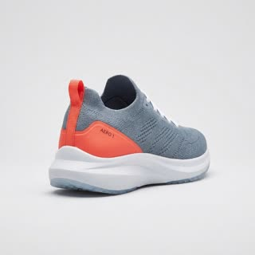<br><br>
<a href="https://refvid.com/pt/product-floating"><b>▶ Assistir ao clipe e fazer com as suas fotos</b></a>
</p>
<br clear="left">

```text
[1] flutua sem peso no ar sobre um fundo em degradê suave de pêssego para lavanda, girando devagar meia volta enquanto sobe e desce de leve, com uma sombra redonda suave no chão logo abaixo. Gravidade zero, luz de estúdio clara e suave, câmera fixa, detalhe nítido no rótulo.
```

<details><summary>Quais fotos funcionam melhor</summary><br>Seu produto dá meia-volta enquanto flutua, então o clipe precisa conhecer a traseira tanto quanto a frente: mande uma foto frontal limpa com o rótulo e depois a traseira e uma lateral, de preferência em fundo liso.<br><br><sub>Feito com o RefVid no Kling 4 a partir de 3 fotos de referência de AERO 1 (um personagem criado por IA), usando o prompt deste modelo.</sub></details>

### Revelação do produto

<p>
<a href="https://refvid.com/pt/product-hero-reveal"></a>
<b>Modelo</b>&nbsp; Kling 3.0 Omni<br>
<b>Clipe</b>&nbsp; 5 s · 16:9 · sem som<br>
<b>Sujeitos</b>&nbsp; <code>[1]</code> seu produto<br><br>
<b>Fotos de referência</b><br> 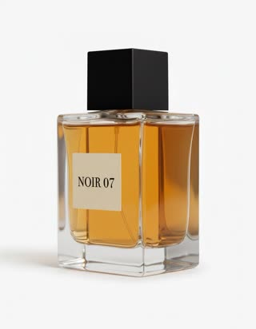 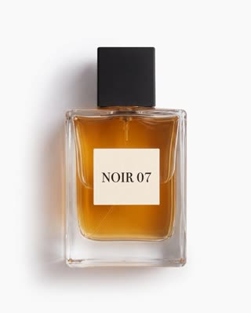<br><br>
<a href="https://refvid.com/pt/product-hero-reveal"><b>▶ Assistir ao clipe e fazer com as suas fotos</b></a>
</p>
<br clear="left">

```text
Cena 1: Escuridão, depois um feixe estreito de luz quente percorre lentamente [1] apoiado sobre um pedestal de pedra preta, captando suas bordas e reflexos. Baixa luminosidade, cinematográfico, filetes de névoa.
Cena 2: Aproximação lenta em [1] enquanto a luz se assenta, o rótulo nítido e centralizado, fundo preto profundo.
```

<details><summary>Quais fotos funcionam melhor</summary><br>Um feixe fino de luz passa pelas bordas e pelo acabamento antes de a câmera se aproximar do rótulo, então mostre o material como ele é: uma foto frontal com o rótulo nítido e outra em ângulo em que a luz pegue as bordas, o brilho ou a textura.<br><br><sub>Feito com o RefVid no Kling 3.0 Omni a partir de 3 fotos de referência do NOIR 07 (um elemento criado por IA), com o prompt deste modelo.</sub></details>

### Anúncio UGC

<p>
<a href="https://refvid.com/pt/product-in-hand-ugc"></a>
<b>Modelo</b>&nbsp; Kling 3.0 Omni<br>
<b>Clipe</b>&nbsp; 10 s · 9:16 · com som<br>
<b>Sujeitos</b>&nbsp; <code>[1]</code> o apresentador · <code>[2]</code> seu produto<br><br>
<b>Fotos de referência</b><br>      <br><br>
<a href="https://refvid.com/pt/product-in-hand-ugc"><b>▶ Assistir ao clipe e fazer com as suas fotos</b></a>
</p>
<br clear="left">

```text
Cena 1: Vídeo tipo selfie, com a câmera na mão, em um cômodo bem iluminado da casa: [1] segura [2] ao lado do rosto, sorri para a câmera do celular e diz: "Okay, I have to show you this one."
Cena 2: Close de [2] na mão de [1], girado devagar até o rótulo ficar de frente para a câmera; depois [1] olha de volta para a câmera e assente com a cabeça. Luz natural do dia.
```

<details><summary>Quais fotos funcionam melhor</summary><br>O apresentador segura seu produto ao lado do rosto e depois o gira em close, então mande uma foto frontal nítida do apresentador e uma foto reta do rótulo; uma imagem do produto na mão ajuda a acertar o tamanho.<br><br><sub>Feito com o RefVid no Kling 3.0 Omni a partir de 7 fotos de referência de Mia e LUMEN (um elemento criado por IA), com uma versão anterior do prompt deste modelo.</sub></details>

### Splash de ingredientes

<p>
<a href="https://refvid.com/pt/product-ingredient-splash"></a>
<b>Modelo</b>&nbsp; Kling 4<br>
<b>Clipe</b>&nbsp; 5 s · 9:16 · com som<br>
<b>Sujeitos</b>&nbsp; <code>[1]</code> seu produto<br><br>
<b>Fotos de referência</b><br> <br><br>
<a href="https://refvid.com/pt/product-ingredient-splash"><b>▶ Assistir ao clipe e fazer com as suas fotos</b></a>
</p>
<br clear="left">

```text
Câmera lenta: [1] fica em pé no centro sobre um fundo vibrante na cor principal da sua embalagem enquanto seus principais ingredientes, os que o rótulo cita, explodem de baixo para cima e giram ao redor, gotas voando pela luz; depois tudo cai e [1] fica em pé, limpo, com o rótulo voltado para a câmera. Luz de estúdio forte, detalhe nítido.
```

<details><summary>Quais fotos funcionam melhor</summary><br>O fundo usa a cor principal da sua embalagem e os ingredientes que voam são os impressos nela, então a foto principal é a frente com os nomes dos ingredientes legíveis e as cores reais, sem foto escura ou puxada para outra cor.<br><br><sub>Feito com o RefVid no Kling 4 a partir de 2 fotos de referência de SOL (um elemento criado por IA), com uma versão anterior do prompt deste modelo.</sub></details>

### Lifestyle em casa

<p>
<a href="https://refvid.com/pt/product-lifestyle-home"></a>
<b>Modelo</b>&nbsp; Kling 3.0 Omni<br>
<b>Clipe</b>&nbsp; 5 s · 16:9 · sem som<br>
<b>Sujeitos</b>&nbsp; <code>[1]</code> seu produto<br><br>
<b>Fotos de referência</b><br>  <br><br>
<a href="https://refvid.com/pt/product-lifestyle-home"><b>▶ Assistir ao clipe e fazer com as suas fotos</b></a>
</p>
<br clear="left">

```text
Cena 1: Um quarto calmo e iluminado pelo sol: a câmera desliza devagar por cortinas de linho e uma planta em vaso até [1], em pé sobre uma cômoda de madeira perto da janela.
Cena 2: A câmera para em [1], com o rótulo nítido, luz suave da manhã e sombras delicadas de folhas se movendo sobre ele.
```

<details><summary>Quais fotos funcionam melhor</summary><br>A câmera atravessa um quarto e para no seu produto em pé sobre uma cômoda, então use uma foto dele em pé, na altura dos olhos, com o rótulo para a frente; fotos com luz do dia suave ajudam a combinar com a luz da manhã.<br><br><sub>Feito com o RefVid no Kling 3.0 Omni a partir de 3 fotos de referência de NOIR 07 (um sujeito criado por IA), usando o prompt deste modelo.</sub></details>

### Chuva de pétalas

<p>
<a href="https://refvid.com/pt/product-petal-fall"></a>
<b>Modelo</b>&nbsp; Kling 4<br>
<b>Clipe</b>&nbsp; 5 s · 9:16 · com som<br>
<b>Sujeitos</b>&nbsp; <code>[1]</code> seu produto<br><br>
<b>Fotos de referência</b><br>  <br><br>
<a href="https://refvid.com/pt/product-petal-fall"><b>▶ Assistir ao clipe e fazer com as suas fotos</b></a>
</p>
<br clear="left">

```text
Câmera lenta: pétalas de rosa em tom rosa suave caem devagar pela luz quente ao redor de [1], que está sobre um pedestal de pedra clara contra um fundo rosa-claro; algumas pétalas pousam ao lado enquanto a câmera se aproxima suavemente até o rótulo preencher o quadro. Fundo onírico em foco suave, estilo de anúncio de beleza.
```

<details><summary>Quais fotos funcionam melhor</summary><br>A câmera se aproxima até o rótulo preencher todo o quadro, então a foto do rótulo precisa funcionar de perto, com letras pequenas e acabamento visíveis; adicione uma vista inteira dele em pé, como ficará no pedestal de pedra.<br><br><sub>Feito com o RefVid no Kling 4 a partir de 3 fotos de referência de LUMEN (um personagem criado por IA), usando o prompt deste modelo.</sub></details>

### Unboxing

<p>
<a href="https://refvid.com/pt/product-unboxing"></a>
<b>Modelo</b>&nbsp; Kling 3.0 Omni<br>
<b>Clipe</b>&nbsp; 10 s · 9:16 · com som<br>
<b>Sujeitos</b>&nbsp; <code>[1]</code> seu produto<br><br>
<b>Fotos de referência</b><br>  <br><br>
<a href="https://refvid.com/pt/product-unboxing"><b>▶ Assistir ao clipe e fazer com as suas fotos</b></a>
</p>
<br clear="left">

```text
Cena 1: Plano de cima de uma caixa simples de papel kraft sobre uma mesa de madeira clara, com luz suave do dia; duas mãos levantam a tampa e dobram para trás um papel de seda branco. Som de papel farfalhando.
Cena 2: Close-up enquanto as mãos tiram [1] de dentro da caixa e o erguem, girando devagar para que o rótulo fique virado para a câmera.
Cena 3: [1] fica em pé sobre a mesa, ao lado da caixa aberta, com a câmera avançando suavemente. Limpo, claro, com profundidade de campo rasa.
```

<details><summary>Quais fotos funcionam melhor</summary><br>Mãos tiram seu produto de uma caixa kraft e o giram para a câmera, então mostre cada lado que aparece no giro: o rótulo da frente, a traseira e a base, cada um fotografado sozinho, fora de qualquer caixa.<br><br><sub>Feito com a RefVid no Kling 3.0 Omni a partir de 3 fotos de referência da LUMEN (um elemento criado por IA), com o prompt deste modelo.</sub></details>

### Respingo d’água

<p>
<a href="https://refvid.com/pt/product-water-splash"></a>
<b>Modelo</b>&nbsp; Kling 3.0 Omni<br>
<b>Clipe</b>&nbsp; 5 s · 9:16 · sem som<br>
<b>Sujeitos</b>&nbsp; <code>[1]</code> seu produto<br><br>
<b>Fotos de referência</b><br>  <br><br>
<a href="https://refvid.com/pt/product-water-splash"><b>▶ Assistir ao clipe e fazer com as suas fotos</b></a>
</p>
<br clear="left">

```text
Câmera lenta: [1] mergulha em um tanque de água cristalina sobre um fundo de degradê azul suave, uma explosão de bolhas e gotas se espalha ao redor, e então ele se assenta em pé com o rótulo voltado para a câmera. Luz forte de estúdio, detalhe em macro.
```

<details><summary>Quais fotos funcionam melhor</summary><br>Seu produto mergulha na água e fica de pé, então precisa de uma vista inteira em pé, da tampa à base, com o rótulo de frente; evite fotos em que brilho molhado ou reflexos escondam o que está impresso.<br><br><sub>Feito com o RefVid no Kling 3.0 Omni a partir de 3 fotos de referência de LUMEN (um personagem criado por IA), usando o prompt deste modelo.</sub></details>

### Textura de skincare

<p>
<a href="https://refvid.com/pt/skincare-texture-macro"></a>
<b>Modelo</b>&nbsp; Kling 3.0 Omni<br>
<b>Clipe</b>&nbsp; 5 s · 9:16 · sem som<br>
<b>Sujeitos</b>&nbsp; <code>[1]</code> seu produto<br><br>
<b>Fotos de referência</b><br>  <br><br>
<a href="https://refvid.com/pt/skincare-texture-macro"><b>▶ Assistir ao clipe e fazer com as suas fotos</b></a>
</p>
<br clear="left">

```text
Cena 1: Macro extremo: uma única porção brilhante da fórmula de [1], com a própria cor e textura, pousa sobre uma superfície lisa de pedra clara e se assenta devagar. Luz natural suave, fundo cremoso.
Cena 2: [1] fica em pé sobre a pedra clara, ao lado de alguns pedaços do seu ingrediente principal, o que o rótulo cita, sob a luz suave de uma janela pela manhã; a câmera avança devagar até o rótulo preencher o quadro.
```

<details><summary>Quais fotos funcionam melhor</summary><br>A primeira cena é a própria fórmula, então adicione uma foto de um swatch ou de uma porção que mostre a cor e a textura reais, e depois uma foto frontal nítida do pote, do tubo ou do frasco, porque a câmera termina com o rótulo ocupando o quadro.<br><br><sub>Feito com o RefVid no Kling 3.0 Omni a partir de 3 fotos de referência de LUMEN (um elemento criado por IA), com uma versão anterior do prompt deste modelo.</sub></details>

### Anúncio de tênis

<p>
<a href="https://refvid.com/pt/sneaker-street-walk"></a>
<b>Modelo</b>&nbsp; Kling 3.0 Omni<br>
<b>Clipe</b>&nbsp; 5 s · 9:16 · sem som<br>
<b>Sujeitos</b>&nbsp; <code>[1]</code> seus tênis<br><br>
<b>Fotos de referência</b><br>  <br><br>
<a href="https://refvid.com/pt/sneaker-street-walk"><b>▶ Assistir ao clipe e fazer com as suas fotos</b></a>
</p>
<br clear="left">

```text
Cena 1: Câmera baixa, na altura do tornozelo, acompanhando um par de pés calçados com [1] enquanto caminham depressa por uma calçada ensolarada de uma cidade, sombras de pedestres, profundidade de campo rasa.
Cena 2: Close de [1] tocando o chão no meio da passada, um pouco de poeira levantando, a câmera desacelerando até parar ao lado.
```

<details><summary>Quais fotos funcionam melhor</summary><br>A câmera baixa acompanha os tênis de lado e depois pega um deles pisando em close, então o perfil externo com a borda da sola é o que mais importa; uma foto do par calçado ajuda a passada e o caimento a parecerem naturais.<br><br><sub>Feito com a RefVid no Kling 3.0 Omni a partir de 3 fotos de referência do AERO 1 (um elemento criado por IA), com o prompt deste modelo.</sub></details>

### Revelação tech

<p>
<a href="https://refvid.com/pt/tech-gadget-reveal"></a>
<b>Modelo</b>&nbsp; Kling 4<br>
<b>Clipe</b>&nbsp; 5 s · 16:9 · com som<br>
<b>Sujeitos</b>&nbsp; <code>[1]</code> seu aparelho<br><br>
<b>Fotos de referência</b><br> <br><br>
<a href="https://refvid.com/pt/tech-gadget-reveal"><b>▶ Assistir ao clipe e fazer com as suas fotos</b></a>
</p>
<br clear="left">

```text
[1] repousa sobre uma superfície preta fosca, quase no escuro; uma linha fina de luz azul e fria contorna as bordas, depois a luz se abre e a câmera desliza em um arco lento ao redor, captando reflexos limpos na superfície, e termina de frente com cada detalhe nítido. Estilo elegante de lançamento tech, fundo preto profundo, névoa sutil.
```

<details><summary>Quais fotos funcionam melhor</summary><br>Primeiro a luz contorna o aparelho, depois a câmera faz um arco e termina de frente, então mande uma foto frontal bem reta com a tela ou o logo visível e outra em ângulo que mostre as bordas, as entradas e o acabamento da carcaça.<br><br><sub>Feito com o RefVid no Kling 4 a partir de 2 fotos de referência de PULSE (um personagem criado por IA), usando o prompt deste modelo.</sub></details>

### Relógio em macro

<p>
<a href="https://refvid.com/pt/watch-macro"></a>
<b>Modelo</b>&nbsp; Kling 4<br>
<b>Clipe</b>&nbsp; 5 s · 1:1 · com som<br>
<b>Sujeitos</b>&nbsp; <code>[1]</code> seu relógio<br><br>
<b>Fotos de referência</b><br> <br><br>
<a href="https://refvid.com/pt/watch-macro"><b>▶ Assistir ao clipe e fazer com as suas fotos</b></a>
</p>
<br clear="left">

```text
Macro extremo de [1]: a câmera desliza devagar pelo mostrador enquanto o ponteiro dos segundos avança, a luz percorrendo a caixa polida e os índices das horas; depois se afasta e mostra o relógio inteiro sobre couro escuro. Luz quente e baixa, profundidade de campo rasa, detalhes luxuosos.
```

<details><summary>Quais fotos funcionam melhor</summary><br>A câmera começa num close extremo do mostrador, então comece com uma vista de cima nítida e sem reflexo em que os índices, os ponteiros e o logo estejam legíveis; adicione uma vista lateral da caixa e da coroa e outra com a pulseira estendida.<br><br><sub>Feito com o RefVid no Kling 4 a partir de 2 fotos de referência de ATLAS (um personagem criado por IA), usando o prompt deste modelo.</sub></details>

[↑ Voltar ao conteúdo](#conteúdo)

## Pessoas

Você, um amigo ou um casal em cada cena, a partir de algumas fotos de cada rosto.

### Viagem de carro

<p>
<a href="https://refvid.com/pt/best-friends-road-trip"></a>
<b>Modelo</b>&nbsp; Kling 3.0 Omni<br>
<b>Clipe</b>&nbsp; 10 s · 16:9 · com som<br>
<b>Sujeitos</b>&nbsp; <code>[1]</code> você · <code>[2]</code> seu amigo<br><br>
<b>Fotos de referência</b><br>       <br><br>
<a href="https://refvid.com/pt/best-friends-road-trip"><b>▶ Assistir ao clipe e fazer com as suas fotos</b></a>
</p>
<br clear="left">

```text
Cena 1: Um conversível antigo dirige por uma estrada ensolarada à beira-mar; [1] ao volante e [2] no banco do passageiro riem, com o cabelo voando ao vento. Plano geral com travelling.
Cena 2: Plano fechado de duas pessoas dentro do carro: [2] canta alto enquanto [1] ri e balança a cabeça. Barulho de vento, luz quente.
Cena 3: O carro estacionado num mirante no alto de um penhasco ao pôr do sol, [1] e [2] sentados sobre o capô vistos de costas, olhando para o mar.
```

<details><summary>Quais fotos funcionam melhor</summary><br>Vocês aparecem lado a lado nos bancos da frente e terminam vistos de costas sobre o capô, então adicione para cada um uma foto nítida de frente, uma em três quartos e uma que mostre bem o cabelo e o corpo.<br><br><sub>Feito com o RefVid no Kling 3.0 Omni a partir de 8 fotos de referência de Mia e Leo (um elemento criado por IA), usando o prompt deste modelo.</sub></details>

### Parabéns

<p>
<a href="https://refvid.com/pt/birthday-greeting"></a>
<b>Modelo</b>&nbsp; Kling 3.0 Omni<br>
<b>Clipe</b>&nbsp; 5 s · 9:16 · com som<br>
<b>Sujeitos</b>&nbsp; <code>[1]</code> você<br><br>
<b>Fotos de referência</b><br>   <br><br>
<a href="https://refvid.com/pt/birthday-greeting"><b>▶ Assistir ao clipe e fazer com as suas fotos</b></a>
</p>
<br clear="left">

```text
Plano médio fechado de [1] em uma sala aconchegante segurando um bolinho com velas acesas em direção à câmera, depois sorrindo e dizendo com carinho: "Happy birthday! I hope this year is your best one yet." Luz quente de fim de tarde, luzes de fada ao fundo.
```

<details><summary>Quais fotos funcionam melhor</summary><br>É um único plano médio em que você fala atrás de um bolo com velas, então funciona melhor uma foto nítida de frente, enquadrada na altura do peito; uma luz interna quente ajuda o tom da sua pele a combinar com o brilho das velas.<br><br><sub>Feito com o RefVid no Kling 3.0 Omni a partir de 4 fotos de referência do Leo (um personagem criado por IA), usando o prompt deste modelo.</sub></details>

### Programa de culinária

<p>
<a href="https://refvid.com/pt/chef-cooking-show"></a>
<b>Modelo</b>&nbsp; Kling 3.0 Omni<br>
<b>Clipe</b>&nbsp; 10 s · 16:9 · com som<br>
<b>Sujeitos</b>&nbsp; <code>[1]</code> você<br><br>
<b>Fotos de referência</b><br>   <br><br>
<a href="https://refvid.com/pt/chef-cooking-show"><b>▶ Assistir ao clipe e fazer com as suas fotos</b></a>
</p>
<br clear="left">

```text
Cena 1: Uma cozinha caseira acolhedora, com panelas de cobre e ervas sobre a bancada: [1] de avental azul-marinho sorri para a câmera e diz: "Welcome back to Sunday Kitchen. Today: the easiest pasta you’ll ever make."
Cena 2: Close de uma panela no fogão enquanto [1] salteia alho e tomates em azeite de oliva, e uma labareda sobe. Som de chiado.
Cena 3: [1] coloca um prato de espaguete com manjericão fresco diante da câmera e faz um aceno satisfeito com a cabeça.
```

<details><summary>Quais fotos funcionam melhor</summary><br>Você fala direto para a câmera no balcão e acena com a cabeça diante do prato pronto, então o que mais importa é uma foto nítida de frente com um sorriso natural; outra com o cabelo preso, como quando cozinha, mantém você igual no fogão.<br><br><sub>Feito com a RefVid no Kling 3.0 Omni a partir de 4 fotos de referência do Leo (um elemento criado por IA), usando o prompt deste modelo.</sub></details>

### Feira de Natal

<p>
<a href="https://refvid.com/pt/christmas-market-couple">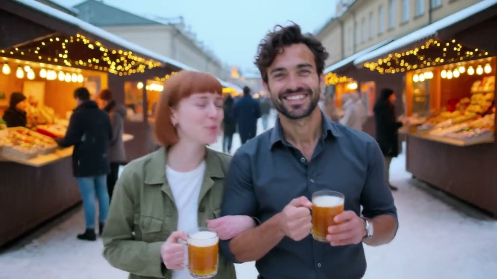</a>
<b>Modelo</b>&nbsp; Kling 3.0 Omni<br>
<b>Clipe</b>&nbsp; 5 s · 16:9 · sem som<br>
<b>Sujeitos</b>&nbsp; <code>[1]</code> você · <code>[2]</code> seu parceiro ou sua parceira<br><br>
<b>Fotos de referência</b><br>       <br><br>
<a href="https://refvid.com/pt/christmas-market-couple"><b>▶ Assistir ao clipe e fazer com as suas fotos</b></a>
</p>
<br clear="left">

```text
Cena 1: Entardecer numa feira de Natal coberta de neve, com barracas de madeira e fios de luzes quentinhas: [1] e [2] caminham de braços dados em direção à câmera, cada um segurando uma caneca fumegante de vinho quente, rindo. Neve leve caindo.
Cena 2: Plano fechado dos dois: [2] tira um floco de neve do cabelo de [1] e eles trocam um sorriso tranquilo, com as luzes da feira brilhando suavemente atrás deles.
```

<details><summary>Quais fotos funcionam melhor</summary><br>Vocês caminham de braços dados em direção à câmera e depois dividem um momento de perto, frente a frente, então cada um precisa de uma foto nítida de frente e um perfil; mostre o cabelo como você costuma usar, porque um floco de neve é tirado dele.<br><br><sub>Feito com o RefVid no Kling 3.0 Omni a partir de 8 fotos de referência de Mia e Leo (um elemento criado por IA), usando o prompt deste modelo.</sub></details>

### Mensagem de Natal

<p>
<a href="https://refvid.com/pt/christmas-sweater-greeting"></a>
<b>Modelo</b>&nbsp; Kling 3.0 Omni<br>
<b>Clipe</b>&nbsp; 5 s · 9:16 · com som<br>
<b>Sujeitos</b>&nbsp; <code>[1]</code> você<br><br>
<b>Fotos de referência</b><br>   <br><br>
<a href="https://refvid.com/pt/christmas-sweater-greeting"><b>▶ Assistir ao clipe e fazer com as suas fotos</b></a>
</p>
<br clear="left">

```text
Cena 1: Uma sala aconchegante à noite: uma árvore de Natal iluminada com luzes quentes e uma lareira crepitante com meias penduradas; [1], de suéter vermelho de tricô natalino, sentado no tapete segurando uma caneca de chocolate quente, enquanto a câmera se aproxima lentamente.
Cena 2: [1] olha para a câmera com um sorriso caloroso e diz: "Merry Christmas, I miss you all. See you soon!" O fogo crepita suavemente.
```

<details><summary>Quais fotos funcionam melhor</summary><br>Você se senta no tapete e olha para cima, para a câmera, ao dizer seus votos, então combina melhor uma foto de frente tirada um pouco de cima, com o rosto em luz suave e quente; uma foto sentado ajuda o suéter a cair com naturalidade.<br><br><sub>Feito com a RefVid no Kling 3.0 Omni a partir de 4 fotos de referência da Mia (um elemento criado por IA), com o prompt deste modelo.</sub></details>

### Pôr do sol na praia

<p>
<a href="https://refvid.com/pt/couple-beach-sunset"></a>
<b>Modelo</b>&nbsp; Kling 3.0 Omni<br>
<b>Clipe</b>&nbsp; 10 s · 16:9 · sem som<br>
<b>Sujeitos</b>&nbsp; <code>[1]</code> você · <code>[2]</code> seu parceiro<br><br>
<b>Fotos de referência</b><br>       <br><br>
<a href="https://refvid.com/pt/couple-beach-sunset"><b>▶ Assistir ao clipe e fazer com as suas fotos</b></a>
</p>
<br clear="left">

```text
Cena 1: Plano geral na hora dourada: [1] e [2] caminham descalços pela beira do mar de uma praia tranquila, em direção à câmera, conversando, com ondas suaves batendo nos pés.
Cena 2: Plano médio de [1] e [2] rindo juntos, com o sol baixo e quente atrás deles, o cabelo balançando na brisa do mar.
Cena 3: [1] e [2] ficam lado a lado, vistos de costas, olhando o sol se pondo no mar. Aproximação lenta da câmera, céu laranja e quente.
```

<details><summary>Quais fotos funcionam melhor</summary><br>A primeira cena mostra vocês caminhando em direção à câmera e a última, de costas diante do pôr do sol, então adicione para cada um uma foto nítida de frente e outra de costas com cabelo e ombros; fotos de corpo inteiro mantêm as alturas certas.<br><br><sub>Feito com o RefVid no Kling 3.0 Omni a partir de 8 fotos de referência de Mia e Leo (elementos criados por IA), com o prompt deste modelo.</sub></details>

### Lookbook de moda

<p>
<a href="https://refvid.com/pt/fashion-lookbook-walk"></a>
<b>Modelo</b>&nbsp; Kling 3.0 Omni<br>
<b>Clipe</b>&nbsp; 10 s · 9:16 · sem som<br>
<b>Sujeitos</b>&nbsp; <code>[1]</code> você<br><br>
<b>Fotos de referência</b><br>   <br><br>
<a href="https://refvid.com/pt/fashion-lookbook-walk"><b>▶ Assistir ao clipe e fazer com as suas fotos</b></a>
</p>
<br clear="left">

```text
Cena 1: Plano geral: [1] com um trench coat caramelo sobre uma camiseta branca e calça jeans de perna larga caminha com confiança em direção à câmera por uma tranquila rua lateral de Paris, sob a luz suave da manhã.
Cena 2: Ângulo lateral baixo acompanhando [1] no meio da passada, o casaco se movendo a cada passo, as vitrines passando ao lado.
Cena 3: Close-up enquanto [1] se vira por sobre o ombro em direção à câmera, com um leve sorriso, o cabelo captando a luz.
```

<details><summary>Quais fotos funcionam melhor</summary><br>As três cenas mostram você andando de frente, de um ângulo lateral baixo e virando por cima do ombro, então adicione uma foto de corpo inteiro de frente, uma de lado e uma olhando para trás, com a de frente nítida e bem iluminada.<br><br><sub>Feito com o RefVid no Kling 3.0 Omni a partir de 4 fotos de referência da Mia (um sujeito criado por IA), com o prompt deste modelo.</sub></details>

### Treino fitness

<p>
<a href="https://refvid.com/pt/fitness-coach-demo"></a>
<b>Modelo</b>&nbsp; Kling 3.0 Omni<br>
<b>Clipe</b>&nbsp; 5 s · 9:16 · com som<br>
<b>Sujeitos</b>&nbsp; <code>[1]</code> você<br><br>
<b>Fotos de referência</b><br>   <br><br>
<a href="https://refvid.com/pt/fitness-coach-demo"><b>▶ Assistir ao clipe e fazer com as suas fotos</b></a>
</p>
<br clear="left">

```text
Cena 1: Uma academia moderna e bem iluminada, com janelões: [1] de roupa de treino preta faz um agachamento livre lento, visto de lado, com as costas retas e os braços estendidos à frente. Ambiente de academia.
Cena 2: [1] se levanta, olha para a câmera e diz com um sorriso encorajador: "Push the floor away, and keep your chest up."
```

<details><summary>Quais fotos funcionam melhor</summary><br>O agachamento é filmado de lado antes de você falar de frente, então adicione uma vista lateral de corpo inteiro com roupa de treino e uma foto nítida do rosto de frente; uma foto que mostre seu físico faz o movimento parecer seu.<br><br><sub>Feito com o RefVid no Kling 3.0 Omni a partir de 4 fotos de referência do Leo (um sujeito criado por IA), com o prompt deste modelo.</sub></details>

### Fantasma de lençol

<p>
<a href="https://refvid.com/pt/halloween-bedsheet-ghost"></a>
<b>Modelo</b>&nbsp; Kling 3.0 Omni<br>
<b>Clipe</b>&nbsp; 6 s · 9:16 · sem som<br>
<b>Sujeitos</b>&nbsp; <code>[1]</code> você<br><br>
<b>Fotos de referência</b><br>   <br><br>
<a href="https://refvid.com/pt/halloween-bedsheet-ghost"><b>▶ Assistir ao clipe e fazer com as suas fotos</b></a>
</p>
<br clear="left">

```text
Cena 1: Uma figura embaixo de um lençol branco liso, com furos para os olhos e óculos escuros pretos, está numa trilha coberta de folhas em um parque de outono, na hora dourada, virando-se devagar em direção à câmera. Câmera na mão, luz quente, folhas caindo.
Cena 2: A figura tira o lençol: é [1], sorrindo, com o lençol sobre um dos braços e folhas girando ao redor. Plano médio, contraluz dourado e suave.
```

<details><summary>Quais fotos funcionam melhor</summary><br>Você só aparece quando o lençol sai, sorrindo na contraluz dourada, então o que mais importa é uma foto nítida de frente com o cabelo como você costuma usar; uma foto de corpo inteiro mantém sua altura certa debaixo do lençol.<br><br><sub>Feito com a RefVid no Kling 3.0 Omni a partir de 4 fotos de referência da Mia (um sujeito criado por IA), com o prompt deste modelo.</sub></details>

### Provador de fantasias

<p>
<a href="https://refvid.com/pt/halloween-costume-try-on"></a>
<b>Modelo</b>&nbsp; Kling 3.0 Omni<br>
<b>Clipe</b>&nbsp; 10 s · 9:16 · sem som<br>
<b>Sujeitos</b>&nbsp; <code>[1]</code> você<br><br>
<b>Fotos de referência</b><br>   <br><br>
<a href="https://refvid.com/pt/halloween-costume-try-on"><b>▶ Assistir ao clipe e fazer com as suas fotos</b></a>
</p>
<br clear="left">

```text
Cena 1: [1] com roupas do dia a dia gira uma vez na frente de um espelho alto de quarto e termina olhando para a câmera como um vampiro: cabeça descoberta, capa preta de gola alta com forro vermelho, presas pequenas de plástico, rosto totalmente visível. Luzes de fada quentes, aspecto de câmera de celular.
Cena 2: Corte seco: [1] gira de novo e a capa desaparece; ela termina com um traje fofo e redondo de abóbora laranja, com colarinho de haste verde, cabeça descoberta, rindo para a câmera.
Cena 3: Corte seco: [1] gira uma terceira vez e o traje de abóbora desaparece; ela termina como bruxa, com vestido longo preto e chapéu pontudo preto, lançando uma piscadela brincalhona para a câmera.
```

<details><summary>Quais fotos funcionam melhor</summary><br>Nenhuma fantasia cobre a cabeça e você gira para a câmera três vezes, então adicione uma foto nítida de frente com o rosto inteiro e o cabelo à mostra, mais uma de corpo inteiro para o corpo continuar igual em cada fantasia.<br><br><sub>Feito com o RefVid no Kling 3.0 Omni a partir de 4 fotos de referência de Mia (um sujeito criado por IA), usando o prompt deste modelo.</sub></details>

### Cabeça de abóbora

<p>
<a href="https://refvid.com/pt/halloween-pumpkin-head"></a>
<b>Modelo</b>&nbsp; Kling 3.0 Omni<br>
<b>Clipe</b>&nbsp; 6 s · 9:16 · sem som<br>
<b>Sujeitos</b>&nbsp; <code>[1]</code> você<br><br>
<b>Fotos de referência</b><br>   <br><br>
<a href="https://refvid.com/pt/halloween-pumpkin-head"><b>▶ Assistir ao clipe e fazer com as suas fotos</b></a>
</p>
<br clear="left">

```text
Cena 1: Em um estúdio escuro com um fundo laranja profundo, uma pessoa de gola alta preta segura uma abóbora esculpida iluminada na frente do rosto, com a chama da vela tremeluzindo lá dentro. Aproximação lenta, luz baixa e sombria.
Cena 2: [1] abaixa a abóbora até a altura do peito e olha direto para a câmera com um leve sorriso, o brilho da vela iluminando o rosto por baixo. Primeiro plano, cinematográfico.
```

<details><summary>Quais fotos funcionam melhor</summary><br>Seu rosto só aparece no final, num close iluminado por baixo pela vela, então o que mais importa é uma foto nítida bem de frente, sem chapéu nem óculos escuros; um olhar calmo ou um leve sorriso combina com a cena.<br><br><sub>Feito com o RefVid no Kling 3.0 Omni a partir de 4 fotos de referência da Mia (um sujeito criado por IA), com o prompt deste modelo.</sub></details>

### Flash Y2K

<p>
<a href="https://refvid.com/pt/halloween-y2k-flash">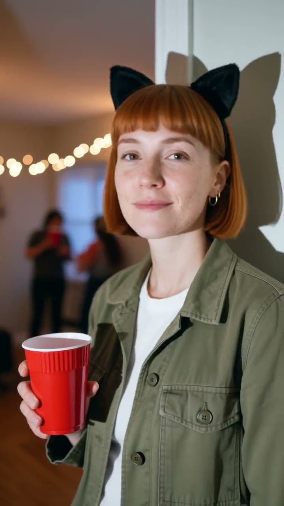</a>
<b>Modelo</b>&nbsp; Kling 3.0 Omni<br>
<b>Clipe</b>&nbsp; 5 s · 9:16 · sem som<br>
<b>Sujeitos</b>&nbsp; <code>[1]</code> você<br><br>
<b>Fotos de referência</b><br>   <br><br>
<a href="https://refvid.com/pt/halloween-y2k-flash"><b>▶ Assistir ao clipe e fazer com as suas fotos</b></a>
</p>
<br clear="left">

```text
O visual de uma foto de festa de câmera descartável de 2004: uma festa de Halloween noturna em casa, luz forte e direta de flash, pele levemente superexposta, uma sombra marcada na parede ao fundo, granulado forte de filme, luzes de fita ao fundo. [1] com orelhas de gato pretas está parado perto da porta segurando um copo vermelho de papel, vira-se para a câmera, ri e faz um sinal de paz. Sem reflexo de luz no rosto.
```

<details><summary>Quais fotos funcionam melhor</summary><br>O flash direto achata a luz, então uma foto de frente com luz uniforme e sem sombras fortes dá o resultado mais fiel; você se vira para a câmera rindo, por isso uma foto sorrindo ajuda.<br><br><sub>Feito com o RefVid no Kling 3.0 Omni a partir de 4 fotos de referência da Mia (um personagem criado por IA), com o prompt deste modelo.</sub></details>

### Caminhada zumbi

<p>
<a href="https://refvid.com/pt/halloween-zombie-walk"></a>
<b>Modelo</b>&nbsp; Kling 3.0 Omni<br>
<b>Clipe</b>&nbsp; 5 s · 16:9 · com som<br>
<b>Sujeitos</b>&nbsp; <code>[1]</code> você<br><br>
<b>Fotos de referência</b><br>   <br><br>
<a href="https://refvid.com/pt/halloween-zombie-walk"><b>▶ Assistir ao clipe e fazer com as suas fotos</b></a>
</p>
<br clear="left">

```text
Cena 1: Plano médio numa rua enevoada à noite, sob um único poste piscando: [1] vestido de zumbi para o Halloween, com o rosto coberto por tinta espessa cinza-esverdeada, sombras escuras e fundas pintadas em volta dos olhos, sangue falso no canto da boca, uma camisa xadrez rasgada e manchada, caminhando devagar em direção à câmera com os braços rígidos. Luz azul fria, névoa se movendo.
Cena 2: Close-up de [1], ainda com a tinta cinza-esverdeada de zumbi e o sangue falso, parando sob o poste, inclinando a cabeça e, em seguida, abrindo um sorriso para a câmera. Rosnado baixo, vento distante.
```

<details><summary>Quais fotos funcionam melhor</summary><br>Tinta cinza-esverdeada e sombras escuras cobrem seu rosto, então é a estrutura do rosto que mantém você reconhecível: use uma foto nítida de frente e uma de perfil em luz neutra, sem maquiagem nem óculos, porque a cena termina no seu sorriso.<br><br><sub>Feito com o RefVid no Kling 3.0 Omni a partir de 4 fotos de referência de Mia (um personagem criado por IA), com o prompt deste modelo.</sub></details>

### Apresentação em vídeo

<p>
<a href="https://refvid.com/pt/linkedin-intro"></a>
<b>Modelo</b>&nbsp; Kling 3.0 Omni<br>
<b>Clipe</b>&nbsp; 5 s · 16:9 · com som<br>
<b>Sujeitos</b>&nbsp; <code>[1]</code> você<br><br>
<b>Fotos de referência</b><br>   <br><br>
<a href="https://refvid.com/pt/linkedin-intro"><b>▶ Assistir ao clipe e fazer com as suas fotos</b></a>
</p>
<br clear="left">

```text
Plano médio de [1] sentado num escritório moderno e iluminado, com plantas e uma janela ao fundo, olhando diretamente para a câmera e dizendo com um sorriso tranquilo: "Hi, I’m Leo — I help small brands tell their story on video." Luz natural suave.
```

<details><summary>Quais fotos funcionam melhor</summary><br>Você fala direto para a câmera de uma mesa de escritório, então o que mais importa é uma foto nítida de frente, na altura dos olhos e com um sorriso tranquilo; inclua outra que mostre seus ombros e o tipo de roupa que você usa no trabalho.<br><br><sub>Feito com o RefVid no Kling 3.0 Omni a partir de 4 fotos de referência de Leo (um sujeito gerado por IA), com o prompt deste modelo.</sub></details>

### Minidrama

<p>
<a href="https://refvid.com/pt/mini-drama-scene"></a>
<b>Modelo</b>&nbsp; Kling 3.0 Omni<br>
<b>Clipe</b>&nbsp; 10 s · 9:16 · com som<br>
<b>Sujeitos</b>&nbsp; <code>[1]</code> o primeiro protagonista · <code>[2]</code> o segundo protagonista<br><br>
<b>Fotos de referência</b><br>       <br><br>
<a href="https://refvid.com/pt/mini-drama-scene"><b>▶ Assistir ao clipe e fazer com as suas fotos</b></a>
</p>
<br clear="left">

```text
Cena 1: Noite chuvosa em um café silencioso: [1] e [2] sentados frente a frente, numa mesa pequena, com o café intacto entre eles. Plano geral, luz melancólica da janela.
Cena 2: Close em [1], olhar firme, dizendo baixinho: "You knew all along, didn’t you?"
Cena 3: Close em [2], olhando para baixo e depois para cima, respondendo: "I was going to tell you tonight."
```

<details><summary>Quais fotos funcionam melhor</summary><br>Cada protagonista ganha um close fechado na sua fala, então use fotos nítidas de frente das duas pessoas, com expressão calma e séria em vez de um sorrisão; uma vista de três quartos de cada uma ajuda quando ficam frente a frente na mesa.<br><br><sub>Feito com o RefVid no Kling 3.0 Omni a partir de 8 fotos de referência de Mia e Leo (personagens criados por IA), com o prompt deste modelo.</sub></details>

### Rotina matinal

<p>
<a href="https://refvid.com/pt/morning-routine"></a>
<b>Modelo</b>&nbsp; Kling 3.0 Omni<br>
<b>Clipe</b>&nbsp; 5 s · 9:16 · sem som<br>
<b>Sujeitos</b>&nbsp; <code>[1]</code> você<br><br>
<b>Fotos de referência</b><br>   <br><br>
<a href="https://refvid.com/pt/morning-routine"><b>▶ Assistir ao clipe e fazer com as suas fotos</b></a>
</p>
<br clear="left">

```text
Cena 1: Sol suave da manhã numa cozinha minimalista e tranquila: [1], de camisa de linho solta, despeja água quente devagar sobre um café coado no filtro, vapor subindo, plantas no peitoril da janela.
Cena 2: [1] se senta perto da janela com a caneca nas duas mãos, dá um primeiro gole lento e olha para fora, sorrindo suavemente. Luz quente, profundidade de campo rasa.
```

<details><summary>Quais fotos funcionam melhor</summary><br>A segunda cena é um olhar tranquilo pela janela com a caneca nos lábios, então uma foto nítida do seu rosto de lado ou de três quartos vale tanto quanto uma de frente; uma foto das suas mãos ajuda na hora de passar o café.<br><br><sub>Feito com o RefVid no Kling 3.0 Omni a partir de 4 fotos de referência da Mia (um elemento criado por IA), com o prompt deste modelo.</sub></details>

### Contagem de Ano Novo

<p>
<a href="https://refvid.com/pt/new-year-countdown"></a>
<b>Modelo</b>&nbsp; Kling 3.0 Omni<br>
<b>Clipe</b>&nbsp; 5 s · 16:9 · com som<br>
<b>Sujeitos</b>&nbsp; <code>[1]</code> você<br><br>
<b>Fotos de referência</b><br>   <br><br>
<a href="https://refvid.com/pt/new-year-countdown"><b>▶ Assistir ao clipe e fazer com as suas fotos</b></a>
</p>
<br clear="left">

```text
Cena 1: Plano médio de frente para a câmera num terraço à meia-noite do Réveillon, com o horizonte da cidade cintilando ao fundo: [1], de roupa brilhante, ergue uma taça de champanhe e faz a contagem regressiva olhando para a câmera, com um sorriso largo: "Three, two, one…"
Cena 2: [1] se vira para a câmera e comemora "Happy New Year!", com a taça erguida, enquanto fogos dourados explodem sobre o horizonte atrás e confete flutua no ar.
```

<details><summary>Quais fotos funcionam melhor</summary><br>Você faz a contagem de frente para a câmera e depois comemora de boca bem aberta, então o mais importante é uma foto nítida de frente com um sorriso largo e aberto; outra com o braço esticado, mostrando cabelo e tronco, mantém você reconhecível na roupa de festa.<br><br><sub>Feito com a RefVid no Kling 3.0 Omni a partir de 4 fotos de referência da Mia (um elemento criado com IA), usando o prompt deste modelo.</sub></details>

### Apresentador de podcast

<p>
<a href="https://refvid.com/pt/podcast-host">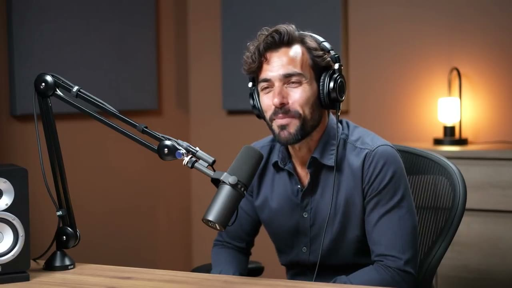</a>
<b>Modelo</b>&nbsp; Kling 3.0 Omni<br>
<b>Clipe</b>&nbsp; 5 s · 16:9 · com som<br>
<b>Sujeitos</b>&nbsp; <code>[1]</code> você<br><br>
<b>Fotos de referência</b><br>   <br><br>
<a href="https://refvid.com/pt/podcast-host"><b>▶ Assistir ao clipe e fazer com as suas fotos</b></a>
</p>
<br clear="left">

```text
Plano médio de [1] sentado à mesa de um estúdio de podcast, com microfone em braço articulado e fones de ouvido, luz quente de abajur e painéis acústicos ao fundo, inclinando-se para a frente e dizendo com um sorriso: "Welcome back to Small Brands, Big Stories."
```

<details><summary>Quais fotos funcionam melhor</summary><br>Os fones ficam sobre as orelhas e você se inclina para um microfone com braço articulado, então mostre bem a linha do cabelo e as orelhas numa foto de frente e inclua uma de três quartos; se você usa óculos no programa, use também nas fotos.<br><br><sub>Feito com o RefVid no Kling 3.0 Omni a partir de 4 fotos de referência do Leo (um protagonista gerado por IA), com o prompt deste modelo.</sub></details>

### Dupla de rap

<p>
<a href="https://refvid.com/pt/rap-duo-booth">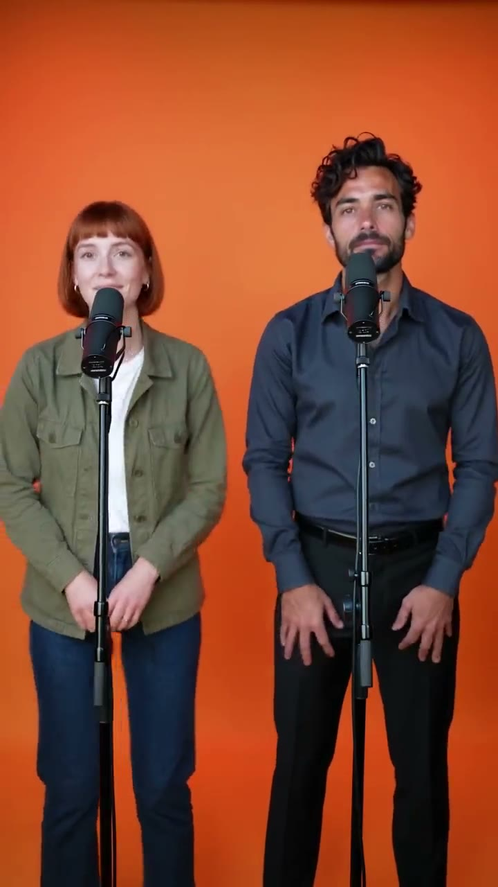</a>
<b>Modelo</b>&nbsp; Kling 3.0 Omni<br>
<b>Clipe</b>&nbsp; 15 s · 9:16 · com som<br>
<b>Sujeitos</b>&nbsp; <code>[1]</code> você · <code>[2]</code> seu parceiro de rap<br><br>
<b>Fotos de referência</b><br>       <br><br>
<a href="https://refvid.com/pt/rap-duo-booth"><b>▶ Assistir ao clipe e fazer com as suas fotos</b></a>
</p>
<br clear="left">

```text
Dentro de uma pequena cabine de estúdio de música com paredes e piso laranja vibrante sem emendas, iluminada por igual pela frente, dois microfones de voz em pedestais. [1] e [2] estão lado a lado com roupas streetwear, de frente para a câmera, e mandam um verso rápido sobre um beat pesado de trap, balançando a cabeça e mexendo as mãos no ritmo. [1] canta: "Same face every frame, yeah we never switch it up." Depois [2] canta: "Two photos in and now the whole world's watching us." Em seguida os dois cantam juntos, sorrindo. Plano médio vertical fixo, com clima de apresentação ao vivo.
```

<details><summary>Quais fotos funcionam melhor</summary><br>Vocês dois rimam lado a lado de frente para a câmera, em plano médio, então cada um precisa de uma foto frontal nítida com a boca à mostra, mais uma da cintura para cima para que altura e porte fiquem certos lado a lado.<br><br><sub>Feito com o RefVid no Kling 3.0 Omni a partir de 8 fotos de referência de Mia e Leo (um elemento criado por IA), usando o prompt deste modelo.</sub></details>

### Pouso de super-herói

<p>
<a href="https://refvid.com/pt/superhero-landing"></a>
<b>Modelo</b>&nbsp; Kling 3.0 Omni<br>
<b>Clipe</b>&nbsp; 5 s · 16:9 · sem som<br>
<b>Sujeitos</b>&nbsp; <code>[1]</code> você<br><br>
<b>Fotos de referência</b><br>   <br><br>
<a href="https://refvid.com/pt/superhero-landing"><b>▶ Assistir ao clipe e fazer com as suas fotos</b></a>
</p>
<br clear="left">

```text
Cena 1: Uma noite tempestuosa sobre a cidade: [1], com um traje original de armadura azul-escuro com detalhes prateados, despenca do céu e pousa no telhado num pouso de três pontos, com um punho no concreto, rachaduras se espalhando e poeira sendo lançada para fora.
Cena 2: [1] se ergue devagar do pouso e encara a câmera de frente, com o vento puxando o traje e relâmpagos piscando atrás. Ângulo baixo, cinematográfico.
```

<details><summary>Quais fotos funcionam melhor</summary><br>O traje substitui sua roupa, então o rosto carrega toda a semelhança: uma foto frontal nítida para o olhar final para a câmera e outra um pouco de baixo ou de lado, já que você se levanta filmado de baixo para cima.<br><br><sub>Feito com a RefVid no Kling 3.0 Omni a partir de 4 fotos de referência de Mia (um personagem criado por IA), com o prompt deste modelo.</sub></details>

### Anúncio falado

<p>
<a href="https://refvid.com/pt/talking-head-ad"></a>
<b>Modelo</b>&nbsp; Kling 3.0 Omni<br>
<b>Clipe</b>&nbsp; 5 s · 9:16 · com som<br>
<b>Sujeitos</b>&nbsp; <code>[1]</code> o apresentador<br><br>
<b>Fotos de referência</b><br>   <br><br>
<a href="https://refvid.com/pt/talking-head-ad"><b>▶ Assistir ao clipe e fazer com as suas fotos</b></a>
</p>
<br clear="left">

```text
Plano médio fechado de [1] sentado num home office iluminado, olhando direto para a câmera, dizendo com um sorriso caloroso: "Here is the one thing I wish I had known sooner." Luz suave de janela, profundidade de campo rasa.
```

<details><summary>Quais fotos funcionam melhor</summary><br>O apresentador fala direto para a lente em plano médio fechado, então rosto e boca carregam o clipe: use fotos de frente na altura dos olhos, sem óculos escuros nem mãos perto da boca, e uma com um sorriso natural.<br><br><sub>Feito com o RefVid no Kling 3.0 Omni a partir de 4 fotos de referência da Mia (uma pessoa criada por IA), com o prompt deste modelo.</sub></details>

### Brinde de Ação de Graças

<p>
<a href="https://refvid.com/pt/thanksgiving-table"></a>
<b>Modelo</b>&nbsp; Kling 3.0 Omni<br>
<b>Clipe</b>&nbsp; 5 s · 16:9 · com som<br>
<b>Sujeitos</b>&nbsp; <code>[1]</code> você<br><br>
<b>Fotos de referência</b><br>   <br><br>
<a href="https://refvid.com/pt/thanksgiving-table"><b>▶ Assistir ao clipe e fazer com as suas fotos</b></a>
</p>
<br clear="left">

```text
Cena 1: Uma longa mesa de jantar de Ação de Graças sob a luz quente das velas: um peru assado, travessas de acompanhamentos, pequenas abóboras e folhas de outono, com a câmera deslizando devagar ao longo da mesa até [1] na cabeceira.
Cena 2: [1] se levanta, ergue uma taça de vinho tinto em direção à câmera e diz com um sorriso caloroso: "To all of us, and to next year." Luz suave de velas, o tilintar discreto das taças.
```

<details><summary>Quais fotos funcionam melhor</summary><br>Você se levanta na cabeceira da mesa e ergue a taça para a câmera, então o que mais importa é uma foto frontal calorosa com um sorriso natural; uma da cintura para cima ajuda o clipe a acertar ombros e roupa quando você se levanta.<br><br><sub>Feito com o RefVid no Kling 3.0 Omni a partir de 4 fotos de referência da Mia (um elemento criado por IA), usando o prompt deste modelo.</sub></details>

### Vlog de viagem

<p>
<a href="https://refvid.com/pt/travel-vlog-walk"></a>
<b>Modelo</b>&nbsp; Kling 3.0 Omni<br>
<b>Clipe</b>&nbsp; 10 s · 9:16 · com som<br>
<b>Sujeitos</b>&nbsp; <code>[1]</code> você<br><br>
<b>Fotos de referência</b><br>   <br><br>
<a href="https://refvid.com/pt/travel-vlog-walk"><b>▶ Assistir ao clipe e fazer com as suas fotos</b></a>
</p>
<br clear="left">

```text
Cena 1: Plano de vlog com câmera na mão: [1] caminha por uma rua de paralelepípedos ensolarada do centro histórico, cheia de cafés e casas em tons pastel, segurando a câmera com o braço estendido, sorrindo. Sons da rua, uma brisa leve.
Cena 2: [1] para perto de uma fonte e diz para a câmera: "Okay, this little street is my favourite thing so far."
Cena 3: [1] vira a câmera para mostrar uma vista ampla dos telhados de terracota até o mar, na luz dourada do fim da tarde.
```

<details><summary>Quais fotos funcionam melhor</summary><br>A câmera fica a um braço de distância o tempo todo, então o clipe depende de selfies do seu rosto tiradas um pouco de cima, com luz do dia; adicione uma de corpo inteiro para que a caminhada pela rua mantenha seu corpo e sua roupa.<br><br><sub>Feito com o RefVid no Kling 3.0 Omni, a partir de 4 fotos de referência da Mia (um elemento criado por IA), usando o prompt deste modelo.</sub></details>

### Save the date

<p>
<a href="https://refvid.com/pt/wedding-save-the-date"></a>
<b>Modelo</b>&nbsp; Kling 3.0 Omni<br>
<b>Clipe</b>&nbsp; 10 s · 16:9 · sem som<br>
<b>Sujeitos</b>&nbsp; <code>[1]</code> você · <code>[2]</code> seu parceiro ou sua parceira<br><br>
<b>Fotos de referência</b><br>       <br><br>
<a href="https://refvid.com/pt/wedding-save-the-date"><b>▶ Assistir ao clipe e fazer com as suas fotos</b></a>
</p>
<br clear="left">

```text
Cena 1: Luz do fim da tarde em um jardim de rosas em flor: [1] e [2] caminham de mãos dadas por uma trilha de cascalho em direção à câmera, sorrindo um para o outro.
Cena 2: Plano médio: [2] sussurra algo para [1], que ri e se aproxima; bokeh suave de flores ao fundo.
Cena 3: Close nas mãos entrelaçadas, com uma aliança de ouro simples recebendo a luz.
```

<details><summary>Quais fotos funcionam melhor</summary><br>Vocês caminham de mãos dadas em direção à câmera e depois riem juntos em plano médio, então cada um precisa de uma foto frontal nítida e sorrindo e uma de corpo inteiro; para o anel de verdade aparecer no close, adicione uma foto das mãos de vocês juntas.<br><br><sub>Feito com a RefVid no Kling 3.0 Omni a partir de 8 fotos de referência da Mia e do Leo (um sujeito criado por IA), com o prompt deste modelo.</sub></details>

[↑ Voltar ao conteúdo](#conteúdo)

## Pets

Seu próprio cachorro ou gato, o mesmo pet em cada cena.

### Rap do cachorro

<p>
<a href="https://refvid.com/pt/dog-rap-video"></a>
<b>Modelo</b>&nbsp; Kling 3.0 Omni<br>
<b>Clipe</b>&nbsp; 10 s · 9:16 · com som<br>
<b>Sujeitos</b>&nbsp; <code>[1]</code> você · <code>[2]</code> seu cachorro<br><br>
<b>Fotos de referência</b><br>       <br><br>
<a href="https://refvid.com/pt/dog-rap-video"><b>▶ Assistir ao clipe e fazer com as suas fotos</b></a>
</p>
<br clear="left">

```text
Dentro de uma pequena cabine de estúdio de gravação com paredes de espuma acústica escura e luz laranja quente, um microfone de voz num pedestal entre os dois. [1], de fone e moletom com capuz, está ao lado de [2], o cachorro, que está sentado num banco alto usando uma correntinha de ouro e balança a cabeça ao som de um beat pesado de hip-hop. [1] canta para a câmera: "Me and my dog, yeah we run this block." Depois [2], o cachorro, se inclina para o microfone e responde cantando numa voz rouca de desenho animado, com a boca acompanhando as palavras: "Treats on the table and we never stop." [1] ri. Plano médio vertical fixo.
```

<details><summary>Quais fotos funcionam melhor</summary><br>Seu cachorro faz rap no microfone mexendo a boca, então o que mais importa é uma foto nítida de frente da cabeça dele, com focinho e manchas em luz clara; para você, uma foto de frente em pé combina com a cabine.<br><br><sub>Feito com o RefVid no Kling 3.0 Omni a partir de 8 fotos de referência de Leo e Biscuit (um elemento criado por IA), usando o prompt deste modelo.</sub></details>

### Pôr do sol com o pet

<p>
<a href="https://refvid.com/pt/pet-and-owner-sunset"></a>
<b>Modelo</b>&nbsp; Kling 3.0 Omni<br>
<b>Clipe</b>&nbsp; 10 s · 16:9 · sem som<br>
<b>Sujeitos</b>&nbsp; <code>[1]</code> seu pet · <code>[2]</code> você<br><br>
<b>Fotos de referência</b><br>       <br><br>
<a href="https://refvid.com/pt/pet-and-owner-sunset"><b>▶ Assistir ao clipe e fazer com as suas fotos</b></a>
</p>
<br clear="left">

```text
Cena 1: Plano aberto na hora dourada: [2] caminha descalço pela beira da água de uma praia tranquila, com [1] acompanhando o passo ao lado, ondas suaves chegando à areia e o sol baixo e quente atrás deles.
Cena 2: [2] e [1] sentados lado a lado na areia, vistos de costas, olhando o sol se pondo no mar. Aproximação lenta da câmera, céu alaranjado e quente.
```

<details><summary>Quais fotos funcionam melhor</summary><br>As duas cenas mostram vocês lado a lado, a segunda de costas, então adicione fotos de corpo inteiro de vocês dois de lado e de costas, não só de rosto; as costas e o rabo do seu pet sustentam a cena do pôr do sol.<br><br><sub>Feito com o RefVid no Kling 3.0 Omni a partir de 8 fotos de referência de Biscuit e Mia (um elemento criado com IA), usando o prompt deste modelo.</sub></details>

### Pet astronauta

<p>
<a href="https://refvid.com/pt/pet-astronaut"></a>
<b>Modelo</b>&nbsp; Kling 3.0 Omni<br>
<b>Clipe</b>&nbsp; 5 s · 16:9 · sem som<br>
<b>Sujeitos</b>&nbsp; <code>[1]</code> seu pet<br><br>
<b>Fotos de referência</b><br>   <br><br>
<a href="https://refvid.com/pt/pet-astronaut"><b>▶ Assistir ao clipe e fazer com as suas fotos</b></a>
</p>
<br clear="left">

```text
Dentro de uma estação espacial iluminada, [1] com um traje branco e pequeno de astronauta e o visor do capacete aberto flutua sem peso em direção à câmera, com as patinhas à deriva, enquanto a Terra azul brilha pela grande janela ao fundo. Movimento lento e sonhador.
```

<details><summary>Quais fotos funcionam melhor</summary><br>O rosto do seu pet fica emoldurado pelo visor aberto do capacete enquanto ele flutua até você, então o mais importante é uma foto nítida de frente, com olhos e focinho bem visíveis; o traje cobre o corpo, por isso é a cor do pelo ao redor do rosto que garante a semelhança.<br><br><sub>Feito com o RefVid no Kling 3.0 Omni a partir de 4 fotos de referência da Miso (um personagem criado por IA), usando o prompt deste modelo.</sub></details>

### Aniversário do pet

<p>
<a href="https://refvid.com/pt/pet-birthday-party"></a>
<b>Modelo</b>&nbsp; Kling 3.0 Omni<br>
<b>Clipe</b>&nbsp; 5 s · 9:16 · com som<br>
<b>Sujeitos</b>&nbsp; <code>[1]</code> seu pet<br><br>
<b>Fotos de referência</b><br>   <br><br>
<a href="https://refvid.com/pt/pet-birthday-party"><b>▶ Assistir ao clipe e fazer com as suas fotos</b></a>
</p>
<br clear="left">

```text
Cena 1: [1] está sentado em uma mesinha, usando um chapéu listrado de festa, com balões coloridos ao fundo e um bolinho de aniversário com três velas acesas à frente. Luz quente de casa, aproximação suave da câmera.
Cena 2: [1] olha para a câmera ao lado do bolo, inclina a cabeça e solta um pequeno som feliz com a própria voz natural. Foco suave nas velas, clima aconchegante de aniversário.
```

<details><summary>Quais fotos funcionam melhor</summary><br>Seu pet se senta a uma mesinha e olha para cima, para a câmera, sob um chapeuzinho de festa, então o mais importante é uma foto tirada um pouco de cima, com orelhas e olhos nítidos; uma dele sentado bem ereto mostra a postura ao lado do bolo.<br><br><sub>Feito com o RefVid no Kling 3.0 Omni a partir de 4 fotos de referência do Biscuit (um sujeito criado por IA), com o prompt deste modelo.</sub></details>

### Pet chef

<p>
<a href="https://refvid.com/pt/pet-chef"></a>
<b>Modelo</b>&nbsp; Kling 3.0 Omni<br>
<b>Clipe</b>&nbsp; 5 s · 9:16 · com som<br>
<b>Sujeitos</b>&nbsp; <code>[1]</code> seu pet<br><br>
<b>Fotos de referência</b><br>   <br><br>
<a href="https://refvid.com/pt/pet-chef"><b>▶ Assistir ao clipe e fazer com as suas fotos</b></a>
</p>
<br clear="left">

```text
Cena 1: [1] usando um chapeuzinho de chef branco senta-se na bancada de uma cozinha aconchegante, atrás de uma frigideira com legumes chiando, vapor subindo e luz quente de manhã. Som de chiado.
Cena 2: [1] senta-se ao lado de um prato pronto de salteado colorido e olha orgulhoso para a câmera, com o chapéu de chef levemente inclinado.
```

<details><summary>Quais fotos funcionam melhor</summary><br>O chapéu de chef fica na cabeça do seu pet e a segunda cena é um olhar orgulhoso e de perto para a câmera, então o mais importante é uma foto nítida de frente com as duas orelhas no quadro; inclua uma de lado para que pelagem e tamanho se mantenham no balcão.<br><br><sub>Feito com o RefVid no Kling 3.0 Omni a partir de 4 fotos de referência da Miso (um sujeito criado por IA), usando o prompt deste modelo.</sub></details>

### Natal do pet

<p>
<a href="https://refvid.com/pt/pet-christmas-morning"></a>
<b>Modelo</b>&nbsp; Kling 3.0 Omni<br>
<b>Clipe</b>&nbsp; 5 s · 9:16 · sem som<br>
<b>Sujeitos</b>&nbsp; <code>[1]</code> seu pet<br><br>
<b>Fotos de referência</b><br>   <br><br>
<a href="https://refvid.com/pt/pet-christmas-morning"><b>▶ Assistir ao clipe e fazer com as suas fotos</b></a>
</p>
<br clear="left">

```text
Cena 1: Manhã de Natal numa sala aconchegante: [1], com um cachecol pequeno de lã vermelha, senta-se ao lado de uma árvore de Natal brilhante e cheira com curiosidade um presente embrulhado em papel vermelho com fita dourada. Luzes de fada quentes, luz suave da manhã.
Cena 2: Close na mesma sala, com a árvore de Natal iluminada ao fundo: [1], ainda com o cachecol vermelho, agarra a fita dourada e puxa o papel de presente, com pedaços de papel vermelho voando, e depois olha para cima, em direção à câmera.
```

<details><summary>Quais fotos funcionam melhor</summary><br>A primeira cena mostra seu pet de lado farejando o presente e o cachecol envolve o pescoço, então adicione uma foto de perfil nítida com focinho e peito à mostra, junto com uma de frente para o olhar final para cima.<br><br><sub>Feito com o RefVid no Kling 3.0 Omni a partir de 4 fotos de referência do Biscuit (um elemento criado com IA), usando o prompt deste modelo.</sub></details>

### Pet ganha vida

<p>
<a href="https://refvid.com/pt/pet-comes-to-life"></a>
<b>Modelo</b>&nbsp; Kling 3.0 Omni<br>
<b>Clipe</b>&nbsp; 5 s · 9:16 · sem som<br>
<b>Sujeitos</b>&nbsp; <code>[1]</code> seu pet<br><br>
<b>Fotos de referência</b><br>   <br><br>
<a href="https://refvid.com/pt/pet-comes-to-life"><b>▶ Assistir ao clipe e fazer com as suas fotos</b></a>
</p>
<br clear="left">

```text
[1] deita sobre uma manta macia num sofá, com luz quente de fim de tarde, pisca devagar, inclina a cabeça e olha direto para a câmera, respirando suavemente. Aproximação lenta, casa aconchegante, profundidade de campo rasa.
```

<details><summary>Quais fotos funcionam melhor</summary><br>É uma única cena próxima e calma do seu pet deitado olhando nos seus olhos, então o mais importante é uma foto nítida na altura dos olhos dele, com a cor dos olhos e o pelo ao redor bem claros; uma foto dele deitado ajuda na pose.<br><br><sub>Feito com o RefVid no Kling 3.0 Omni a partir de 4 fotos de referência do Biscuit (um elemento criado por IA), com uma versão anterior do prompt deste modelo.</sub></details>

### Retrato de família

<p>
<a href="https://refvid.com/pt/pet-family-portrait"></a>
<b>Modelo</b>&nbsp; Kling 3.0 Omni<br>
<b>Clipe</b>&nbsp; 5 s · 1:1 · sem som<br>
<b>Sujeitos</b>&nbsp; <code>[1]</code> seu primeiro pet · <code>[2]</code> seu segundo pet<br><br>
<b>Fotos de referência</b><br>       <br><br>
<a href="https://refvid.com/pt/pet-family-portrait"><b>▶ Assistir ao clipe e fazer com as suas fotos</b></a>
</p>
<br clear="left">

```text
[1] e [2] sentados lado a lado em um sofá cinza macio com almofadas, em uma sala de estar aconchegante, como num retrato de família; [2] olha para [1], e então os dois olham diretamente para a câmera. Luz quente de abajur, aproximação suave.
```

<details><summary>Quais fotos funcionam melhor</summary><br>Dois pets dividem um sofá, então o Estúdio precisa diferenciá-los: dê de cada um uma foto de frente e outra que mostre o tamanho ao lado de algo conhecido, para que o maior continue maior quando sentarem lado a lado.<br><br><sub>Feito com o RefVid no Kling 3.0 Omni a partir de 8 fotos de referência de Biscuit e Miso (sujeitos criados por IA), usando o prompt deste modelo.</sub></details>

### Fantasia de pet

<p>
<a href="https://refvid.com/pt/pet-halloween-costume"></a>
<b>Modelo</b>&nbsp; Kling 3.0 Omni<br>
<b>Clipe</b>&nbsp; 6 s · 9:16 · com som<br>
<b>Sujeitos</b>&nbsp; <code>[1]</code> seu pet<br><br>
<b>Fotos de referência</b><br>   <br><br>
<a href="https://refvid.com/pt/pet-halloween-costume"><b>▶ Assistir ao clipe e fazer com as suas fotos</b></a>
</p>
<br clear="left">

```text
Cena 1: [1] está sentado numa varanda de madeira ao entardecer, usando uma fantasia macia de abóbora laranja, abóboras esculpidas brilhando nos degraus, folhas secas ao redor. Aproximação lenta, luz quente de velas.
Cena 2: [1] olha para a câmera ao lado de um pote de doces embrulhados, inclina a cabeça e emite um pequeno som feliz com sua própria voz natural. Noite aconchegante de Halloween, profundidade de campo rasa.
```

<details><summary>Quais fotos funcionam melhor</summary><br>A fantasia de abóbora cobre o corpo do seu pet, então rosto e orelhas fazem todo o trabalho: use uma foto de frente, próxima e bem iluminada, com brilho nos olhos, e outra dele sentado para a fantasia seguir o formato real.<br><br><sub>Feito com o RefVid no Kling 3.0 Omni a partir de 4 fotos de referência do Biscuit (um sujeito criado por IA), com uma versão anterior do prompt deste modelo que pedia um latido.</sub></details>

### Homenagem ao pet

<p>
<a href="https://refvid.com/pt/pet-memorial">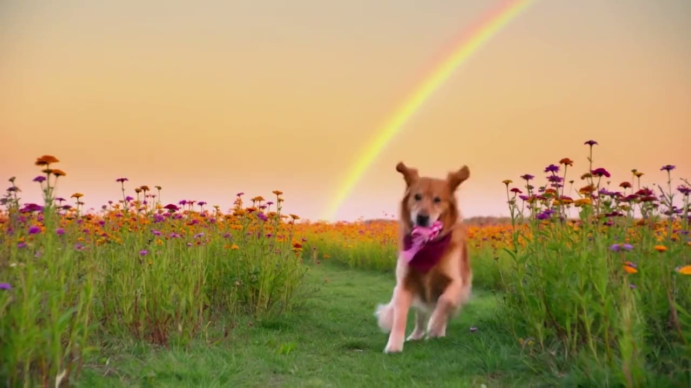</a>
<b>Modelo</b>&nbsp; Kling 3.0 Omni<br>
<b>Clipe</b>&nbsp; 5 s · 16:9 · sem som<br>
<b>Sujeitos</b>&nbsp; <code>[1]</code> seu pet<br><br>
<b>Fotos de referência</b><br>   <br><br>
<a href="https://refvid.com/pt/pet-memorial"><b>▶ Assistir ao clipe e fazer com as suas fotos</b></a>
</p>
<br clear="left">

```text
Cena 1: Um campo ensolarado de flores silvestres altas sob um céu dourado e quente, com um arco-íris suave ao longe: [1] sai em disparada do meio das flores em velocidade máxima, direto na direção da câmera, orelhas balançando, língua para fora, com uma meia listrada vermelha e branca presa orgulhosamente na boca.
Cena 2: Close-up no mesmo campo na hora dourada do entardecer, com o arco-íris brilhando ao fundo: [1] freia de repente, solta a meia listrada na grama, senta, inclina a cabeça para a câmera e abana o rabo, parecendo muito orgulhoso de si.
```

<details><summary>Quais fotos funcionam melhor</summary><br>Seu pet corre direto para a câmera com as orelhas ao vento e uma meia na boca, então, se você tiver, o que mais ajuda é uma foto dele correndo ou brincando de boca aberta; fotos antigas do celular, mesmo um pouco borradas, servem, desde que o rosto apareça.<br><br><sub>Feito com o RefVid no Kling 3.0 Omni a partir de 4 fotos de referência de Captain (um elemento criado por IA), com o prompt deste modelo.</sub></details>

### Pet âncora

<p>
<a href="https://refvid.com/pt/pet-news-anchor"></a>
<b>Modelo</b>&nbsp; Kling 3.0 Omni<br>
<b>Clipe</b>&nbsp; 5 s · 16:9 · com som<br>
<b>Sujeitos</b>&nbsp; <code>[1]</code> seu pet<br><br>
<b>Fotos de referência</b><br>   <br><br>
<a href="https://refvid.com/pt/pet-news-anchor"><b>▶ Assistir ao clipe e fazer com as suas fotos</b></a>
</p>
<br clear="left">

```text
Um estúdio de telejornal com luzes fortes e um skyline da cidade na tela ao fundo: [1] senta-se ereto atrás da bancada de notícias, usando uma gravatinha vermelha, olha para a câmera e diz com voz séria de apresentador: "Good evening. Tonight’s top story: dinner is late again."
```

<details><summary>Quais fotos funcionam melhor</summary><br>Atrás da bancada do telejornal só aparecem a cabeça, o pescoço e o peito do seu pet, com a gravata no pescoço, então use uma foto de frente dele sentado bem ereto, com o peito à mostra; uma cara calma e séria combina mais com a manchete do que uma brincalhona.<br><br><sub>Feito com o RefVid no Kling 3.0 Omni a partir de 4 fotos de referência do Biscoito (um elemento criado por IA), com o prompt deste modelo.</sub></details>

### Pet porta-alianças

<p>
<a href="https://refvid.com/pt/pet-ring-bearer"></a>
<b>Modelo</b>&nbsp; Kling 3.0 Omni<br>
<b>Clipe</b>&nbsp; 5 s · 16:9 · sem som<br>
<b>Sujeitos</b>&nbsp; <code>[1]</code> seu pet<br><br>
<b>Fotos de referência</b><br>   <br><br>
<a href="https://refvid.com/pt/pet-ring-bearer"><b>▶ Assistir ao clipe e fazer com as suas fotos</b></a>
</p>
<br clear="left">

```text
Um casamento no jardim com luz suave de fim de tarde: [1], usando uma pequena coleira de flores, caminha pelo corredor entre fileiras de cadeiras brancas em direção à câmera, levando uma cestinha com a caixinha das alianças na boca, convidados dos dois lados se virando para sorrir, pétalas espalhadas pela grama.
```

<details><summary>Quais fotos funcionam melhor</summary><br>Seu pet percorre o corredor inteiro em direção à câmera com a cestinha na boca, então o mais importante é uma foto de corpo inteiro andando ou em pé, tirada de frente na altura dele; o pescoço bem à mostra ajuda a coleira de flores a ficar certa.<br><br><sub>Feito com a RefVid no Kling 3.0 Omni a partir de 4 fotos de referência de Biscuit (um elemento criado com IA), usando o prompt deste modelo.</sub></details>

### Passarela do pet

<p>
<a href="https://refvid.com/pt/pet-runway-walk">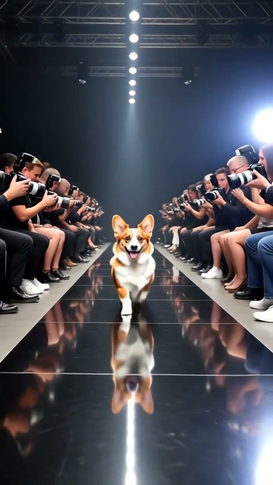</a>
<b>Modelo</b>&nbsp; Kling 3.0 Omni<br>
<b>Clipe</b>&nbsp; 5 s · 9:16 · com som<br>
<b>Sujeitos</b>&nbsp; <code>[1]</code> seu pet<br><br>
<b>Fotos de referência</b><br>   <br><br>
<a href="https://refvid.com/pt/pet-runway-walk"><b>▶ Assistir ao clipe e fazer com as suas fotos</b></a>
</p>
<br clear="left">

```text
[1] caminha com confiança por uma passarela de moda brilhante em direção à câmera, sob holofotes intensos, com fotógrafos dos dois lados disparando flashes, e para no fim para fazer uma pose. Câmera baixa, murmúrio da multidão e cliques de obturador.
```

<details><summary>Quais fotos funcionam melhor</summary><br>A câmera fica baixa enquanto seu pet desfila a passarela inteira, então as patas e o jeito de andar sustentam esta cena: adicione uma foto de corpo inteiro de frente, rente ao chão, e outra de lado para que o porte e o desenho da pelagem fiquem fiéis no meio do passo.<br><br><sub>Feito com o RefVid no Kling 3.0 Omni a partir de 4 fotos de referência do Biscuit (um sujeito criado por IA), usando o prompt deste modelo.</sub></details>

### Pet debaixo d’água

<p>
<a href="https://refvid.com/pt/pet-underwater-swim"></a>
<b>Modelo</b>&nbsp; Kling 3.0 Omni<br>
<b>Clipe</b>&nbsp; 5 s · 9:16 · sem som<br>
<b>Sujeitos</b>&nbsp; <code>[1]</code> seu pet<br><br>
<b>Fotos de referência</b><br>   <br><br>
<a href="https://refvid.com/pt/pet-underwater-swim"><b>▶ Assistir ao clipe e fazer com as suas fotos</b></a>
</p>
<br clear="left">

```text
Debaixo d'água, em mar turquesa cristalino, [1] nada em direção à câmera com as patas em movimento e os olhos abertos, raios de sol ondulando sobre ele, pequenas bolhas subindo, o pelo levado suavemente pela água.
```

<details><summary>Quais fotos funcionam melhor</summary><br>Debaixo d’água a pelagem flutua e parece mais escura, então o rosto e as manchas precisam ser inconfundíveis: uma foto nítida de frente com os olhos abertos e outra que mostre o comprimento e a cor reais da pelagem à luz do dia dão ao Estúdio o que ele precisa.<br><br><sub>Feito com o RefVid no Kling 3.0 Omni a partir de 4 fotos de referência do Biscuit (um elemento criado por IA), com o prompt deste modelo.</sub></details>

[↑ Voltar ao conteúdo](#conteúdo)

## Objetos e personagens

Um brinquedo, uma figura, um carro ou um personagem desenhado que continua igual.

### Massinha animada

<p>
<a href="https://refvid.com/pt/clay-figure-stopmotion"></a>
<b>Modelo</b>&nbsp; Kling 3.0 Omni<br>
<b>Clipe</b>&nbsp; 5 s · 16:9 · sem som<br>
<b>Sujeitos</b>&nbsp; <code>[1]</code> seu personagem de argila<br><br>
<b>Fotos de referência</b><br>   <br><br>
<a href="https://refvid.com/pt/clay-figure-stopmotion"><b>▶ Assistir ao clipe e fazer com as suas fotos</b></a>
</p>
<br clear="left">

```text
Cena 1: Estilo claymation em stop-motion, movimento levemente picotado: [1] atravessa um pequeno cenário artesanal de uma rua de vila feita de papel e feltro, com casinhas minúsculas e uma nuvem de algodão, com a textura de argila e as digitais visíveis. Luz quente de mesa.
Cena 2: [1] para, vira para a câmera e acena com uma mão de argila, depois dá um pequeno pulinho. Visual de stop-motion, pouca profundidade de campo.
```

<details><summary>Quais fotos funcionam melhor</summary><br>Seu personagem atravessa o cenário de lado e depois se vira para acenar, então mostre-o de perfil e de frente, de perto o bastante para a textura da argila e as digitais aparecerem; uma vista de costas mantém a caminhada coerente.<br><br><sub>Feito com o RefVid no Kling 3.0 Omni a partir de 4 fotos de referência da Momo (um sujeito criado por IA), com o prompt deste modelo.</sub></details>

### Vitrine de crochê

<p>
<a href="https://refvid.com/pt/crochet-showcase">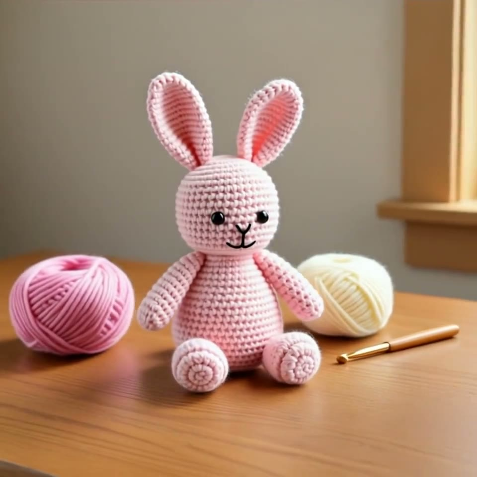</a>
<b>Modelo</b>&nbsp; Kling 3.0 Omni<br>
<b>Clipe</b>&nbsp; 5 s · 1:1 · sem som<br>
<b>Sujeitos</b>&nbsp; <code>[1]</code> sua peça<br><br>
<b>Fotos de referência</b><br>  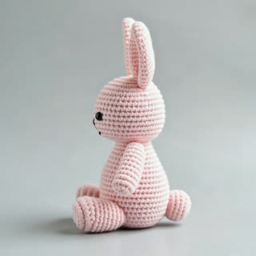 <br><br>
<a href="https://refvid.com/pt/crochet-showcase"><b>▶ Assistir ao clipe e fazer com as suas fotos</b></a>
</p>
<br clear="left">

```text
Cena 1: [1] fica sobre uma mesa de carvalho quentinha, ao lado de dois novelos de lã macia e uma agulha de crochê de madeira, com luz de janela da tarde, a câmera contornando lentamente a peça.
Cena 2: Close macro passando pelos pontos e pelo rosto de [1], cada laçada de lã visível, com profundidade de campo rasa.
```

<details><summary>Quais fotos funcionam melhor</summary><br>A segunda cena passa em macro pelos pontos e pelo rosto, então tire uma foto de perto em que cada laçada da linha apareça nítida, além de vistas de frente e de lado para a forma se manter enquanto a câmera gira em volta da peça.<br><br><sub>Feito com o RefVid no Kling 3.0 Omni a partir de 4 fotos de referência de Bun (um personagem criado com IA), usando o prompt deste modelo.</sub></details>

### Diorama em miniatura

<p>
<a href="https://refvid.com/pt/diorama-miniature"></a>
<b>Modelo</b>&nbsp; Kling 3.0 Omni<br>
<b>Clipe</b>&nbsp; 5 s · 16:9 · sem som<br>
<b>Sujeitos</b>&nbsp; <code>[1]</code> sua figura<br><br>
<b>Fotos de referência</b><br>   <br><br>
<a href="https://refvid.com/pt/diorama-miniature"><b>▶ Assistir ao clipe e fazer com as suas fotos</b></a>
</p>
<br clear="left">

```text
Diorama em miniatura com efeito tilt-shift de uma pequena praça de cidade, com árvores de maquete, postes de rua e casinhas; [1] fica no meio enquanto um trem de maquete passa devagar atrás, a câmera deslizando na altura dos olhos, as bordas suavemente desfocadas. Luz natural forte.
```

<details><summary>Quais fotos funcionam melhor</summary><br>A câmera passa pela sua figura na altura dos olhos dela, então fotografe-a de frente dessa altura baixa, e não de cima; uma vista de lado ajuda a manter a forma enquanto o trem passa atrás.<br><br><sub>Feito com o RefVid no Kling 3.0 Omni a partir de 4 fotos de referência da Pip (um personagem criado por IA), com o prompt deste modelo.</sub></details>

### Figura 360°

<p>
<a href="https://refvid.com/pt/figure-turntable-showcase"></a>
<b>Modelo</b>&nbsp; Kling 3.0 Omni<br>
<b>Clipe</b>&nbsp; 5 s · 1:1 · sem som<br>
<b>Sujeitos</b>&nbsp; <code>[1]</code> sua figure<br><br>
<b>Fotos de referência</b><br>   <br><br>
<a href="https://refvid.com/pt/figure-turntable-showcase"><b>▶ Assistir ao clipe e fazer com as suas fotos</b></a>
</p>
<br clear="left">

```text
Cena 1: [1] sobre uma pequena plataforma redonda dentro de um armário de exposição escuro, com um holofote suave, girando devagar por uma volta completa. Reflexos limpos na prateleira de vidro.
Cena 2: Close macro do rosto e dos detalhes pintados de [1], com a luz deslizando sobre eles e profundidade de campo rasa.
```

<details><summary>Quais fotos funcionam melhor</summary><br>A figure dá uma volta completa antes de a câmera se aproximar do rosto, então cubra as costas e os dois lados além da frente, e adicione um close da pintura do rosto em que os detalhes pequenos apareçam nítidos.<br><br><sub>Feito com o RefVid no Kling 3.0 Omni a partir de 4 fotos de referência de Pip (um elemento feito por IA), com o prompt deste modelo.</sub></details>

### Mascote acenando

<p>
<a href="https://refvid.com/pt/mascot-wave-hello"></a>
<b>Modelo</b>&nbsp; Kling 3.0 Omni<br>
<b>Clipe</b>&nbsp; 5 s · 1:1 · com som<br>
<b>Sujeitos</b>&nbsp; <code>[1]</code> seu mascote<br><br>
<b>Fotos de referência</b><br>   <br><br>
<a href="https://refvid.com/pt/mascot-wave-hello"><b>▶ Assistir ao clipe e fazer com as suas fotos</b></a>
</p>
<br clear="left">

```text
[1] está em pé sobre uma mesa clara e limpa, na frente de um fundo pastel suave, olha para a câmera, acena com um braço e diz, com uma vozinha alegre: "Hi there, welcome in!" Leve aproximação da câmera.
```

<details><summary>Quais fotos funcionam melhor</summary><br>Seu mascote acena com um braço e olha para a câmera, então fotografe-o em pé, de frente, com os dois braços e o rosto inteiros no quadro; uma vista de costas ou de lado ajuda a forma a se manter quando ele se mexe.<br><br><sub>Feito com o RefVid no Kling 3.0 Omni a partir de 4 fotos de referência da Pip (um personagem criado por IA), usando o prompt deste modelo.</sub></details>

### Aventura de pelúcia

<p>
<a href="https://refvid.com/pt/plush-adventure"></a>
<b>Modelo</b>&nbsp; Kling 3.0 Omni<br>
<b>Clipe</b>&nbsp; 10 s · 9:16 · sem som<br>
<b>Sujeitos</b>&nbsp; <code>[1]</code> sua pelúcia<br><br>
<b>Fotos de referência</b><br>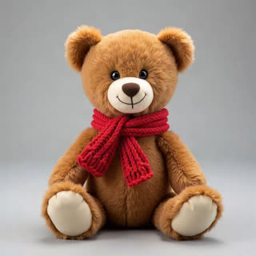  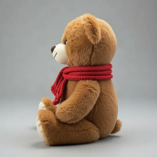 <br><br>
<a href="https://refvid.com/pt/plush-adventure"><b>▶ Assistir ao clipe e fazer com as suas fotos</b></a>
</p>
<br clear="left">

```text
Cena 1: Visual de stop-motion: [1] está sentado num banco de madeira de um antigo bonde amarelo da cidade, junto à janela, com a rua deslizando lá fora, luz da manhã.
Cena 2: [1] está sentado numa mesinha minúscula de café, ao lado de uma xícara de chocolate quente com chantilly, virando a cabeça em direção à câmera.
Cena 3: [1] está sentado no parapeito de uma ponte de pedra, observando o pôr do sol sobre o rio, com as luzes da cidade acendendo atrás dele.
```

<details><summary>Quais fotos funcionam melhor</summary><br>Sua pelúcia aparece sentada nos três lugares, de lado no bonde e de costas na ponte, então fotografe-a sentada de frente, de lado e de costas; deixe cachecol, laço ou patch nela para que esses detalhes viajem junto.<br><br><sub>Feito com o RefVid no Kling 3.0 Omni a partir de 4 fotos de referência do Bobo (um personagem criado por IA), usando o prompt deste modelo.</sub></details>

### Brinquedo ganha vida

<p>
<a href="https://refvid.com/pt/toy-comes-alive">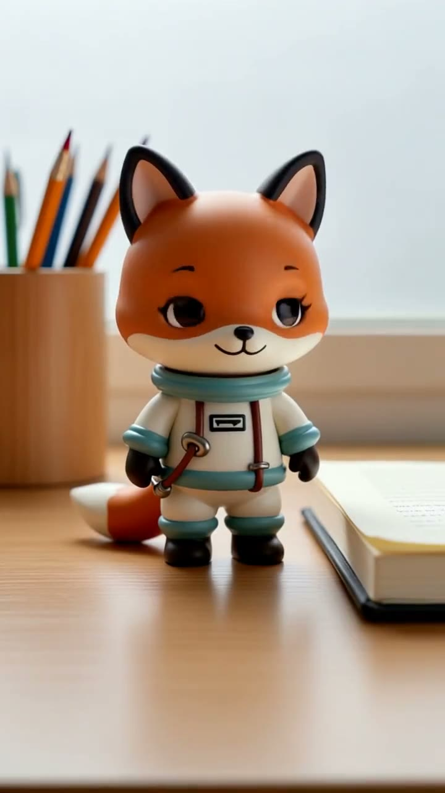</a>
<b>Modelo</b>&nbsp; Kling 3.0 Omni<br>
<b>Clipe</b>&nbsp; 5 s · 9:16 · sem som<br>
<b>Sujeitos</b>&nbsp; <code>[1]</code> sua miniatura<br><br>
<b>Fotos de referência</b><br>   <br><br>
<a href="https://refvid.com/pt/toy-comes-alive"><b>▶ Assistir ao clipe e fazer com as suas fotos</b></a>
</p>
<br clear="left">

```text
Cena 1: [1] fica perfeitamente parada sobre uma mesa de madeira, ao lado de um porta-lápis e de um caderno, sob a luz suave da manhã, como um brinquedo em exposição. Close-up na altura dos olhos do brinquedo.
Cena 2: [1] ganha vida: pisca, olha em volta com curiosidade e depois dá alguns passinhos trêmulos em direção à câmera e acena. Continua sendo o mesmo pequeno brinquedo pintado, com o mesmo material e as mesmas cores. Profundidade de campo rasa.
```

<details><summary>Quais fotos funcionam melhor</summary><br>A miniatura pisca, olha em volta e anda em direção a uma câmera na altura dos olhos dela, então fotografe nessa altura também: rosto e olhos de frente, mais os pés ou a base, para que os primeiros passos mantenham a forma e a pintura reais.<br><br><sub>Feito com o RefVid no Kling 3.0 Omni a partir de 4 fotos de referência do Pip (um elemento criado por IA), usando o prompt deste modelo.</sub></details>

[↑ Voltar ao conteúdo](#conteúdo)

## Como escrever os seus

1. **Chame o sujeito pelas fotos, não por uma descrição.** Escreva `[1]` onde ele aparece e deixe as fotos de referência carregarem o rosto, a pelagem ou o produto; descrever de novo em palavras briga com as fotos.
2. **Duas ou três cenas, uma ação cada.** Diga onde está a câmera (aberta, close, acompanhando, de costas) e uma coisa que acontece.
3. **As fotos decidem a consistência.** 3–4 fotos nítidas de ângulos diferentes, um sujeito por conjunto, fundo liso para produtos.
4. **Termine num quadro que valha guardar.** A última cena é a que as pessoas capturam e compartilham.

Mais sobre isso: [tutoriais do RefVid](https://refvid.com/pt/tutorials).

## Licença

Prompts, textos, fotos de referência e clipes: [CC BY 4.0](LICENSE) — use para o que quiser, com crédito a "RefVid (refvid.com)". As pessoas, pets e produtos das fotos de referência são feitos com IA; nenhum é uma pessoa real nem o produto de um cliente.

Contribuições são bem-vindas: abra uma issue com o prompt, o modelo usado e o resultado.

## Histórico de estrelas

[](https://star-history.com/#refvid/awesome-reference-to-video-prompts&Date)
